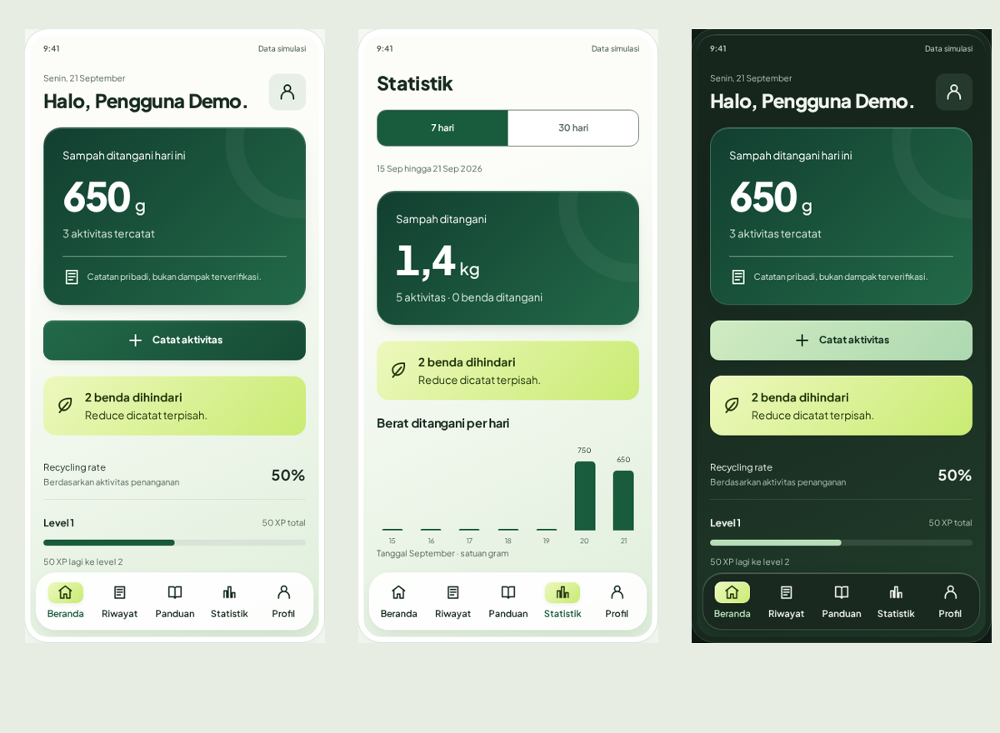
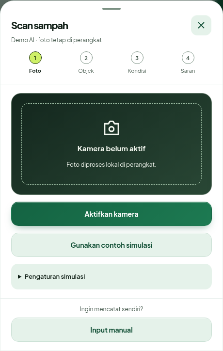

# WasteNot Android

**Track everyday waste through Reduce, Reuse, Recycle, and Trash, with AI-assisted detection and guidance.**


-3DDC84?logo=android&logoColor=white)


| | |
|---|---|
|  |  |
| Home screen (design kit mockup) | AI scan flow (design kit mockup) |

WasteNot lets people log what they do with their waste and see their habits over time. They can:

- record each item as Reduce, Reuse, Recycle, or Trash, by weight or item count;
- read curated handling guides;
- follow their statistics, XP, levels, and streaks.

An optional AI scan detects items in a photo and suggests one handling method. The user always confirms the object, its condition, and the method before anything is saved.

The interface is in English, with an Indonesian translation for phones set to Indonesian. Every build talks to the real [WasteNot Backend](https://github.com/waste-not-app/waste-not-backend); there is no local mock mode.

## Contents

- [Features](#features)
- [Getting started](#getting-started)
- [Build variants and configuration](#build-variants-and-configuration)
- [Make targets](#make-targets)
- [Project structure](#project-structure)
- [Architecture](#architecture)
- [CI/CD and releases](#cicd-and-releases)
- [Documentation](#documentation)
- [Related repositories](#related-repositories)

## Features

### Logging and progress

- **Waste logs.**
  - Create, edit, and delete logs by category and method, measured by weight (g or kg) or by item count.
  - Optional private photo attachments.
  - Idempotent requests, so retries never duplicate entries.
- **History.** Filterable, paginated history with detail views and draft restore in the editor.
- **Dashboard and statistics.** Today's totals, the recycling rate, and items avoided through Reduce, plus 7- and 30-day statistics by day, category, and method.
- **Progress.** XP, levels, streaks, and achievements, all computed by the server.
- **Guides.** Searchable waste handling guides with sources.

### AI scan

- **Capture.** A multi-step bottom sheet: capture with CameraX, review the photo, then send it.
- **Detection.** Bounding boxes with confidence bands. The user picks or corrects an object and confirms its material and condition.
- **Recommendation.** One recommended method with its reason, steps, cautions, and sources.
- **Saving.** Nothing is saved until the user confirms the method and quantity.
- **Privacy.** Scan photos are temporary: they are removed when the flow ends, on sign-out, or within one hour.

### Offline and accounts

- **Offline first.** Activity is read from Room. Edits queue locally, sync through WorkManager, and surface conflicts for review.
- **Accounts.** Registration, sign-in, password recovery with a one-time code, and account deletion.
- **Credential storage.** Refresh tokens are protected by the Android Keystore and excluded from backups.
- **Display and accessibility.** Light and dark themes, edge-to-edge layouts, 48 dp touch targets, and screen reader labels.

## Getting started

Requirements:

- JDK 17;
- Android SDK Platform 36, located through `ANDROID_HOME` or `sdk.dir` in `local.properties`;
- a physical Android 11+ device for running the app.

```sh
make check          # lint and unit tests
make build          # debug APK
make run            # build, install, and launch on a connected device
```

Without a local Android SDK, build inside Docker:

```sh
make docker-apk     # unit tests and a debug APK in dist/apk/
make docker-ci      # lint, unit tests, and debug and staging APKs
```

See [docs/ANDROID_SETUP.md](docs/ANDROID_SETUP.md) for the full setup and signing guide.

## Build variants and configuration

| Variant | Application ID | API base URL property | Notes |
|---|---|---|---|
| `debug` | `com.example.wastenot` | `wastenot.debugApiBaseUrl` | Optional hot reload; cleartext only for explicit localhost overrides |
| `staging` | `com.example.wastenot.staging` | `wastenot.stagingApiBaseUrl` | Non-debuggable, installs side by side, HTTPS only |
| `release` | `com.example.wastenot` | `wastenot.releaseApiBaseUrl` | HTTPS only; requires release signing |

All variants default to `https://waste-not-api.bccdev.id/v1/`. Override the backend per build:

```sh
./gradlew assembleDebug -Pwastenot.debugApiBaseUrl=http://10.0.2.2:8080/v1/
```

## Make targets

Run `make help` for every target.

| Target | Purpose |
|---|---|
| `make check` | Lint and debug unit tests, before committing |
| `make check-ci` | Lint all variants, run unit tests, and build every APK, as CI does |
| `make pr-ready` | `check` plus the navigation graph check |
| `make build` / `make build-release` | Build the debug or release APK |
| `make run` / `make install` | Install on a connected device |
| `make test-device` | Instrumented tests on a connected device |
| `make nav-html` | Export the interactive navigation graph |
| `make docker-apk` / `make docker-ci` | Build in a container without a local Android SDK |

## Project structure

```
waste-not-android/
├── app/
│   ├── src/main/java/com/example/wastenot/
│   │   ├── ui/              Screens and components: auth, main, scan, shared components
│   │   ├── data/            Network, repositories, Room, session, and sync
│   │   ├── model/           Pure Kotlin domain rules: quantities, formatting, dates
│   │   ├── theme/           WasteNot design tokens and theme
│   │   ├── AppContainer.kt  Dependency wiring
│   │   └── Navigation.kt    Navigation 3 root and back stack
│   ├── src/test/            Unit tests and contract fixtures
│   ├── src/testFixtures/    Shared test-only adapters
│   ├── src/androidTest/     Instrumented and UI tests
│   └── schemas/             Exported Room schemas
├── docs/                    Developer guides, design kit, and archive
├── scripts/                 Build, release, and verification tooling
├── Dockerfile               Containerized APK build
└── Makefile                 Development shortcuts
```

## Architecture

- **Structure.** A single activity in a single `:app` module, organized by feature.
- **State.** ViewModel and StateFlow with unidirectional data flow.
- **Navigation.** Navigation 3, with routes that carry only IDs.
- **Networking.** Retrofit and OkHttp with kotlinx.serialization.
  - Requests and responses are typed.
  - Credentials are scoped to the API host.
  - Writes are sent once, never replayed.
- **Storage.**
  - Room holds account-scoped activity, the outbox, and snapshots.
  - DataStore holds the theme.
  - The Android Keystore protects the refresh token.
- **Dependency injection.** Constructor injection through a small `AppContainer`.

The design kit's [architecture document](docs/design-kit/ARCHITECTURE.md) covers the details. The [network](docs/ANDROID_NETWORK.md), [offline sync](docs/OFFLINE_SYNC.md), and [data model](docs/ANDROID_MODELS.md) guides describe the implementation.

## CI/CD and releases

- **Android CI.** Runs on pushes and pull requests. It lints all three variants, runs the unit tests, checks the URL configuration, and builds every APK.
- **Android Release & Deploy.** Runs on `v*` tags or a manual dispatch. It builds a signed release APK and publishes it to <https://waste-not.bccdev.id/apk/>.
- **Dependabot.** Updates Gradle dependencies, GitHub Actions, and the Docker base image weekly.
- **Action pinning.** All actions are pinned to commit SHAs.

The latest APK is always at <https://waste-not.bccdev.id/apk/latest.apk>. See [docs/CICD_SETUP.md](docs/CICD_SETUP.md) for secrets, variables, and verification steps.

## Documentation

| Document | Description |
|---|---|
| [Android setup](docs/ANDROID_SETUP.md) | Requirements, build types, backend configuration, and signing |
| [CI/CD](docs/CICD_SETUP.md) | Workflows, secrets, APK distribution, and release checks |
| [Development plugins](docs/DEV_PLUGINS.md) | Hot reload, the navigation graph, and IDE plugins |
| [Network layer](docs/ANDROID_NETWORK.md) | HTTP client rules, error handling, and account recovery |
| [Offline sync](docs/OFFLINE_SYNC.md) | Local storage, the mutation queue, conflicts, and caching |
| [Data models](docs/ANDROID_MODELS.md) | Quantities, formatting, and date rules |
| [Design kit](docs/design-kit/README.md) | Product requirements, design system, screen specs, API, and AI specs |
| [Agent guide](AGENTS.md) | Rules for AI coding agents working in this repository |
| [Contributing](CONTRIBUTING.md) | Branches, commits, and pull requests |
| [Archive](docs/archive/README.md) | Past plans, task logs, and QA evidence |

## Related repositories

| Repository | Description |
|---|---|
| [waste-not-backend](https://github.com/waste-not-app/waste-not-backend) | REST API and AI gateway |
| [waste-not-ai](https://github.com/waste-not-app/waste-not-ai) | Detection and recommendation workers |
| [waste-not-landing](https://github.com/waste-not-app/waste-not-landing) | Marketing site, privacy policy, and APK downloads |
