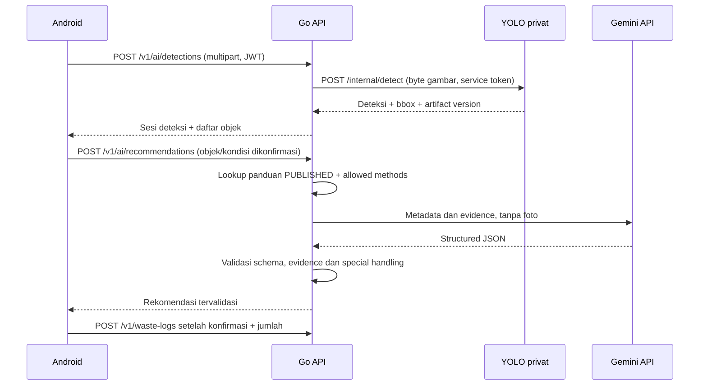

# WasteNot AI: pilot YOLO + Gemini

Prototipe lokal untuk pekerjaan AI-01, baseline AI-03, dan eksperimen AI-06. Foto → YOLO nyata → pilih satu objek dan konfirmasi material → kondisi → panduan → Gemini structured output → validasi. Hasil berhenti pada konfirmasi metode dan input jumlah; tidak membuat waste log/XP.

Pembaruan 20 Oktober 2026: Gemini memilih **tepat satu** dari **Reduce / Reuse / Recycle / Trash**, disertai alasan dan sumber panduan. [Kontrak empat metode](docs/RECOMMENDATION_CONTRACT.md) menggantikan pembatasan scan tiga metode/alternatif pada rancangan lama, dan menjelaskan perubahan DTO backend/frontend. Reduce adalah pencegahan penggunaan berikutnya.

## Demo kamera di browser

Setelah instalasi, cara termudah dari root repo:

```powershell
.\ai\demo-camera.bat
```

Atau jalankan Python langsung:

```powershell
.\.venv-ai\Scripts\python.exe -m wastenot_ai.cli demo --demo-guides
```

Browser terbuka otomatis ke `http://127.0.0.1:8092`. Izinkan kamera ketika browser meminta izin. Foto belum dikirim saat pratinjau video berlangsung.

1. Arahkan kamera ke benda, lalu **Ambil foto**. Kamera berhenti setelah capture.
2. Tinjau foto dan tekan **Kirim untuk deteksi**. YOLO memproses satu foto di server lokal, tidak mengunggah video terus-menerus.
3. Klik bingkai objek atau pilih dari daftar. Kandidat ≥0,50 dapat ditinjau; skor rendah/kelas nonkatalog diarahkan ke pilihan manual.
4. Konfirmasikan jenis/material. Label `bottle`, `cup` atau `bowl` belum memastikan bahan pembuatnya.
5. Isi kebersihan, keutuhan, kelayakan dan niat pakai ulang; centang konfirmasi. Untuk menguji saran REUSE pada cangkir/tas/peralatan, semua kondisi harus sesuai kenyataan: bersih, utuh, masih layak, dan ingin dipakai ulang. UNKNOWN tidak ditebak otomatis.
6. Pilih **Gemini · API langsung** lalu **Minta rekomendasi**. Key/model dibaca server dari `ai/.env`; tidak dikirim ke browser. Untuk mencoba tanpa request berbayar, pilih **Simulasi · tanpa API**, yang diberi label eksplisit.
7. Periksa satu label Reduce/Reuse/Recycle/Trash, alasan, langkah, caution dan sumber panduan yang langsung terbuka. Fokus **Otomatis sesuai objek** meminta Gemini mengutamakan penanganan saat ini yang didukung panduan. Pilih **Pencegahan berikutnya (Reduce)** untuk mencoba saran pencegahan. Isi akses daur ulang sesuai yang sudah diperiksa. Tidak ada aktivitas/XP yang disimpan. Ubah kondisi untuk membatalkan saran lama atau **Bersihkan** untuk menghapus foto/hasil sementara.

Jika izin kamera ditolak atau perangkat tidak mempunyai webcam, gunakan **Pilih foto**. Gambar dinormalisasi sebelum dikirim agar bbox sesuai preview. Katalog di bagian bawah bisa dicari/filter dan dipilih secara manual; hasilnya ditandai pilihan manual, bukan hasil identifikasi YOLO.

`demo` default meminta izin kamera ketika halaman dibuka. Saat pindah tab/background, track kamera dihentikan; gunakan **Aktifkan kamera** ketika kembali. Foto hanya berada dalam memori browser/server dan dibersihkan dari halaman setelah 15 menit, saat Bersihkan, atau ketika halaman ditutup. Kamera fisik tidak digunakan dalam pengujian otomatis; pengujian browser memakai perangkat kamera palsu Chromium.

Opsi tambahan:

```powershell
# Port alternatif jika 8092 sedang dipakai.
.\ai\demo-camera.bat --port 8094
# Server saja, tanpa membuka browser otomatis.
.\.venv-ai\Scripts\python.exe -m wastenot_ai.cli demo --demo-guides --no-browser
# Artikel yang sudah ditinjau, tanpa mengizinkan draf.
.\.venv-ai\Scripts\python.exe -m wastenot_ai.cli demo --guides path/to/reviewed-guides.json
```

Untuk membuka halaman tanpa meminta kamera otomatis, tambahkan `?camera=off`, misalnya `http://127.0.0.1:8092/?camera=off`. `Ctrl+C` menghentikan server. Jalankan ulang demo setelah mengubah konfigurasi key/model di `.env`.

### Cakupan demo yang diperluas

Katalog versi `demo-catalog-03` mempunyai **68 pilihan benda/material**, terhubung ke **58 kelas visual** yang memang terdapat pada checkpoint COCO. YOLO tetap memiliki 80 kelas; orang, hewan dan sebagian kendaraan tidak dipaksakan menjadi sampah.

| Kelompok | Contoh yang dapat dikenali YOLO | Perilaku panduan |
|---|---|---|
| Wadah / peralatan | Botol, cup, bowl, gelas berkaki, garpu, sendok, vas | Konfirmasi material; reuse/recycle sesuai evidence dan kondisi |
| Barang penggunaan ulang | Tas, ransel, koper, payung, dasi, boneka, bola dan peralatan olahraga | REUSE hanya setelah kelayakan/niat dikonfirmasi |
| Furnitur | Sepeda, bangku, kursi, sofa, meja, tempat tidur | Penggunaan ulang perlu pemeriksaan kelayakan; tanpa menganggap foto membuktikan aman |
| Buku | Book | Pilihan reuse/recycle sesuai kondisi dan panduan |
| Elektronik | Laptop, ponsel, TV, mouse, keyboard, remote, jam, kulkas, oven, microwave, toaster, pengering rambut | RECYCLE melalui pengelola e-waste, dengan peringatan; jangan membongkar sendiri |
| Benda tajam | Pisau, gunting | RECYCLE melalui pengelola yang menerima benda tajam; peringatan tetap muncul |
| Makanan | Pisang, apel, jeruk, brokoli, wortel, roti isi, pizza, hot dog, kue, donat | REDUCE untuk pencegahan sisa berikutnya; penanganan sisa saat ini perlu layanan organik lokal |
| Barang campuran | Tanaman beserta pot, sink, toilet | REDUCE untuk pencegahan; penanganan material campuran perlu panduan tambahan |
| Sikat gigi | Toothbrush | Konfirmasi plastik manual tanpa listrik/baterai; TRASH hanya saat tidak layak dan akses daur ulang khusus sudah diperiksa tidak ada |
| Katalog manual | Kaleng aluminium, kardus, baterai | Belum punya kelas khusus pada checkpoint ini; bukan klaim kemampuan deteksi baru |

Semua 68 panduan merupakan **draf demo**, sebagian dibuat dari template bersama. Kelas baru memanfaatkan label pretrained yang sudah ada; belum fine-tuning atau evaluasi akurasi per kelas. Perluasan katalog tidak menambah kelas visual baru pada bobot. Template tersedia pada [guide_templates.json](src/wastenot_ai/data/guide_templates.json); katalog pada [catalog.json](src/wastenot_ai/data/catalog.json). Script `ai/scripts/expand_demo_catalog.py` memperbarui data extension secara idempotent jika tabel sumber diubah.

### Batas layanan demo

Server ini khusus loopback, terpisah dari worker `/internal/detect` dan endpoint produksi Go. Endpoint `/demo/api/*` memakai cookie HttpOnly, token anti-CSRF, pemeriksaan Host/Origin, memori sesi 15 menit dan replay request yang dideduplikasi. Batas rekomendasi 30 per jam per proses; model/provider masing-masing satu job aktif. Tidak ada endpoint untuk menyimpan log.

Jangan menjadikan server demo sebagai API publik. Integrasi Go/Android di bawah tetap memakai kontrak produk. Gemini hanya menerima metadata/context/evidence, sementara foto berhenti di YOLO lokal. Sumber Gemini hanya ditampilkan untuk hasil model yang lolos validasi; penanganan khusus diberi label panduan/kebijakan.

## Isi panduan

- [Instalasi](#mulai-di-powershell) dan [konfigurasi Gemini](#gemini-api).
- [Demo kamera interaktif](#demo-kamera-di-browser) dengan bbox dan pemilihan objek.
- [Mencoba YOLO, LLM dan alur lengkap](#percobaan-langkah-demi-langkah).
- [Integrasi backend Go](#integrasi-backend-go) dan [frontend Android](#integrasi-frontend-android).
- [Troubleshooting](#troubleshooting) dan [pengujian](#pengujian-dan-evaluasi).

## Mulai di PowerShell

Jalankan dari root repository. Python 3.11+ diperlukan; lingkungan pengembangan ini diuji pada 3.13.1.

```powershell
python -m venv .venv-ai
.\.venv-ai\Scripts\python.exe -m pip install -e "./ai[yolo,worker,test]" -c ai/constraints.txt
.\.venv-ai\Scripts\python.exe -m wastenot_ai.cli doctor
.\.venv-ai\Scripts\python.exe -m wastenot_ai.cli fetch-assets
```

`.venv-ai` yang dibuat saat pengerjaan memakai `--system-site-packages` untuk memanfaatkan paket lokal; instalasi baru dapat memakai venv biasa seperti di atas. Paket yang ditambahkan berada dalam venv, bukan mengubah instalasi Python global. CUDA tidak otomatis diaktifkan oleh adanya GPU; gunakan CPU sampai runtime CUDA yang cocok disiapkan dan diukur.

## Objek pilot awal

Lima objek berikut adalah prioritas pilot awal. Demo kamera juga mendukung [katalog perluasan](#cakupan-demo-yang-diperluas) yang memanfaatkan 58 label visual pretrained.

| Objek produk | Kategori | Baseline COCO | Jalur awal |
|---|---|---|---|
| Botol plastik PET | PLASTIC | `bottle`, ID 39 | Konfirmasi material dari pengguna; bukan identifikasi resin |
| Botol kaca | GLASS | `bottle`, ID 39 | Konfirmasi material; pecah → penanganan khusus |
| Kaleng aluminium | METAL | Tidak tersedia | Konfirmasi/input manual; kandidat fine-tuning |
| Kardus | PAPER | Tidak tersedia | Konfirmasi/input manual; kandidat fine-tuning |
| Baterai | ELECTRONIC | Tidak tersedia | Manual + policy penanganan khusus; kandidat fine-tuning |

Lihat [katalog berversi](src/wastenot_ai/data/catalog.json). Ini cakupan usulan pilot, bukan daftar kelas yang telah dievaluasi. Model tidak menebak material dari label `bottle`. Kelas lain, hasil kosong, dan skor <0,50 diarahkan ke manual. Skor ≥0,50 dan <0,70 = UNCERTAIN; ≥0,70 = OFFERED. Semuanya tetap membutuhkan konfirmasi. Threshold adalah kandidat eksperimen.

## Menjalankan baseline dan alur lengkap

```powershell
# Gunakan gambar JPEG/PNG yang memang boleh diproses.
.\.venv-ai\Scripts\python.exe -m wastenot_ai.cli detect ai/data/local/smoke/bottle.jpg --output ai/artifacts/detection.json

# Baca object_id pada hasil deteksi; pilih satu objek yang supported_for_review=true.
# context-glass.json adalah contoh. Ubah sesuai material/kondisi yang benar-benar dikonfirmasi.
# Pada sampel/runtime yang diuji, bottle adalah object-3; periksa hasil detect terbaru.
.\.venv-ai\Scripts\python.exe -m wastenot_ai.cli pipeline ai/data/local/smoke/bottle.jpg --object-id object-3 --confirm-object --context ai/examples/context-glass.json --provider fixture --demo-guides --output ai/artifacts/pipeline-fixture.json

# Ukur cold/first inference serta p50/p95 warm, tanpa menyimpan salinan foto.
.\.venv-ai\Scripts\python.exe -m wastenot_ai.cli benchmark ai/data/local/smoke --repeat 5 --output ai/artifacts/baseline.json
```

`fixture` adalah simulator kontrak yang dipilih secara eksplisit, selalu `prototype_only=true`; hasilnya bukan keluaran Gemini. `pipeline` menolak object_id yang hilang, kelas yang tidak didukung mapping, atau kandidat terlalu rendah sebelum memanggil provider. Koreksi objek/kondisi memerlukan pemanggilan baru; prototipe tidak mengubah state sesi produksi. Jalur `recommend` menguji konteks manual secara mandiri, tanpa mengklaim provenance deteksi.

## Gemini API

Salin `ai/.env.example` ke `ai/.env` bila belum ada. Isi secara lokal:

```dotenv
GEMINI_API_KEY_1=isi_key_pertama
GEMINI_API_KEY_2=isi_key_kedua
GEMINI_API_KEY_3=isi_key_ketiga
GEMINI_API_KEY_4=isi_key_keempat
GEMINI_API_KEY_5=isi_key_kelima
GEMINI_MODEL=isi_id_model_yang_tersedia_di_akunmu
GEMINI_TIMEOUT_SECONDS=15
```

Isi satu sampai lima slot yang tersedia; slot kosong dilewati dan nilai duplikat hanya dipakai sekali. Jika ada key bernomor yang terisi, `GEMINI_API_KEY` lama diabaikan. Jika seluruh slot bernomor kosong, key lama tetap bekerja sebagai fallback konfigurasi. File `ai/.env` lokal sudah memiliki lima slot kosong tanpa mengganti key lama; isi key asli sendiri dan mulai ulang server demo setelah mengubahnya.

Pemakaian normal bergiliran **1 → 2 → 3 → 4 → 5 → 1**, sesuai slot terisi. HTTP 429 membuat key tersebut masuk cooldown minimal 60 detik atau lebih lama sesuai `Retry-After`/`RetryInfo` dari Google, lalu mencoba key lain yang tersedia. Setiap key hanya dicoba sekali per permintaan, maksimum lima percobaan dalam satu anggaran timeout. Jika semua sedang cooldown, langsung menghasilkan `LLM_RATE_LIMITED` tanpa request baru. HTTP 401/403 menonaktifkan key sampai proses dimulai ulang; key lain tetap dapat dicoba. Timeout, 5xx, output invalid dan respons terblokir tidak memicu pengulangan generation otomatis.

Rotasi dan cooldown tersimpan di memori **satu instance provider/proses**. Demo mempertahankannya selama server hidup. Menjalankan CLI sekali lagi memulai urutan baru dari key pertama; ini bukan penghitung rotasi yang disimpan di disk. `list-gemini-models` memakai key pertama yang terkonfigurasi tanpa rotasi. Batas 30 permintaan demo per jam tetap berlaku.

Google menetapkan [rate limit per proyek, bukan per API key](https://ai.google.dev/gemini-api/docs/rate-limits). Lima key dalam proyek yang sama berbagi kuota; rotasi tidak menjamin bebas limit dan tidak menambah kuota proyek. Periksa kuota/model di AI Studio dan sesuaikan laju permintaan atau ajukan kenaikan kuota bila diperlukan. Semua key yang digunakan perlu memiliki akses ke `GEMINI_MODEL` yang sama.

Jangan tempel key ke chat, commit, argumen CLI, atau laporan. `doctor` hanya mengungkap status dan `gemini_key_count`, tanpa nilai key. Model sengaja tidak diasumsikan: pilih ID yang mendukung `generateContent` dan structured output. Periksa akses akun melalui:

```powershell
.\.venv-ai\Scripts\python.exe -m wastenot_ai.cli list-gemini-models
.\.venv-ai\Scripts\python.exe -m wastenot_ai.cli recommend --context ai/examples/context-pet.json --provider gemini --demo-guides --output ai/artifacts/gemini-demo.json
.\.venv-ai\Scripts\python.exe -m wastenot_ai.cli pipeline ai/data/local/smoke/bottle.jpg --object-id object-3 --confirm-object --context ai/examples/context-glass.json --provider gemini --demo-guides --output ai/artifacts/pipeline-gemini.json
```

Endpoint Google HTTPS tetap; key pada header `x-goog-api-key`, bukan query URL. Failover key hanya untuk penolakan 429/401/403 seperti di atas, tanpa retry loop tak terbatas. Foto, nama, email, lokasi, token dan catatan pribadi tidak dikirim. Payload terbatas objek, kategori, tiga kondisi, niat reuse, fokus saran, akses daur ulang, allowed methods dan evidence panduan. `generationConfig` memakai `responseMimeType=application/json` dan `responseJsonSchema`; refusal/truncation, error HTTP yang tidak dipulihkan, timeout dan schema invalid menjadi fallback tanpa metode.

Tidak ada raw provider response/prompt dalam output CLI. Alasan dan caution yang ditampilkan dirender dari evidence/teks panduan yang dipilih setelah validasi, sehingga prosa bebas LLM tidak menjadi instruksi penanganan. Ini pemeriksaan konsistensi deterministik; belum merupakan evaluasi kualitas atau keselamatan model pada semua kasus.

## Status panduan

Kelima [panduan awal](src/wastenot_ai/data/guides.json) dan 63 tambahan dari template adalah **DRAFT**, belum ditinjau untuk Indonesia. Tidak ada nama reviewer/tanggal review yang direkayasa. Tanpa `--demo-guides`, default menghasilkan `NO_REVIEWED_GUIDE` dan tidak mengirim request ke Gemini. Mode draf selalu ditandai `prototype_only=true`.

Untuk percobaan setelah review konten, buat salinan JSON, lakukan pemeriksaan lokal oleh penanggung jawab, lalu isi `publication_status=PUBLISHED`, `reviewer`, `reviewed_at` dan `valid_until` (ISO date). Pakai `--guides path/to/reviewed-guides.json`. Artikel kedaluwarsa, tanggal review di masa depan, ARCHIVED dan reviewer kosong ditolak. Jangan mempublikasikan hanya agar demo melewati gate.

Evidence mendukung empat label: RECYCLE sesuai panduan, termasuk rute pengelola khusus untuk baterai/elektronik/pisau/gunting; REUSE dengan kelayakan/niat yang dikonfirmasi; REDUCE untuk pencegahan berikutnya; TRASH pada kaca/keramik rusak dan sikat gigi plastik manual sesuai syarat. TRASH bukan fallback untuk semua benda. Panduan/syarat yang tidak cocok menghasilkan `NO_ALLOWED_METHOD`; model tidak mengarang metode.

**Risiko tidak lagi menghentikan klasifikasi.** Untuk kaca pecah, hasil utama tetap **Trash**, lalu peringatan penanganan khusus, langkah melindungi pecahan dan sumber. Untuk baterai/elektronik, hasil utama **Recycle** melalui layanan khusus, bukan tong daur ulang biasa. Evidence untuk konteks berisiko harus memiliki `risk_compatible=true`; REUSE umum tidak ditawarkan pada objek berisiko. Jika pengguna menandai risiko yang belum jelas dan belum ada evidence penanganan yang cocok, fokus AUTO dapat menghasilkan **Reduce** dengan scope PREVENTION untuk penggunaan berikutnya, disertai peringatan; ini tidak mengklaim telah menyelesaikan pembuangan benda berbahaya saat ini. Lihat [contoh empat hasil dan sumber](docs/RECOMMENDATION_CONTRACT.md#mencoba-keempat-hasil).

Policy REUSE bersifat konservatif: kondisi bersih, utuh, reusable=YES, reuse_intention=true, serta evidence panduan yang cocok semuanya wajib. Jangan mengubah UNKNOWN menjadi YES secara otomatis.

## Worker privat untuk backend Go

```powershell
# Isi AI_SERVICE_TOKEN dengan secret acak minimal 24 karakter di ai/.env.
.\.venv-ai\Scripts\python.exe -m wastenot_ai.cli serve-worker --port 8091
```

Worker bind ke `127.0.0.1`, tanpa docs/access log, tanpa DB atau akses Gemini. `GET /health/ready` dan `POST /internal/detect` memerlukan `Authorization: Bearer <AI_SERVICE_TOKEN>`. Body deteksi adalah byte JPEG/PNG dengan Content-Type yang sesuai, bukan URL/base64/multipart. Respons `{data: ...}` berisi deteksi dan metadata artifact. Ini kontrak internal; endpoint publik `/v1/ai/detections` tetap milik Go sesuai [handoff](docs/HANDOFF.md).

Satu job aktif; overload langsung 503 + Retry-After. Batas gambar 5 MiB, 12 MP, sisi 4096; orientasi dibetulkan dan EXIF dibuang. Gambar hanya di memori worker; tidak ditulis ke disk. Deadline 10 detik termasuk membaca body. Jika native inference melewati deadline, caller menerima 504 tetapi worker tetap sibuk hingga job selesai: tidak membuat antrean thread tak terbatas. Restart proses adalah batas pemulihan jika runtime native macet permanen.

## Percobaan langkah demi langkah

Sesudah instalasi dan `fetch-assets`, alur berikut dapat dijalankan terpisah dari Go/Android. Perintah membuat laporan JSON pada `ai/artifacts`, folder lokal yang diabaikan Git.

1. **Deteksi foto.** Jalankan `detect` seperti contoh di atas. Untuk gambar sendiri, ganti `ai/data/local/smoke/bottle.jpg` dengan path JPEG/PNG milikmu. Foto harus ≤5 MiB, ≤12 MP, sisi ≤4096 piksel.
2. **Pilih satu objek.** Buka `ai/artifacts/detection.json` dan cari `objects` dengan `supported_for_review=true`. Catat `object_id`; ID hanya berlaku pada hasil deteksi itu. Pada sampel yang diuji, botol adalah `object-3`, tetapi urutan dapat berubah. Jika tidak ada kandidat yang dapat ditinjau, pilih input manual atau foto ulang.
3. **Konfirmasi material dan kondisi.** Gunakan `ai/examples/context-glass.json` untuk skenario botol kaca atau `context-pet.json` untuk botol PET. Buat salinan JSON dan ubah field sesuai konfirmasi pengguna, bukan tebakan dari confidence. `UNKNOWN` adalah jawaban yang valid. Katalog tersedia lewat `python -m wastenot_ai.cli catalog` menggunakan interpreter venv.
4. **Coba LLM secara mandiri.** Jalankan `recommend` dengan `--provider fixture --demo-guides` untuk simulasi tanpa key, atau `--provider gemini --demo-guides` untuk request Gemini sungguhan. `recommend` hanya memerlukan context JSON, sehingga dapat dipakai saat pengembangan LLM tanpa mengulang YOLO.
5. **Jalankan gabungan.** Gunakan perintah `pipeline` berikut setelah memeriksa object_id dan context.

```powershell
# YOLO nyata + rekomendasi simulasi; cocok untuk mencoba tanpa key.
.\.venv-ai\Scripts\python.exe -m wastenot_ai.cli pipeline ai/data/local/smoke/bottle.jpg --object-id object-3 --confirm-object --context ai/examples/context-glass.json --provider fixture --demo-guides --output ai/artifacts/pipeline-fixture.json

# YOLO nyata + request Gemini; membutuhkan konfigurasi key/model.
.\.venv-ai\Scripts\python.exe -m wastenot_ai.cli pipeline ai/data/local/smoke/bottle.jpg --object-id object-3 --confirm-object --context ai/examples/context-glass.json --provider gemini --demo-guides --output ai/artifacts/pipeline-gemini.json
```

`pipeline` menjalankan deteksi lagi pada foto yang sama; periksa objek terpilih dalam output terbaru sebelum menerima saran. Flag `--confirm-object` menyatakan bahwa context adalah pilihan/koreksi pengguna. Flag itu tidak mengonfirmasi metode dan tidak menyimpan catatan.

Output `READY` memuat tepat satu `recommended_method`, `recommendation_scope` (PREVENTION untuk REDUCE, HANDLING untuk lainnya), `reason`, `source_urls`, `steps`, caution, evidence dan versi panduan. Tidak ada alternatif atau status klasifikasi SPECIAL_HANDLING. `special_handling=true` boleh menyertai READY sebagai peringatan tambahan; bukan alasan mengosongkan metode. `UNAVAILABLE` menyediakan `reason_code` ketika layanan/panduan/output tidak siap. Periksa juga `provider` dan `prototype_only`: request Gemini dengan panduan draf tetap merupakan demo. `saved_log=false` dan `next_action` menunjukkan bahwa pengguna masih perlu mengonfirmasi tindakan dan mengisi jumlah. Contoh context tersedia untuk [Reduce](examples/context-reduce.json), [Reuse](examples/context-reuse.json), [Recycle](examples/context-glass.json), [Trash](examples/context-trash.json), [kaca pecah](examples/context-broken-glass.json), dan [baterai](examples/context-battery.json).

Untuk memakai panduan yang sudah ditinjau, tambahkan `--guides path/to/reviewed-guides.json` dan hilangkan `--demo-guides`. Langkah review ada di [Status panduan](#status-panduan).

## Integrasi backend Go

**Yang sudah berjalan:** CLI eksperimen dan worker deteksi Python. **Yang harus ditambahkan di backend:** endpoint publik AI, sesi, mapping authoritative, retrieval, pemanggilan Gemini, validasi dan integrasi waste log. CLI `pipeline` bukan endpoint publik yang dapat langsung dipanggil aplikasi.



### 1. Jalankan worker pada host backend

Isi `AI_SERVICE_TOKEN` minimal 24 karakter pada `ai/.env`, lalu jalankan dari root repo:

```powershell
.\.venv-ai\Scripts\python.exe -m wastenot_ai.cli serve-worker --port 8091
```

Konfigurasi proses Go secara terpisah melalui environment/secret configuration:

| Variabel | Contoh / fungsi |
|---|---|
| `AI_INFERENCE_URL` | `http://127.0.0.1:8091`, base URL worker pada host yang sama |
| `AI_SERVICE_TOKEN` | Nilai yang sama dengan konfigurasi worker |
| `GEMINI_API_KEY_1` … `GEMINI_API_KEY_5` | Pool secret Gemini, dirotasi backend; abaikan slot kosong/duplikat |
| `GEMINI_API_KEY` | Kompatibilitas satu key, hanya jika seluruh slot bernomor kosong |
| `GEMINI_MODEL` | ID model dengan akses dan structured output yang sudah diuji |

Pembacaan `ai/.env` oleh CLI Python tidak otomatis mengisi environment terminal, proses Go atau Android. Worker menghapus `GEMINI_API_KEY` serta kelima variabel bernomor dari environment prosesnya saat diluncurkan lewat CLI. Hanya proses rekomendasi/backend yang memerlukannya.

CLI worker saat ini bind ke `127.0.0.1`; contoh ini memakai Go dan worker pada host yang sama. `127.0.0.1` di container berbeda menunjuk container itu sendiri. Deployment lintas container/host perlu penyesuaian bind dan jaringan privat oleh tim backend; jangan menganggap perintah lokal ini sudah menyediakan deployment Docker.

### 2. Panggil worker dari Go

Setelah Go mengautentikasi user dan memvalidasi gambar/request, kirim byte JPEG/PNG ke worker. Berikut contoh fungsi pemanggil; handler publik dan pemetaan error tetap harus ditambahkan.

```go
import (
    "bytes"
    "context"
    "encoding/json"
    "fmt"
    "io"
    "net/http"
    "os"
    "strings"
    "time"
)

func callYOLO(ctx context.Context, photo []byte, contentType string) (json.RawMessage, error) {
    // URL dan token berasal dari konfigurasi server, bukan request Android.
    baseURL := strings.TrimRight(os.Getenv("AI_INFERENCE_URL"), "/")
    req, err := http.NewRequestWithContext(ctx, http.MethodPost,
        baseURL+"/internal/detect", bytes.NewReader(photo))
    if err != nil {
        return nil, err
    }
    req.Header.Set("Authorization", "Bearer "+os.Getenv("AI_SERVICE_TOKEN"))
    req.Header.Set("Content-Type", contentType) // image/jpeg atau image/png tervalidasi

    client := &http.Client{Timeout: 12 * time.Second}
    resp, err := client.Do(req)
    if err != nil {
        return nil, err
    }
    defer resp.Body.Close()
    if resp.StatusCode != http.StatusOK {
        return nil, fmt.Errorf("YOLO worker status %d", resp.StatusCode)
    }
    var result struct { Data json.RawMessage `json:"data"` }
    if err := json.NewDecoder(io.LimitReader(resp.Body, 1<<20)).Decode(&result); err != nil {
        return nil, err
    }
    if len(result.Data) == 0 {
        return nil, fmt.Errorf("YOLO worker response missing data")
    }
    return result.Data, nil
}
```

Validasi konfigurasi saat startup. Gunakan HTTP client bersama pada implementasi backend. Parse dan validasi payload worker menjadi DTO bertipe sebelum menyimpan sesi atau mengirim hasil ke Android; contoh `json.RawMessage` hanya memperlihatkan transport. Respons worker belum memiliki `detection_id`, ownership dan TTL produksi. Petakan error worker ke error envelope publik, tanpa mengirim exception mentah atau service token ke client.

### 3. Tambahkan endpoint publik dan sesi

| Endpoint Go yang perlu diimplementasikan | Isi / tanggung jawab |
|---|---|
| `GET /v1/ai/objects` | Katalog object_key, kategori, special_handling dan versi mapping |
| `POST /v1/ai/detections` | Multipart `image` dan UUID `client_request_id`; JWT, rate limit, validasi media, dedup, worker dan sesi user-scoped |
| `POST /v1/ai/recommendations` | ID sesi/objek, objek/kategori dikonfirmasi, kondisi, reuse_intention, recommendation_goal, recycling_access, UUID request; retrieval dan Gemini tervalidasi |
| `DELETE /v1/ai/detections/{id}` | Buang sesi/rekomendasi sementara milik user; idempotent |

Go mengambil kelas/confidence/versi model dari sesi yang dimilikinya. Client hanya mengirim pilihan/koreksi yang diverifikasi terhadap katalog. Replay request identik tidak mengulang inference/provider; ID sama dengan payload berbeda menghasilkan conflict. TTL, ownership dan capability mengikuti [API §10](../docs/WasteNot-Product-Design-Kit%20update/WasteNot/API.md).

### 4. Integrasikan Gemini dan policy di Go

Gunakan [providers.py](src/wastenot_ai/providers.py) sebagai referensi request `generateContent`, header key, prompt dan response JSON schema. Gunakan [recommendation.py](src/wastenot_ai/recommendation.py) sebagai referensi urutan policy: special handling → guide yang ditinjau → allowed methods dari kondisi → validasi schema/evidence → hasil.

Port atau implementasikan ulang perilaku tersebut pada modul rekomendasi Go. Worker Python yang tersedia hanya melayani deteksi; belum ada endpoint HTTP rekomendasi Python. Menjalankan subprocess CLI untuk setiap request bukan mekanisme integrasi produksi yang disediakan prototipe ini. Hasil tes Python menjadi kasus acuan untuk tes backend Go.

Pertahankan satu instance pool key selama proses backend hidup, dengan pemilihan bergiliran yang aman untuk request bersamaan, cooldown dan batas percobaan yang sama. Jangan membuat pool baru untuk setiap request. Deployment dengan beberapa worker/replica membutuhkan koordinasi limit pada tingkat proyek; state in-memory prototipe tidak mengoordinasikan proses lain. Rotasi tidak mengubah respons frontend atau memindahkan key ke Android.

Jangan mengirim foto/data pribadi ke Gemini. Simpan snapshot versi panduan dan policy. Pasang deadline, rate limit dan budget pada Go. Mode fixture/draft hanya untuk lingkungan eksperimen; capability produksi memerlukan panduan PUBLISHED yang ditinjau. Setelah user mengonfirmasi metode dan mengisi berat/jumlah, buat waste log melalui endpoint existing dengan provenance sesuai kontrak; statistik/XP hanya berubah setelah transaksi berhasil.

## Integrasi frontend Android

Frontend Android berkomunikasi dengan **Go API** menggunakan JWT. Gemini API key dan token worker berada pada server; APK hanya memerlukan base URL publik Go. URL worker `127.0.0.1:8091` adalah alamat internal backend, bukan alamat scan untuk Android.

### 1. Siapkan kontrak network dan DTO

Tambahkan kontrak AI ke `WasteNotApi` atau interface terpisah yang memakai network/session layer yang sama. Berikut kerangka Retrofit yang perlu diimplementasikan setelah endpoint Go tersedia; nama DTO adalah nama usulan, belum kelas yang tersedia di app.

```kotlin
@Multipart
@POST("ai/detections")
suspend fun detect(
    @Part image: MultipartBody.Part,
    @Part("client_request_id") requestId: RequestBody,
    @Tag credential: RequestCredential,
): Response<DataEnvelope<DetectionDto>>

@POST("ai/recommendations")
suspend fun recommend(
    @Body input: RecommendationRequestDto,
    @Tag credential: RequestCredential,
): Response<DataEnvelope<RecommendationDto>>
```

Path relatif di atas mengikuti base URL Go yang sudah berakhiran `/v1/`; jika konfigurasi berbeda, sesuaikan sekali di network layer. Ikuti pola `ApiExecutor`/credential yang sudah ada untuk bearer dan refresh sesi. File multipart memakai nama field `image`, MIME JPEG/PNG dan UUID request yang dipertahankan saat retry. Jangan mengirim URL lokal Android sebagai isi foto.

`DetectionDto` perlu memuat detection_id, status, model/mapping version, expires_at, dimensi gambar dan objek (object_id, raw_class, confidence, bbox, confidence_band, object_key/category nullable, requires_material_confirmation). `RecommendationRequestDto` memakai ID sesi/objek, confirmed_object_key/category, condition, reuse_intention, recommendation_goal, recycling_access dan client_request_id. `RecommendationDto` memuat recommendation_id, status, satu recommended_method nullable, recommendation_scope, reason, source_urls, steps, caution, guide_refs, policy version dan expires_at. Sesuaikan API.md §10 dengan [kontrak empat metode](docs/RECOMMENDATION_CONTRACT.md); jangan menyalin seluruh output CLI.

### 2. Hubungkan repository, ViewModel dan sheet

1. Action **Catat/Scan** membuka satu `ModalBottomSheet` S21–S25; input manual tetap tersedia.
2. CameraX mengambil foto sementara. Tampilkan preview/ambil ulang dan minta aksi kirim sebelum upload. Normalisasi orientasi dan buang EXIF; backend tetap memvalidasi ulang.
3. Repository mengirim multipart ke Go. ViewModel menampilkan bbox + daftar objek; pengguna memilih satu, mengonfirmasi material dan mengisi kondisi. `bottle` tidak otomatis menjadi PLASTIC.
4. Kirim request rekomendasi dengan ID baru saat objek/kondisi berubah. Abaikan hasil request yang berasal dari konteks lama. State dan draf tetap bertahan saat error; ViewModel tidak menyimpan Context/Activity atau byte bitmap besar.
5. Tampilkan READY dengan satu label + alasan + sumber. Jika special_handling=true, tampilkan peringatan di bawah metode tanpa menghilangkan label. UNAVAILABLE menunjukkan layanan/panduan/output yang belum siap, dengan metode null. Simpan hanya setelah pengguna mengonfirmasi metode, mengisi gram/jumlah/tanggal, lalu menekan simpan.
6. `POST /v1/waste-logs` menggunakan request ID draf dan `ai_provenance` sesuai kontrak. Refresh riwayat/ringkasan setelah server sukses; hapus foto sementara/sesi pada keluar sesuai aturan retensi.

Capability `ai_scan`/`ai_recommendation` dari metadata menentukan ketersediaan layanan; tombol Catat tetap mendukung manual ketika AI mati. Alur ini masih pekerjaan integrasi Android, bukan fitur kamera yang sudah otomatis terpasang setelah menginstal package Python.

### 3. Uji bersama tim backend

Urutan smoke integrasi: health worker → deteksi publik memakai akun uji → pilih/koreksi objek → konteks → rekomendasi → konfirmasi/jumlah → satu waste log → perubahan riwayat/statistik/XP. Ulangi untuk permission denied, kandidat rendah, unknown, special handling, timeout, rekomendasi expired, replay simpan dan akses lintas akun. Kriteria lengkap: AT-AI-01–18 pada design kit.

## Troubleshooting

| Gejala / reason_code | Pemeriksaan / langkah berikutnya |
|---|---|
| `No module named wastenot_ai` atau dependency hilang | Jalankan instalasi dari root dan gunakan `.venv-ai\Scripts\python.exe` untuk semua perintah |
| Model tidak ditemukan | Jalankan `fetch-assets`, periksa `ai/artifacts/models/yolo11n.pt`, atau pakai `--model path/to/model.pt` pada detect/benchmark/pipeline |
| `fetch-assets` gagal mengunduh | Periksa jaringan ke GitHub/Flickr; gunakan gambar milik sendiri jika sampel tidak tersedia. Model yang sudah terunduh dapat dipakai setelah checksum diverifikasi |
| `MANUAL_REQUIRED` atau `recommendation=null` | Periksa supported_for_review, score, object_id dan label. Object-1 belum tentu botol; pilih kandidat yang benar atau lanjut manual |
| `LLM_NOT_CONFIGURED` / `LLM_MODEL_NOT_CONFIGURED` | Isi key/model pada `ai/.env`; `doctor` memeriksa status, bukan menampilkan secret |
| Model Gemini tidak dapat diakses / `LLM_UNAVAILABLE` | Jalankan `list-gemini-models`; periksa nama model, akses akun, jaringan, billing/kuota dan dukungan structured output |
| `NO_REVIEWED_GUIDE` | Untuk demo gunakan `--demo-guides`; penggunaan sesungguhnya memerlukan `--guides` berisi artikel PUBLISHED yang masih valid dan ditinjau |
| `NO_ALLOWED_METHOD` | Kondisi belum memenuhi evidence panduan; jangan mengubah UNKNOWN/kondisi hanya untuk mendapatkan saran. Lanjut manual atau lengkapi aturan editorial yang ditinjau |
| `INVALID_MODEL_OUTPUT` / `INVALID_EVIDENCE` | Output ditolak; metode tetap null. Periksa schema/policy dan kasus uji provider tanpa meloloskan output mentah |
| `LLM_RATE_LIMITED` | Semua key yang tersedia sedang dibatasi/cooldown; tunggu petunjuk Google dan periksa kuota proyek. Lima key pada satu proyek tetap berbagi limit |
| `LLM_TIMEOUT` / `LLM_BLOCKED_OR_INCOMPLETE` | Request gagal atau belum lengkap; sediakan manual dan retry eksplisit sesuai kuota. Tidak otomatis mengulang generation dengan key lain |
| Worker 401 | Header bearer harus berisi token worker, sama dengan AI_SERVICE_TOKEN proses server; JWT pengguna dipakai hanya pada API publik Go |
| Worker 413/415/422 | Periksa ukuran, format aktual, dimensi dan decoder gambar; mengganti ekstensi file tidak mengubah format |
| Worker 503/504 | Worker sibuk/model belum siap atau melewati deadline. Native job tetap memegang slot sampai selesai; coba ulang eksplisit setelah tersedia |
| Terminal Go tidak membaca nilai `ai/.env` | CLI Python memuat file itu untuk prosesnya sendiri. Konfigurasikan environment/secret Go secara terpisah |

Output `UNAVAILABLE` adalah fallback terkontrol dan dapat dikembalikan CLI dengan exit code 0. Untuk memastikan Gemini benar-benar menghasilkan rekomendasi, periksa `status`, `reason_code`, `provider` dan laporan pengujian; jangan memakai exit code saja sebagai bukti sukses LLM.

## Pengujian dan evaluasi

```powershell
$env:PYTEST_DISABLE_PLUGIN_AUTOLOAD = '1'
.\.venv-ai\Scripts\python.exe -m pytest ai/tests -q
# Uji adapter HTTP privat dengan model nyata dan rekomendasi fixture:
.\.venv-ai\Scripts\python.exe ai/scripts/verify_runtime.py
# Opsional, hanya untuk pengujian browser otomatis (bukan kebutuhan menjalankan demo):
.\.venv-ai\Scripts\python.exe -m pip install playwright
.\.venv-ai\Scripts\python.exe -m playwright install chromium
# Dengan demo server aktif; menggunakan kamera palsu, YOLO nyata dan rekomendasi fixture:
.\.venv-ai\Scripts\python.exe ai/scripts/verify_camera_demo.py
# Tambahkan --live-gemini untuk enam request Gemini: empat label serta baterai dan kaca pecah.
```

Tes memakai transport Gemini palsu dan detector fixture secara eksplisit; tidak memerlukan key, internet, atau unduhan YOLO. Uji inference nyata dilakukan terpisah melalui detect/benchmark. Perintah benchmark adalah pengukuran latency eksploratif; bukan precision/recall/mAP atau bukti akurasi material. Lihat [rencana dataset](docs/DATASET.md) dan [laporan verifikasi](docs/BASELINE.md).

Bobot dan sampel publik hanya disimpan pada folder lokal yang diabaikan Git. Sampel bawaan berasal dari TACO (image_id=0); metadata publiknya belum mencantumkan lisensi gambar, sehingga belum disetujui untuk redistribusi atau training. Manifest menyatakan status tersebut dan mencatat checksum. Pilih gambar milik sendiri/berlisensi jelas untuk dataset pilot. Lisensi MIT kode TACO tidak dianggap sebagai bukti lisensi seluruh foto.

## Referensi implementasi

- Spesifikasi repo: [AI_SPEC](../docs/WasteNot-Product-Design-Kit%20update/WasteNot/AI_SPEC.md), [API §10](../docs/WasteNot-Product-Design-Kit%20update/WasteNot/API.md).
- [Ultralytics Predict](https://docs.ultralytics.com/modes/predict/) dan [YOLO11](https://docs.ultralytics.com/models/yolo11/).
- [Gemini generateContent structured output](https://ai.google.dev/gemini-api/docs/generate-content/structured-output) dan [model tersedia](https://ai.google.dev/gemini-api/docs/models). JSON sesuai schema masih membutuhkan validasi aturan bisnis.
- [EPA: common recyclables](https://www.epa.gov/recycle/how-do-i-recycle-common-recyclables) dan [baterai rumah tangga](https://www.epa.gov/recycle/used-household-batteries), sumber draf yang perlu review lokal.
- Template tambahan mengacu pada [EPA reuse basics, arsip 2021](https://19january2021snapshot.epa.gov/recycle/reducing-and-reusing-basics_.html), [elektronik](https://www.epa.gov/recycle/electronics-donation-and-recycling), dan [pengelolaan makanan](https://www.epa.gov/sustainable-management-food/sustainable-management-food-basics). Prinsip umum dari sumber ini belum menjadi ketentuan penerimaan fasilitas Indonesia.
