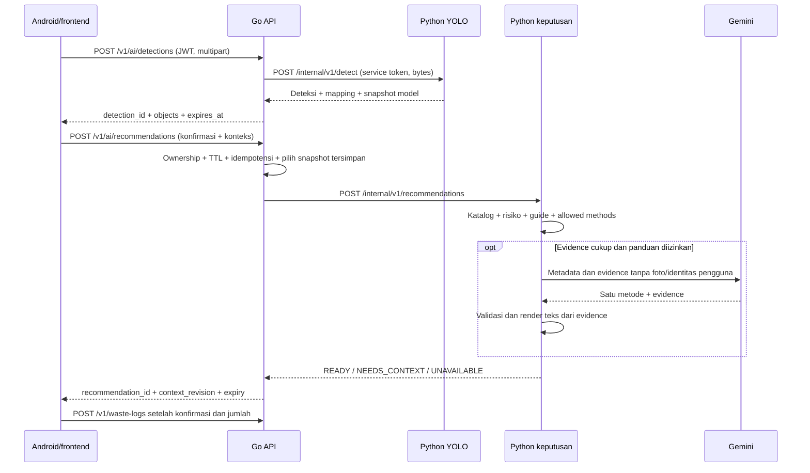

# Kontrak HTTP AI v1 dan pembagian tanggung jawab

Pembaruan aktif: [pilot-policy-06, kondisi kosong dan audit background](CONDITIONAL_AND_BACKGROUND.md). UNKNOWN biasa boleh mendapat READY/CONDITIONAL; syarat yang belum diketahui muncul di conditions_to_verify. Bagian policy-05/evaluasi 40 kasus di bawah adalah perilaku/run sebelumnya; allow_conditional=false mempertahankan mode ketat tersebut. Suite aktif kini 44 kasus, dengan 40 kasus lama diuji dalam mode ketat dan empat kasus kondisi kosong. Hash report lama merujuk snapshot skenario sebelum perubahan, bukan byte file skenario aktif.

Keputusan 20 Oktober 2026: **Python memiliki satu implementasi aturan AI**.
Go mengaksesnya melalui HTTP privat. Frontend memakai HTTP publik Go.
Kontrak bertipe, mock publik dan adapter Python sudah tersedia di repo ini;
backend Go, penyimpanan sesi produksi dan layar Android belum diimplementasikan
oleh pekerjaan ini. Pembaruan poin 3-4 menambahkan profil deteksi per kelas dan panduan pilot; lihat [mutu deteksi](DETECTION_QUALITY.md) dan [evaluasi rekomendasi](RECOMMENDATION_EVALUATION.md).

## Artifact yang menjadi acuan tim

| File | Pemakai |
|---|---|
| [public.openapi.json](../contracts/v1/public.openapi.json) | Go dan Android/frontend; kontrak empat endpoint `/v1/ai/*` |
| [private-detection.openapi.json](../contracts/v1/private-detection.openapi.json) | Go → worker YOLO |
| [private-recommendation.openapi.json](../contracts/v1/private-recommendation.openapi.json) | Go → modul keputusan Python |
| [errors.json](../contracts/v1/errors.json) | Status HTTP, kode stabil, pesan dan retryability |
| [examples](../contracts/v1/examples) | Request/response empat metode, kebutuhan konteks, error dan referensi deteksi |

Versi envelope `api_version=1.0.0`; URL publik memakai `/v1`. Fields JSON
snake_case, UUID string, waktu RFC3339 UTC, bbox `[xmin,ymin,xmax,ymax]` 0..1
terhadap gambar setelah orientasi dinormalisasi. Kategori dan label metode
adalah enum, bukan teks tampilan. Object key stabil; label Indonesia boleh
berubah tanpa mengganti object key. Daftar guide/evidence memakai ID string,
bukan selalu UUID. Source detail mencatat judul/penerbit/wilayah/batas cakupan.

`wire.py` adalah schema transport, `decisions.py` adalah interface keputusan,
`recommendation.py`/`catalog.py`/`providers.py` adalah implementasi aturan AI.
OpenAPI dan contoh digenerate dari model/adapter tersebut. Perubahan schema
memerlukan regenerasi, pemeriksaan kompatibilitas Go/Android, serta pembaruan
versi jika mematahkan kontrak; jangan mengedit JSON hasil generate secara manual.

```powershell
.\.venv-ai\Scripts\python.exe -m pip install -e "./ai[worker,test]" -c ai/constraints.txt
.\.venv-ai\Scripts\python.exe -m wastenot_ai.cli export-contracts
.\.venv-ai\Scripts\python.exe -m wastenot_ai.cli export-contracts --check
$env:PYTEST_DISABLE_PLUGIN_AUTOLOAD = '1'
.\.venv-ai\Scripts\python.exe -m pytest ai/tests -q -p no:cacheprovider
```

CI memvalidasi tiga dokumen OpenAPI, contoh terhadap JSON Schema, conditional
status/metode/scope, dan drift artifact. Tidak membutuhkan YOLO, key, atau
request Gemini. Pemeriksaan format OpenAPI mengacu pada
[OpenAPI 3.1](https://spec.openapis.org/oas/v3.1.0.html); ekspor route mengikuti
[mekanisme FastAPI](https://fastapi.tiangolo.com/how-to/extending-openapi/).

## Pemilik aturan

| Modul | Memiliki | Memakai hasil dari modul lain |
|---|---|---|
| Python YOLO | Decode/orientasi, model/checksum, bbox, threshold/band, mapping kelas, capability model aktif | Tidak memiliki akun, database atau key Gemini |
| Python keputusan | Validasi object/category, propagasi risiko, panduan dan expiry editorial, allowed methods, Gemini/pool key, validasi evidence, alasan/langkah/sumber, policy version | Menerima konteks yang dikonfirmasi dan snapshot deteksi dari Go yang terautentikasi |
| Go | JWT/ownership, feature flag, rate limit/budget akun, sesi/TTL, dedup/in-flight, snapshot provenance, transaksi waste log/XP, validasi struktur respons Python | Tidak mengimplementasikan ulang mapping/evidence/prompt/aturan penanganan |
| Android/frontend | Kamera, persetujuan kirim, memilih objek/koreksi, mengisi konteks, menampilkan hasil, konfirmasi simpan | Tidak memilih sumber/allowed methods dan tidak memanggil worker atau Gemini langsung |



## Mock untuk frontend dan backend

```powershell
.\.venv-ai\Scripts\python.exe -m wastenot_ai.cli serve-mock --port 8094
```

Buka `http://127.0.0.1:8094/docs`. Authorize memakai **`mock-user-a`** atau
**`mock-user-b`**. Token ini hanya identitas fixture; mock tidak memverifikasi
JWT dan tidak boleh menjadi backend produksi. Setiap respons mempunyai
`X-WasteNot-Mock: true`. Data rekomendasi memakai provider `fixture` dan
`prototype_only=true`. Model fixture tidak membaca isi gambar untuk mengenali
benda; decode gambar hanya menguji batas media. Tidak ada panggilan YOLO,
Gemini, database atau endpoint penyimpanan catatan.

```powershell
$headers = @{Authorization='Bearer mock-user-a'}
Invoke-RestMethod http://127.0.0.1:8094/v1/ai/objects -Headers $headers
$body = Get-Content ai/contracts/v1/examples/recycle-request.json -Raw
Invoke-RestMethod http://127.0.0.1:8094/v1/ai/recommendations -Method Post -Headers $headers -ContentType 'application/json' -Body $body
```

Contoh request manual tidak membutuhkan upload. Untuk alur deteksi, kirim
multipart `image` JPEG/PNG dan `client_request_id` UUID ke detections, lalu
pakai detection_id/object_id yang **baru diterima**, bukan ID statis contoh.
Gambar tidak masuk sesi/cache; parser multipart memakai penyimpanan sementara
yang ditutup setelah request. Mock memiliki batas body, 64 sesi dan 128
request replay di memori, dengan TTL 24 jam; restart menghapus seluruh state.

Skenario startup (restart server untuk mengganti):

```powershell
.\.venv-ai\Scripts\python.exe -m wastenot_ai.cli serve-mock --scenario uncertain
.\.venv-ai\Scripts\python.exe -m wastenot_ai.cli serve-mock --scenario no-detections
.\.venv-ai\Scripts\python.exe -m wastenot_ai.cli serve-mock --scenario provider-unavailable
.\.venv-ai\Scripts\python.exe -m wastenot_ai.cli serve-mock --scenario rate-limited
.\.venv-ai\Scripts\python.exe -m wastenot_ai.cli serve-mock --scenario timeout
```

`normal` memakai aturan Python nyata dengan provider fixture. Contoh reuse,
recycle, reduce, trash dan needs-context mengubah **input kondisi**, bukan
memaksa metode dari query/header publik. Scenario provider-unavailable
menyimulasikan hasil 200/UNAVAILABLE; timeout adalah HTTP 504, rate-limited
HTTP 429 + `Retry-After: 30`. Flag scenario bukan bagian API produksi.

## Menjalankan interface privat

Isi token berbeda dan acak, minimal 24 karakter, pada konfigurasi lokal:
`AI_SERVICE_TOKEN` untuk YOLO, `AI_RECOMMENDATION_TOKEN` untuk keputusan.
`ai/.env.example` menyediakan nama variabelnya; jangan commit nilainya.

```powershell
# Terminal 1, hanya perlu untuk deteksi nyata:
.\.venv-ai\Scripts\python.exe -m wastenot_ai.cli serve-worker --port 8091
# Terminal 2, tanpa key untuk uji aturan dan draft yang diberi label:
.\.venv-ai\Scripts\python.exe -m wastenot_ai.cli serve-recommendations --port 8093 --provider fixture --demo-guides
# Atau Gemini nyata memakai ai/.env:
.\.venv-ai\Scripts\python.exe -m wastenot_ai.cli serve-recommendations --port 8093 --demo-guides
```

Untuk panduan PUBLISHED nyata, gunakan `--guides path/to/reviewed-guides.json`
dan hilangkan `--demo-guides`. Default tidak meloloskan draft. Tidak ada
reviewer/status publikasi yang dibuat otomatis. Modul keputusan tidak perlu
Ultralytics, model `.pt`, atau GPU. Modul deteksi CLI membuang env key Gemini
dan token rekomendasi sebelum melayani request; modul keputusan tidak memakai
token deteksi. Keduanya bind loopback, tanpa docs HTTP dan tanpa access log.

Endpoint privat:

- YOLO: `POST /internal/v1/detect` raw JPEG/PNG, `GET /internal/v1/capabilities`.
- Keputusan: `GET /internal/v1/objects`, `POST /internal/v1/recommendations` JSON.
- Keduanya: `GET /health/ready` memakai credential masing-masing.
- `/internal/detect` lama tetap tersedia sebagai adapter kompatibilitas;
  integrasi baru memakai route versioned dan envelope bersama.

Go mengirim `Authorization: Bearer <service-token>` dan boleh mengirim
`X-Request-ID` UUID untuk korelasi. Header dan envelope endpoint v1 memuat request_id;
error dan respons pribadi memakai `Cache-Control: no-store`. Timestamp tidak
dipakai sebagai ID. Input keputusan dibatasi 16 KiB; gambar maksimal 5 MiB,
12 MP dan sisi 4096. Satu job per proses; busy 503 + Retry-After, deadline 504.
Job native/provider yang belum selesai tetap memegang slot setelah deadline.

Contoh [internal-recommendation-request.json](../contracts/v1/examples/internal-recommendation-request.json)
berisi `context` dan `selection`. **Go membangun selection dari hasil Python
yang tersimpan**, berisi model_version, model_sha256, mapping_version, class_names dan
objek terpilih. Field ini tidak diterima endpoint publik dari Android.
Python memeriksa ulang label, mapping, threshold dan risiko meskipun pengguna
mengoreksi benda. Untuk manual yang tidak berasal dari deteksi, selection=null.
Interface privat mempercayai Go sebagai pemilik snapshot; token privat tidak
menggantikan pemeriksaan ownership sesi pada Go.

## Kewajiban adapter Go

1. Ambil katalog dari modul keputusan dan capability dari worker aktif.
   Simpan versi/checksum bersama; ganti snapshot saat model/mapping berubah.
2. Validasi JWT, ukuran media dan quota sebelum inference. Parse respons
   privat terhadap schema; simpan metadata deteksi milik user selama TTL.
3. Pada rekomendasi, validasi ownership/expiry sebelum cache atau panggilan
   privat. Client hanya boleh mengirim field pada RecommendationInput;
   confidence, raw_class, guide, allowed_methods, provider dan user_id ditolak.
4. Simpan idempotensi secara atomik, scoped `(user, operation, client_request_id)`.
   Digest kanonis berbeda →409. Request bersamaan berbagi satu pekerjaan,
   bukan masing-masing memanggil Python. Identical replay mengembalikan ID,
   expiry dan data yang sama dengan request_id transport baru.
5. Private recommendation **stateless** dan tidak menjamin dedup provider.
   Go memiliki status IN_PROGRESS/COMPLETED/FAILED_UNCERTAIN. Jika timeout
   transport membuat hasil panggilan tidak diketahui, jangan mengirim ulang
   RPC diam-diam: simpan hasil error/uncertainty untuk request ID tersebut.
   Replay mengembalikan status tersimpan. Percobaan generasi baru memerlukan
   tindakan eksplisit dan client_request_id baru. Private HTTP client tidak
   mengaktifkan retry generation otomatis.
6. Bungkus keputusan Python dengan recommendation_id, category,
   confirmed_object_key, context_revision dan expires_at yang tidak melebihi
   sesi deteksi. Jangan mengubah metode, menambah evidence, atau mengganti
   UNAVAILABLE dengan saran buatan Go. Validasi struktur/domain tetap milik Go.
7. Hapus sesi membatalkan penggunaan rekomendasi terkait, termasuk replay;
   hasil terlambat tidak menghidupkan sesi kembali. Ownership tidak bocor.
8. POST waste-logs tetap satu-satunya penyimpanan: konfirmasi objek/metode,
   jumlah manual, ownership, TTL, category dan unique recommendation linkage
   dalam transaksi. REDUCE masih dicatat manual sampai provenance pencegahan
   didukung backend. Rekomendasi tidak menghasilkan XP.

Go memerlukan implementasi DB/in-flight/budget sendiri; struktur memori mock
bukan jaminan lintas proses atau contoh autentikasi produksi. Secret Gemini
berada pada modul Python keputusan; Go hanya memiliki URL privat dan token.

## Kewajiban frontend

`confirmed_object=true` wajib eksplisit. `input_source=DETECTION` memerlukan
dua ID; MANUAL tidak membawa keduanya. `context_revision` naik ketika pilihan
atau kondisi berubah; gunakan request UUID baru dan buang respons yang tidak
cocok dengan fase, detection_id atau revision terbaru.

| Hasil | Perilaku frontend |
|---|---|
| REVIEW_REQUIRED | Bbox/daftar, band confidence dan konfirmasi material; model tidak mengisi kategori sebagai fakta |
| MANUAL_REQUIRED | Pilih katalog atau ambil ulang; jangan membuat saran deteksi palsu |
| READY | Satu label, scope, alasan, langkah, sumber dan caution; tunggu konfirmasi simpan |
| NEEDS_CONTEXT | Render field pada missing_context, pertahankan isian lain; metode/scope null |
| UNAVAILABLE | Tampilkan reason_code, caution dan sumber yang tersedia, lalu manual/retry eksplisit |
| 401/404/410/409 | Tangani sesi/login/konflik sesuai error code dan pertahankan draft |
| 429/503/504 | Hormati Retry-After bila ada; tidak retry loop atau mengulang dengan UUID baru otomatis |

201 adalah pembuatan sesi/hasil READY pertama; 200 adalah replay atau
hasil rekomendasi NEEDS_CONTEXT/UNAVAILABLE. 204 untuk delete tanpa body.
Jangan menyamakan HTTP 200 dengan rekomendasi yang siap. `prototype_only`
dan `provider=fixture` harus terlihat sebagai simulasi/draft pada UI pengujian.

## Status verifikasi

Tes kontrak mencakup validitas OpenAPI/JSON Schema, empat label, missing context,
enum/scope invalid, request spoofing, auth, replay/conflict, lintas akun,
delete/expiry, media/body limit, propagasi risiko dan native timeout lock.
Integrasi Go, JWT produksi, DB, concurrency lintas proses, kamera Android,
dan transaksi penyimpanan tetap pekerjaan tim backend/frontend. Peningkatan
YOLO/threshold dan kurasi/evaluasi kualitas panduan/LLM adalah tahap berikutnya.

Verifikasi 20 Oktober 2026: **146 tes Python lulus**, tiga dokumen OpenAPI
valid, 26 artifact hasil generate konsisten. Mock diuji melalui HTTP loopback
nyata: Swagger tersedia, POST pertama 201 dan replay identik 200 dengan ID/data
tetap. YOLO nyata → adapter HTTP privat versi baru → keputusan Python →
Gemini langsung menghasilkan READY/RECYCLE dan sumber yang lolos schema.
Smoke tersebut melalui ASGI TestClient, bukan backend Go.

Demo kamera lama juga kembali lulus 14 pemeriksaan browser (kamera palsu,
YOLO nyata, rekomendasi fixture), tanpa error JavaScript. Kamera fisik belum
diuji. Seluruh hasil lokal tersimpan di `ai/artifacts`, tidak memuat key.

```powershell
# Smoke memakai model/sampel lokal; default provider fixture:
.\.venv-ai\Scripts\python.exe ai/scripts/verify_http_integration.py
# Satu request Gemini nyata, tetap dengan guide draft berlabel demo:
.\.venv-ai\Scripts\python.exe ai/scripts/verify_http_integration.py --live-gemini
```

## Pembaruan kualitas policy-05

Schema v1 menambahkan field dengan default: condition.former_contents (FOOD_DRINK/CHEMICAL/OTHER/UNKNOWN), review_profile pada hasil/capability, review_thresholds/review_reasons/ambiguous_with per objek, class_thresholds/review_only_classes pada capability/katalog gabungan. Frontend memakai confidence_band server dan menampilkan konflik; JSON consumer perlu menerima field tambahan. Penambahan field tidak mengubah URL/envelope 1.0.0. Keputusan berubah secara eksplisit melalui recommendation_version=pilot-policy-05 dan mapping/profile version.

Untuk checkpoint terdaftar, Go harus mengirim model_sha256 dari model.sha256 pada selection privat agar replay threshold sama; model_version saja tidak mengaktifkan profil. Mapping berprofil tanpa provenance yang cocok ditolak, bukan diturunkan diam-diam. Field ini berasal dari snapshot Python tersimpan, bukan body frontend. Profil dipilih Python, bukan dikirim sebagai konfigurasi oleh client.

RECYCLE pilot memerlukan akses penerima YES. HDPE meminta former_contents=FOOD_DRINK; UNKNOWN menghasilkan NEEDS_CONTEXT dengan field condition.former_contents. Chemical history memblokir aturan biasa walaupun foto tampak bersih. UI demo sudah menyediakan field/reset hasil. Go/Android produksi tetap perlu mengimplementasikan kontrak ini.
