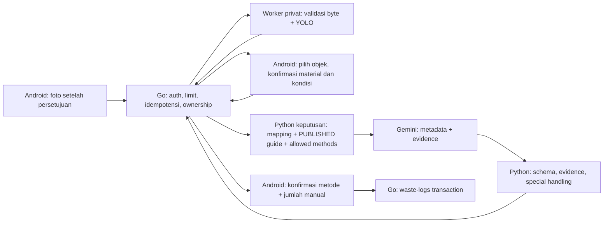

# Integrasi Android / Go / AI

Pembaruan aktif: [pilot-policy-06, kondisi kosong dan audit background](CONDITIONAL_AND_BACKGROUND.md). UNKNOWN biasa boleh mendapat READY/CONDITIONAL; syarat yang belum diketahui muncul di conditions_to_verify. Bagian policy-05/evaluasi 40 kasus di bawah adalah perilaku/run sebelumnya; allow_conditional=false mempertahankan mode ketat tersebut. Suite aktif kini 44 kasus, dengan 40 kasus lama diuji dalam mode ketat dan empat kasus kondisi kosong. Hash report lama merujuk snapshot skenario sebelum perubahan, bukan byte file skenario aktif.

Status: prototipe lokal dan kontrak HTTP v1. [Kontrak integrasi terbaru](AI_HTTP_CONTRACT.md) beserta OpenAPI/mock menetapkan Python sebagai pemilik tunggal aturan AI; Go memegang JWT, sesi, dedup dan penyimpanan. Mock publik Python hanya untuk pengujian kontrak, bukan implementasi Go produksi. Gemini memilih REDUCE/REUSE/RECYCLE/TRASH dan evidence; Python menyediakan alasan serta sumber tervalidasi. REDUCE berscope PREVENTION; lainnya HANDLING.

Demo kamera tersedia melalui `ai/demo-camera.bat` atau `python -m wastenot_ai.cli demo --demo-guides` menggunakan interpreter venv. Endpoint `/demo/api/*` khusus loopback menggabungkan YOLO dan rekomendasi untuk eksperimen UI. Endpoint tersebut tidak menggantikan kontrak publik Go. Katalog versi 05 memiliki 78 pilihan benda/material; cakupan COCO tetap 58 kelas visual yang dipetakan. Kandidat broad mempunyai 10 kelas bentuk dengan review wajib, mapping tersendiri dan padding square; lihat [training dan integrasi broad](BROAD_WASTE_TRAINING.md).

## Serah-terima artifact

Kandidat fine-tuning empat kelas botol/kaleng dipilih eksplisit dengan `demo --model ... --device ...` atau `serve-worker --model ... --device ...`. Ikuti [fine-tuning](FINE_TUNING.md) untuk sumber, hash dan evaluasi. Mapping `drinking-waste-reviewed-02` membaca seluruh taksonomi khusus; ID 0-3 bukan COCO. Botol PET/kaca dan kaleng diarahkan ke pilihan katalog yang tetap dikonfirmasi; HDPE mempunyai panduan khusus bekas pangan/minuman dengan konfirmasi isi sebelumnya dan penerima; tidak ada REUSE otomatis. Model COCO tetap tersedia untuk cakupan luas. `/demo/api/config` sekarang menyertakan `supported_object_labels`, `supported_visual_classes` dan `mapping_version` dari checkpoint aktif agar frontend tidak mengiklankan kelas yang tidak tersedia.

- `catalog.json`: objek pilot dan perluasan demo, mapping berdasarkan pasangan COCO class_id/raw_class aktual. `bottle` tetap ambigu material. Go harus membaca versi/checksum artifact sebenarnya, tidak menerima mapping/guide/confidence buatan client.
- Worker: `POST /internal/v1/detect`, body raw JPEG/PNG, token deteksi. `/internal/detect` lama tetap kompatibel. Modul keputusan terpisah menyediakan `POST /internal/v1/recommendations` dan `GET /internal/v1/objects` memakai token rekomendasi. OpenAPI dan envelope bersama ada pada [kontrak HTTP](AI_HTTP_CONTRACT.md).
- Model manifest: checksum SHA-256, label aktual, preprocessing, runtime, ukuran input dan device dari output detect. Pin pasangan artifact dan mapping bersama.
- `ModelSuggestion.model_json_schema()`: bentuk output Gemini, satu enum REDUCE/REUSE/RECYCLE/TRASH wajib, tanpa alternatif/null. Respons publik fallback tetap nullable. `decisions.py` dan `recommendation.py` adalah implementasi tunggal policy/scope/sumber/evidence, dipanggil Go melalui HTTP privat. Go memvalidasi struktur respons tanpa menyalin aturan penanganan.
- `guides.json`: hanya draf editorial. Mode `--demo-guides` dan provider fixture khusus prototipe; tidak dipindahkan menjadi capability produksi.
- Policy `pilot-policy-03`: penanganan khusus menjadi flag peringatan, bukan status/metode pengganti. READY tetap memilih satu metode saat risiko diketahui; server menyaring evidence `risk_compatible=true`, mengirim special_handling pada payload Gemini dan memvalidasi flag balasan. Kaca pecah → TRASH dengan pengemasan; baterai/e-waste/pisau/gunting → RECYCLE melalui pengelola khusus. Jangan menampilkan instruksi reuse yang berasal dari langkah umum guide pada kaca pecah. UNAVAILABLE hanya untuk panduan/layanan/output yang tidak siap, sambil tetap menampilkan caution risiko.
- Policy aktif `pilot-policy-05` memperbaiki konteks pencucian: cleanable=YES/NO/UNKNOWN, soiling=FOOD_DRINK/DUST/HAZARDOUS/UNKNOWN dan risk_type=UNKNOWN/SHARP/CHEMICAL/BIOLOGICAL/ELECTRICAL/OTHER. Peralatan kotor biasa yang utuh/layak dan ingin dipakai ulang dapat REUSE setelah dicuci sesuai evidence. AUTO/HANDLING tidak menawarkan REDUCE; PREVENTION harus dipilih pengguna. NEEDS_CONTEXT + missing_context mengembalikan isian yang dibutuhkan sebelum biaya Gemini timbul. source_details menampilkan penerbit/wilayah/batas cakupan. Lihat [mutu panduan](GUIDE_QUALITY.md) dan terapkan kasus regresi yang sama di Go/Android.

## Yang tetap harus dikerjakan backend

Go memegang JWT/account ownership, endpoint publik objects/detections/recommendations/delete, media/request rate limit dan budget, hash/idempotency/in-flight, TTL 24 jam, snapshot hasil/panduan dan validasi konfirmasi penyimpanan. Secret Gemini hanya berada pada modul Python keputusan.

Worker YOLO hanya menjalankan inference/mapping, tanpa DB credential atau Gemini key. Modul Python keputusan terpisah memegang panduan, aturan serta Gemini, tanpa model YOLO atau database pengguna. CLI/demo dan HTTP menggunakan interface keputusan yang sama; Go tidak membuat subprocess CLI untuk setiap request.

Pool Gemini pada modul Python mendukung `GEMINI_API_KEY_1` sampai `_5`, dengan fallback `GEMINI_API_KEY`. Instance provider dipakai ulang selama proses hidup. Go tidak membuat pool/prompt lain atau melakukan retry generation otomatis. Deployment beberapa proses tetap membutuhkan koordinasi budget/kuota proyek. Google [membatasi kuota per proyek](https://ai.google.dev/gemini-api/docs/rate-limits); banyak key tidak otomatis menambah kuota.

Respons produksi menggunakan model/API.md: detection_id, object_id, model/mapping version, expires_at; recommendation_id, status, metode nullable, guide_refs, policy version. `prototype_only`, environment dan full labels dalam output eksperimen bukan pengganti kontrak publik.

Kunci idempotensi di Go scoped user. Replay identik tidak memanggil model/provider lagi; ID sama payload berbeda →409. Ownership diperiksa sebelum inference/retrieval. Satu recommendation hanya terhubung ke satu waste log. Penyimpanan tetap melalui POST waste-logs; kedua confirmation=true, TTL dan kategori diverifikasi dalam transaksi. Gemini boleh menyarankan REDUCE untuk pencegahan, tetapi pencatatannya tetap melalui manual tanpa provenance disposal sampai backend mendukung validasi provenance PREVENTION. Pengguna harus sudah melakukan tindakan dan mengisi jumlah yang benar-benar dihindari; foto bukan bukti pengurangan. Versi konteks/request mencegah hasil lama menimpa koreksi pengguna.

Worker memproses gambar di memori tanpa backup/salinan disk. File foto pengguna milik caller tidak dihapus oleh CLI; caller bertanggung jawab cleanup kamera ≤1 jam. Go tetap harus membuktikan cleanup ingress/tmp ≤15 menit saat crash, redaksi telemetri, rate limit per akun, dan isolasi data. Sampel publik eksperimen di `data/local` bukan foto sementara pengguna.

## Gate sebelum pilot pengguna

1. Dataset/lisensi, kelas rilis, holdout per objek/sesi dan threshold disepakati.
2. Guide PUBLISHED ditinjau untuk penerapan lokal; evidence tiap metode disesuaikan, termasuk syarat TRASH dan pembedaan REDUCE sebagai pencegahan.
3. Uji Gemini live dan evaluasi kasus tetap, termasuk injection, halusinasi dan special handling.
4. Integrasi Go dan Android: AT-AI-01–18 termasuk ownership, TTL, idempotensi, cleanup, quantity dan konfirmasi simpan.
5. Pengukuran hardware, upload/inference/retrieval/LLM/e2e, p50/p95 dan biaya; keputusan rilis serta rollback artifact/mapping/policy.

Pembaruan poin 3-4: [DETECTION_QUALITY](DETECTION_QUALITY.md) menjelaskan profil SHA-bound, threshold/ambiguitas dan manifest holdout. [RECOMMENDATION_EVALUATION](RECOMMENDATION_EVALUATION.md) mencatat 40 skenario termasuk 12 panggilan Gemini. Condition menambahkan former_contents; pilot RECYCLE memerlukan recycling_access=YES. Go menyimpan checksum dan mengirim model_sha256 pada selection privat. Profile kandidat dw-val-01 membuat mapping drinking-waste-reviewed-02+dw-val-01.
