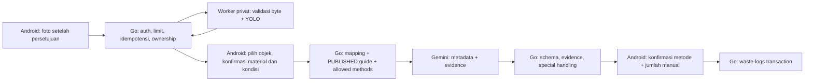

# Integrasi Android / Go / AI

Status: prototipe lokal. Kontrak produk mengikuti API.md §10 dengan pembaruan [empat metode, satu hasil](RECOMMENDATION_CONTRACT.md) pada 20 Oktober 2026; tidak ada endpoint publik baru di Python. Gemini memilih REDUCE/REUSE/RECYCLE/TRASH dan evidence, server menyediakan alasan serta sumber tervalidasi. `alternative_method` dihapus. REDUCE berscope PREVENTION; lainnya HANDLING.

Demo kamera tersedia melalui `ai/demo-camera.bat` atau `python -m wastenot_ai.cli demo --demo-guides` menggunakan interpreter venv. Endpoint `/demo/api/*` khusus loopback menggabungkan YOLO dan rekomendasi untuk eksperimen UI. Endpoint tersebut tidak menggantikan kontrak publik Go. Cakupan demo: 68 objek/material melalui 58 label visual checkpoint COCO; daftar lengkap ada di README AI/katalog versi 03.

## Serah-terima artifact

- `catalog.json`: objek pilot dan perluasan demo, mapping berdasarkan pasangan COCO class_id/raw_class aktual. `bottle` tetap ambigu material. Go harus membaca versi/checksum artifact sebenarnya, tidak menerima mapping/guide/confidence buatan client.
- Worker: `POST /internal/detect`, body raw JPEG/PNG, header service token. Output bbox `[xmin,ymin,xmax,ymax]` normalized terhadap dimensi gambar setelah EXIF rotation; Android menerapkan transform crop/letterbox sendiri.
- Model manifest: checksum SHA-256, label aktual, preprocessing, runtime, ukuran input dan device dari output detect. Pin pasangan artifact dan mapping bersama.
- `ModelSuggestion.model_json_schema()`: bentuk output Gemini, satu enum REDUCE/REUSE/RECYCLE/TRASH wajib, tanpa alternatif/null. Respons publik fallback tetap nullable. `recommendation.py` menyediakan perilaku referensi policy, scope, sumber dan evidence yang perlu diterapkan/direview di Go. Request baru memakai recommendation_goal=AUTO/PREVENTION/HANDLING dan recycling_access=YES/NO/UNKNOWN, default AUTO/UNKNOWN.
- `guides.json`: hanya draf editorial. Mode `--demo-guides` dan provider fixture khusus prototipe; tidak dipindahkan menjadi capability produksi.
- Policy `pilot-policy-03`: penanganan khusus menjadi flag peringatan, bukan status/metode pengganti. READY tetap memilih satu metode saat risiko diketahui; server menyaring evidence `risk_compatible=true`, mengirim special_handling pada payload Gemini dan memvalidasi flag balasan. Kaca pecah → TRASH dengan pengemasan; baterai/e-waste/pisau/gunting → RECYCLE melalui pengelola khusus. Jangan menampilkan instruksi reuse yang berasal dari langkah umum guide pada kaca pecah. UNAVAILABLE hanya untuk panduan/layanan/output yang tidak siap, sambil tetap menampilkan caution risiko.

## Yang tetap harus dikerjakan backend

Go memegang JWT/account ownership, endpoint objects/detections/recommendations/delete, media/request rate limit dan budget, hash/idempotency, detection/recommendation TTL 24 jam, snapshot panduan, secret Gemini, serta validasi konfirmasi.

Python worker hanya menjalankan inference; tidak diberi DB credential atau Gemini key. CLI eksperimen menggabungkan adapter YOLO dan Gemini pada proses lokal agar pekerjaan AI dapat diuji sebelum Go selesai. Konfigurasi Gemini lokal tidak dipakai worker.

Pool Gemini mendukung `GEMINI_API_KEY_1` sampai `_5`, dengan fallback konfigurasi ke `GEMINI_API_KEY` jika seluruh slot bernomor kosong. Port perilaku pada `providers.py`: round-robin dengan lock, skip kosong/duplikat, cooldown 429 minimal 60 detik/mengikuti retry hint Google, disable 401/403 sampai restart, maksimum satu percobaan per key per request dalam satu anggaran timeout. Jangan mengulang timeout/5xx/generation yang sudah selesai dengan key lain. Pool dipakai ulang selama proses hidup; deployment beberapa proses perlu koordinasi kuota proyek. Frontend tidak menerima key atau detail kegagalan mentah; respons tetap sama. Google [membatasi kuota per proyek](https://ai.google.dev/gemini-api/docs/rate-limits), sehingga banyak key tidak otomatis menambah kuota.

Respons produksi menggunakan model/API.md: detection_id, object_id, model/mapping version, expires_at; recommendation_id, status, metode nullable, guide_refs, policy version. `prototype_only`, environment dan full labels dalam output eksperimen bukan pengganti kontrak publik.

Kunci idempotensi di Go scoped user. Replay identik tidak memanggil model/provider lagi; ID sama payload berbeda →409. Ownership diperiksa sebelum inference/retrieval. Satu recommendation hanya terhubung ke satu waste log. Penyimpanan tetap melalui POST waste-logs; kedua confirmation=true, TTL dan kategori diverifikasi dalam transaksi. Gemini boleh menyarankan REDUCE untuk pencegahan, tetapi pencatatannya tetap melalui manual tanpa provenance disposal sampai backend mendukung validasi provenance PREVENTION. Pengguna harus sudah melakukan tindakan dan mengisi jumlah yang benar-benar dihindari; foto bukan bukti pengurangan. Versi konteks/request mencegah hasil lama menimpa koreksi pengguna.

Worker memproses gambar di memori tanpa backup/salinan disk. File foto pengguna milik caller tidak dihapus oleh CLI; caller bertanggung jawab cleanup kamera ≤1 jam. Go tetap harus membuktikan cleanup ingress/tmp ≤15 menit saat crash, redaksi telemetri, rate limit per akun, dan isolasi data. Sampel publik eksperimen di `data/local` bukan foto sementara pengguna.

## Gate sebelum pilot pengguna

1. Dataset/lisensi, kelas rilis, holdout per objek/sesi dan threshold disepakati.
2. Guide PUBLISHED ditinjau untuk penerapan lokal; evidence tiap metode disesuaikan, termasuk syarat TRASH dan pembedaan REDUCE sebagai pencegahan.
3. Uji Gemini live dan evaluasi kasus tetap, termasuk injection, halusinasi dan special handling.
4. Integrasi Go dan Android: AT-AI-01–18 termasuk ownership, TTL, idempotensi, cleanup, quantity dan konfirmasi simpan.
5. Pengukuran hardware, upload/inference/retrieval/LLM/e2e, p50/p95 dan biaya; keputusan rilis serta rollback artifact/mapping/policy.
