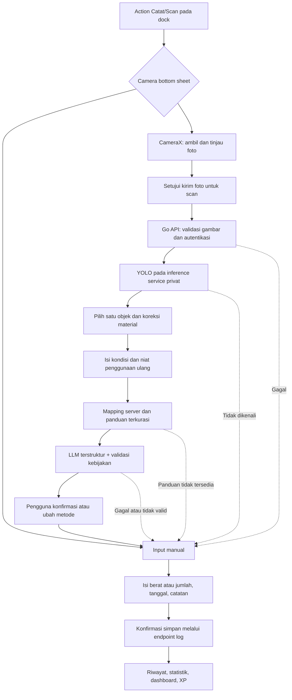

# WasteNot: Computer Vision dan Rekomendasi AI

Versi 1.2 · 28 September 2026 · Spesifikasi usulan, belum diimplementasikan

## 1. Sumber, scope, dan keputusan

Permintaan pengguna pada 28 September memperluas dokumentasi mengikuti [rencana teman tim](sources/AI_PLAN_ORIGINAL.md). Dokumen sumber adalah masukan produk, bukan instruksi untuk menjalankan deployment, mengunggah foto, atau mengaktifkan layanan. PRD PDF tetap sumber kebutuhan inti. Dokumen ini merinci tambahan AI dan menyelesaikan ambiguitas agar Android/backend memakai kontrak yang sama.

| Status | Keputusan |
|---|---|
| Kebutuhan dari rencana | CameraX, YOLO, confidence dan bounding box, koreksi objek, konteks, Waste Guide, LLM terstruktur, validasi, konfirmasi, input jumlah manual |
| Baseline rancangan tambahan | Capture satu foto per request; inference server Python privat di belakang Go API; satu objek dipilih untuk satu catatan |
| Tetap berlaku | Enum domain, jumlah integer gram/benda, ownership, idempotensi, statistik dari catatan tersimpan, 10 XP per log aktif |
| Belum diputuskan tim | Model/checkpoint final, kelas rilis, dataset berlisensi, provider LLM, hardware, biaya, target performa numerik |
| Ditunda | Real-time frame streaming, estimasi berat, batch save, klasifikasi kimia/kontaminasi otomatis, on-device inference, offline LLM |

Permintaan lanjutan pengguna: action utama di tengah navbar membuka kamera dalam bottom sheet, dengan tombol input manual. Lima tab tetap ada; action di tengah atas dock bukan destinasi keenam.

AI merupakan increment setelah alur core stabil. Jadwal empat minggu lama adalah baseline core, bukan janji menyelesaikan semua AI dalam waktu yang sama. Lihat [rencana implementasi](IMPLEMENTATION_PLAN.md).

## 2. Alur dan batas tanggung jawab

YOLO mengenali kelas visual, bukan menentukan material kimia, berat, keamanan, atau penerimaan fasilitas. Waste Guide menyediakan aturan yang ditinjau. LLM merangkum rekomendasi dari konteks tersebut. Pengguna mengonfirmasi tindakan yang benar-benar dilakukan. Rekomendasi untuk masa depan belum menjadi waste log.

Reduce berarti benda/berat yang dihindari. Memotret sampah yang sudah ada tidak membuktikan Reduce. Untuk scan, rekomendasi otomatis dibatasi REUSE/RECYCLE/TRASH sesuai panduan; REDUCE tidak ditawarkan otomatis. Pengguna boleh pindah ke manual untuk mencatat aktivitas pencegahan yang memang dilakukan, dengan definisi Reduce PRD. Ini penyempurnaan terhadap contoh allowed_methods empat enum di rencana sumber.

## 3. Kamera dan siklus hidup

- Minta izin kamera setelah pengguna memilih scan. Ditolak: beri input manual; jika izin diblokir permanen, tawarkan pengaturan sistem tanpa prompt berulang.
- CameraX Preview + ImageCapture terikat lifecycle. Tutup kamera saat keluar/background; iterasi awal tidak menjalankan ImageAnalysis atau upload stream.
- Capture menghasilkan file sementara app-internal. Tampilkan preview dengan Ambil ulang, Kirim untuk scan, dan Batal. Izin kamera tidak dianggap persetujuan upload.
- Jelaskan sebelum upload: foto dikirim untuk pengenalan; tidak otomatis menjadi lampiran atau data latihan. Hindari memotret orang/dokumen pribadi.
- Normalisasi orientasi dan buang EXIF sebelum upload. Backend memvalidasi dan menormalisasi ulang; jangan percaya client.
- Batal sebelum kirim menghapus foto lokal. Batal setelah kirim membatalkan UI/request semampunya; server tetap menjalankan cleanup meskipun koneksi putus.
- Draf kategori/metode/jumlah bertahan sesuai core. Setelah process death, foto sementara yang hilang memunculkan Ambil ulang; jangan mengunggah ulang diam-diam. Logout membuang sesi AI dan foto sementara akun tersebut.

## 4. Deteksi dan mapping

YOLO11n adalah kandidat baseline dari rencana, bukan model yang sudah dipilih/diuji. Model pretrained COCO memiliki label umum seperti `bottle`; label itu tidak cukup untuk memastikan `plastic_bottle` versus `glass_bottle`. Daftar kelas harus dibaca dari artifact model aktual, bukan dibuat berdasarkan keinginan UI. Dokumentasi resmi: [YOLO11](https://docs.ultralytics.com/models/yolo11/) dan [COCO](https://docs.ultralytics.com/datasets/detect/coco/).

| Label dari model yang benar-benar mendukungnya | Kategori usulan | Kunci panduan | Ketentuan |
|---|---|---|---|
| bottle (umum) | null | null | Wajib pengguna memilih material; jangan otomatis PLASTIC |
| plastic_bottle | PLASTIC | pet_bottle | Hanya jika model dilatih dan dievaluasi untuk kelas ini |
| glass_bottle | GLASS | glass_bottle | Konfirmasi kondisi/pecah |
| aluminium_can | METAL | aluminium_can | Bukan semua objek silinder |
| cardboard / paper | PAPER | cardboard / paper | Konteks kotor/basah tetap dari pengguna |
| food_waste | ORGANIC | food_waste | Tidak mengidentifikasi kandungan kimia |
| battery / electronic_waste | ELECTRONIC | battery / electronic_waste | Special handling; flag bukan kategori baru |
| Label tak dikenal | null | null | Pilih manual; OTHER hanya pilihan eksplisit pengguna |

Mapping adalah tabel versioned milik backend: model_version + class_id → object_key + category nullable + guide_key nullable + special_handling. Client tidak dapat memaksakan guide/category dengan payload deteksi buatan. Koreksi pengguna memakai katalog object_key server dan kategori enum; unknown/custom hanya menuju manual tanpa rekomendasi jika tidak ada panduan cocok.

Bbox memakai `[x_min,y_min,x_max,y_max]` normalized 0..1 terhadap gambar setelah orientasi dibetulkan; x_min < x_max dan y_min < y_max. Model adapter mengonversi output runtime ke kontrak ini. Android menghitung ulang posisi pada crop/letterbox preview. Pilihan daftar dan bbox merujuk detection_id yang sama.

### Confidence dan multi-object

| Score kandidat awal | State | Perilaku |
|---|---|---|
| ≥0,70 | OFFERED | Boleh ditawarkan, tetap wajib konfirmasi |
| ≥0,50 dan <0,70 | UNCERTAIN | Teks belum yakin; koreksi atau scan ulang |
| <0,50 / tidak ada kandidat | MANUAL_REQUIRED | Tidak prefill kategori/metode; manual atau ulang |

Ambang adalah hipotesis pengujian, bukan akurasi terukur. Skor 0,94 ditulis “Skor deteksi 94%”, bukan “94% pasti benar” atau akurasi model. Kalibrasi dan ambang per kelas dievaluasi pada validation set; test set tetap terpisah. Satu foto boleh menghasilkan banyak bbox; pengguna memilih satu. Tidak menghitung benda dari banyak bbox, tidak menggandakan XP, tidak membuat batch log.

## 5. Konteks dan panduan

Kondisi bukan satu pilihan yang saling meniadakan. Gunakan tiga field: cleanliness CLEAN/DIRTY/UNKNOWN, integrity INTACT/DAMAGED/UNKNOWN, reusable YES/NO/UNKNOWN. `reuse_intention` boolean nullable terpisah. Default UNKNOWN/null; kamera tidak mengisi kondisi sebagai fakta.

Retrieval awal memakai lookup object_key/guide_key dan filter category + publication_status=PUBLISHED. Tidak perlu vector database atau embeddings. Panduan harus memiliki version, reviewed_at, sumber, metode yang diizinkan, syarat konteks, steps, cautions, special_handling. Artikel draft dalam HTML lama tidak boleh menjadi knowledge produksi. Jika kosong/kedaluwarsa menurut kebijakan editorial, tampilkan UNAVAILABLE dan pilihan manual; jangan mengisi kekosongan dengan pengetahuan bebas LLM.

Rekomendasi mengacu pada snapshot panduan dan kondisi yang dikonfirmasi. Mengubah objek/kategori/kondisi membatalkan rekomendasi lama; request lama tidak boleh menimpa state baru. Perubahan metode manual tetap diperbolehkan dan dicatat sebagai koreksi pengguna.

## 6. LLM dan validasi

Provider berada di backend. Kirim hanya object_key, kategori, konteks, metode yang diizinkan, dan potongan panduan yang diperlukan. Jangan kirim foto, nama, email, lokasi, token, atau catatan pribadi ke LLM baseline. Jangan beri LLM tool database atau browsing bebas.

Output internal mempunyai recommended_method nullable, alternative_method nullable, reason, special_handling, caution, dan evidence_ids. Server memvalidasi JSON/schema, batas panjang (reason 500, caution 500 karakter), enum, referensi evidence, dan kesesuaian aturan panduan. JSON yang valid saja belum membuktikan rekomendasi benar. Teks panduan diperlakukan sebagai data; instruksi tersembunyi di dalamnya tidak boleh mengubah kebijakan sistem. Tidak memakai OCR/teks gambar sebagai instruksi.

Server menghitung allowed methods dari panduan dan konteks, lalu memeriksa hasil LLM terhadap subset itu. Alternatif harus berbeda, termasuk subset yang sama, atau null. Evidence ID harus berasal dari retrieval request tersebut; URL sumber disediakan server, bukan URL baru buatan LLM. COMPOST tidak otomatis menjadi enum baru atau diam-diam dipetakan ke RECYCLE tanpa aturan editorial.

Prioritas validasi: special handling → ketersediaan panduan → allowed methods → schema/evidence → tampilkan hasil. Jika special handling benar pada mapping/panduan/kondisi yang berisiko, kebijakan server memaksa method dan alternative null; LLM tidak boleh membatalkannya. Tampilkan instruksi ringkas dari panduan terkurasi untuk fasilitas khusus. Kelas tidak terdeteksi bukan bukti benda aman. Pengguna yang menyatakan benda tajam/berbahaya dapat memilih jalur khusus meskipun model tidak mengenalinya.

Jika timeout, JSON invalid, evidence palsu, atau aturan tidak cocok, respons UNAVAILABLE dengan method null. Boleh tampilkan tautan panduan yang valid. Tidak ada auto-save atau fallback saran acak. Pilihan manual tetap melewati validasi domain biasa; tampilkan pengingat bahwa metode adalah tindakan yang dilakukan, bukan sertifikasi penanganan aman.

## 7. State dan konsistensi

`Idle → Permission → Preview → ReviewPhoto → Detecting → ReviewObject → Context → Recommending → ReviewRecommendation → LogDraft → Saving → Saved`.

Exit melalui Batal/Manual tersedia di semua tahap sebelum Saving. Tidak ada retry otomatis upload/inference berulang. Tombol ulang mengirim aksi eksplisit; hasil request lama diabaikan dengan request ID/generation. Loading dapat dibatalkan dan tidak memiliki progres persentase palsu. Timeout tidak menghapus draf. Setelah rekomendasi expired, kategori/metode yang sudah dikonfirmasi tetap bisa disimpan sebagai manual setelah metadata AI dilepas secara eksplisit.

AI session dan recommendation tidak menambah log/statistik/XP. Hanya POST waste-logs yang sukses menambah catatan; replay mengikuti client_request_id core. Retry model boleh menambah biaya inference, sehingga memakai dedup request ID dan pembatasan akun. Detail/edit log menunjukkan data final pengguna. Metadata awal AI adalah provenance, tidak ditulis ulang seolah model menyarankan hasil koreksi belakangan.

## 8. Privasi, retensi, dan operasi

Keputusan baseline usulan yang harus diwujudkan sebelum pilot:

| Data | Retensi / batas |
|---|---|
| Foto lokal scan | Hapus saat keluar alur/logout atau paling lambat cleanup 1 jam; bukan galeri pengguna |
| Foto inference server | Memori/tmp ephemeral tanpa backup; hapus saat selesai/gagal; scavenger batas 15 menit untuk crash |
| Sesi deteksi/rekomendasi sementara | TTL 24 jam; user-scoped; hapus job berkala |
| Metadata AI yang terhubung log | Umur log; hapus bersama data log sesuai kebijakan retensi core, akses langsung dicabut saat log dihapus |
| Telemetri operasional | 7 hari untuk pilot, tanpa raw image/prompt/notes/token; agregat evaluasi dianonimkan |
| Foto lampiran | Jalur opt-in terpisah /photos dan aturan core; scan tidak mengaktifkannya |
| Dataset training | Tidak mengambil foto pengguna otomatis; dataset terkurasi berlisensi/persetujuan terpisah |

Batasi file JPEG/PNG ≤5 MiB, decoded ≤12 megapiksel, sisi ≤4096 px; tolak malformed/decompression bomb. Angka ini batas rancangan API, bukan limit model. Resize input model dilakukan setelah validasi. Semua endpoint AI butuh sesi; internal service tidak diekspos publik. Akun lain menerima 404 untuk detection/recommendation milik pengguna lain.

Baseline timeout usulan: inference internal 10 detik, LLM 15 detik, deadline API 20 detik per request; timeout client 25 detik. Queue inference bounded; overload menghasilkan 429/503, bukan menumpuk gambar. Rate limit awal usulan 10 scan/menit/akun dan 30 rekomendasi/jam/akun; batas biaya harian per lingkungan wajib diisi tim. Jangan memanggil LLM setiap frame. Semua angka harus dituning dari pengukuran; tidak dipresentasikan sebagai latency aktual.

LLM provider harus mendukung kebijakan retensi yang disepakati tim; konfigurasi sebelum pilot. Simpan secret server-side. Pemilihan model YOLO juga memerlukan pencatatan lisensi kode, bobot dan dataset; [halaman lisensi Ultralytics](https://www.ultralytics.com/license) menyediakan opsi AGPL-3.0 dan Enterprise. Belum ada keputusan lisensi/deployment komersial dalam kit ini.

## 9. Dataset, evaluasi, dan release gate

Mulai dari pipeline pretrained dengan label asli; fine-tune hanya setelah taksonomi dan anotasi disepakati. Setiap artifact mempunyai model_version, checksum, daftar label, preprocessing, ukuran input, mapping_version dan provenance dataset. Pisahkan train/validation/test berdasarkan objek fisik/sesi pengambilan, bukan frame acak yang hampir sama. Audit duplikat, lisensi, ketimpangan kelas, dan background leakage. Data pengguna yang dikoreksi tidak otomatis menjadi label training benar.

Laporan harus memuat jumlah gambar/instance per split dan kelas, precision/recall per kelas, confusion matrix, mAP@0.5 dan mAP@0.5:0.95, false negative special waste, unknown rejection, confidence calibration, serta ukuran sampel. Uji cahaya rendah, objek kecil/tertutup, multi-object, background rumit, material mirip, perangkat/lokasi berbeda. Angka aggregate tidak cukup untuk menyetujui kelas berisiko.

Ukur upload/preprocess/inference/retrieval/LLM/end-to-end secara terpisah, p50/p95, hardware, versi runtime, ukuran foto dan koneksi. Catat acceptance/correction/fallback rate per versi serta waktu pengguna menyelesaikan log dibanding manual. Acceptance pengguna bukan ground truth akurasi. Target numerik kualitas/biaya/latency ditetapkan setelah baseline, sebelum pilot; tabel hasil tetap BELUM DIUKUR sampai ada bukti.

Release AI hanya jika taxonomy tersedia, mapping diuji, panduan PUBLISHED nyata, lisensi dicatat, privasi/cleanup dibuktikan, fallback manual berjalan, isolasi akun/idempotensi lulus, dan penanggung jawab menyetujui hasil holdout. Jika gagal, matikan capability AI tanpa mematikan tracking core. Model update memiliki evaluasi regresi dan rollback artifact+mapping; jangan mengganti bobot tanpa versi.

## 10. Referensi dan traceability

- Rencana tim §1–8 → pipeline, scope, confidence, validasi, special handling di §1–6 dokumen ini.
- Rencana tim §9–13 → [ARCHITECTURE](ARCHITECTURE.md) dan [API](API.md), termasuk endpoint detection yang belum dirinci sumber.
- Rencana tim §14–19 → dataset/evaluasi/privasi di §8–9 dan acceptance [IMPLEMENTATION_PLAN](IMPLEMENTATION_PLAN.md).
- Rencana tim §20–23 → increment AI, optimasi ditunda, dan milestone setelah core.
- [CameraX architecture](https://developer.android.com/media/camera/camerax/architecture) dan [Image capture](https://developer.android.com/media/camera/camerax/take-photo): lifecycle dan capture, diperiksa 28 September 2026.
- [YOLO11](https://docs.ultralytics.com/models/yolo11/), [COCO](https://docs.ultralytics.com/datasets/detect/coco/), [lisensi](https://www.ultralytics.com/license): kandidat model, taksonomi pretrained, dan opsi lisensi; diperiksa 28 September 2026. Tidak mengunci versi runtime atau menjanjikan akurasi WasteNot.
