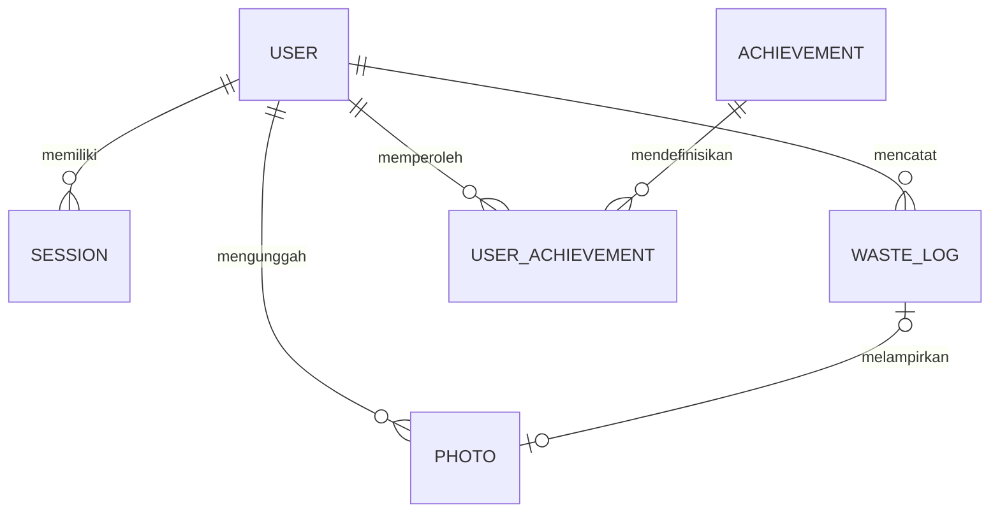

# WasteNot: Data Model dan Kontrak API

Versi rancangan 1.1 · 21 September 2026 · Belum diimplementasikan

Dokumen ini menetapkan kontrak usulan Android dan backend, melengkapi draft endpoint halaman 4 PDF. Aturan domain ada di [PRD.md](PRD.md). Prefix `/v1` merupakan keputusan rancangan. Contoh menggunakan data simulasi, bukan akun atau endpoint nyata.

## 1. Konvensi

- HTTPS untuk lingkungan bersama. Base URL disediakan konfigurasi build; jangan hardcode alamat produksi di composable.
- JSON UTF-8, `snake_case`, UUID sebagai string, timestamp RFC 3339 UTC, tanggal aktivitas `YYYY-MM-DD`.
- Autentikasi `Authorization: Bearer <access_token>`. Server mengambil user dari token, tidak dari body/query.
- Semua endpoint selain register/login/refresh dan health memerlukan autentikasi pada baseline ini.
- Respons sukses memakai `data`; daftar menambah `page`; error memakai `error` dan `request_id`.
- Angka berat disimpan integer gram; jumlah benda integer. Persentase dihitung server dengan presisi penuh dan ditampilkan client sesuai PRD.
- `created_at` dan `updated_at` milik server. `activity_date` milik pengguna dalam batas yang diizinkan.
- Value enum API berbahasa Inggris kapital, label UI berbahasa Indonesia. Enum tidak mengambil nama tampilan sebagai kunci database.
- `Cache-Control: no-store` untuk auth dan respons pribadi di intermediary HTTP. Cache aplikasi yang sengaja dibuat harus terisolasi per user.

## 2. Data model

### 2.1 Entitas

| Entitas | Field dan constraint |
|---|---|
| users | id UUID PK; name varchar(60); normalized_email varchar(254) UNIQUE; password_hash; timezone IANA; created_at, updated_at |
| sessions | id UUID PK; user_id FK; refresh_token_hash UNIQUE; expires_at; revoked_at nullable; created_at |
| waste_logs | id UUID PK; user_id FK; category enum; method enum; quantity_kind enum; weight_g nullable; item_count nullable; activity_date date; activity_timezone; notes varchar(500); photo_id nullable; client_request_id UUID; request_hash; version int; created_at, updated_at; deleted_at nullable |
| waste_guides | id UUID PK; slug UNIQUE; name; category; keywords; recommended_method; summary; steps JSON; cautions JSON; source_url; reviewed_at; publication_status |
| achievements | id UUID PK; code UNIQUE; name; description; requirement_type; requirement_value integer |
| user_achievements | user_id FK + achievement_id FK composite PK; unlocked_at; derived dari catatan aktif |
| photos (opsional) | id UUID PK; user_id FK; object_key UNIQUE; mime_type; size_bytes; status; created_at |

`xp`, `level`, dan `streak` pada entitas User di PDF menjadi field respons turunan pada rancangan ini. Untuk dataset MVP, hitung dari catatan aktif agar edit/hapus tidak membuat cache progres salah. Jangan menyimpan versi kedua tanpa strategi invalidasi. `user_achievements` hanya perlu disimpan jika fitur achievement diaktifkan dan timestamp unlock dibutuhkan.

### 2.2 Enum

```text
category: ORGANIC | PLASTIC | PAPER | GLASS | METAL | ELECTRONIC | OTHER
method: REDUCE | REUSE | RECYCLE | TRASH
quantity_kind: WEIGHT | COUNT
publication_status: DRAFT | PUBLISHED | ARCHIVED
requirement_type: ACTIVE_LOG_COUNT | RECYCLE_LOG_COUNT | BEST_STREAK
```

### 2.3 Constraint database

Contoh SQL berikut menunjukkan constraint yang harus ada; bukan migrasi produksi lengkap.

```sql
CHECK (
  (quantity_kind = 'WEIGHT'
    AND weight_g IS NOT NULL AND weight_g BETWEEN 1 AND 100000
    AND item_count IS NULL)
  OR
  (quantity_kind = 'COUNT'
    AND item_count IS NOT NULL AND item_count BETWEEN 1 AND 10000
    AND weight_g IS NULL)
);
UNIQUE (user_id, client_request_id);
CHECK (version >= 1);
```

Gunakan NOT NULL untuk user_id, category, method, quantity_kind, activity_date, activity_timezone, client_request_id, request_hash, version, created_at, updated_at. Validasi enum di DB. Index aktif untuk `(user_id, activity_date DESC, id DESC) WHERE deleted_at IS NULL`, index filter kategori/metode ditambahkan bila query plan menunjukkan kebutuhan. Soft-delete mempertahankan identitas request agar replay create setelah delete tidak membuat aktivitas baru; hard-delete/retensi diputuskan terpisah.

Seluruh query objek pribadi mencantumkan `user_id = authenticated_user`. UUID yang sulit ditebak bukan kontrol akses. Object storage tidak boleh memakai public bucket.

### 2.4 Relasi



Satu photo_id maksimal terkait satu log aktif dan harus milik user yang sama. WasteGuide tidak memiliki relasi kepemilikan pribadi; hanya record PUBLISHED yang dapat dibaca pengguna.

## 3. Daftar endpoint

| Method | Endpoint | Tujuan | Status |
|---|---|---|---|
| POST | /v1/auth/register | Buat akun + sesi | Dari PDF, diperinci |
| POST | /v1/auth/login | Buat sesi | Dari PDF |
| POST | /v1/auth/refresh | Rotasi refresh token | Tambahan rancangan |
| POST | /v1/auth/logout | Cabut sesi sekarang | Tambahan rancangan |
| GET | /v1/me | Profil dan progres | Dari PDF |
| GET | /v1/dashboard | Ringkasan hari ini dan 3 aktivitas terbaru | Tambahan rancangan |
| GET | /v1/metadata | Kategori, metode, batas validasi, capability | Tambahan rancangan |
| GET | /v1/waste-logs | Riwayat, filter, pagination | Dari PDF |
| POST | /v1/waste-logs | Tambah catatan | Dari PDF |
| GET | /v1/waste-logs/{id} | Detail milik sendiri | Dari PDF |
| PATCH | /v1/waste-logs/{id} | Koreksi catatan | Memperjelas CRUD PDF |
| DELETE | /v1/waste-logs/{id} | Hapus catatan | Memperjelas CRUD PDF |
| GET | /v1/waste-guide | Daftar/pencarian | Dari PDF |
| GET | /v1/waste-guide/{id} | Detail artikel | Tambahan rancangan |
| GET | /v1/statistics | Ringkasan, seri harian, kategori, metode | Dari PDF |
| GET | /v1/achievements | Achievement dan progres | Dari PDF, fitur opsional |
| POST | /v1/photos | Upload multipart gambar privat | Opsional |
| DELETE | /v1/photos/{id} | Hapus lampiran belum terpakai | Opsional |
| GET | /health/live | Proses hidup | Operasional |
| GET | /health/ready | Aplikasi dan DB siap | Operasional, jangan bocorkan detail |

Tidak ada endpoint Maps dalam baseline. Saat opsi peta dipilih, tentukan provider/list lokasi terverifikasi dan kontraknya tersendiri. Tidak ada alamat dummy yang disajikan sebagai data fasilitas sungguhan.

## 4. Autentikasi dan profil

### Register

```http
POST /v1/auth/register
Content-Type: application/json
```

```json
{
  "name": "Pengguna Demo",
  "email": "demo@example.com",
  "password": "contoh-kata-sandi-panjang",
  "timezone": "Asia/Jakarta"
}
```

201 menghasilkan `user`, `access_token`, `access_expires_at`, `refresh_token`, `refresh_expires_at`, dan `session_id` di dalam `data`. Login memakai email/password dan menghasilkan payload sesi yang sama dengan 200. Contoh credential ini untuk format dokumentasi, jangan membuat akun seed dengan password tersebut.

Default usulan: access token 15 menit dan refresh session 7 hari. Nilai dipin di konfigurasi backend, bukan fakta dari PDF. JWT berisi `sub`, `sid`, `iat`, `exp`, issuer, audience. Verifikasi algoritma yang diizinkan, tanda tangan, issuer/audience, expiry, dan sesi yang belum dicabut. Refresh token opaque acak kriptografis; hanya hash token disimpan server.

Refresh menerima refresh_token, mencabut token lama, dan menerbitkan pasangan baru secara atomik. Aplikasi menserialisasi refresh agar beberapa request 401 tidak memicu rotasi bersamaan. Kegagalan rotasi yang hasilnya tidak diketahui meminta login ulang; jangan mengulangi refresh tanpa batas. Logout terautentikasi mencabut session_id yang ada pada JWT, menghasilkan 204 dan idempoten. Setelah logout gagal jaringan, client tetap menghapus rahasia lokal serta menyatakan sesi perangkat telah dihapus; sesi server belum boleh diklaim dicabut. Batas expiry tetap berlaku.

### GET /me

```json
{
  "data": {
    "id": "00000000-0000-4000-8000-000000000001",
    "name": "Pengguna Demo",
    "email": "demo@example.com",
    "timezone": "Asia/Jakarta",
    "progress": {
      "active_log_count": 5,
      "xp": 50,
      "level": 1,
      "xp_into_level": 50,
      "xp_to_next_level": 50,
      "current_streak": 2,
      "best_streak": 2,
      "has_logged_today": true
    }
  }
}
```

Password hash tidak pernah dikirim. Bila streak belum diaktifkan, field streak boleh null dan UI menyembunyikan bagian tersebut, bukan menunjukkan nol seolah sudah dihitung. Metadata mengirim capability boolean seperti `achievements`, `reminders`, `photos`, `recycling_points` untuk menyelaraskan opsi yang sudah diimplementasikan; jangan menjadikan flag sebagai pengganti authorization.

## 5. Catatan aktivitas

### Create

```json
{
  "client_request_id": "00000000-0000-4000-8000-000000000011",
  "category": "PLASTIC",
  "method": "RECYCLE",
  "quantity_kind": "WEIGHT",
  "weight_g": 250,
  "item_count": null,
  "activity_date": "2026-09-21",
  "notes": "Contoh data simulasi.",
  "photo_id": null
}
```

Server menetapkan timezone dari akun. 201 mengirim seluruh WasteLog termasuk id, activity_timezone, version=1, timestamp server, dan `progress` terbaru. Untuk COUNT kirim weight_g=null dan item_count integer. Field berlebih seperti user_id/xp/created_at ditolak, bukan dipakai.

### Idempotensi dan timeout

Android membuat `client_request_id` satu kali ketika draf baru disiapkan, menyimpannya bersama draf nonrahasia. Tombol simpan disabled ketika request aktif. Server melakukan insert dan pemeriksaan uniqueness dalam transaksi.

| Keadaan | Hasil |
|---|---|
| ID belum pernah diterima user ini | Simpan satu log, 201 |
| ID sama + payload kanonik sama | Kembalikan log yang sama, 200; tidak menambah XP |
| ID sama + payload berbeda | 409 IDEMPOTENCY_CONFLICT; jangan menimpa |
| ID sama tetapi log sudah dihapus | 410 LOG_DELETED; jangan menghidupkan ulang |
| Server commit tetapi respons hilang | Retry payload yang sama dengan ID yang sama |

Client tidak boleh mengedit lalu mengirim payload baru memakai ID request yang hasilnya belum diketahui. Resolve dulu dengan retry payload awal; setelah objek ditemukan, buka edit. Jika pengguna ingin aktivitas lain, mulai draf baru dengan ID baru. Uniqueness `(user_id, client_request_id)` tetap terjaga terhadap request paralel.

### List/filter

```http
GET /v1/waste-logs?category=PLASTIC&method=RECYCLE&from=2026-09-15&to=2026-09-21&limit=20
```

Kategori dan metode masing-masing satu nilai atau tidak disertakan. Filter AND, tanggal inklusif. `limit` default 20, maksimum 100. Cursor opaque memuat posisi `(activity_date,id)` dan terikat pada filter serta user; cursor bukan offset. Urutan `activity_date DESC, id DESC`. Saat filter berubah, reset cursor dan daftar. Pull-to-refresh memulai halaman pertama; client deduplikasi berdasarkan id saat pagination karena data dapat berubah.

```json
{
  "data": [],
  "page": {"next_cursor": null, "has_more": false}
}
```

Daftar kosong adalah 200. Kegagalan halaman berikutnya mempertahankan halaman sebelumnya dengan retry di bagian bawah.

### Read/update/delete

GET id sukses 200; objek hilang, dihapus, atau milik akun lain sama-sama 404. PATCH menerima field mutable dan `version` saat dibaca. Field yang tidak disertakan tidak berubah; `notes: null` berarti kosong; immutable field ditolak. Setelah penggabungan, lakukan validasi XOR weight/count yang sama seperti create.

activity_date lama yang tidak berubah boleh dipertahankan di luar jendela create. Tanggal baru pada PATCH harus berada antara hari ini dan 30 hari sebelumnya dalam timezone akun. Nilai notes null dinormalisasi ke string kosong sebelum disimpan.

```json
{"version": 1, "weight_g": 300, "notes": "Berat diperbaiki."}
```

Update memakai conditional query `WHERE id=? AND user_id=? AND version=? AND deleted_at IS NULL`, menaikkan version. 409 VERSION_CONFLICT mengharuskan UI memuat versi terbaru sebelum menerapkan ulang perubahan, dengan draf pengguna tetap tersedia. Jangan auto-merge berat/metode.

DELETE memakai header `If-Match: "<version>"`; missing header → 428 PRECONDITION_REQUIRED. Ketidakcocokan → 409 VERSION_CONFLICT. Delete berhasil → 204, `deleted_at` terisi, version bertambah. Replay delete atas objek milik sendiri yang sudah dihapus → 204; objek akun lain → 404. Semua agregat mengecualikan deleted_at.

## 6. Dashboard dan statistik

GET dashboard mengambil tanggal hari ini menurut timezone akun, bukan parameter client. Respons meliputi `date`, `timezone`, `summary`, `recent_logs` maksimal 3, dan `progress` sepanjang waktu. Summary memakai kontrak agregat yang sama dengan statistics.

```http
GET /v1/statistics?from=2026-09-15&to=2026-09-21
```

```json
{
  "data": {
    "from": "2026-09-15",
    "to": "2026-09-21",
    "timezone": "Asia/Jakarta",
    "summary": {
      "total_handled_weight_g": 1400,
      "total_handled_count": 0,
      "avoided_weight_g": 0,
      "avoided_count": 2,
      "activity_count": 5,
      "handled_activity_count": 4,
      "recycled_activity_count": 2,
      "recycling_rate_percent": 50.0,
      "recycling_rate_basis": "HANDLED_ACTIVITY_COUNT"
    },
    "method_counts": {"REDUCE": 1, "REUSE": 1, "RECYCLE": 2, "TRASH": 1},
    "daily": [
      {"date": "2026-09-15", "handled_weight_g": 0, "handled_count": 0, "activity_count": 0},
      {"date": "2026-09-16", "handled_weight_g": 0, "handled_count": 0, "activity_count": 0},
      {"date": "2026-09-17", "handled_weight_g": 0, "handled_count": 0, "activity_count": 0},
      {"date": "2026-09-18", "handled_weight_g": 0, "handled_count": 0, "activity_count": 0},
      {"date": "2026-09-19", "handled_weight_g": 0, "handled_count": 0, "activity_count": 0},
      {"date": "2026-09-20", "handled_weight_g": 750, "handled_count": 0, "activity_count": 2},
      {"date": "2026-09-21", "handled_weight_g": 650, "handled_count": 0, "activity_count": 3}
    ],
    "categories": [
      {"category": "ORGANIC", "handled_weight_g": 600, "handled_count": 0},
      {"category": "PLASTIC", "handled_weight_g": 250, "handled_count": 0},
      {"category": "PAPER", "handled_weight_g": 150, "handled_count": 0},
      {"category": "GLASS", "handled_weight_g": 400, "handled_count": 0},
      {"category": "METAL", "handled_weight_g": 0, "handled_count": 0},
      {"category": "ELECTRONIC", "handled_weight_g": 0, "handled_count": 0},
      {"category": "OTHER", "handled_weight_g": 0, "handled_count": 0}
    ]
  }
}
```

Hari tanpa aktivitas tetap dikirim nol. Data kosong mengirim array kategori dan hari dengan nol, recycling_rate_percent=null. Filter tanggal invalid atau >366 hari → 422. API tidak mengirim CO2 saved, nilai uang, atau berat hasil perkiraan benda. UI memberi nama metrik dan basis; chart selalu memiliki ringkasan teks/tabel.

## 7. Panduan, achievement, dan foto

GET waste-guide menerima `q` maksimum 100 karakter, kategori opsional, limit/cursor. Query di-trim; string kosong berarti daftar. Cari nama dan keywords tanpa membedakan kapital. Backend memakai parameterized query, bukan merangkai SQL dari q.

Detail panduan mengirim id, name, category, recommended_method, summary, steps[], cautions[], source_url, reviewed_at. `reviewed_at` tidak boleh difabrikasi. Data PUBLISHED harus lolos pemeriksaan editorial; draft contoh di HTML tidak otomatis menjadi seed.

GET achievements mengirim id, title, description, current_value, target_value, is_unlocked, unlocked_at. Nilai progres dicap untuk tampilan, tetapi hitungan asli tidak dibuang. Semantik threshold dan koreksi mengikuti PRD §10.

Foto opsional diunggah dengan multipart langsung ke backend untuk MVP, bukan membuat protokol upload kompleks. Backend memeriksa byte signature, MIME, ukuran ≤5 MiB, dimensi/decompression limit, kepemilikan, menghapus metadata EXIF sensitif, lalu menyimpan ke bucket privat. Respons photo_id dan preview URL berumur pendek. Log hanya menerima photo_id, bukan URL sewenang-wenang. URL bertanda tangan diperoleh hanya setelah otorisasi; log tidak mencatat URL utuh.

Unggahan yang belum terhubung ke log dibersihkan setelah 24 jam (usulan retensi sementara). Jika penyimpanan log gagal, pengguna boleh mencoba kembali memakai photo_id yang sama selama masih valid. Foto yang terhubung ke log dihapus mengikuti kebijakan retensi log; akses pengguna langsung ditolak setelah log dihapus. Jangan menyatakan file telah terhapus permanen jika masih ada di backup.

## 8. Error contract

```json
{
  "error": {
    "code": "VALIDATION_ERROR",
    "message": "Periksa kembali isianmu.",
    "fields": {"weight_g": "Berat minimal 1 gram."}
  },
  "request_id": "example-request-id"
}
```

| HTTP | Code | Perilaku Android |
|---|---|---|
| 400 | INVALID_REQUEST | Pesan terarah, jangan retry otomatis |
| 401 | UNAUTHENTICATED / SESSION_EXPIRED | Refresh sekali; login bila gagal |
| 404 | NOT_FOUND | Kembali ke daftar; tidak membocorkan pemilik lain |
| 409 | EMAIL_EXISTS | Sorot email registrasi |
| 409 | VERSION_CONFLICT | D04, pertahankan draf, tawarkan muat versi baru |
| 409 | IDEMPOTENCY_CONFLICT | Resolve catatan awal sebelum membuat draf baru |
| 410 | LOG_DELETED | Informasikan catatan replay telah dihapus |
| 413 | FILE_TOO_LARGE | Pilih foto lain atau lanjut tanpa foto |
| 415 | UNSUPPORTED_MEDIA_TYPE | Pilih format yang diizinkan |
| 422 | VALIDATION_ERROR | Error inline per field, fokus error pertama |
| 428 | PRECONDITION_REQUIRED | Ambil versi objek sebelum hapus |
| 429 | RATE_LIMITED | Hormati Retry-After; jangan retry loop |
| 500/503 | INTERNAL_ERROR / UNAVAILABLE | Pesan generik + retry; request_id untuk diagnosis |

Tidak ada stack trace, SQL, token, email pemilik lain, atau path internal pada respons error. Network timeout bukan bukti transaksi gagal; create wajib menggunakan mekanisme idempotensi.

## 9. Transaksi, keamanan, dan kontrak pengujian

Create, uniqueness request, dan perubahan derived achievement dilakukan dalam transaksi yang menjaga satu hasil domain. Untuk MVP XP/statistik dihitung langsung dari log aktif. Endpoint summary menggunakan snapshot transaksi konsisten jika menggabungkan beberapa query. Validasi server tetap wajib meski client sudah memvalidasi.

Password disimpan dengan Argon2id melalui library yang terpelihara; simpan parameter dan salt bersama hash, jangan membuat fungsi hashing sendiri. Pilihan ini mengacu pada [OWASP Password Storage Cheat Sheet](https://cheatsheetseries.owasp.org/cheatsheets/Password_Storage_Cheat_Sheet.html). Rate limit auth per IP dan identitas ternormalisasi, tanpa mengunci permanen pengguna lewat serangan pihak lain; nilai limit disepakati setelah pengujian.

Kasus wajib: user A tidak dapat membaca/mengubah/menghapus log user B; integer batas bawah/atas; XOR unit; semua enum invalid; hanya Reduce; tidak ada catatan; campuran unit; request create paralel dengan ID sama; version conflict; replay setelah delete; token expired/revoked; tanggal sekitar pergantian hari. Test penerimaan bersama Android/backend menggunakan dataset PRD §9.4.
