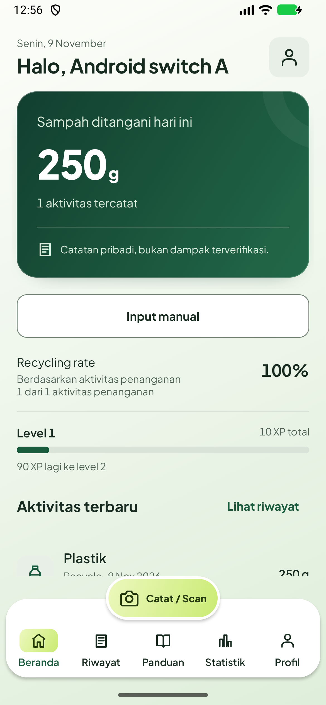
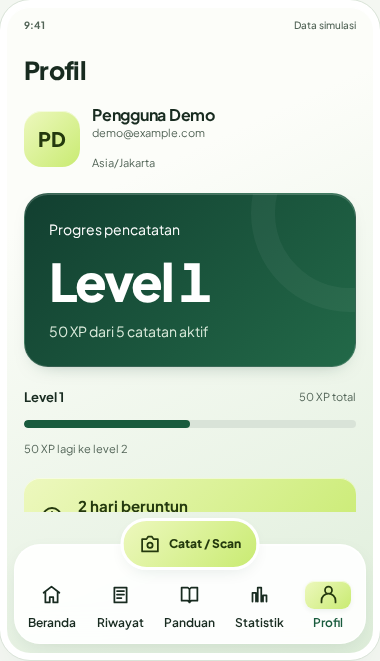
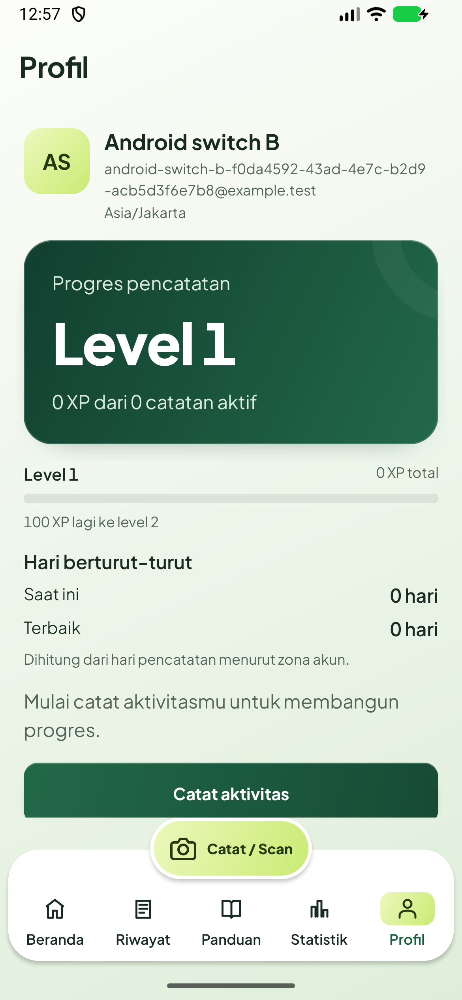

# Isolasi akun pada API publik dan navigasi Android

9 November 2026, checkpoint A36/#70 untuk AT-16/AT-17. Dua metode native memakai backend HTTPS nyata pada API37, 390×844 dp/font100% dan tema terang. Source aplikasi tetap sama dengan main `f98dcf2`; perubahan hanya pengujian, catatan dan pembaruan lokasi referensi AGENTS.md setelah folder checkout utama berganti nama.

## Bukti transport

`RemoteAccountIsolationTest` membuat dua akun melalui API publik. Akun A memiliki satu catatan Plastik/Recycle 250 g; akun B memiliki dua benda Reduce. Replay request A mempertahankan satu record dan 10 XP. Enam operasi silang, GET/PATCH/DELETE A→B dan B→A, semuanya menerima 404/NOT_FOUND dengan request ID. Pembacaan pemilik sesudahnya memverifikasi record/version, daftar, jumlah dan XP tidak berubah.

Edit milik A menjadi 300 g memperbarui total tanpa XP tambahan. Menghapusnya mengembalikan total/XP A ke nol sementara catatan/progres B tetap ada. Logout mencabut credential lama; `/me` dengan credential itu ditolak, lalu login ulang memulihkan identitas dan data A sendiri. Token pada pengujian transport ditahan dalam memori; ini bukan pengujian dua akun simultan dalam Keystore. [Log](account-isolation/phase1/transport.log), [lima langkah dan enam denial](account-isolation/phase1/transport-evidence.json).

## Bukti navigasi dan draf

`RemoteAccountSwitchNavigationTest` membuka MainActivity dan AppContainer sebenarnya, menggunakan sesi HTTP dan Keystore aplikasi. Akun A dibuat melalui UI dan menyimpan 250 g/10 XP. A mengubah filter Riwayat, rentang Statistik ke 30 hari, pencarian Panduan dan draf lokal.

Sesi nyata diakhiri melalui SessionRepository saat editor masih terbuka untuk menguji batas reautentikasi. Keystore menjadi kosong dan private root ditutup. Akun B dibuat melalui UI: Beranda/Riwayat kosong, 0 XP, filter/pencarian awal dan rentang 7 hari. B memiliki draf sendiri dengan request ID berbeda. Login A memulihkan draf A dan record A; login B memulihkan draf B. Keluar melalui dialog UI dan recreate Activity tetap membuka form Masuk.

Draf A **dibuang melalui D03 sebelum D02**. Pemeriksaan logout membuktikan draf B tetap tersedia, bukan penghapusan draf A yang masih berisi saat tombol Keluar ditekan. Skenario penghentian sesi dari repository juga tidak diklaim sebagai klik D02 atau simulasi token kedaluwarsa. [Enam langkah UI](account-isolation/final/navigation-evidence.json), [log final](account-isolation/final/navigation.log).

## Eksekusi dan pemulihan alat

| Tahap | Hasil aktual |
|---|---|
| 1, APK penguji `fa989749` | Transport lulus. Navigasi mencapai create A, lalu guard gambar menolak overlay ANR milik System UI. Akun sementara dibersihkan. Driver juga menemukan berkas bukti UI belum ada dan gagal parse; hasil asli disimpan. |
| 2, APK identik | Navigasi/fungsi lulus setelah pemulihan System UI. Gambar Statistik masih memuat frame loading sehingga tidak diterima sebagai bukti frame kosong. |
| Final, APK penguji `8d11d598` | Cara capture memaksa pengambilan frame baru, memberi waktu compositor dan memeriksa state terlihat sebelum/sesudah capture. Navigasi lulus; sembilan frame ditinjau, termasuk Statistik kosong yang benar. Label langkah logout diperjelas. |

Total **empat eksekusi dari dua metode unik: tiga lulus, satu gagal guard sistem**. Transport yang sudah lulus tidak diulang. Kedua APK penguji dipin; APK aplikasi debug tetap `6861ba45`. [Rekonsiliasi](account-isolation/reconciliation.json), [hasil awal](account-isolation/phase1/native-result.json), [hasil tahap 2](account-isolation/phase2/native-result.json), [hasil final](account-isolation/final/native-result.json), [manifest final](account-isolation/final/build-manifest.json), [build awal](account-isolation/native-build.log) dan [build capture](account-isolation/final/native-build.log).

[Dialog System UI](account-isolation/boot-systemui-anr.png), [hierarki dialog](account-isolation/boot-systemui-anr-current.xml) dan [intervensi](account-isolation/boot-intervention-current.json) disimpan. Pemilihan Wait dibatasi dialog System UI yang diamati; percobaan pertama belum memulihkan dialog setelah ukuran layar dipulihkan driver. Bounds diperiksa ulang sebelum Wait berikutnya berhasil. Tidak ada dialog error WasteNot ditutup untuk menerima pengujian.

## Perbandingan tampilan dan perpindahan akun

Referensi kit tetap memakai gambar historis; angka, identitas, capability dan ukuran kanvas berbeda. Perbandingan berikut memeriksa hierarki hero/avatar, palette, progress dan dock lima tujuan. Ini bukan pengukuran raster seluruh token atau penerimaan seluruh tema/ukuran.

| Referensi kit | Aplikasi dengan akun nyata |
|---|---|
|  |  |
|  |  |

| Setelah pergantian akun | Bukti frame akhir |
|---|---|
| B tidak membawa total A | [Beranda B](account-isolation/captures/b-home-empty.png) |
| B tidak membawa filter/catatan A | [Riwayat B](account-isolation/captures/b-history-without-a-filter.png) |
| B memakai 7 hari dan periode kosong | [Statistik B](account-isolation/captures/b-statistics-default-range.png) |
| Draf A sebelum sesi berakhir | [Editor A](account-isolation/captures/a-draft-before-session-end.png) |
| Draf A pulih hanya untuk A | [A kembali](account-isolation/captures/a-own-draft-restored.png) |
| Draf B pulih hanya untuk B | [B kembali](account-isolation/captures/b-own-draft-restored.png) |
| Keluar lalu recreate tidak memulihkan private root | [Masuk](account-isolation/captures/signed-out-root-after-recreate.png) |

[Sembilan hash PNG akhir](account-isolation/capture-manifest.json) diverifikasi terhadap berkas asli. [Frame Statistik tahap 2](account-isolation/statistics-frame-before.png) dipertahankan sebagai alasan koreksi capture. Email QA panjang tetap membungkus pada Profil; state kosong menampilkan CTA, dan draf milik masing-masing terbaca. Bagian konten yang masih di bawah scroll/keyboard tidak dianggap sudah ditinjau dari viewport ini.

## Backend, APK dan pembersihan

Backend aktif `wastenot-backend:dc127354b7652c5e12bc2543838daa74d0fce443`, image digest dicatat pada [identitas container](account-isolation/backend-image.txt). [Challenge metadata publik](account-isolation/backend-release.json) mengembalikan 401 dan request ID; respons itu tidak membawa header release, sehingga identitas build tidak disimpulkan dari header tersebut.

Tujuh akun sementara pada tiga run dibatasi email/nama/UUID milik rencana. Setiap tahap berakhir dengan **users/sessions/logs nol**, termasuk percobaan yang gagal. Hitungan sebelum/sesudah ada dalam ketiga hasil native. Tidak ada seed permanen, perubahan layanan backend atau pemanggilan AI pada batch ini. Ukuran/density/font/night dipulihkan dan emulator task dihentikan.

Rilis main `f98dcf2` telah lulus CI `42515739877` dan pipeline rilis `42515739911`; upload GitHub terkena kuota, sedangkan deployment VM lulus. APK publik [1.0.0-b9](https://oktaavsm.bccdev.id/wastenot/apk/wastenot-v1.0.0-b9.apk) berhasil diunduh, **36.408.119 byte**, SHA-256 `be4aaeb048936ab1c91dd2749f4ebef1f16737f7d6a771d6cd1815cc973584fb`. [Pemeriksaan unduhan](account-isolation/public-release-check.json), [metadata publik](account-isolation/public-versions.json), [signature](account-isolation/public-signature.log). Gate API30/font/OFL/manifest serta sumber/DEX tanpa adapter contoh lulus untuk APK publik. Bukti runtime di atas memakai APK debug native dengan source produksi sama; tidak diklaim sebagai instalasi rilis bertanda tangan pada perangkat ini.

Self-review mengikuti code-reviewer: guard opt-in, akun nyata/ownership, pembatalan/cleanup, rahasia dalam bukti, scope Keystore, paket dan ketepatan frame diperiksa. A36 tetap **In progress**: seluruh AT-01–26, dataset PRD lengkap, pergantian hari, cakupan font/TalkBack/performa dan regresi AI akhir belum ditutup oleh dua metode ini. Permintaan berikutnya untuk urutan pilihan objek S22 dilacak di A42/#81.
