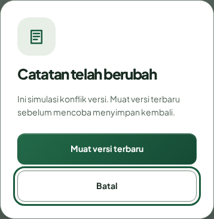
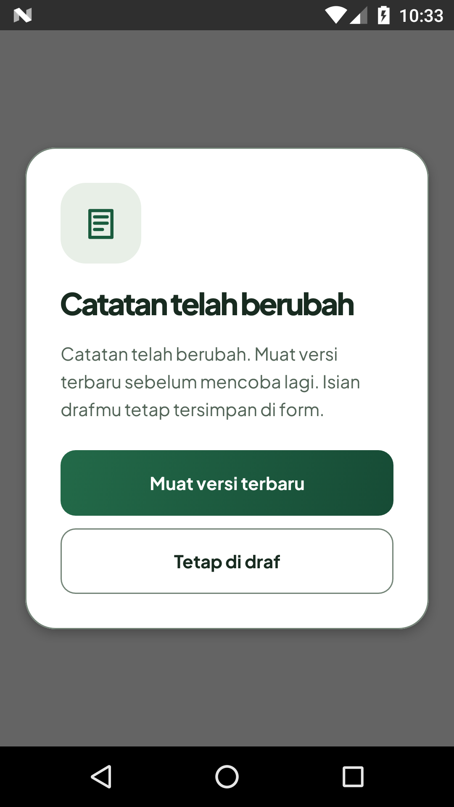
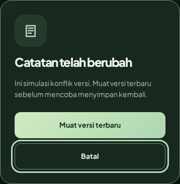
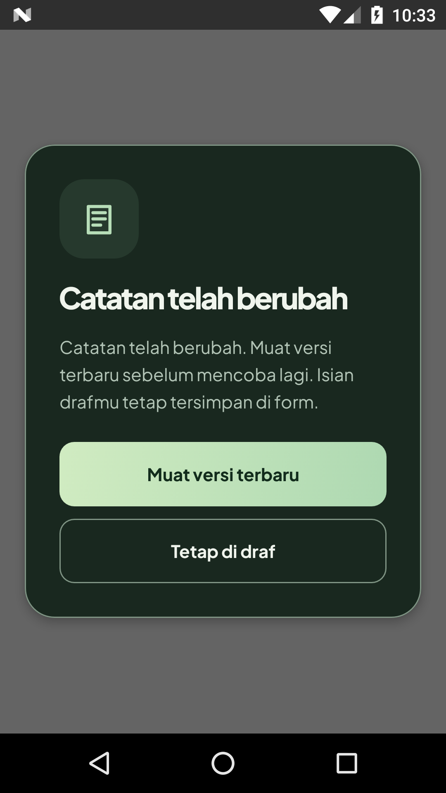

# Konflik edit dan dialog C27

23 Oktober 2026. Checkpoint S09/D04, dengan penyelarasan visual C27 pada dialog konflik dan hapus. Penerimaan seluruh UI tetap mengikuti [matriks Iteration 2](../../tasks/ITERATION_2_DESIGN.md). [Manifest](conflict-checkpoint.json) mengikat source, APK aplikasi/penguji, kasus native, PNG dan sumber kit.

## Perbandingan dengan kit

| Tema | Dialog konflik kit v1.3 | Android |
|---|---|---|
| Terang |  |  |
| Gelap |  |  |

HTML dirender dari kit yang diminta, dengan font lokal. Referensi memakai viewport 390 px; Android memakai layar 1080 px/densitas 480 atau 360 dp. Platform Android memberikan lebar dialog berbeda. Ini perbandingan komposisi dan token, bukan klaim semua pixel identik. Teks simulasi dan tombol Batal pada katalog diganti dengan penjelasan produk dan Tetap di draf sesuai SCREEN_SPEC D04.

Judul memakai Plus Jakarta Sans 24 sp/800 dan tracking −1,3 sp; body 14 sp. Bidang ikon 64 dp/radius 20 dengan ikon 30 dp, modal radius 24, padding 28, outline tema dan elevasi 6 mengikuti render C27. Tombol memakai komponen aksi aplikasi serta pasangan outlined dengan label ink; tinggi minimum 52 dp. Dialog hapus memakai ukuran yang sama. Konten panjang dapat digulir, termasuk catatan hingga batas form; teks pengguna tidak diperkecil agar muat.

| Bagian | Screenshot native |
|---|---|
| Versi terbaru dan draf berbeda | [Perbandingan dua editor](conflict-edit-conflict-compare.png) |
| Pilihan eksplisit setelah pemeriksaan | [Pilihan, tema gelap](conflict-dark-choices.png) |
| Isian draf setelah memakai version baru | [Kembali ke form](conflict-edit-conflict-draft-retained.png) |
| Dialog hapus C27, tema terang/teks normal | [Window aplikasi, dibatalkan tanpa hapus](conflict-delete-dialog-normal.png) |
| Loading / gagal jaringan / catatan hilang | [Loading](conflict-light-1.png), [error](conflict-light-2.png), [tidak tersedia](conflict-light-4.png) |
| 360 dp, teks 200% | [Dialog awal setelah scroll](conflict-light-0-phone200.png), [pilihan setelah scroll](conflict-dark-choices-phone200.png) |
| 600 dp, teks 200% | [Dialog awal](conflict-light-0-wide200.png), [pilihan setelah scroll](conflict-dark-choices-wide200.png) |

Screenshot dialog murni memakai Activity penguji; screenshot perbandingan dan kembali ke form berasal dari perjalanan aplikasi. Dialog hapus terang diperiksa melalui window aplikasi sesudah instrumentasi berhenti, lalu dibatalkan. Posisi scroll berbeda untuk menunjukkan isi atau tombol, bukan semua bagian terlihat bersamaan. Capture awal journey sempat merekam animasi keyboard yang sedang menutup; gambar itu tidak dipakai sebagai pembanding visual utama.

## Perilaku draf dan version

Sebelumnya, edit menerima error form tanpa D04; mengubah field membersihkan error tersebut sehingga pengguna dapat mencoba version lama lagi. Sekarang VERSION_CONFLICT/PRECONDITION_REQUIRED pada catatan berversion membuka D04 dan menahan Simpan sampai versi baru diperiksa. Mengubah field, menutup dialog atau memulihkan state layar tetap mempertahankan konflik dan draf.

Muat versi terbaru hanya membaca. ID respons harus cocok dan version harus lebih tinggi dari baseline editor. Error, respons usang dan catatan hilang mempunyai state tersendiri; tidak ada nilai kosong yang dianggap versi terbaru. Baca yang dibatalkan atau selesai terlambat tidak boleh mengganti hasil editor lain.

Sesudah reload, pengguna dapat memakai **seluruh isian draf** dengan baseline version baru, atau **seluruh isian terbaru**. Tidak ada penggabungan berat/metode per field secara otomatis. Kedua pilihan kembali ke form dan belum menyimpan. Memilih versi terbaru menghasilkan form tanpa perubahan; Simpan tetap disabled hingga isian diubah. Memilih draf mempertahankan kategori, metode, jumlah/satuan, tanggal dan catatan pengguna. Simpan berikutnya memakai version yang sudah ditinjau, sehingga perubahan lain sesudah reload tetap dapat ditolak store.

Tetap di draf membatalkan baca aktif dan mempertahankan isian. Setelah catatan hilang, pengguna dapat kembali ke draf, tetapi tidak ditawarkan pilihan menghidupkan catatan yang telah dihapus. DELETE tetap memakai dialog yang menuntut Muat versi terbaru setelah konflik/precondition; tidak ada hapus ulang otomatis.

## Verifikasi

Build native dan lint lulus; **160 debug unit tests**, nol gagal/error/skip. Delapan unit tests konflik baru mencakup restore/guard, pilihan seluruh isian, versi usang, identitas respons, cancellation yang diabaikan store, missing/retry dan dua editor. Gate API 24, adjustResize, lima bobot font serta lisensi OFL lulus.

| API 24 | Kasus runner | Lulus | Dilewati |
|---|---:|---:|---:|
| 360 dp, teks normal | 18 | 18 | 0 |
| 360 dp, teks 200% | 18 | 18 | 0 |
| 600 dp, teks 200% | 18 | 18 | 0 |

**54 eksekusi native / 18 kasus unik**, aplikasi dan APK penguji identik. Tiga kasus D04 baru memeriksa enam state pada kedua tema, pilihan/cancel/reload, dan journey aktual: buka Plastik 250 g, ubah menjadi 300 g, actor kedua menyimpan Kaca/Trash/2 benda pada v2, edit pertama ditolak, cancel dan koreksi tetap menjaga draf, reload/pilihan belum menulis v2, lalu Simpan eksplisit menghasilkan v3 tanpa menambah lima record. Lima kasus submission, empat detail/hapus dan enam transisi editor menjadi regresi.

Satu run teks 200% terputus ketika proses emulator berhenti dan perangkat hilang dari ADB. Run parsial tidak dihitung. Setelah proses dipastikan terminal dan AVD yang sama dinyalakan lagi, kedua APK yang dibekukan dipasang ulang; run akhir mengulang seluruh 18 kasus. Kandidat sebelum penyelarasan tipografi/ikon juga tidak dijumlahkan ke hasil akhir.

## Gate checkpoint dan batas

- **Hard PASS pada cakupan ini:** tidak ada pilihan yang menyimpan otomatis; state loading/error/missing, reload, dua pilihan, cancel dan guard version dijalankan. Teks 200% tetap memakai scroll dan aksi dapat dicapai. Data berasal dari dummy persisten.
- **Purpose PASS:** ikon history/delete, Pinus–Lime, font, radius, outline dan hierarki mengikuti render C27. Kartu versi hanya mengelompokkan snapshot yang perlu dibandingkan.
- **Liveliness PASS pada cakupan ini:** ENERGY 2 / RHYTHM 2 / MOTION 1; judul menjelaskan konflik dan tindakan utama menjelaskan langkah berikutnya. Tidak ada gerak dekoratif baru.
- **Craft PASS pada konfigurasi tercatat:** screenshot terang/gelap, ponsel/600 dp dan teks normal/200% dibaca. [20 pasangan warna](conflict-contrast.json) memenuhi ambang teks 4,5:1 dan ikon/outline 3:1 masing-masing. Ini perhitungan token, bukan pengukuran pixel seluruh kontrol aplikasi.

Saver membuktikan pemulihan state layar, bukan persistensi draf ke disk per akun atau process death nyata. PATCH/DELETE HTTP dan respons server belum diintegrasikan; dummy mengikuti kontrak version lokal. Spoken TalkBack, IME/transisi per frame, perangkat fisik/API lebih baru serta penerimaan seluruh screen tetap pekerjaan berikutnya. PR #96 tetap draft.
