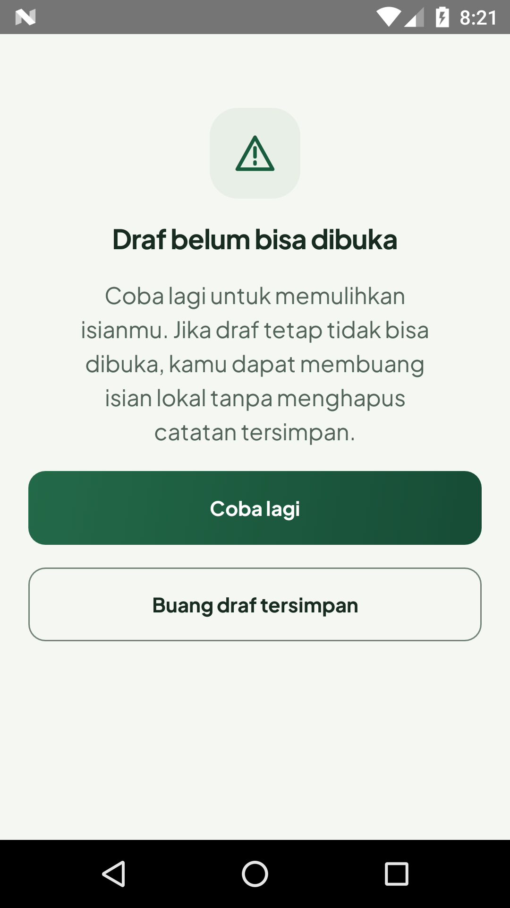
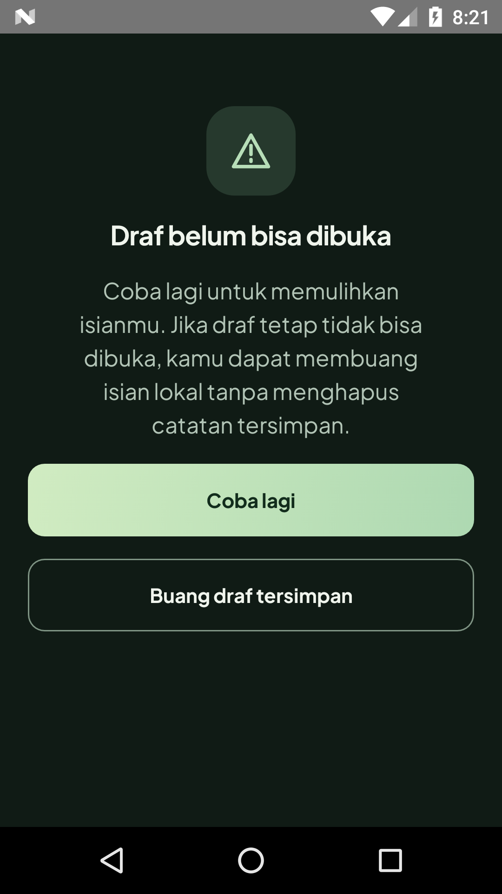
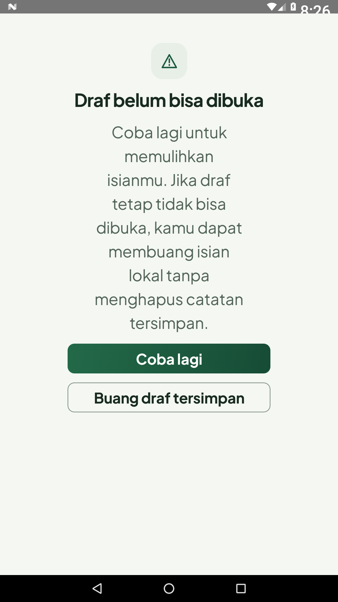
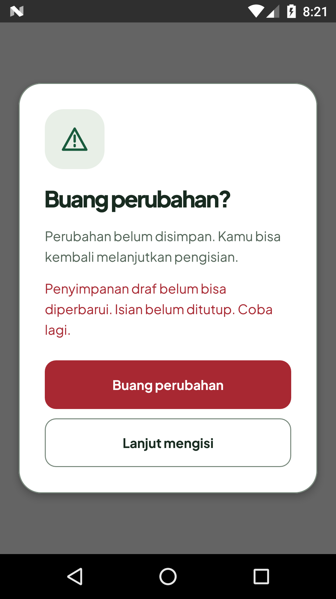

# Draf per akun dan pemulihan proses

24 Oktober 2026. Checkpoint A05/S05/S09/D03 serta C27/C28/C29. [Manifest](draft-checkpoint.json) mengikat source, APK, kasus, PID proses dan screenshot. Seluruh tujuan desain tetap mengikuti [matriks Iteration 2](../../tasks/ITERATION_2_DESIGN.md); PR #96 tetap draft.

## Perubahan dan acuan kit

Sebelumnya isian hanya bertahan melalui state editor/Activity. Sekarang satu draf nonrahasia per akun menyimpan isian asli, nilai awal edit, versi, asal navigasi, prefill dan `client_request_id` di storage internal. Jumlah `0,250` kg serta spasi pada catatan dipertahankan, bukan diganti hasil normalisasi. Snapshot payload sebelum Simpan harus terkonfirmasi di disk sebelum repository menerima write.

C29 pemulihan memakai ikon kit 64/radius 20, ikon 30, judul Plus Jakarta Sans 19/800, teks sekunder, lebar konten maksimum 400 dan body maksimum 270. C03 menjadi retry utama; aksi sekunder minimum 52. D03/C27 memakai panel yang sama dengan [checkpoint dialog](EXIT_DIALOGS.md). Pesan C28 menjelaskan draf lokal atau hasil simpan belum pasti. Aksi tetap eksplisit dan mengikuti ENERGY 2 / RHYTHM 2 / MOTION 1.

| State | Native |
|---|---|
| Draf tidak bisa dibaca, terang |  |
| Draf tidak bisa dibaca, gelap |  |
| Dua aksi pada 600 dp / teks 200% |  |
| Gagal membersihkan draf |  |

[Ponsel teks 200% pada posisi aksi](draft-recovery-actions-phone200.png) dan [retry pembersihan catatan yang sudah tersimpan](draft-confirmed-cleanup-phone200.png). Konten dapat digulir; gambar pada posisi aksi tidak menyatakan heading selalu terlihat bersamaan. Semantics memeriksa overflow heading/label dan ukuran target; PNG diperiksa terpisah. [Beranda/dock sesudah pembersihan draf](draft-home-after-clear.png) memperlihatkan root kembali tanpa mereset lima catatan.

## Kebijakan penyimpanan dan navigasi

- Draf aktif dipulihkan sesudah root mempunyai identitas akun yang cocok. Navigation display baru dipasang setelah tujuan pemulihan ditentukan. Nilai awal edit dan versi ikut kembali, tanpa menyimpan perubahan log otomatis.
- Draft store memakai nama file hash user ID, envelope owner/schema, validasi snapshot dan batas 1 MiB. Password, token dan byte foto tidak disimpan. Write berjalan di IO dan hanya mengumumkan tersimpan setelah commit terkonfirmasi. Jika commit gagal, cache preferences dikembalikan ke nilai sebelumnya dan UI tetap memberi retry.
- Hasil write yang belum pasti tetap mengunci snapshot awal. Tutup formulir menyimpan draf tertunda, lalu Beranda menyediakan Lanjutkan draf. Membuka manual/scan lain meminta melanjutkan draf tersebut agar ID/payload tidak tertimpa.
- Save berhasil, Buang perubahan, Back pada form bersih, atau konfirmasi Keluar membersihkan draf setelah writer sebelumnya selesai. Draf yang sudah ditutup tidak dibangkitkan lagi oleh entry yang sedang fade keluar.
- Kalau catatan sudah tersimpan tetapi pembersihan draf gagal, tombol simpan dinonaktifkan dan retry hanya mengulangi pembersihan lokal. Draf rusak membuka state pemulihan; membuangnya memerlukan konfirmasi dan tidak menghapus catatan tersimpan.
- Keluar memperingatkan penghapusan draf lokal. Root/account ViewModel yang diganti membatalkan pekerjaan akun lama. UI akun B tidak memuat draf A; kembali ke A memulihkan draf A sendiri.

**Pilihan storage saat ini:** adapter SharedPreferences mengikuti adapter lokal dummy yang sudah ada, memakai commit terkonfirmasi dan rollback cache. ARCHITECTURE §5/§8 menargetkan DataStore untuk draf/preferensi; migrasi tersebut masih terbuka. Checkpoint ini tidak mengubah dokumen arsitektur seolah target itu sudah dipenuhi. Isian yang belum memperoleh konfirmasi tersimpan tetap dapat hilang jika proses dihentikan sebelum write selesai.

## Verifikasi native

Build native/lint dan **171 debug unit tests** lulus, nol gagal/error/skip. Gate APK memverifikasi API 24, MainActivity adjustResize, lima font dan OFL. APK aplikasi/penguji identik digunakan pada seluruh pengujian berikut:

| Cakupan API 24 | Lulus | Skip |
|---|---:|---:|
| 360 dp / teks normal | 27 | 0 |
| 360 dp / teks 200% | 27 | 0 |
| 600 dp / teks 200% | 27 | 0 |
| Panduan → editor, jam animasi natural, tiga konfigurasi | 3 | 0 |
| Protokol host prepare/restore untuk create dan edit | 4 | 0 |
| Total: 30 metode test unik | 88 | 0 |

Sebelas kasus draf mencakup Activity recreate, isian mentah, D03 lanjut/buang, clear setelah save, replay permintaan yang sudah committed tanpa duplikasi/XP, Keluar, data rusak, isolasi owner, kegagalan commit nyata yang disimulasikan, state kedua tema, target, serta Back/Escape saat busy. Enam belas regresi lain mencakup transisi editor, akun/profil, root sesi termasuk A → B → A, dan konflik versi. Satu metode Panduan tambahan memeriksa pencarian/Back/prefill tanpa auto-save pada tiga konfigurasi. Source assertions dan store asli melengkapi pemeriksaan render.

Percobaan awal menemukan satu kesalahan pada fixture kegagalan commit: `putString` berantai mengembalikan editor asli sehingga melewati wrapper gagal. Fixture diperbaiki untuk mempertahankan wrapper; assertion kegagalan dan rollback tetap dipertahankan. Run gagal tidak dihitung sebagai bukti final.

### Penghentian proses nyata

Host menjalankan prepare, membuka aplikasi sebagai proses hidup, mencatat PID, memanggil force-stop, memastikan PID hilang, lalu menjalankan restore sebagai proses baru. PID prepare, proses yang benar-benar dihentikan, dan proses restore dicatat terpisah karena runner dapat menutup proses prepare setelah test selesai. Ini bukan klaim bahwa PID prepare selalu menjadi PID yang dihentikan.

- Create: `0,250` kg, metode/kategori, catatan dengan spasi, dan ID permintaan pulih. Lima catatan tetap lima.
- Edit: `0,300` kg dan catatan pulih, ID log/permintaan serta seluruh snapshot sama. Nilai awal/version 1 tetap ada; record belum berubah sebelum Simpan.
- [Create dipulihkan](draft-process-create-restored.png), [edit dipulihkan](draft-process-edit-restored.png), [akun A dipulihkan](draft-account-restored.png). Test membandingkan teks mentah dan snapshot persis; gambar tidak dipakai untuk membuktikan spasi/request ID.

Installed APK dicocokkan SHA-256 byte-nya dengan APK terlindungi sebelum protokol host. [26 pasangan token](draft-contrast.json), termasuk kedua ujung canvas, memenuhi ambang teks 4,5:1 serta ikon/outline 3:1; minimum teks 5,239:1. Ini pengukuran token, bukan audit pixel semua layar atau semua state disabled.

## Gate dan pekerjaan yang masih terbuka

Hard PASS pada cakupan tercatat: recovery, retry/discard/save/keluar, data tidak diam-diam direset, kedua tema, teks besar, target dan aksi aktual diperiksa. Purpose PASS: C29/C28 menjelaskan keadaan penyimpanan; C27 menjaga keputusan; ikon/warna/type berasal dari kit. Liveliness PASS pada cakupan ini: satu aksi utama, hierarki teks, spacing dan tanpa animasi dekoratif. Craft PASS: native render diperiksa terpisah dari semantics, dengan create/edit, kegagalan storage dan regresi navigasi nyata.

Belum membuktikan seluruh aplikasi siap rilis. Migrasi DataStore, rotasi/resize dinamis, background kill oleh tekanan memori, timeout HTTP nyata, respons terlambat server, spoken TalkBack, API 36/perangkat fisik dan audit seluruh screen/navbar tetap terbuka. Root akun juga masih perlu menampilkan hasil logout gagal ketika sesi lokal tidak berhasil dibersihkan. Ini terpisah dari kegagalan membersihkan draf yang sudah ditangani. CI GitHub memeriksa build/lint/unit test; pengujian emulator di atas dijalankan lokal.

Pembaruan 26 Oktober: [checkpoint sesi](SESSION_EXIT.md) menangani kegagalan logout di root akun dan memeriksa ulang draf create/edit setelah force-stop pada APK terbaru. Batas checkpoint historis di atas tetap mengacu pada source yang terikat manifest draf.
