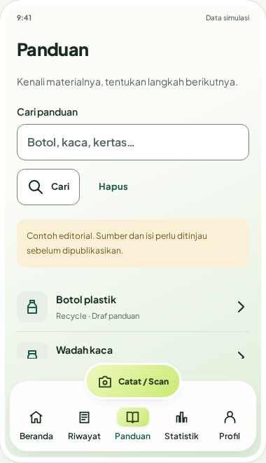
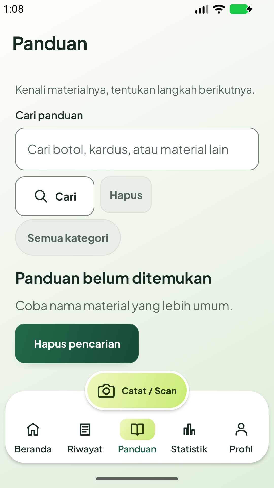
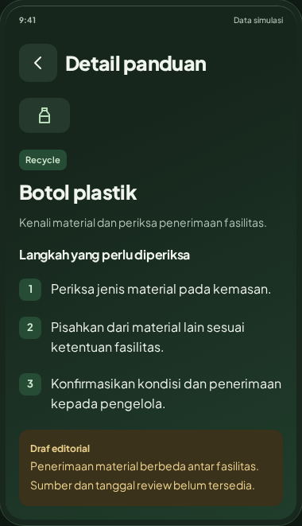
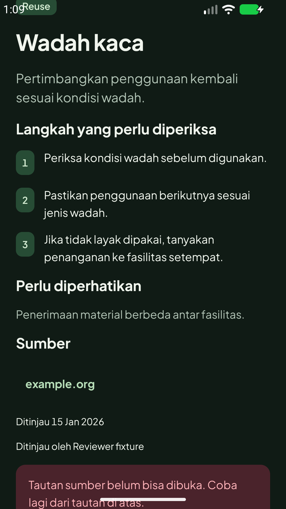

# Panduan melalui API nyata

Checkpoint `codex/android-guide-api`, di atas PR #100. Cakupan S11/S12 adalah binding daftar/detail melalui `waste-guide`; sumber tampilan tetap kit v1.3 dan [matriks seluruh layar](../../tasks/ITERATION_2_DESIGN.md).

RemoteGuideStore sekarang memakai CoreRepository, autentikasi sesi dan error executor yang sama dengan catatan. Pencarian mengirim q yang ditrim, kategori, limit 20 dan cursor opaque. Daftar memerlukan page valid, ID unik, kategori sesuai filter dan status 200. Detail harus cocok dengan ID yang diminta. Error jaringan/HTTP tetap menjadi error; daftar kosong adalah hasil sukses tanpa menggantinya dengan artikel dummy.

GuideDto memeriksa UUID, enum, isi, langkah, HTTPS tanpa credential dan tanggal review. `publication_status`, bila dikirim, wajib PUBLISHED; kontrak core mengizinkan field itu tidak dikirim, dan handler Go memfilter PUBLISHED. Reviewer ditampilkan bila disediakan, tanpa mengarang nama peninjau. Date/source wajib sesuai kontrak. Input 100 karakter dihitung sebagai Unicode code points pada VM, dummy dan remote. Respons 429 menyimpan Retry-After pada VM milik akun: pencarian/detail/retry sebelum deadline tidak mengirim request, pesan meminta pengguna menunggu, dan tidak ada retry loop. Pergantian query/filter tetap membuang cursor lama ketika sedang dibatasi.

## Bukti backend publik

APK memakai minSdk 30, hot reload nonaktif, USE_DUMMY_DATA=false dan HTTPS publik `https://pred-autoscaler.bccdev.id/wastenot/api/v1/`. App SHA256 `d52a3693a4dc181463fceed2be7e431983564184f3678c4769e29af1c58fef99`; test SHA256 `ae1a7eab147c4f89690a0597f4ed9b209badfde67f26963b3871ac7692354bed`. APK membawakan binding ringkasan PR #100 sekaligus Panduan; minimum/font/license diperiksa kembali.

Pada Android 17/API 37, MainActivity/AppContainer sebenarnya lulus satu tes dengan tujuh tahap dan sembilan PNG: daftar akun baru, verifikasi GET katalog terbit kosong dan layar Panduan/Hapus pencarian, tambah catatan, Statistik/Profil, edit satuan tanpa XP tambahan, hapus/agregat nol, dan logout. Tidak menginjeksi sesi/repository fake. Akun fixture diperiksa belum ada, lalu dibersihkan berdasarkan identitas UUID persis; akun, session, refresh token, waste log dan AI operation miliknya berjumlah nol setelah tes. Font/ukuran/density kembali ke kondisi awal.

Katalog umum backend yang diuji berisi **0 artikel PUBLISHED**. Empat panduan AI merupakan katalog terpisah. Karena itu detail artikel umum dari produksi belum dapat dinyatakan lulus. Tidak ada artikel yang diterbitkan atau deployment yang diubah oleh checkpoint ini. Kurasi dan penanggung jawab konten tetap mengikuti PRD §12 dan B11.

## Tampilan dan pemisahan fixture

| Kit | APK / harness |
|---|---|
|  |  |
|  |  |

Kit S11 memakai artikel contoh; APK publik menampilkan keadaan kosong sesuai respons server. Header, field, action, pemilihan kategori, pine/lime dan lima tujuan dock mengikuti komponen yang sama. Frame S12 kanan adalah harness fixture, bukan konten produksi: host example.org, tanggal dan Reviewer fixture memang data uji. Ia memeriksa sumber yang gagal dibuka tanpa menghilangkan artikel, label peninjau, 404 yang tidak menawarkan catat, serta error pencarian/refresh yang mempertahankan data.

GuideStateDesignTest lulus **10 eksekusi dari 5 metode unik**, normal dan font 200%, nol gagal/skip; empat PNG per profil. Metode memakai tema terang/gelap sesuai kasus; ini belum matriks setiap state × setiap tema. Harness tanpa scaffold/inset akun tidak dipakai untuk menerima status/navigation bar; alur MainActivity publik di atas menguji frame aplikasi. Reviewer dan pesan masih terbaca dalam viewport yang telah discroll; penerimaan seluruh scroll/IME/ukuran perangkat tetap terbuka.

## Pengujian dan batas

212 debug unit tests dan lint lulus. Delapan kasus RemoteGuideStore menguji URL/header/filter/cursor, metadata review, kosong/NOT_CONFIGURED, input invalid tanpa request, artikel malformed/DRAFT/ARCHIVED, halaman/ID/filter rusak, status detail dan error HTTP. Tambahan VM memeriksa batas Unicode dan Retry-After, termasuk cursor lama pada query baru serta pemisahan owner. Kasus prefill/race/cancel/detail yang sudah ada tetap lulus; fixture tidak membuat catatan otomatis.

Pengambilan gambar memeriksa active window aplikasi agar dialog ANR sistem tidak dianggap bukti UI. Bootstrap emulator sempat gagal sebelum APK baru dipasang karena XML eksternal belum tersedia serta ANR launcher/System UI saat host mengalami tekanan memori/I/O. Log awal disimpan terpisah; compiler milik agen yang sudah idle ditutup dan dialog sistem dipulihkan melalui kontrol yang terlihat. Tidak ada perubahan logika aplikasi, penonaktifan ANR, atau penurunan versi Android untuk meloloskan tes. Hasil final dan hash seluruh berkas ada pada [manifest](guide-api-checkpoint.json).

ENERGY 2 / RHYTHM 2 / MOTION 1 mengikuti kit. Data server, sumber, peninjau dan error tetap apa adanya. **Gate global belum selesai**: artikel produksi terkurasi, detail/prefill positif dengan artikel terbit, spoken TalkBack, perangkat fisik, seluruh inset/IME/state/transisi dan integrasi AI masih terbuka. Default adapter source tetap dummy; APK remote checkpoint disediakan terpisah.
