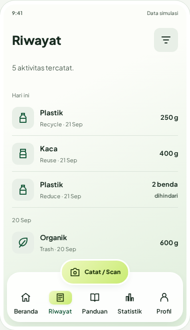
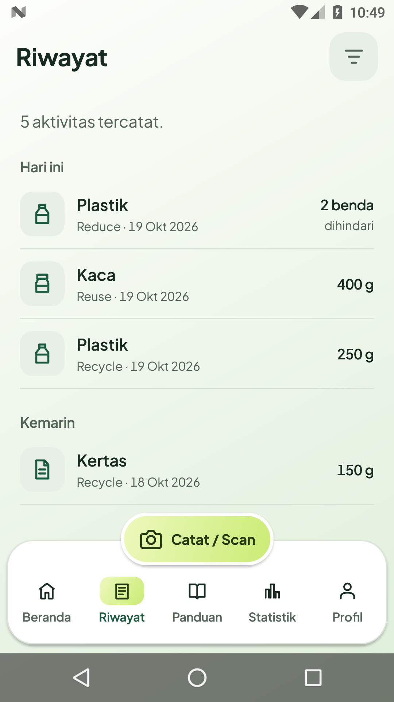
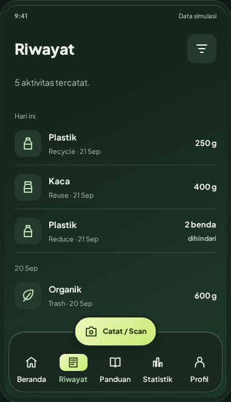
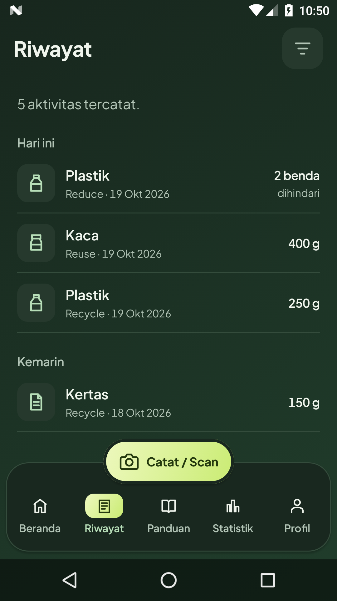
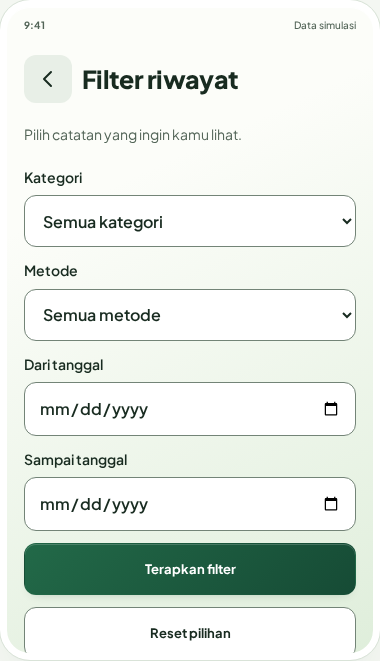
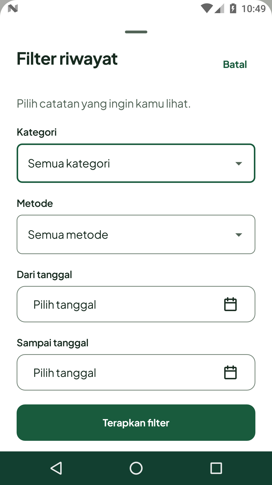
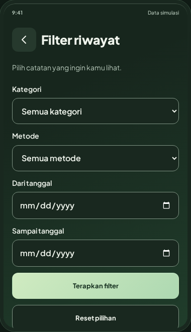
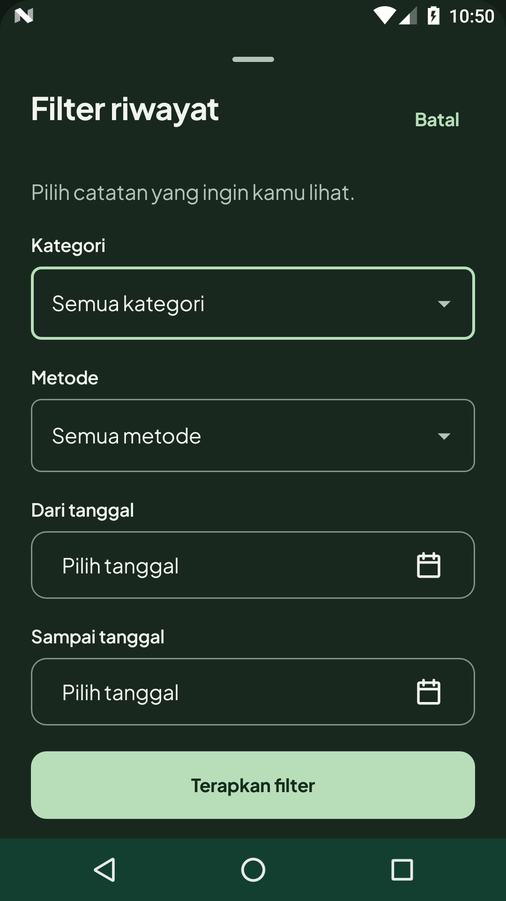

# Riwayat dan filter: S07/S10

19 Oktober 2026 · kelanjutan checkpoint Beranda/dock. Branch `codex/android-iteration-2-design`. Ini bukti komposisi dan interaksi Riwayat/filter; target semua layar pada [matriks Iteration 2](../../tasks/ITERATION_2_DESIGN.md) tetap berjalan.

## Perbandingan langsung

Referensi berasal dari render lokal kit v1.3. Screenshot Android ≈390 dp berasal dari APK native API 24, layar fisik 1080×1920 dan densitas 443, font 100%. Tidak ada pengolahan ulang gambar. Ref memakai tanggal/urutan seed dokumentasi dan frame mockup; Android memakai tanggal akun lokal dan urutan `(activity_date DESC, id DESC)` sesuai API. S10 pada Android adalah sheet opak, sebagaimana diminta spesifikasi; preview HTML menggambarkannya sebagai layar untuk dokumentasi.

| Layar | Referensi kit | Android |
|---|---|---|
| Riwayat terang |  |  |
| Riwayat gelap |  |  |
| Filter terang |  |  |
| Filter gelap |  |  |

Daftar memakai ikon kategori dalam bidang soft, metadata dan nilai di kanan, divider, serta label Reduce “dihindari”. Pada font besar nilai mengalir di bawah metadata agar teks tidak bertabrakan. Catatan yang berisi teks ditampilkan sebagai cuplikan satu baris. Header memiliki aksi filter, jumlah hasil dan chip aktif; input manual tersedia setelah daftar. Dock tetap memakai komposisi checkpoint sebelumnya. Fokus dropdown pada screenshot manual terlihat sebagai outline primary, bukan state pilihan filter yang sudah diterapkan.

Sheet memuat kategori Semua+7, metode Semua+4, pasangan tanggal, Terapkan, Reset pilihan dan Batal. Label berada di atas kontrol; batas kontrol memakai outline theme. Tanggal tanpa pilihan tetap kosong, tidak diam-diam berisi hari ini. Reset hanya mengubah draft; Apply memvalidasi pasangan tanggal, menutup modal dan kembali ke awal daftar. Batal, dismiss dan Back membuang perubahan yang belum diterapkan.

## Bukti fungsi dan perangkat

- Build native debug/aplikasi instrumentasi dan lint debug lulus dengan `-Pwastenot.hotReload=false`. **105 unit test, 0 gagal/error/skip**, termasuk empat kasus gabungan kategori/metode/tanggal inklusif, validasi pasangan tanggal dan urutan ID stabil.
- **API 24, 360 dp, font 100%:** 13 kasus runner, **12 dijalankan lulus**, satu kasus gestur khusus API 36 dilewati; 56,677 detik. Mencakup tiga tes Riwayat baru, enam regresi navigasi dan empat komponen form. Kalender yang dipakai bersama editor memeriksa tanggal masa depan disabled serta Apply/Batal.
- **API 24, 360 dp, font 200%:** empat kasus Riwayat/rotasi lulus; 27,069 detik.
- **API 24, 600 dp, font 200%:** lima kasus lulus; 31,176 detik. Termasuk journey dock/rail/Beranda, manual, tema dan recreate, serta Riwayat/filter pada shell aplikasi sebenarnya.
- Tes Riwayat dengan 25 fixture memeriksa bahwa awalnya 20 ditampilkan, tombol muat berikutnya menambah menjadi 25, grup tanggal tetap benar, baris mengirim ID yang benar dan posisi scroll/limit pulih melalui save/restore. Ini tes viewport lokal, **belum bukti pagination cursor repository**.
- Draft sheet bertahan melalui save/restore lokal. Filter aktif bertahan saat detail ditutup, pindah tab dan Activity direcreate. Skenario Batal sesudah perubahan, Reset+Batal, Reset+Apply, rentang tidak lengkap, rentang terbalik dan satu hari inklusif dijalankan.
- Driver window Android terpisah memverifikasi Back sistem (`KEYCODE_BACK`) membatalkan kategori draft, hasil tetap lima catatan, dan sheet dibuka lagi dengan Semua kategori. Screenshot terang/gelap diperiksa pada proses aplikasi sebenarnya.

| Konfigurasi native | Riwayat | Filter, awal | Filter, aksi setelah scroll |
|---|---|---|---|
| 360 dp, font 200% | [Riwayat](history-light-360-font200.png) | [Filter](filter-light-360-font200.png) | [Terapkan/Reset](filter-actions-360-font200.png) |
| 600 dp, font 200% | [Riwayat + rail](history-light-600-font200.png) | [Filter](filter-light-600-font200.png) | [Terapkan/Reset](filter-actions-600-font200.png) |

Screenshot font besar berasal dari perjalanan window Android terpisah setelah suite instrumentasi; Apply dapat dijangkau melalui scroll dan mengembalikan hasil tanpa perubahan. [Baseline 360 dp](history-light-360.png) dan [hasil filter Plastik](history-filtered-360.png) berasal dari journey integrasi aplikasi. Screenshot uji sesaat dapat menampilkan fokus/tooltip Material; gambar pembanding utama di atas diambil setelah window stabil. Pengujian proses mati, TalkBack menyeluruh dan frame-by-frame transisi belum diulang untuk layar ini.

## Batas checkpoint dan pekerjaan selanjutnya

**A18/#37 belum selesai.** Store saat ini memuat snapshot seluruh data dummy untuk ringkasan aplikasi. Riwayat membatasi viewport 20 item per tahap; ini belum memenuhi cursor repository, pull-to-refresh, deduplikasi halaman server, kegagalan halaman kedua, maupun bukti 1.000 catatan tanpa load seluruh data. Adapter dummy perlu menyediakan kontrak halaman dan agregat sebelum integrasi backend; jangan menyamakan tombol “Muat catatan berikutnya” dengan selesainya pagination API.

**A19/#49 tetap In progress** untuk integrasi cursor dan audit fokus modal yang lebih lengkap. Implementasi UI/draft/tanggal bergerak sesuai kit; ini belum penerimaan akhir semua state aksesibilitas. Loading/error/empty yang sudah ada belum diaudit secara visual pada seluruh konfigurasi.

Detail/hapus/feedback, Panduan/detail, grafik Statistik, Profil/achievement/pengaturan dan alur foto/AI masih harus dilengkapi. Dummy tidak mengklaim layanan autentikasi, sinkronisasi cloud atau inference tersedia. PR tetap draft selama matriks tersebut belum terpenuhi.
