# Riwayat melalui API: S07/S10

9 November 2026, A18/#37. Riwayat kini mengirim kategori, metode dan pasangan tanggal ke server, mengambil halaman berisi paling banyak 20 catatan, serta mempertahankan halaman yang sudah dibaca ketika muat berikutnya gagal. Jumlah yang ditampilkan berarti catatan yang sudah dimuat, bukan total akun yang belum diketahui.

## Perubahan dan kontrak

`HistoryScreen → HistoryViewModel → ActivityStore.page → CoreRepository.wasteLogs → Go`.

State daftar/query dipisahkan dari WorkspaceViewModel yang menangani detail dan penulisan. Filter tersimpan melalui SavedStateHandle; posisi scroll dan draft sheet tetap milik Compose. Request lama dibatalkan dan diperiksa generasinya sebelum boleh mengubah daftar. VM mengikuti pemilik akun pada AccountRoot; pembatalan pemilik juga mencegah hasil terlambat dipublikasikan.

Setiap halaman divalidasi: metadata wajib, cursor tidak kosong/berulang/bersiklus, has_more konsisten, maksimal 20 catatan dan hasil sesuai filter AND. ID dideduplikasi dengan versi terbaru, lalu diurutkan `(activity_date DESC, id DESC)`. Error sementara mempertahankan cursor untuk retry halaman yang sama; cursor yang ditolak menawarkan muat ulang halaman pertama. Refresh mempertahankan data lama, membatalkan cursor lama dan menampilkan kegagalannya secara terpisah dari error load-more. Retry-After tetap dihormati.

Perubahan create/edit/delete yang dikonfirmasi server menginvalidasi halaman; hint hasil penulisan menjaga baris yang benar jika refresh gagal. Detail terbaru dapat memperbarui baris atau menghapusnya ketika tidak lagi tersedia. Ringkasan/XP tetap berasal dari endpoint agregat. Daftar riwayat memakai LogDateRange tanpa batas 366 hari; pembatasan tersebut tetap berlaku khusus statistik.

## APK checkpoint

| Paket | SHA-256 |
|---|---|
| Debug native | `ce2d92666ca6580688f11ecbda37a2ce1f3b002c691d9d36219c2febf25f5b2c` |
| Staging native | `09c5327dfbe3f9b8985842d2762c03ad94b4cdd8b36c99b1bb48d8e6d8077aea` |
| Penguji terakhir, v4 | `22c7edde274ae14bd6e9462e4785b66f3a270ae4e0505c82b268f9f2bd8c4e0a` |

Staging berukuran **34.939.375 byte**, package `com.example.wastenot.staging`, tidak debuggable, minimum API30, target36. Signature v2, lima bobot Plus Jakarta Sans, lisensi OFL dan adjustResize diperiksa. Gate source/DEX/assets memastikan adapter lokal tidak ikut dalam kedua APK aplikasi. Origin tetap HTTPS Go publik.

Instalasi dan cold startup staging di luar instrumentation membuka Masuk akun nyata pada API37/360×640dp. Paket debug yang dipakai pengujian tidak berubah. [Manifest APK](history-api/build-manifest.json), [cold startup](history-api/staging-smoke.json), [frame Masuk](history-api/staging-login.png) dan [salinan lokal yang diberikan](history-api/delivery.json). APK sebelumnya diarsipkan sebelum pointer lokal diperbarui.

## Bukti pengujian

- **253 debug unit tests, 0 failure/error/skip**, termasuk 14 metode HistoryViewModel: 1.000 catatan dalam 50 request, tidak eager-load, deduplikasi/versi, retry cursor yang sama, filter terlambat, pemilik dibuang, refresh gagal, cursor invalid/siklus, metadata/filter invalid, Retry-After, filter restore, rentang lintas tahun dan hint penulisan. [Hasil unit](history-api/unit-test-result.json).
- Lint debug serta build debug, staging dan instrumentation lulus. [Hook commit wajib](history-api/product-hook.log) menjalankan lintDebug/test dan lulus; fingerprint source produksi setelah hook tetap cocok dengan APK native yang dipin.
- **Enam metode native diterima** pada API37, 390dp/font100%: empat metode HistoryDesignTest, satu metode state/error dua tema, dan satu journey backend nyata. Ada sembilan eksekusi total dengan tiga kegagalan harness yang dipertahankan sebagai bukti, bukan disembunyikan. [Rekonsiliasi metode/percobaan](history-api/accepted-native-summary.json).
- Akun khusus dibuat melalui API nyata; 22 catatan juga dibuat melalui API. Endpoint langsung membuktikan halaman 20+2 tanpa ID ganda. UI kategori Kertas menemukan catatan yang tidak ada pada halaman pertama; reset memulai halaman pertama lagi; load-more membuka catatan ke-22; detail/Back mempertahankan posisi; pull-to-refresh mengembalikan 20 hasil pertama. [Log native final](history-api/history-real-backend.log), [langkah server/UI](history-api/live-evidence.json).
- Akun, sesi dan catatan probe dibersihkan melalui akses server dengan batas email/nama/UUID probe. Hasil akhir ketiganya **nol**; setiap percobaan terdahulu juga dibersihkan. Tidak ada deploy atau restart backend. [Hasil final dan cleanup](history-api/native-result.json).

Bukti 1.000 catatan di sini adalah pengujian ViewModel, sedangkan journey native memakai 22 catatan server. Ini belum pengukuran jank/memori 1.000 catatan pada perangkat untuk A35.

## Render dan pembandingan kit

Acuan tetap kit v1.3: baris C14, filter/chip, state C29, Pine/Lime dan Plus Jakarta Sans. Frame berikut adalah PNG asli; data server berbeda dari isi contoh kit.

| Cakupan | Kit | Android |
|---|---|---|
| S07, aplikasi nyata terang | 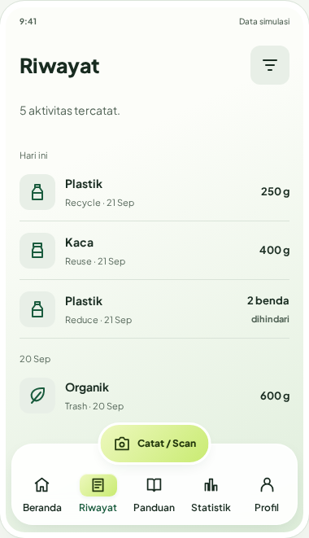 | 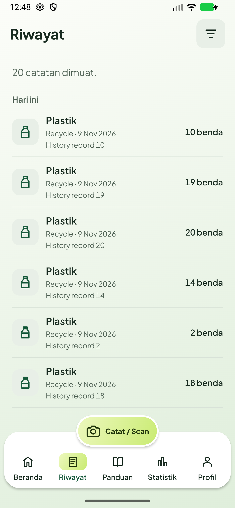 |
| Konten daftar gelap, harness komponen | 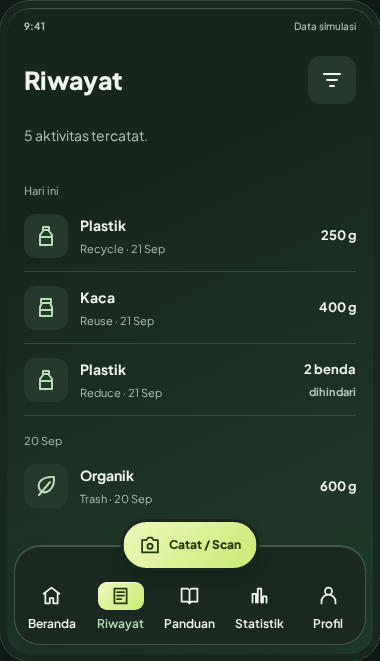 | 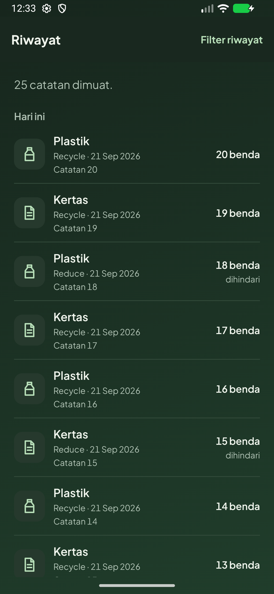 |
| S10, sheet terang | 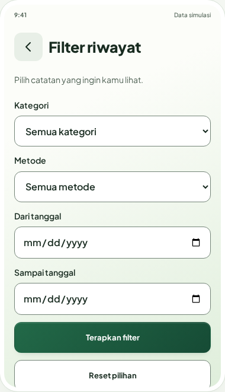 | 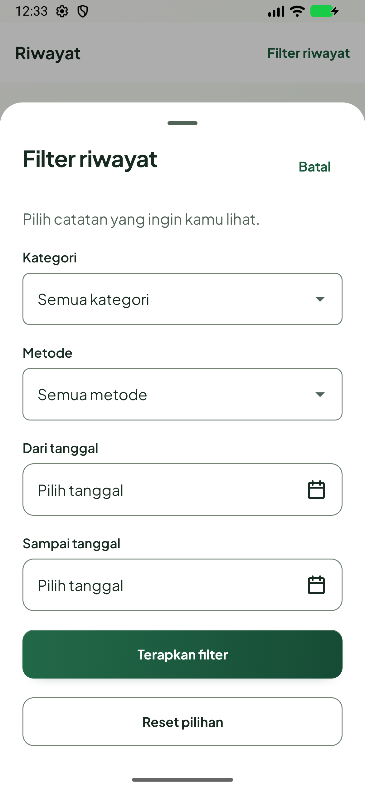 |
| S10, sheet gelap | 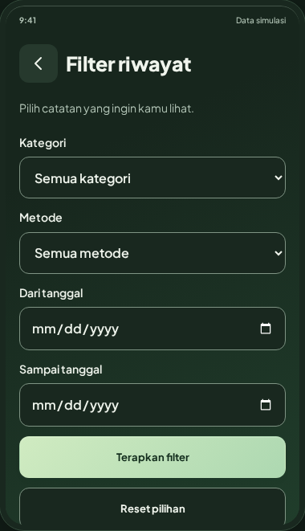 | 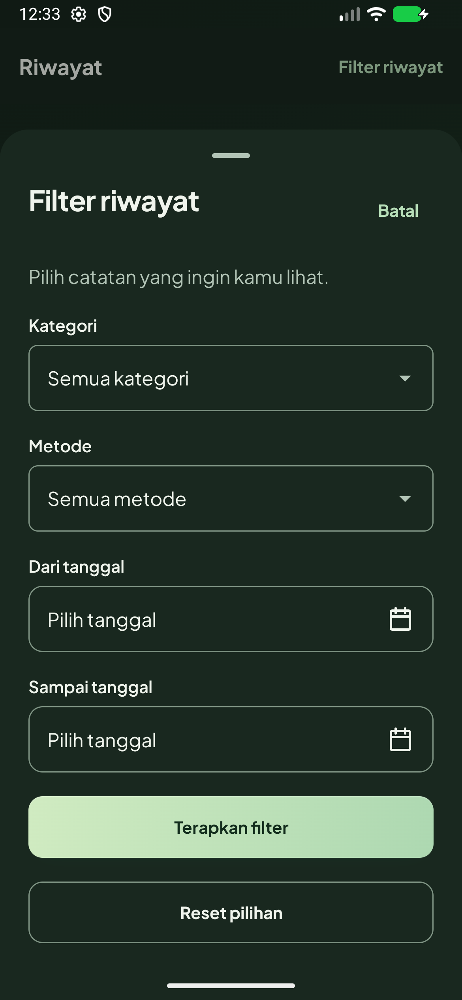 |

Harness komponen memakai header pengujian; frame daftar terang dari harness juga tidak membuktikan kontras system bar aplikasi. Frame aplikasi backend nyata di atas memuat header, system bar dan dock sebenarnya. Pembandingan komponen gelap membuktikan konten/warna baris, bukan penerimaan ulang seluruh navigasi gelap.

| Perilaku | Terang | Gelap |
|---|---|---|
| Loading halaman berikutnya di bawah baris lama | 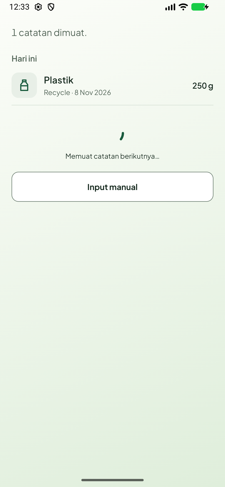 | 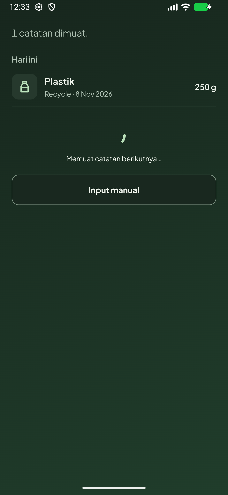 |
| Error lanjut dengan baris lama tetap tersedia | 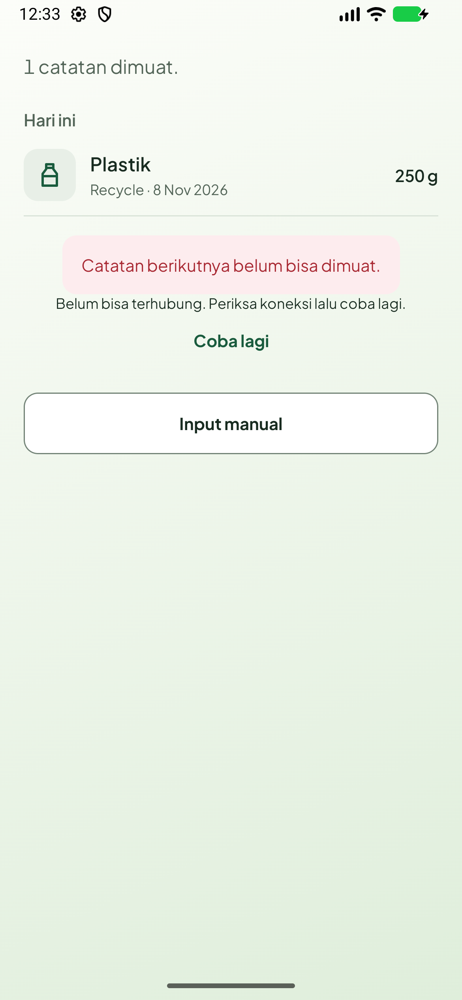 | 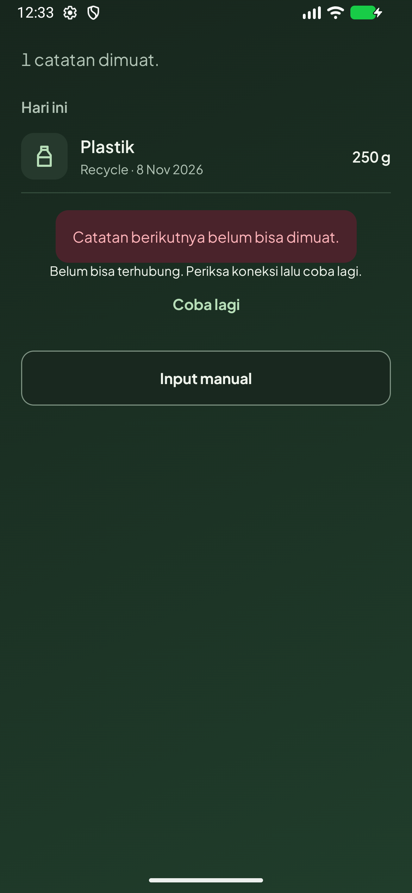 |

Frame error/loading memakai state terkontrol pada source pengujian. Pemulihan cursor/error dibuktikan unit test; frame tersebut tidak diklaim sebagai pemutusan jaringan pada akun nyata. [Filter server menemukan baris belum dimuat](history-api/captures/live-server-filter-unloaded-record.png), [posisi setelah detail/Back](history-api/captures/live-detail-back-preserves-scroll.png), [refresh ke halaman pertama](history-api/captures/live-pull-refresh-first-page.png). Dua puluh frame diterima dan hash-nya diverifikasi terhadap manifest hasil native.

## Koreksi harness dan batas bukti

APK aplikasi debug/staging tidak berubah selama empat versi penguji. Pada fase pertama, empat metode lulus dan satu gagal karena assertion rotasi masih mencari label jumlah lama. Koreksi label pada v2 meluluskan metode tersebut.

Journey backend v2 berhenti ketika mencari header jumlah yang sudah berada di luar viewport LazyColumn. v3 menambahkan dump semantics; percobaan ini memperlihatkan 27 elemen daftar sesudah halaman kedua masuk, tetapi footer yang didorong lebih jauh oleh baris baru juga tidak sedang dikomposisikan. v4 menggulir aktif menuju baris terakhir, lalu memeriksa footer/jumlah sesudah menggulir ke lokasinya. Journey lulus; bukti mencatat bahwa header memang tidak dikomposisikan saat baris terakhir terlihat. Tidak ada retry otomatis terhadap penulisan server untuk meloloskan assertion.

[Log fase pertama](history-api/phase1/history-render-and-state.log), [fase kedua](history-api/phase2/history-real-backend.log), [fase ketiga](history-api/phase3/history-real-backend.log), [dump diagnostik](history-api/phase3/failure-semantics.txt), [rotasi setelah koreksi](history-api/history-restored-label.log). Manifest tiap fase menyimpan SHA APK penguji masing-masing. Kegagalan lama tetap tercatat sebagai kegagalan harness, bukan dihitung sebagai metode yang lulus pada percobaan itu.

Emulator API37 sempat menampilkan ANR System UI saat boot sebelum APK/alur pengujian dijalankan. Recovery dibatasi dialog System UI yang diamati; tidak ada dialog error WasteNot yang ditutup untuk meloloskan tes. Tampilan/font/tema perangkat dikembalikan dan emulator milik task dihentikan setelah selesai.

Self-review mengikuti code-reviewer: jalur query/cursor, isolasi akun/cancellation, efek penulisan, metadata/error, sumber APK dan batas bukti diperiksa; tidak ditemukan penghalang produk pada perubahan ini. Perbandingan normal ini tidak membuktikan profil font200%, semua ukuran, spoken TalkBack atau perangkat fisik. A30/DataStore, A35/performa, regresi core/AI akhir dan audit penuh goal tetap terpisah. Batch ini tidak membuat generasi Gemini baru.
