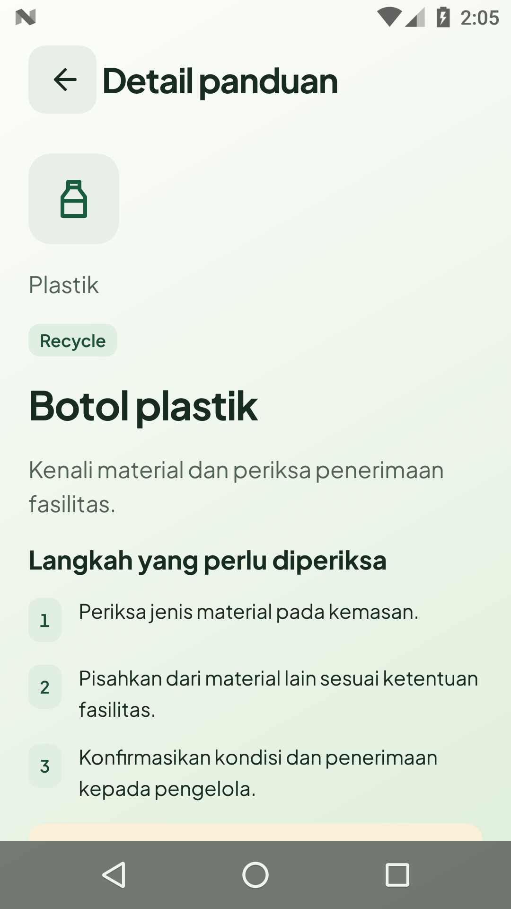
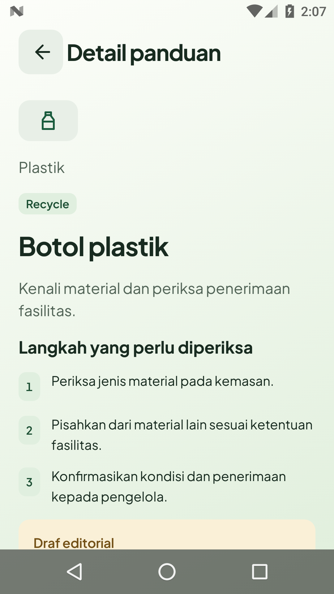
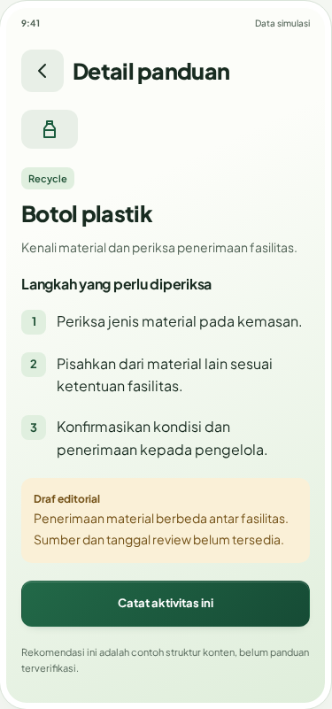
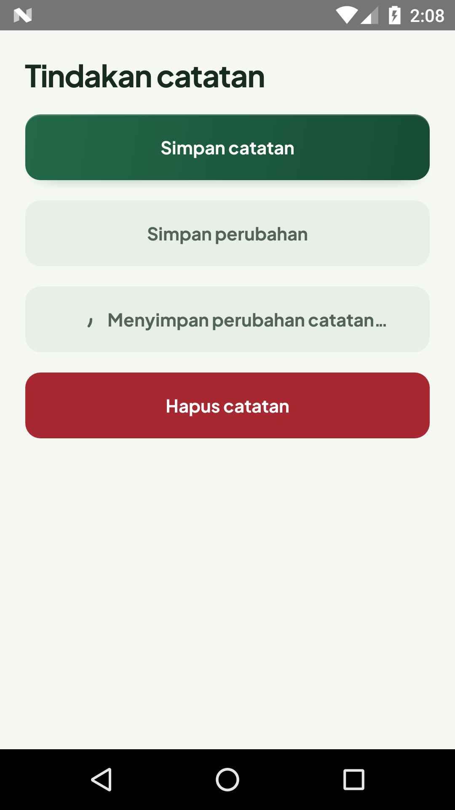
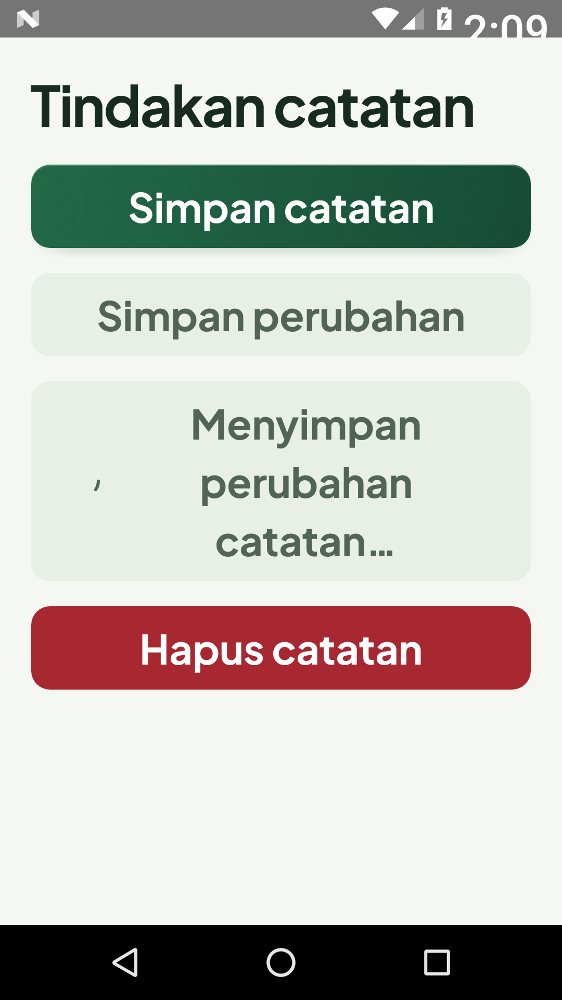
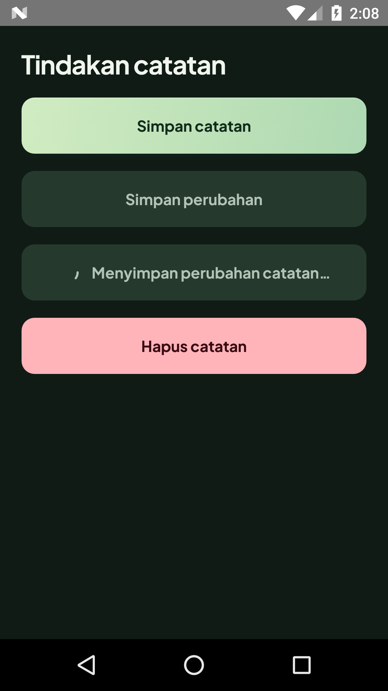
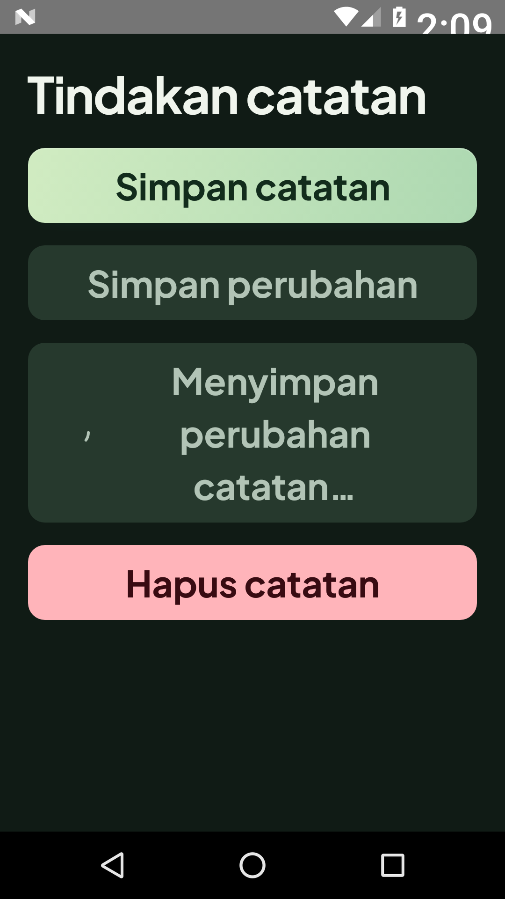

# Material ringkasan, tombol utama dan ikon S12

Checkpoint 4 November 2026. Sumber visual tetap DESIGN.md dan render design-system.html v1.3. **Penerimaan seluruh aplikasi belum selesai.** Perubahan ini menutup selisih material yang ditemukan pada review sembilan viewport.

## Perubahan

- S04/S13/S14 memakai satu modifier summarySurface: tepi putih tipis, highlight atas, bayangan, serta motif lingkaran yang sama. Ring mengikuti diameter luar 150, stroke 24, top -80/right -94 dari pseudo-element kit; radius jalur native 63, pusat (width + 19, -5). Motif sebelumnya lebih besar dan lebih pekat.
- C03 yang aktif mendapat highlight dan bayangan kecil sesuai aturan CSS primary:not(:disabled). Pending/nonaktif tetap soft/muted opak; tombol destructive mempertahankan warna error. Ukuran, label, enabled gate dan callback tidak diubah.
- S12 memakai bidang 64×44, radius 12 dan viewport glyph 24. Nilai kategori/metode serta CTA prefill tetap tersedia.

| Material | Tepi / highlight | Bayangan: offset y / radius / spread |
|---|---|---|
| Summary | border 1 dp #FFFFFF26; inset atas 1 dp #FFFFFF35 | 8 / 20 / -14 dp, #123F3080 |
| Primary aktif | inset atas 1 dp #FFFFFF30 | 5 / 12 / -9 dp, #123F3070 |

Warna ditulis dalam urutan RGBA CSS; token Kotlin memakai ARGB. Compose dropShadow/innerShadow dipakai tanpa menambah dependency atau animasi. Nilai desain dipetakan ke dp; perbedaan rasterisasi browser/Android tidak dinyatakan pixel-identical.

## Koreksi ukuran detail Panduan

Catatan sebelumnya terlalu umum ketika menyarankan bidang 44–48 untuk S12. Markup detail memiliki width/height inline 64, tetapi flex-basis komponen membuat tinggi render akhirnya 44. [Computed style](materials/reference-computed.json) dan PNG kit menunjukkan bidang **64×44**, radius **12**, glyph viewport **24**. Implementasi mengikuti hasil render tersebut.

Pengukuran piksel mengambil komponen bidang soft yang benar-benar dicat, lalu mengukur ink glyph di dalamnya, terpisah dari deklarasi Modifier. Pada kedua tema:

| Ukuran setelah normalisasi density | Sebelum | Sesudah | Render kit |
|---|---:|---:|---:|
| Bidang ikon | 64×64 | 64×44 | 64×44 |
| Batas ink glyph | 18,67×26,67 | 14×20 | 14×20 |

Batas ink adalah gambar botol yang tampak di dalam viewport; berbeda dari ukuran viewport 24. Kategori/metode tidak disembunyikan untuk mengecilkan layout.

| S12 terang sebelum | Sesudah | Kit |
|---|---|---|
|  |  |  |

## Runtime dan gambar

| API 24 | Lulus / kasus unik | Durasi |
|---|---:|---:|
| normal | 4 / 4, nol skip | 56.975 s |
| phone200 | 4 / 4, nol skip | 64.875 s |
| wide200 | 4 / 4, nol skip | 75.383 s |

**12 eksekusi native dari empat metode unik**, APK aplikasi/penguji identik antarprofil. Baseline pada APK 61218cd menjalankan empat metode yang sama dengan APK penguji identik dan lulus; baseline ini memperlihatkan selisih visual, bukan kegagalan fungsi material. Bukti versi lain tidak dijumlahkan sebagai coverage head.

171 debug unit tests, lint dan build native lulus. Perjalanan sembilan screen mencakup lima tab, editor, dua detail dan Pengaturan, judul terbaca, tab/kamera benar-benar dicat, serta aksi rail di halaman anak. Tiga tes ActionButton memeriksa terang/gelap, empat state, label panjang, sentuh, Tab/Enter dan callback. Ada 54 capture viewport dan 24 capture komponen; 72 sampel warna/kontras lulus, minimum 5,40:1. [Manifest dan hash source/PNG](materials-checkpoint.json), [baseline](materials/before-native.log), [normal](materials/normal-native.log), [200%](materials/phone200-native.log), [600 dp/200%](materials/wide200-native.log).

Snapshot awal yang tercampur keyboard dikeluarkan dari total lulus. Eksperimen memakai APK yang sama menunjukkan mode sistem masih keyboard setelah tes Tab; sentuhan sistem nyata mengembalikan touch mode dan seluruh viewport lulus. Driver tab kini mengirim MotionEvent melalui Android input dispatch dan memverifikasi touch mode. Tes tombol juga memakai Tab sistem, menggantikan permintaan fokus saat mode sentuh. Kode fokus/navigasi aplikasi tidak diubah untuk koreksi driver ini.

| Area | Sebelum (61218cd) | Sesudah terang / gelap | Kit terang / gelap |
|---|---|---|---|
| S04 Beranda | [Terang](screen-review/normal-S04-light.png) · [Gelap](screen-review/normal-S04-dark.png) | [Terang](materials/S04-light.png) · [Gelap](materials/S04-dark.png) | [Terang](screen-review/kit-S04-light.png) · [Gelap](screen-review/kit-S04-dark.png) |
| S13 Statistik | [Terang](screen-review/normal-S13-light.png) · [Gelap](screen-review/normal-S13-dark.png) | [Terang](materials/S13-light.png) · [Gelap](materials/S13-dark.png) | [Terang](screen-review/kit-S13-light.png) · [Gelap](screen-review/kit-S13-dark.png) |
| S14 Profil | [Terang](screen-review/normal-S14-light.png) · [Gelap](screen-review/normal-S14-dark.png) | [Terang](materials/S14-light.png) · [Gelap](materials/S14-dark.png) | [Terang](screen-review/kit-S14-light.png) · [Gelap](screen-review/kit-S14-dark.png) |
| S08 Primary pada detail | [Terang](screen-review/normal-S08-light.png) · [Gelap](screen-review/normal-S08-dark.png) | [Terang](materials/S08-light.png) · [Gelap](materials/S08-dark.png) | [Terang](screen-review/kit-S08-light.png) · [Gelap](screen-review/kit-S08-dark.png) |

| Kontrol normal | Label pending pada 200% |
|---|---|
|  |  |
|  |  |

Emulator dikembalikan ke density/font dan enam pengaturan semula setelah pengujian, lalu hanya emulator milik run ini yang dihentikan. APK native dibekukan sebelum hook default HotSwan mengubah output build.

## Tetap terbuka

Bagian bawah seluruh screen, semua state loading/kosong/error, visual pressed/focus global, pemulihan fokus modal, resize dinamis, motion/predictive Back per frame dan penerimaan perangkat/API lain tetap mengikuti matriks Iteration 2. Ukuran header/isi lain pada S12 tidak dinyatakan sama seluruhnya dari hasil ukur ikon. Sumber data tetap dummy persisten; integrasi HTTP/AI server menunggu layanan yang tersedia. CI harus diperiksa untuk SHA checkpoint yang dipublikasikan.
