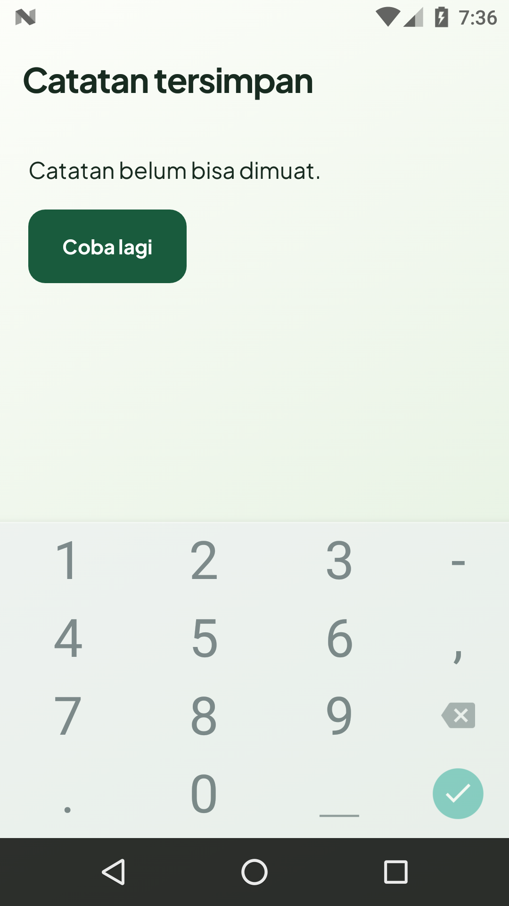
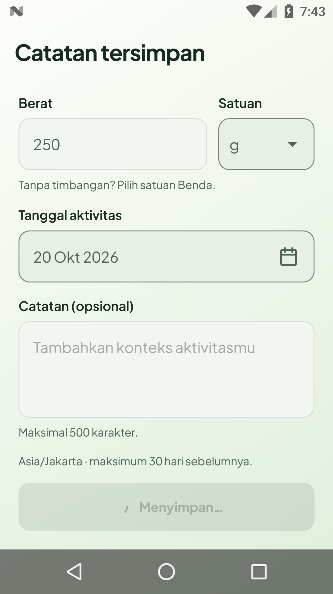
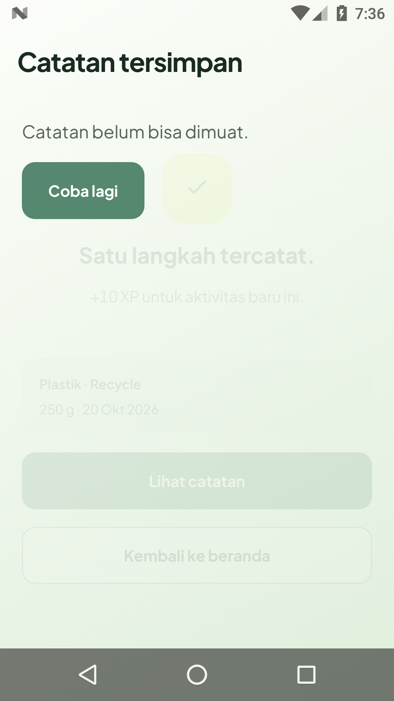
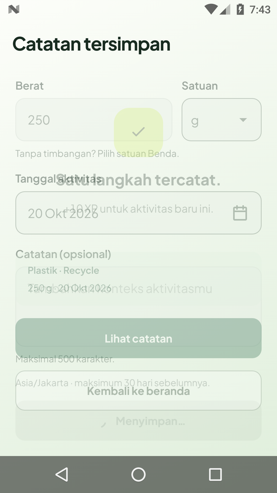
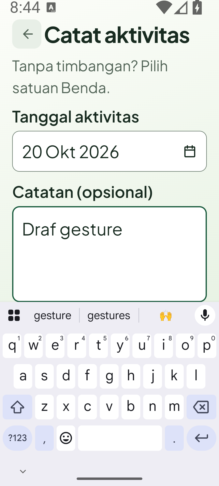
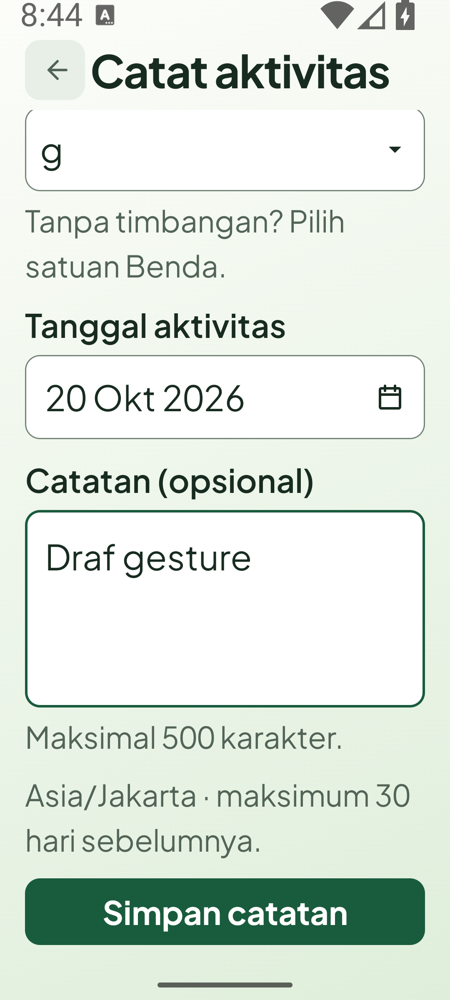
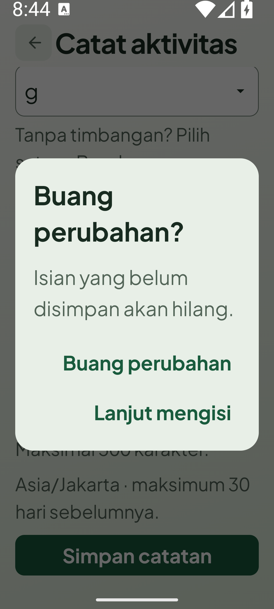

# Navigasi: draf bertahan selama transisi

Checkpoint branch `codex/android-iteration-2-design`, dari `fac827c`. Mengikuti ARCHITECTURE §4–7, SCREEN_SPEC S05/S06/S09/D03 dan DESIGN §8. Sasaran seluruh aplikasi tetap [dalam pengerjaan](../../tasks/ITERATION_2_DESIGN.md).

## Bug yang direproduksi

Setelah create dikonfirmasi store, UI sudah mengganti judul menjadi Catatan tersimpan, tetapi konten form yang sedang keluar diganti dengan Catatan belum bisa dimuat dan Coba lagi. Draf sebelumnya dimiliki parent hanya selama route aktif masih LogEditor. NavDisplay masih menggambar entry lama ketika route aktif telah berubah, sehingga guard `editor == key` memilih fallback error pada entry tersebut.

Dengan animasi sistem aktif (ketiga skala 1,0), probe clock Compose menemukan fallback error pada 14 sampel, indeks 2–15, dari 20 sampel yang diamati. Screenshot indeks 2 dan 5 memperlihatkan pesan salah tersebut; ini bukan hanya node semantics yang tersembunyi. Angka ini adalah sampel clock uji, bukan pengukuran FPS atau klaim semua 14 sampel tampak sama terang pada layar.

| Sebelum: simpan berhasil, body salah | Setelah: form tetap selama keluar |
|---|---|
|  |  |
|  |  |

## Perbaikan

Draf sekarang dibuat melalui rememberSaveable di entry LogEditor, memakai state-holder decorator Navigation 3 yang sudah ada. Parent hanya menyimpan referensi draf entry aktif untuk kebijakan Back dan hasil save. Dispose memeriksa request ID agar entry lama tidak menghapus referensi draf baru. Efek hasil save juga mengikuti registrasi draf, sehingga hasil yang sudah tersedia saat entry dipulihkan tetap dapat ditangani.

Form keluar dipertahankan sampai entry selesai bertransisi. Sesudah save berhasil, kontrol form tetap nonaktif selama keluar. Durasi fade tetap 180 ms masuk dan 120 ms keluar; tidak ada mesin animasi tambahan. Snapshot payload/retry pada [checkpoint submission](SUBMISSION.md) tetap berlaku.

Probe awal yang sama memakai APK instrumentasi identik (`ec953961329540eaca6317ce0e930d3eaacd9fbddb6ad6b7d0c5ada5f9a3fdb5`): sebelum perbaikan gagal karena 14 sampel error; sesudah perubahan owner lulus dengan 0 sampel error. Setelah itu cakupan tes diperluas tanpa mengubah app APK yang diuji.

## Cakupan audit dan regresi

Lima alur disampling per frame clock: create pada tema sistem/terang, create gelap, edit, Back pada form bersih, dan konfirmasi buang draf. Target harus muncul dan pengamatan dilanjutkan setidaknya 16 tick setelahnya. Kelima alur tidak boleh menampilkan fallback load-error. Buang draf juga memeriksa Batal mempertahankan isian dan draf berikutnya benar-benar kosong.

Regresi lain mencakup touch/Tab/validasi editor, Activity recreate, create/edit/XP, filter/range/scroll, dock/rail dan feedback simpan. Satu kasus tambahan merusak sementara JSON fixture pada AVD milik pengujian untuk menghasilkan failure STORAGE melalui jalur aplikasi sebenarnya. Error dan isian bertahan setelah Activity recreate; setelah storage dipulihkan dan pengguna mengoreksi, save eksplisit menghasilkan tepat satu catatan baru. Tidak ada toggle fault/demo dalam produk.

| API / lebar / font | Eksekusi lulus | Durasi diterima |
|---|---:|---:|
| 24 / 360 dp / normal | 12 | 122,159 detik |
| 24 / 360 dp / 200% | 8 | 79,101 detik |
| 24 / 600 dp / 200% | 10 | 148,098 detik |
| 36 / 360 dp / 200% | 10 | 157,281 detik |

Total **40 eksekusi dari 14 kasus unik**, tanpa skip. Lima alur pada empat konfigurasi memberi **382 sampel clock** tanpa fallback load-error. Kasus tambahan storage API 24 dicatat dari log runner dan setup/restorasi; pengaturan runtime tidak disampling independen untuk kasus tambahan tersebut.

[Rekap native](motion-native-results.json) menyimpan nama kasus, konfigurasi dan hasil sampling. Build native app/instrumentasi, lint debug dan 120 debug unit tests lulus; 0 gagal/error/skip. APK minimum 24, adjustResize, lima weight font dan OFL diverifikasi. App APK seluruh regresi setelah perbaikan identik: `77386cbde7be2050bf68dcdabb7a1a13463d6480f24553823597169470b93d52`. Ekspor instrumentasi berbeda ketika kasus regresi baru ditambahkan; hash tiap suite dicatat dalam rekap.

Android 36/font 200% memakai mode gestur 2. Tes gestur awal mengharapkan D03 dari gestur pertama saat keyboard masih tampil; screenshot menunjukkan keyboard ditutup dan draf tetap ada. Tes diperbaiki untuk memeriksa kedua tahap: keyboard terlihat → gestur menutup keyboard tanpa membuang draf → gestur berikutnya membuka D03 → Batal menjaga isian. Paket Android 36 diulang dan seluruh 10 kasus lulus. Percobaan dengan prasyarat keliru tidak dimasukkan dalam hitungan diterima.

| Keyboard sebelum Back | Sesudah Back pertama | Dialog sesudah Back kedua |
|---|---|---|
|  |  |  |

Gestur memakai input touchscreen nyata di emulator. Pemeriksaan ini membuktikan kebijakan Back dan draf; predictive seek per frame tetap belum diaudit.

Gambar lain: [akhir create](motion-after-create-end.png), [create gelap](motion-after-dark-create.png), [edit tanpa XP baru](motion-after-edit.png), [kembali setelah buang draf](motion-after-discard.png), [ponsel 200%](motion-after-phone200-create.png), [lebar 200%](motion-after-wide200-create.png).

## Batas bukti

UiAutomation.takeScreenshot dipakai pada API 24; captureToImage yang memakai overload Window PixelCopy tidak tersedia di perangkat minimum ini. Kegagalan helper screenshot awal diperbaiki sebelum probe bug dilakukan. Animasi pada AVD API 24 sebelumnya dimatikan; audit ini mengaktifkan ketiga skala menjadi 1,0 dan mengembalikannya ke nilai semula setelah selesai. Font/density juga dipulihkan. AVD Android 36 terpisah memakai image SDK yang sudah terpasang dan userdata baru.

Crossfade memang memperlihatkan dua konten sesaat; gate ini menolak penggantian konten dengan error palsu, bukan melarang fade dari kit. Screenshot adalah sampling UI native, bukan benchmark performa, rekaman semua frame perangkat, atau pengganti pengujian perangkat fisik. Perilaku IME/system bars dapat berbeda antar-API; frame dengan keyboard sedang menutup tidak dianggap frame layout statis.

Audit motion semua layar, predictive seek per frame, spoken feedback, material/kontras CTA bersama, konflik D04, persistensi draf ke disk/per akun dan backend HTTP tetap belum selesai. Panduan/detail, Statistik, Profil/pengaturan dan kamera/AI tetap bagian sasaran penuh. PR #96 dan issue A09 tetap terbuka.
