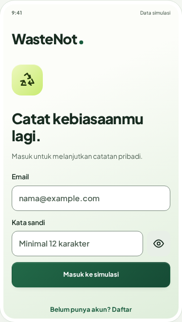
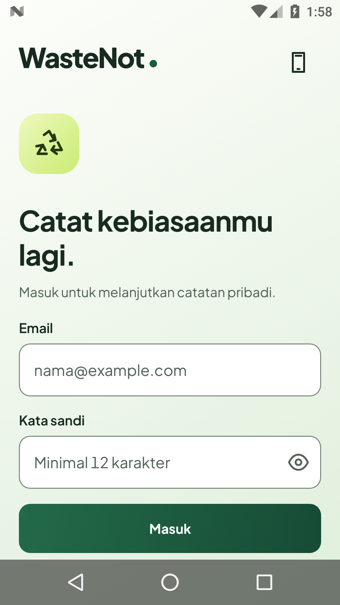
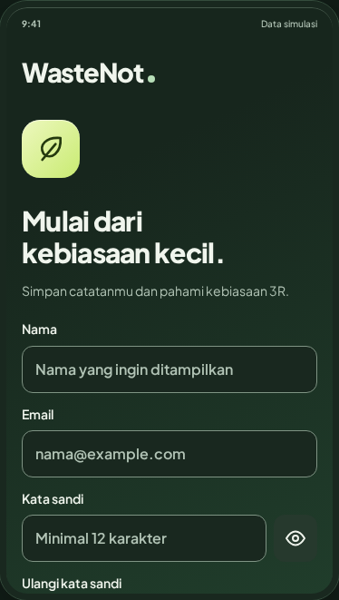
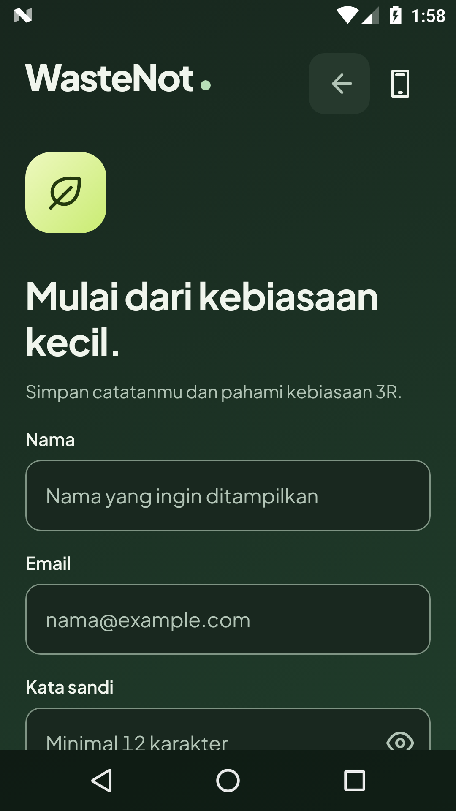
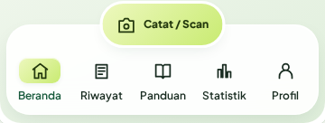
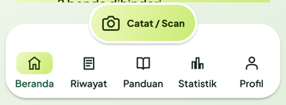
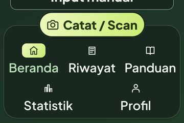

# Dock adaptif dan form akun

23 Oktober 2026. Checkpoint S02/S03/C24/C25/C35 pada Iteration 2. Penerimaan seluruh layar masih terbuka pada [matriks](../../tasks/ITERATION_2_DESIGN.md). [JSON](nav-auth-checkpoint.json) mengikat source, APK native/penguji, hasil tiap kasus, PNG dan sumber kit.

## Perbandingan visual

| Bagian | Kit v1.3 | Android |
|---|---|---|
| Masuk terang |  |  |
| Daftar gelap |  |  |
| Dock normal |  |  |

[Masuk sebelumnya](nav-auth-login-before.png), [Masuk gelap](nav-auth-login-dark.png), [Daftar terang](nav-auth-register-light.png), [bagian form Daftar](nav-auth-register-form.png), [dock sebelumnya](nav-auth-dock-before.png), dan [Beranda normal utuh](nav-auth-home-normal.png).

Referensi dirender dari HTML/font lokal kit yang diminta. Lebar luar frame 374 px memberi konten 360 px; Android memakai 1080 px/densitas 480 untuk 360 dp. Crop dock dinormalisasi ke 360 px untuk perbandingan; gambar utuh tetap tersedia. Frame/status bar web dan line height berbeda dari Android. Tab terpilih pada crop dock sebelumnya adalah Profil. Ini perbandingan komposisi, bukan klaim semua pixel identik. Copy simulasi katalog tidak dipakai pada aplikasi.

## Perubahan

- Auth memakai canvas pinus–lime, wordmark/titik, ikon recycle/leaf dari kit, heading dan deskripsi. App bar kosong dihapus; pemilih tema serta Back Daftar berada pada header. Field opak memakai label di atas, placeholder, visibility, IME dan autofill pada node input. CTA tetap Masuk/Buat akun. String jalur demo lama yang sudah tidak dipakai di auth dihapus.
- Dock normal mempertahankan lima tujuan dan aksi kamera terpisah. Radius 26, bidang aktif 46×28/radius 9, label 12 sp, teks aksi 12 sp/800 dan tepi highlight mengikuti hasil render kit. Baseline surface opak mengikuti DESIGN; blur belum diaktifkan.
- Layout menghitung lebar label aktual. Lima kolom digunakan bila muat; pada ponsel/200% lima tujuan mengalir menjadi 3+2. Ukuran huruf pengguna dipertahankan. Label mendapat seluruh lebar sel agar area paragraph dan kotak teks sama. Rail tetap digunakan mulai 600 dp; perubahan ini tidak menambah library adaptif eksperimental.

| Teks besar | Hasil |
|---|---|
| Dock 360 dp/200% |  |
| Masuk 360 dp/200% | [Screenshot](nav-auth-login-phone200.png) |
| Form Daftar 360 dp/200% | [Screenshot](nav-auth-register-form-phone200.png) |
| Rail 600 dp/200% | [Screenshot utuh](nav-auth-home-wide200.png) |

## Verifikasi

137 debug unit tests, nol gagal/error/skip; build native dan lint lulus. Gate API 24/adjustResize/lima font/OFL lulus. Delapan [pasangan token warna](nav-auth-contrast.txt) lulus AA, minimum 5,24:1; ini perhitungan token, bukan pengukuran pixel semua kontrol.

| API 24 | Kasus runner | Lulus | Dilewati | Detik |
|---|---:|---:|---:|---:|
| 360 dp, normal | 29 | 28 | 1 | 367,552 |
| 360 dp, teks 200% | 10 | 10 | 0 | 152,249 |
| 600 dp, teks 200% | 10 | 10 | 0 | 143,842 |

Total **48 eksekusi lulus / 28 kasus unik / satu skip khusus API lebih baru**, dengan app dan test APK identik. Mencakup validasi/credential error/IME/autofill, registrasi lalu login ulang Wulan/0 XP tanpa mengganggu akun awal, tema, lima tab/manual/sheet, panduan dan enam regresi transisi editor. Tiap label tab diperiksa satu baris tanpa overflow; target tab minimal 48 dp.

Regresi awal menangkap kata Beranda yang terbelah pada 200%. Setelah reflow, penguji diagnostik masih gagal: kotak teks 294 px sedangkan paragraph 330 px. Penguji yang sama lulus setelah label mengisi lebar sel. Tes tidak dilonggarkan untuk mengabaikan overflow. Kandidat awal form pernah gagal mencapai Home dan penyebabnya belum ditetapkan; run tersebut bukan hasil akhir. Satu run final terputus (host exit 143 dan UiAutomation not connected); setelah runner/app dipastikan terminal, APK yang sama dijalankan ulang hingga selesai. Run parsial tidak dihitung.

Pemeriksaan UI manual terpisah membaca hierarchy aktual untuk Profil → Keluar → Daftar → tombol Kembali pada header. Form Masuk kembali dengan posisi scroll sebelumnya; [hasil](nav-auth-header-back.png). Tidak ada data login nyata yang dimasukkan.

## Gate checkpoint dan batas

- Hard PASS untuk kontrol yang diubah: lima tab, aksi/manual, tema, form, validasi, visibility, IME, autofill semantics serta Back dapat dijalankan. Data memakai adapter dummy persisten; tidak ada jalur masuk demo.
- Purpose PASS: Pinus–Lime, font, ikon, radius dan hierarki mengikuti kit; reflow menjaga label utuh pada teks besar, highlight memisahkan navigasi dari canvas, dan form tetap opak.
- Liveliness PASS untuk checkpoint: ENERGY 2 / RHYTHM 2 / MOTION 1, aksi kamera menjadi fokus dock; wordmark/ikon serta heading memberi urutan pada auth. Transisi Login/Daftar pendek 180/120 ms; tidak ada gerak dekoratif baru.
- Craft PASS untuk konfigurasi yang diuji: terang/gelap, normal/200%, dock/rail, target tab dan alur nyata diperiksa. Gesture/predictive seek per frame, spoken TalkBack, password manager eksternal, perangkat fisik dan API 36 pada perubahan ini tetap terbuka.

S01, penyempurnaan tipografi/material seluruh layar, kamera/AI, draf disk, D04, cursor/pull-to-refresh dan integrasi HTTP tetap berjalan. Repo organisasi yang dapat diakses saat pemeriksaan masih Android dan landing; layanan backend tidak diklaim sudah terintegrasi. [Identitas akun dummy](ACCOUNT_IDENTITY.md) adalah checkpoint terpisah. PR tetap draft.
