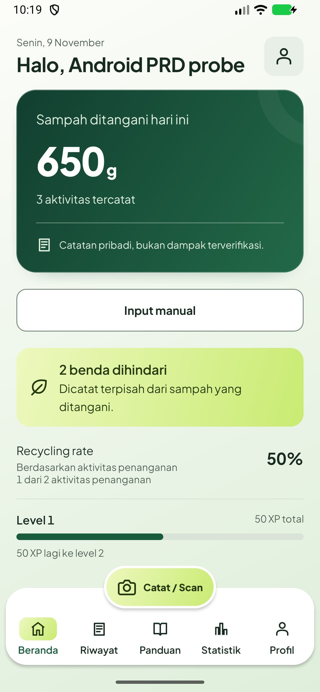
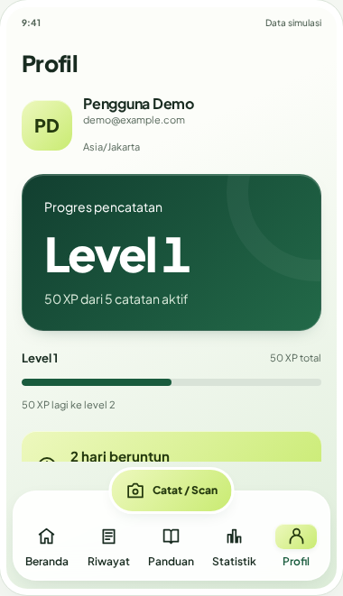
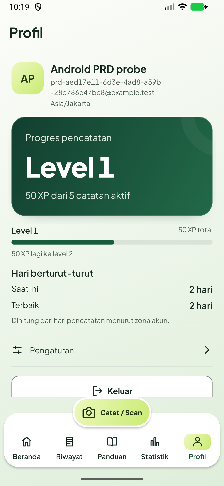
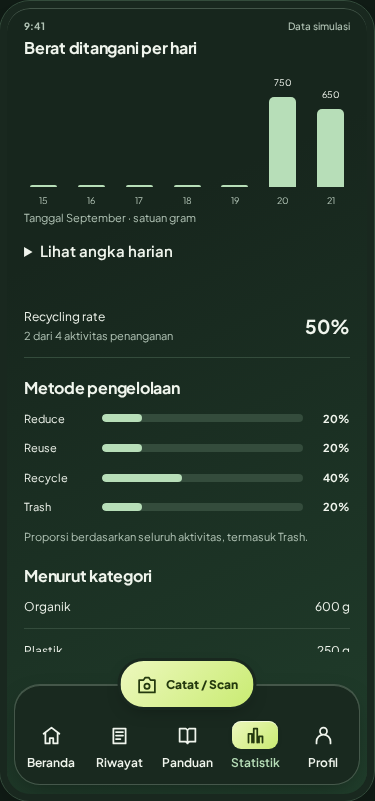
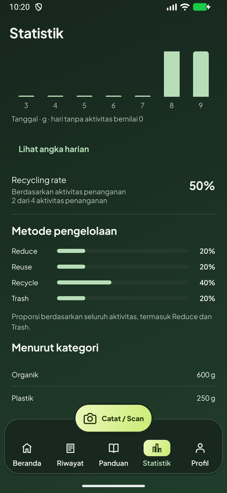

# Dataset PRD pada akun backend nyata

9 November 2026, AT-10/A36/#70. `RemotePrdDatasetTest` membuktikan lima baris PRD §9.4 melalui SessionRepository/CoreRepository dan MainActivity sebenarnya. Source produksi sama dengan main `e6098bcd605a2756a1c54c8cec239c9cd748f45a`, sesudah merge PR #111. Perubahan checkpoint ini hanya pengujian dan dokumentasi; aplikasi tetap memakai adapter remote.

## Data dan hasil

Tanggal contoh September digeser relatif terhadap tanggal dashboard server: 9 November 2026 di Asia/Jakarta. Jam perangkat/server tidak diubah. Akun khusus dibuat melalui API Android, kemudian lima catatan dibuat melalui API: Plastik/Recycle 250 g, Kaca/Reuse 400 g dan Plastik/Reduce dua benda pada hari ini; Organik/Trash 600 g dan Kertas/Recycle 150 g pada kemarin. ID aktual dicatat, bukan ID contoh kit.

| Pembacaan server dan layar | Hasil yang diverifikasi |
|---|---|
| Beranda hari ini | 650 g ditangani, dua benda dihindari, tiga aktivitas, recycling rate 1/2 = 50% |
| Statistik 7 dan 30 hari | 1.400 g ditangani, dua benda dihindari, lima aktivitas, recycling rate 2/4 = 50% |
| Rincian harian | Kemarin 750 g/dua aktivitas, hari ini 650 g/tiga aktivitas; hari lain nol; benda ditangani tetap nol |
| Kategori penanganan | Organik 600 g, Plastik 250 g, Kertas 150 g, Kaca 400 g; kategori lain nol, Reduce terpisah |
| Metode | Reduce 20%, Reuse 20%, Recycle 40%, Trash 20% |
| Profil | Lima catatan aktif, 50 XP, level 1, 50 XP ke level 2, current/best streak 2/2, sudah mencatat hari ini |

Satu metode native **lulus pada percobaan pertama, 110,885 detik**, API37/390×844 dp/font100%. Server diperiksa langsung, Activity dibuat ulang, lalu Beranda/Statistik/Profil diperiksa dalam tema Terang dan Gelap. Rentang 7/30, perluasan rincian harian, kategori/metode dan penggantian tema dijalankan lewat UI. [Log](prd-dataset/native.log), [lima langkah](prd-dataset/native-fixture.json), [hasil/cleanup/hash PNG](prd-dataset/native-result.json), [binding source/APK](prd-dataset/build-manifest.json).

Kelima catatan dipersiapkan melalui API pada akun probe, bukan lima kali input form. Perjalanan input/edit/delete UI nyata sudah memiliki [bukti terpisah](AI_MAIN_REGRESSION.md). Recreate Activity di sini bukan bukti process death. Ini menutup AT-10 pada konfigurasi tersebut, bukan seluruh AT-01–26, perangkat fisik, font besar, TalkBack atau akurasi AI.

## Review gambar dan kit

Empat belas PNG asli ditinjau dan hash diverifikasi; **14 diterima**. [Catatan review](prd-dataset/capture-review.json). Posisi gulir berbeda antargambar; footer atau konten yang berada di luar viewport tidak dianggap telah terlihat. Identitas akun, tanggal, system bar dan kanvas berbeda dari kit historis. Hero, avatar, warna, bar XP dan dock dapat dibandingkan pada gambar berikut; ini bukan pengukuran raster seluruh token atau penerimaan ulang setiap state.

| Kit | Android dengan server nyata |
|---|---|
|  |  |
|  |  |
|  |  |

Kit S14 memakai satu callout streak; aplikasi saat ini merinci current/best dari server beserta dasar zona akun. Checkpoint data ini tidak menyatakan keduanya identik secara visual. Penerimaan desain penuh tetap mengikuti review per layar.

| Viewport | Terang | Gelap |
|---|---|---|
| Beranda | [PNG](prd-dataset/captures/home-light.png) | [PNG](prd-dataset/captures/home-dark.png) |
| Statistik tujuh hari | [PNG](prd-dataset/captures/statistics-week-light.png) | [PNG](prd-dataset/captures/statistics-week-dark.png) |
| Statistik 30 hari | [PNG](prd-dataset/captures/statistics-month-light.png) | [PNG](prd-dataset/captures/statistics-month-dark.png) |
| Angka harian | [PNG](prd-dataset/captures/statistics-daily-light.png) | [PNG](prd-dataset/captures/statistics-daily-dark.png) |
| Metode | [PNG](prd-dataset/captures/statistics-methods-light.png) | [PNG](prd-dataset/captures/statistics-methods-dark.png) |
| Kategori tidak nol | [PNG](prd-dataset/captures/statistics-categories-light.png) | [PNG](prd-dataset/captures/statistics-categories-dark.png) |
| Profil | [PNG](prd-dataset/captures/profile-light.png) | [PNG](prd-dataset/captures/profile-dark.png) |

## APK, CI dan pemulihan

Pengujian memakai debug native `91f92558709a3b4c04fbad6889d0df92dd20da78b271e57fdff6399009ffb82e`, identik dengan APK produk pada [pergantian hari](ACCOUNT_DAY_ROLLOVER.md). Staging tetap `f65e9f9a6fddc18bc4635a1d52a5d79306e7e234942514620d5e5fd5eb3113ff`; pointer lokal yang sudah diterima tidak diganti dengan build tanpa perubahan produk. APK penguji baru `2ae2c9704933786ead2413b42a47bebc90e4498e283fb26b7e56cfb71add066a`. [Build](prd-dataset/build.log), [pemeriksaan sumber dibekukan: 55 task up-to-date](prd-dataset/source-freeze-build.log). Lint/unit wajib commit dan CI perubahan baru dilaporkan pada PR.

PR #111 sudah merge sebagai `e6098bc`; [CI PR 42630103570](https://github.com/waste-not-app/waste-not-android/actions/runs/42630103570) meluluskan seluruh gate aplikasi. [Rilis 42641391040](https://github.com/waste-not-app/waste-not-android/actions/runs/42641391040) juga berhasil membangun, menandatangani dan menerbitkan APK. Upload artefak opsional pada keduanya ditolak kuota GitHub, terpisah dari hasil build/test/deployment. [Metadata PR](prd-dataset/pr-ci-result.json), [rilis](prd-dataset/release-ci-result.json). [CI main 42641391022](https://github.com/waste-not-app/waste-not-android/actions/runs/42641391022) juga lulus pada commit merge e6098bc; [hasil](prd-dataset/main-ci-result.json).

APK publik [1.0.0-b13](https://oktaavsm.bccdev.id/wastenot/apk/wastenot-v1.0.0-b13.apk) berhasil diunduh: **36.408.543 byte**, SHA-256 `72b9f2d16bc04dcd7d8953617e69dfaa9748e92dc8cd149d5009cfe68ac5a183`. Signature produksi sama dengan rilis sebelumnya; gate minimum API30/font/OFL/adjustResize dan adapter remote lulus. [Hasil unduhan](prd-dataset/public-release-result.json), [signature](prd-dataset/public-signature.log). Runtime di atas memakai APK debug dengan source produk sama, bukan instrumentation terhadap APK rilis.

Backend aktif [dc127354](prd-dataset/backend-image.txt) tidak dideploy atau direstart. Setelah logout, akun probe dibersihkan dengan guard email/nama/UUID tepat. ID sesi ditangkap sebelum akun dihapus agar refresh token diverifikasi melalui `session_id`; hasil akhir users/sessions/refresh_tokens/waste_logs/ai_operations/ai_log_metadata semuanya **nol**. Tidak ada generasi AI dibuat atau seed permanen ditinggalkan.

System UI emulator sempat ANR saat cold boot, sebelum pengujian aplikasi. Dua dump awal saat boot belum siap tidak memberi root; sesudah boot, dialog System UI diamati lalu tombol Wait dipilih pada bounds XML aktual. [Dialog](prd-dataset/boot-systemui-current.png), [XML](prd-dataset/boot-current.xml), [intervensi](prd-dataset/boot-intervention.json), [launcher siap](prd-dataset/ready.xml). Ukuran/density/font/night dipulihkan setelah metode lulus. Emulator kemudian diminta berhenti; proses sudah nol, tetapi emulator mengalami SIGSEGV saat shutdown sehingga unit berstatus failed/core-dump. [Status dan urutan shutdown](prd-dataset/emulator-stop.log). Kejadian sesudah pengujian dan cleanup ini tidak dilaporkan sebagai crash WasteNot.

Self-review mengikuti code-reviewer dan Test Guard: guard opt-in, adapter nyata, data server, UI yang diamati, akun/cleanup, sumber APK dan batas konfigurasi diperiksa. Tidak ada temuan penghalang pada scope tes. Goal penuh tetap aktif untuk kesesuaian visual akhir dan cakupan penerimaan yang belum dibuktikan.
