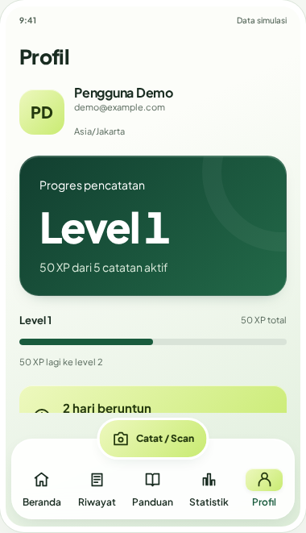
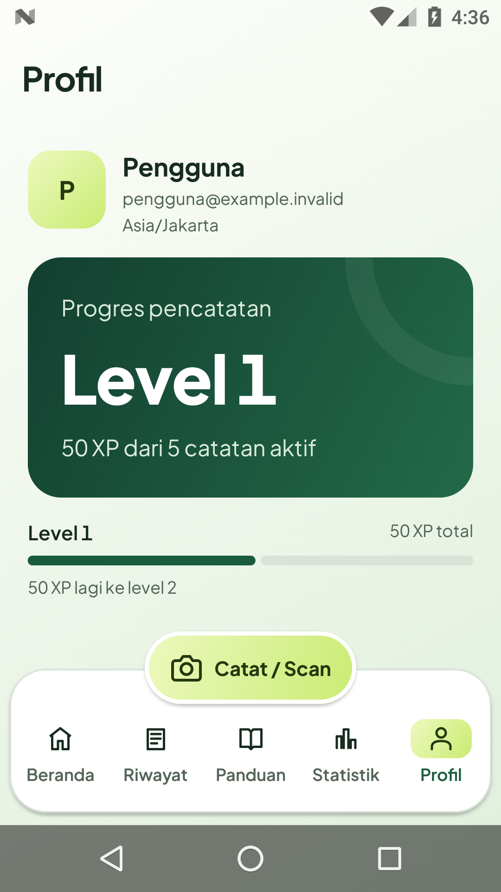
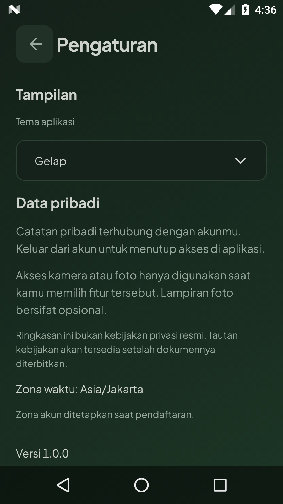

# S14 Profil / S16 Pengaturan — checkpoint 22 Oktober 2026

Acuan: SCREEN_SPEC S14/S16, DESIGN typography/material serta PRD §10. Identitas berasal dari sesi akun aktif. Pada dummy, progres memakai seluruh catatan aktif namespace akun; remote memakai `User.progress`, bukan menghitung XP dari halaman Riwayat parsial.

| Kit S14 | Profil native | Pengaturan native |
|---|---|---|
|  |  |  |

Profil memakai avatar inisial yang dapat bertambah pada teks besar, nama/email/zona, summary pinus, level/XP, bar dan sisa XP. Menu Pengaturan berupa baris berdivider. Keluar memakai tombol sekunder dan D02 sebelum sesi ditutup. Progres tidak dibuat nol ketika loading/error belum memberi data; refresh gagal mempertahankan data akun yang sudah ada dengan retry. Akun kosong memiliki CTA mencatat yang membuka editor.

Pengaturan menjadi entry anak Profil: Back kembali ke Profil, dock ponsel tidak menjadi navigasi layar sekunder, sedangkan rail lebar mempertahankan konteks tab. Field tema membuka pemilih Sistem/Terang/Gelap yang sudah ada. Tema diterapkan segera dan disimpan lewat `ThemePreferences`/SharedPreferences yang sudah digunakan aplikasi; tidak ada migrasi DataStore pada checkpoint ini. Zona read-only, versi build aktual, ringkasan data pribadi dan foto opsional ditampilkan. Tidak ada link kebijakan resmi atau fitur opsi yang belum tersedia.

Streak/achievement tetap gated, sehingga tidak menampilkan hitungan nol palsu atau link buntu. S15 bukan selesai dari checkpoint ini. Kit menyertakan streak dan menu opsi; perbedaan tersebut mengikuti capability/gate produk, bukan pengganti implementasi fitur opsional.

## Perbaikan akun baru

Regresi native mendaftar `profile.zero@example.invalid`, lalu meminta 0 XP. APK sebelumnya gagal: namespace baru berisi lima record/50 XP karena semua store baru menerima seed. Factory sekarang membatasi seed ke `dummy-owner`; akun lain yang pertama kali dibuat mulai dengan array kosong. Record yang sudah tersimpan tidak dihapus atau dimigrasikan. Uji yang sama lulus sesudah perbaikan, dapat membuka editor akun kosong tanpa write/XP, lalu login akun awal masih menampilkan lima record/50 XP.

[Profil akun baru](profile-new-account.png). APK penguji yang sama digunakan untuk pembuktian sebelum/sesudah; eksekusi tambahan tersebut dicatat terpisah dan tidak ditambahkan ke total regresi.

## Verifikasi

137 debug unit tests, nol gagal/error/skip; build aplikasi/instrumentasi native, lint debug dan gate SDK 24/adjustResize/font/OFL lulus. Dua unit test baru mencakup 9/10/11 record, transisi level, edit tanpa XP baru, delete turun level, akun kosong dan tanggal lokal.

60 eksekusi native lulus dari 44 kasus unik; dua skip khusus konfigurasi lain. API 24/SwiftShader, APK app/test identik:

| Konfigurasi | Lulus | Skip |
|---|---:|---:|
| 360 dp / font normal | 44 | 2 |
| 360 dp / font 200% | 8 | 0 |
| 600 dp / font 200% | 8 | 0 |

Regresi normal menjalankan seluruh kelas penguji tema dari AppNavigation, editor, Panduan, detail/hapus, receipt, transisi, Statistik, ditambah ProfileDesign/ProfileNavigation, SessionRoot, Theme dan DummyData. Ini mencakup penyimpanan, idempotency/rollback, pergantian akun, registrasi, Back, tema dan pembatalan logout. Dua konfigurasi besar mengulang lima kasus Profil/Pengaturan, perjalanan Statistik, lima tab/manual serta persistensi pemilih tema. [JSON checkpoint](profile-checkpoint.json) menyebut nama tiap kasus, skip dan hash bukti.

Pemeriksaan manual terpisah menghentikan proses aplikasi, membuka MainActivity kembali, lalu menavigasi Profil → Pengaturan lewat bounds UI yang baru dibaca. Disk dan UI sama-sama menunjukkan DARK/Gelap; lima record dan 50 XP akun awal tetap tersedia. Ini membuktikan tema/data dummy pada restart proses tersebut, bukan draf editor tanpa saved bundle.

Bukti tambahan: [Profil gelap](profile-app-dark.png), [ponsel teks 200%](profile-app-phone200.png), [Pengaturan teks 200%](settings-app-phone200.png), [rail Profil](profile-app-wide200.png), [rail Pengaturan](settings-app-wide200.png), [akun kosong harness](profile-empty-dark200.png), [identitas/progres error harness](profile-error-dark200.png).

Satu run rail kehilangan koneksi UiAutomation, proses instrumen berakhir, kemudian diulang tanpa mengganti APK; run parsial tidak dihitung. Screenshot awal saat scrim dialog tema masih keluar juga tidak digunakan untuk penerimaan. Capture final aplikasi menunggu rentang warna canvas agar scrim tidak dinilai sebagai kontras produk. Window/transition platform 0, animator Compose 1; bukan audit predictive Back.

## Batas checkpoint

Integrasi progres HTTP/refresh profil dan capability metadata, S15/streak/pengingat/foto, dokumen privasi resmi, perangkat fisik, spoken TalkBack, API 36 pada perubahan ini serta audit seluruh kontrol tetap terbuka. Login dummy baseline masih memakai nama Pengguna dan zona Asia/Jakarta; pemulihan nama/zona hasil registrasi setelah logout belum selesai. Matriks Iteration 2 mempertahankan pekerjaan tersebut; PR tetap draft.

Perbaikan berikutnya: [registry nama/zona akun dummy dan pembatalan sesi](ACCOUNT_IDENTITY.md). Batas login ulang di atas berlaku pada APK checkpoint profil, sebelum perbaikan tersebut.
