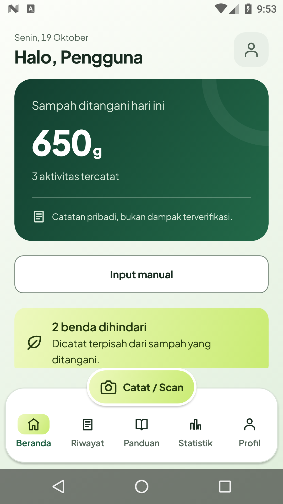
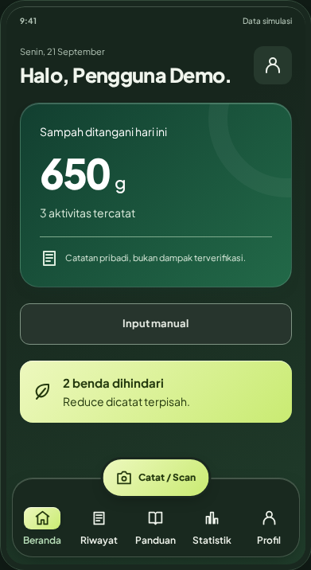
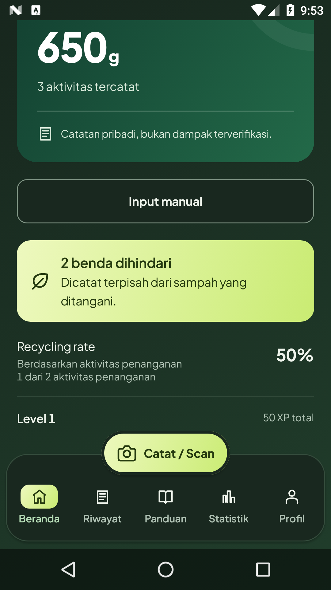

# Checkpoint dock, Beranda dan dummy

Checkpoint Statistik dan bagian scroll: [grafik bernilai, rincian metode/kategori, serta 13 posisi konten dalam dua tema](SCROLLED_CONTENT.md). Build/lint, 171 debug unit tests dan 33 eksekusi native/enam metode unik lulus pada ponsel normal/200% serta rail 600 dp/200%, nol skip. Ada 138 PNG sesudah perubahan dan 24 render kit. Update `main` sampai `c125859` sudah disinkronkan; backend HTTPS kini tersedia tetapi wiring Android masih mengikuti [peta integrasi](../../tasks/BACKEND_INTEGRATION.md). Penerimaan seluruh screen/navbar/navigasi tetap terbuka.

Checkpoint C12/C11/C31: [kategori nonaktif serta picker kategori/satuan/kalender ketika form terkunci](PICKERS.md). Palet field kini dipakai bersama dan picker menutup tanpa callback saat dinonaktifkan. 171 debug unit tests dan 54 eksekusi native/18 metode unik lulus pada tiga konfigurasi, nol skip. Penerimaan seluruh screen/navbar/navigasi tetap terbuka.

Checkpoint C08/C09/C11: [field akun/editor, nilai terisi saat pending, placeholder dan visibility](TEXT_FIELDS.md). Border/placeholder/ikon nonaktif kini mengikuti token opak; 171 debug unit tests dan 33 eksekusi native/11 metode unik lulus pada tiga konfigurasi, nol skip. Seluruh screen/navbar/navigasi tetap dalam pengerjaan.

Checkpoint C06 terbaru: [tombol ikon header/sheet, perbandingan dan regresi dock](ICON_ACTIONS.md). Enam tindakan kini mengikuti soft/ink/radius 12; 171 debug unit tests dan 27 eksekusi native/9 metode unik lulus pada tiga konfigurasi, nol skip. Angka checkpoint lain tetap berlaku pada source masing-masing; seluruh screen/navbar/navigasi belum diterima.

Kelanjutan S07/S10 tersedia pada [bukti Riwayat dan filter](HISTORY.md), S08/D01 pada [bukti Detail dan hapus](DETAIL.md), S06 pada [bukti feedback simpan](SAVE.md), S05/S09 pada [bukti editor Catat/Ubah](EDITOR.md), serta retry/hasil simpan belum pasti pada [bukti submission](SUBMISSION.md), serta transisi editor dan gestur keyboard pada [bukti navigasi](NAVIGATION_MOTION.md), serta gradasi/label tombol utama pada [bukti C03](ACTIONS.md), dan S11/S12 serta viewport selama transisi pada [bukti Panduan](GUIDE.md). Angka tes pada halaman ini merujuk checkpoint awal `1693e7c`, bukan total source terbaru.

19 Oktober 2026. Branch `codex/android-iteration-2-design`, dasar `ceb8707`. Ini bukti untuk perubahan checkpoint, **bukan penerimaan seluruh layar WasteNot**. Matriks pekerjaan lengkap ada di [Iteration 2](../../tasks/ITERATION_2_DESIGN.md).

## Perbandingan visual langsung

Referensi dirender dari `design-system.html` v1.3 dengan Chromium dan font lokal. Hasil Android berasal dari APK native pada emulator API 24. Data awal mengikuti kuantitas kit; nama dan tanggal memakai sumber dummy baru. Reference memiliki frame/status bar dokumentasi, sedangkan Android memiliki system bars asli. Lebar Android ≈390 dp diperoleh dari densitas 443 pada layar fisik 1080×1920; ukuran gambar bukan satuan dp.

| Tema | Render kit v1.3 | Android ≈390 dp |
|---|---|---|
| Terang |  |  |
| Gelap |  |  |

Komposisi sapaan, ringkasan pinus, input manual sekunder, Reduce lime dan dock kini mengikuti arah kit. Dock memiliki radius 26 dp, lima tujuan, bidang ikon aktif lime dan tombol kamera di tengah atas. Baseline opak memang diizinkan DESIGN §2; tidak ada klaim backdrop blur. Penyempurnaan tipografi/detail material dan perbandingan layar lain masih berlanjut. Belum ada klaim semua screen sudah sama dengan mockup.

## Perangkat dan regresi

APK native memakai `-Pwastenot.hotReload=false`, sehingga mendukung API 24 tanpa interpreter HotSwan.

- **101 tes debug unit, 0 gagal/error/skip**. Build debug/aplikasi instrumentasi dan lint debug lulus pada source terakhir checkpoint.
- **API 24, 360 dp, font normal: 11 kasus runner, 10 dijalankan lulus; satu kasus gestur khusus API 36 tidak dijalankan. 66,461 detik.** Mencakup tiga kasus adapter dummy, perbandingan presisi statistik, journey baru, serta regresi tab/Back/filter/range/rotasi/dirty/create/edit/logout/keyboard.
- **API 24, 360 dp, font 200%: journey desain lulus, 19,098 detik.** Kelima tab, target sentuh ≥48 dp, sheet, manual, tema dan recreate diperiksa.
- **API 24, 600 dp, font 200%: journey yang sama lulus, 18,450 detik.** Aksi rail ditata vertikal agar kata Catat/Scan tidak pecah. Tes memeriksa batas baris dari `TextLayoutResult`, sehingga bukan sekadar menemukan string di semantics.
- Pemeriksaan window nyata setelah cold start memastikan Beranda tersedia, tombol Tutup mengembalikan dock, dan Back sistem saat sheet terbuka menutup modal tanpa keluar dari aplikasi. Driver membaca hierarchy window setiap langkah; pemeriksaan ini terpisah dari dispatcher Back editor pada suite Compose.
- Baseline ≈390 dp juga menjalankan suite 11 kasus runner dengan 10 kasus lulus dan satu kasus API 36 tidak dijalankan, 63,662 detik. Setelah itu susunan rail disempurnakan; tiga konfigurasi di atas dijalankan kembali.
- Gate native lulus untuk API 24, `MainActivity.adjustResize`, lima font dan lisensi OFL. Verifier environment/isolasi APK serta lima skenario packaging release lulus. Pemeriksaan status Actions mengikuti SHA pada PR, bukan dianggap selalu lulus dari dokumen ini.

Tes dummy memeriksa rekonstruksi store/sesi, idempotency key yang tetap berlaku, konflik version, jumlah record tidak berganda, isolasi namespace akun, data rusak tidak diganti seed sukses, login ulang akun fixture, logout, serta password tidak masuk preferences. Ini bukan tes autentikasi atau database server. Pergantian proses sistem untuk draf dummy baru belum diaudit ulang.

| Konfigurasi | Terang | Gelap | Sheet |
|---|---|---|---|
| 360 dp, normal | [Beranda](home-light-360.png) | [Beranda](home-dark-360.png) | [Sheet](capture-sheet-360.png) |
| 360 dp, 200% | [Beranda](home-light-360-font200.png) | [Beranda](home-dark-360-font200.png) | [Sheet](capture-sheet-360-font200.png) |
| 600 dp, 200% | [Rail](home-light-600-font200.png) | [Rail](home-dark-600-font200.png) | [Sheet](capture-sheet-600-font200.png) |

Pada teks 200%, konten Beranda dapat digulir dan label tab membungkus. Screenshot Beranda besar diambil setelah menggulir ke angka utama; bukan bukti header di posisi paling atas. Screenshot API 24 juga memuat UI sistem lama. Sheet memakai navigation bar pinus pada API 24–25 agar ikon sistem putih tetap terbaca.

## Gate perubahan checkpoint

- **Hard PASS untuk kontrol yang diubah:** perjalanan perangkat membuka lima tab, profil dari header, input manual Beranda/sheet, riwayat, detail, tema, lalu memulihkan state setelah recreate. Tidak ada tombol masuk demo. Kamera masih memiliki keterangan belum tersedia; alur foto/AI belum diterima.
- **Purpose PASS:** alasan warna, font, ikon, komposisi, radius, gradient dan baseline opak mengikuti DESIGN §1–5/12; dicatat pada dokumen Iteration 2. Sumber angka adalah fixture PRD dan catatan dummy tersimpan.
- **Liveliness PASS untuk checkpoint:** ENERGY 2 / RHYTHM 2 / MOTION 1, satu angka utama, daftar sekunder, aksen lime dan fade 180 ms. Kualitas predictive Back per frame belum dievaluasi ulang.
- **Craft PASS untuk keterbacaan konfigurasi yang diuji:** tema terang/gelap, font normal/200%, dock/rail dan keyboard diperiksa. Kontras aktual dihitung: teks lime ≥9,37:1; teks sekunder canvas terang 5,24:1 dan gelap 6,50:1; teks summary pada highlight paling terang 4,63:1; ikon sistem putih pada pinus 11,80:1. Gate ini tidak mengubah status layar lain menjadi selesai.

## Pekerjaan berikutnya

Lanjutkan kriteria editor/konflik/draf, cursor Riwayat, penerimaan Panduan, Statistik/grafik, Profil/achievement/pengaturan, serta alur foto/AI sesuai matriks Iteration 2. Audit state kosong/error dan proses mati setelah masing-masing alur tersedia. Placeholder Panduan sudah diganti daftar/detail dengan fixture editorial kit. Kelanjutan kamera/scan tersedia pada [checkpoint S21–S25](SCAN.md): CameraX, tinjau foto dan alur dummy sampai prefill editor. Backend HTTP diintegrasikan setelah layanan ada; penerimaan seluruh UI masih berjalan.

Checkpoint S13: [Statistik 7/30 hari, chart dan alternatif teks](STATISTICS.md). Koreksi pembacaan glyph pada bukti sebelumnya: [pemeriksaan ulang](VISUAL_RECHECK.md).

Checkpoint S14/S16: [Profil, Pengaturan dan akun baru kosong](PROFILE_SETTINGS.md).

Checkpoint S02/S03/C24/C25/C35: [form akun, proporsi dock dan label utuh pada teks besar](NAV_AUTH.md).

Checkpoint S21–S25/C36–C39: [kamera, objek, kondisi, saran dan fallback dalam satu sheet](SCAN.md).

Checkpoint S09/D04/C27: [konflik edit, pilihan eksplisit dan dialog sesuai render kit](CONFLICT.md).

Checkpoint S01/C01/C29: [pemulihan sesi, wordmark bersama dan sampel transisi root](STARTUP.md).

Checkpoint D02/D03/C27 dan lebar label C03: [Keluar, Buang perubahan, Tutup formulir dan keyboard](EXIT_DIALOGS.md).

Checkpoint A05/S05/S09/D03/C27–C29: [draf per akun, pemulihan proses, retry idempotent dan pembersihan eksplisit](DRAFTS.md).

Checkpoint D02/C27/root akun dan auth: [status menunggu/gagal, retry, pemulihan dialog dan warna nonaktif](SESSION_EXIT.md).

Checkpoint C04/C07: [secondary bersama, D01 pending, label panjang, keyboard dan regresi lintas layar](SECONDARY_ACTIONS.md).

Checkpoint C05: [text action bersama, form pending opak, label panjang, kalender/tema dan regresi pemakai](TEXT_ACTIONS.md).

Checkpoint sembilan viewport S04–S16 dan aksi rail pada halaman anak: [review kit/native dan batas penerimaan](SCREENS_NAVIGATION.md).

Checkpoint material S04/S13/S14, primary C03 dan proporsi ikon S12: [perbandingan kit/native, geometri dan regresi](MATERIALS.md).
