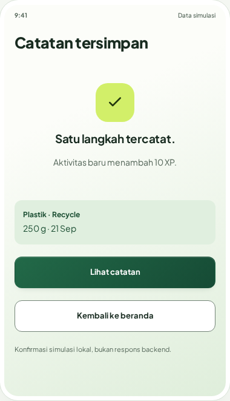
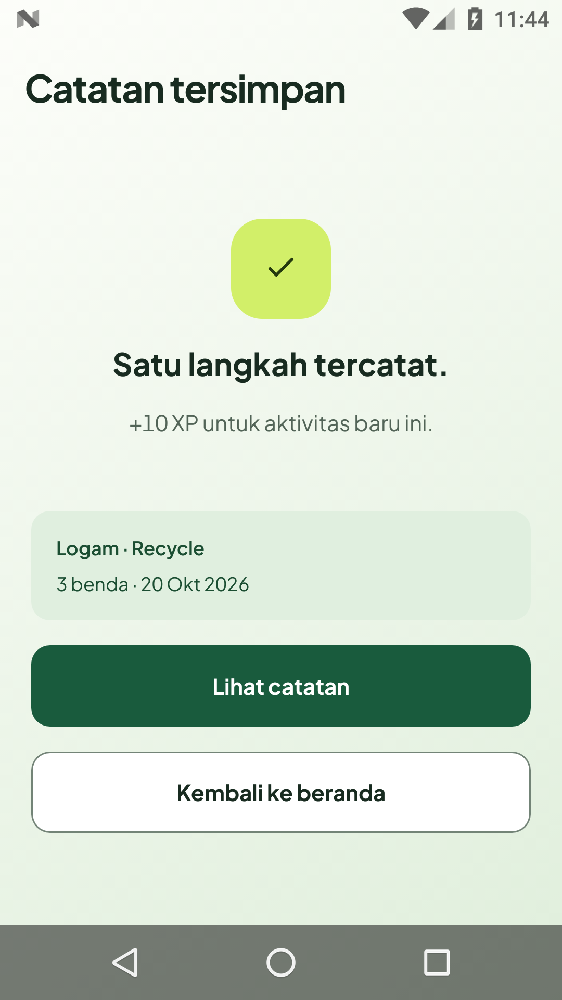
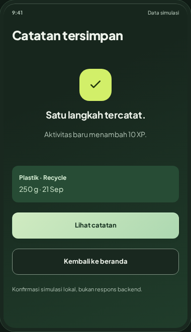
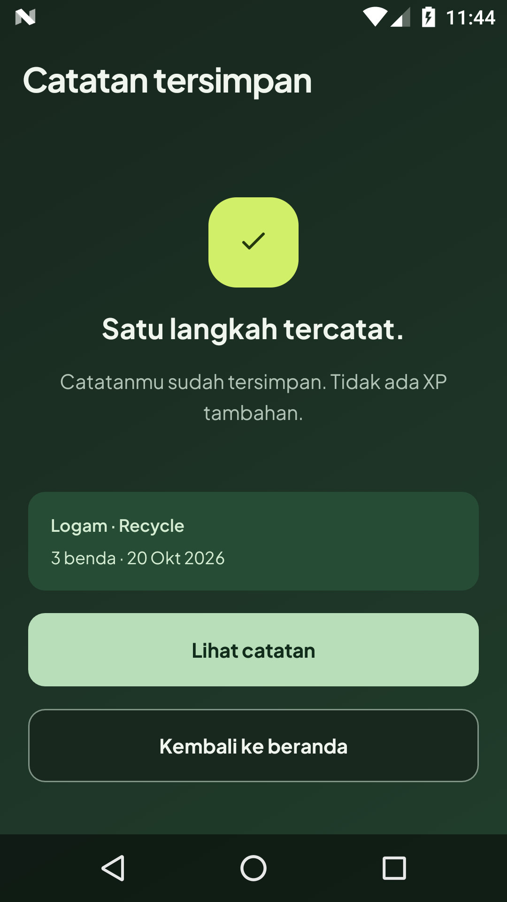

# Feedback simpan: S06

20 Oktober 2026 · branch `codex/android-iteration-2-design`. Mengikuti SCREEN_SPEC S06 dan render kit v1.3. Ini kelanjutan [detail/hapus](DETAIL.md); [cakupan seluruh Iteration 2](../../tasks/ITERATION_2_DESIGN.md) tetap aktif.

## Komposisi dan referensi

| Tema | Referensi kit | Android 360 dp |
|---|---|---|
| Terang, create |  |  |
| Gelap, edit |  |  |

Referensi berasal dari galeri S06, berisi contoh create Plastik 250 g. Android memakai catatan Logam 3 benda yang benar-benar disimpan oleh adapter dummy pada journey pengujian. Karena galeri menampilkan create, teks XP referensi gelap berbeda dari hasil edit Android. Tanggal mengikuti akun, bukan diganti dengan tanggal mockup. Frame/status bar HTML bukan system bars Android. Keterangan simulasi HTML tidak disalin ke produk sesuai permintaan pengguna.

Panel status mengikuti ikon centang kit 24 dp dalam bidang lime 64 dp/radius 20, judul dan helper rata tengah, ringkasan dengan radius 12, dua tombol lebar dan bidang opak untuk aksi sekunder. Heading memakai 20 sp, kategori/metode 12 sp, isi mengikuti role typography kit. Konten maksimal 560 dp dan dapat digulir pada teks besar. ENERGY 2 / RHYTHM 2 / MOTION 1; tidak ada konfeti, suara atau animasi penghargaan berulang.

## Kontrak transaksi dan navigasi

- `ActivityCreation(log, created)` membedakan create baru dari replay yang mengembalikan ID sama. Adapter dummy menerbitkan `created=true` hanya setelah commit catatan baru berhasil; pembacaan request yang sudah tersimpan mengembalikan false. Format preferences tidak berubah.
- ViewModel membawa flag itu pada hasil simpan yang dikorelasikan dengan request ID. Update selalu false. `+10 XP` hanya muncul untuk create baru yang dikonfirmasi. Edit/replay menunjukkan tidak ada XP tambahan; angka tidak disimpulkan dari jumlah item yang kebetulan ada di cache UI.
- Timeout/error tidak mengirim hasil sukses ber-ID ke UI. Jika transaksi sudah tersimpan tetapi respons hilang, retry payload/request ID yang sama mengembalikan record yang sama tanpa reward baru. Hasil tersebut baru mengizinkan navigasi setelah respons berhasil.
- S06 adalah state hasil pada route `LogDetail(id)`, bukan tab atau NavKey baru. Hasil editor dikonsumsi sekali. “Lihat catatan” menutup feedback dan menampilkan detail; “Kembali ke beranda” membuka root Beranda. Ketukan tab biasa tetap mempertahankan stack masing-masing.
- Feedback yang memuat aksi tidak memakai timer. ID hasil dan flag create tersimpan sebagai state UI nonrahasia sehingga Activity recreate tidak menutup feedback atau mengulangi transaksi. Back kembali ke sumber dan membersihkan feedback terkait; setelah ack tidak muncul lagi saat detail dibuka kembali.
- Semantics menyediakan heading, live region Polite serta state description “Catatan tersimpan”. Ini kontrak semantics, belum bukti pembacaan seluruh alur oleh layanan TalkBack nyata.

## Bukti pengujian

Build native/aplikasi instrumentasi dan lint debug setelah penyelarasan visual lulus; **113 debug unit tests, 0 gagal/error/skip**. Gate APK membuktikan minimum API 24, MainActivity adjustResize, lima font dan lisensi OFL. Hasil mencakup kasus respons create hilang setelah commit, retry tanpa record/reward baru serta receipt update tanpa flag create.

- **API 24, 360 dp, font normal:** 16 kasus runner, **15 dijalankan lulus**, satu kasus khusus rail dilewati; 85,179 detik. Termasuk delapan tes penyimpanan dummy: persistensi/replay, isolasi, versi/tombstone, rollback cache/commit, seed gagal dan 16 adapter konkuren. Tepat satu adapter menerima receipt create baru; adapter berikutnya menerima replay.
- **API 24, 360 dp, font 200%:** tujuh kasus runner, **enam dijalankan lulus**, satu kasus khusus rail dilewati; 46,231 detik. Create/feedback/rotasi/Home, edit tanpa XP baru, semantics/callback/target tombol, detail/delete, stack dan create/edit lama diuji.
- **API 24, 600 dp, font 200%:** **tujuh kasus lulus**, 67,780 detik. Termasuk pemulihan stack per tab dan delete ke daftar Riwayat pada rail.
- Setelah journey diperluas, **satu kasus tambahan rail/200% lulus (18,412 detik)**: Beranda mempertahankan detail Plastik, create dilakukan dari Riwayat, lalu Kembali ke beranda membuka root Beranda. Hasil edit dan total XP tetap benar. Ini penajaman precondition pada tes; source aplikasi dan susunan visual tidak berubah.

| Konfigurasi | Awal feedback | Ringkasan | Edit gelap |
|---|---|---|---|
| 360 dp, 200% | [Awal](save-light-start-360-font200.png) | [Ringkasan](save-light-360-font200.png) | [Edit](save-edit-dark-360-font200.png) |
| 600 dp, 200% | [Feedback + rail](save-light-600-font200.png) | [Feedback + rail](save-light-600-font200.png) | [Edit + rail](save-edit-dark-600-font200.png) |

Pada teks 200%, paragraf membungkus dan sebagian aksi berada di bawah viewport awal. Suite mencapai kedua aksi lewat scroll; tidak mengklaim semua konten muat sekaligus. [Feedback setelah Activity recreate](save-restored-360-font200.png) tetap memuat hasil yang sama tanpa submit ulang. Screenshot API 24 juga memuat UI sistem lama; clipping jam sistem bukan clipping judul aplikasi.

Build awal sebelum penyelarasan visual lulus, **113 debug unit tests, 0 gagal/error/skip**. Journey native awal lulus (18,523 detik): create, feedback, Activity recreate, kembali Beranda, total 60 XP, edit pada tema gelap, tanpa reward baru dan detail nilai tersimpan. Pengujian tersebut membuktikan fondasi interaksi; screenshot final dan konfigurasi teks besar dicatat terpisah.

## Verifikasi checkpoint

- **Hard PASS untuk kontrol yang diubah:** kedua aksi benar-benar digunakan, target ≥48 dp diperiksa, data berasal dari receipt tersimpan dan tidak ada jalur demo pada feedback. Timeout tidak menghasilkan ID sukses; replay/edit tidak mengumumkan reward baru. Loading/error tetap berada pada editor/detail, bukan menampilkan halaman sukses kosong.
- **Purpose PASS:** centang menandai write terkonfirmasi; lime memfokuskan status, panel ringkasan menampilkan data tersimpan dan dua aksi mempunyai tujuan berbeda. Tidak ada glass, shadow besar atau gerak dekoratif pada feedback.
- **Liveliness PASS untuk S06:** ENERGY 2 / RHYTHM 2 / MOTION 1, satu fokus status, warna pinus–lime dan susunan kit dipakai pada kedua tema. UI sistem/frame serta isi fixture tidak dianggap bagian dari kecocokan pixel.
- **Craft PASS pada konfigurasi teruji:** ponsel/rail dan teks normal/200% diperiksa. Kontras token aktual: helper pada canvas ≥5,24:1, ringkasan ≥7,78:1, primary CTA ≥8,06:1, ikon lime 9,77:1, secondary label ≥13,91:1 dan outline ≥3,97:1 pada kedua tema. Semantics diuji; spoken feedback dan process death tetap audit tersendiri.

Primary CTA menggunakan primitive bersama `ActionButton` dengan warna primary/onPrimary baseline DESIGN §6. Penyelarasan material gradient/highlight primitive tersebut terhadap render HTML masih bagian dari audit komponen global; halaman ini tidak mengklaim penerimaan visual akhir seluruh aplikasi.

## Batas checkpoint

Adapter HTTP write belum mengonsumsi status 201/200 server nyata. Saat backend diintegrasikan, flag create harus berasal dari kontrak respons, bukan perkiraan client. Tidak ada klaim endpoint atau progres cloud sudah diuji. Pengujian process death berbeda dari Activity recreate dan belum dibuktikan untuk route hasil ini. Audit spoken feedback TalkBack dan keseluruhan state layar lain tetap terbuka.

S05/S09 editor/konflik D04, pagination cursor/pull-to-refresh, Panduan/detail, grafik Statistik, Profil/achievement/pengaturan dan foto/AI masih perlu dilengkapi. Issue #61 tetap In progress, Iteration 2, assignee `oktavsm`; bukti lokal tidak menutup kriteria integrasi/penerimaan yang belum diuji.
