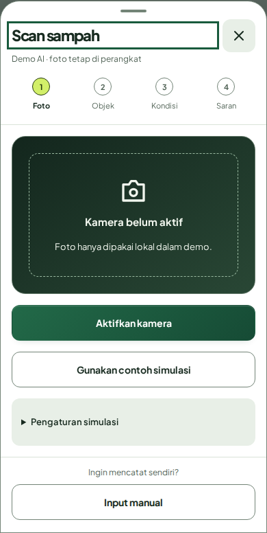
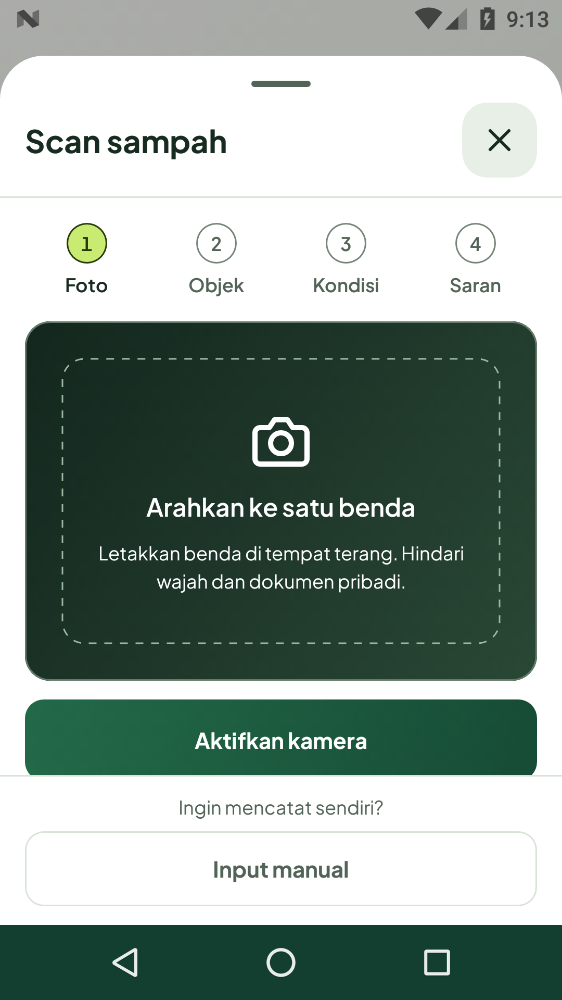
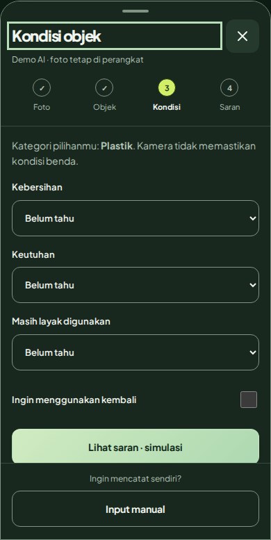
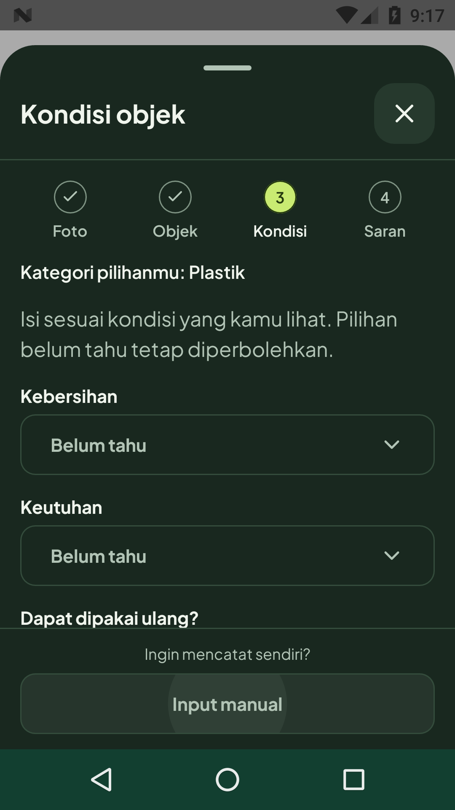
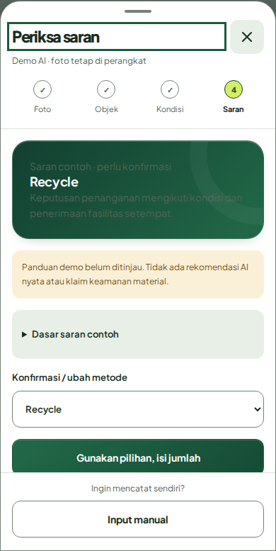
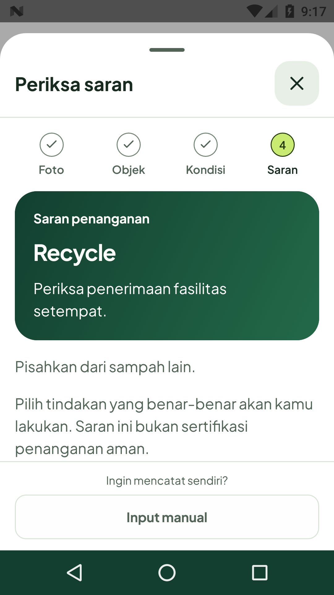

# Catat/Scan: foto sampai form Catat

23 Oktober 2026. Checkpoint S21–S25/C36–C39; penerimaan seluruh produk pada [matriks Iteration 2](../../tasks/ITERATION_2_DESIGN.md) tetap terbuka. [Manifest bukti](scan-checkpoint.json) mengikat source, APK native/penguji, hasil tiap kasus dan gambar.

## Kit dan implementasi

| Panel | Render kit v1.3 | Android API 24 |
|---|---|---|
| Kamera |  |  |
| Kondisi gelap |  |  |
| Saran |  |  |

Referensi berasal dari HTML/font lokal kit yang diminta. Teks/skenario simulasi katalog sengaja tidak menjadi kontrol aplikasi. Screenshot Android mempertahankan status/navigation bar dan viewport perangkat; tabel membandingkan komposisi, bukan kesamaan setiap piksel. Role tipografi memakai skala Android pada DESIGN §3. Konten panjang dapat digulir; Input manual tetap di footer opak.

- Satu sheet opak, sudut atas 28 dp, handle dekoratif, judul dan tombol tutup 48 dp. Tahap Foto → Objek → Kondisi → Saran memakai indikator lime; padding ponsel 16 dp, viewport lebih besar 24 dp. Pada teks besar tahap mengalir menjadi dua kolom, tanpa mengecilkan huruf.
- Kamera diaktifkan lewat tindakan pengguna dan izin Android. Preview/ImageCapture mengikuti lifecycle; foto ditinjau sebelum Scan foto. Tidak ada tombol contoh, pemilih skenario, upload stream atau ImageAnalysis.
- Hasil dummy berupa botol dengan kategori kosong. Daftar dan bbox memakai ID yang sama; bbox dihitung terhadap gambar berorientasi benar dengan ContentScale.Fit/letterbox. Pengguna wajib mengonfirmasi material. Skor disebut skor deteksi, bukan akurasi.
- Kebersihan, keutuhan, kelayakan pakai dan rencana penggunaan ulang berdiri sendiri; default UNKNOWN/null. Kembali untuk koreksi mempertahankan konteks pada objek/material yang sama. Mengganti objek/material mereset konteks dan membatalkan saran lama. Koreksi juga tersedia ketika saran sedang dimuat.
- Saran menampilkan metode, alasan, peringatan yang langsung terlihat, serta disclosure judul/versi/langkah panduan. Pilihan scan dibatasi Reuse/Recycle/Trash. Tidak ada metode otomatis untuk special handling atau panduan yang tidak cocok.
- Gunakan pilihan membuka S05 dengan kategori/metode yang dikonfirmasi, jumlah kosong, unit g dan tanggal aturan core. Prefill menjadi draf dirty yang mengikuti D03; membaca/menerima saran tidak membuat log atau XP. Manual sebelum konfirmasi tidak membawa kategori tebakan.

## Kamera dan data dummy

[Izin ditolak](scan-camera-denied.png), [foto hasil capture](scan-photo-review.png), [review objek setelah material dipilih dan digulir](scan-object-review.png), dan [form dengan jumlah kosong](scan-editor-prefill.png).

Capture memakai kamera emulasi milik AVD `wastenot_api24`, bukan ilustrasi yang disuntikkan ke UI kamera. Pola kotak pada foto memang keluaran kamera emulasi. Deteksi/rekomendasi sesudahnya tetap adapter dummy; screenshot ini tidak membuktikan pengenalan objek, akurasi YOLO, kurasi panduan atau layanan server.

Fixture rekomendasi hanya memetakan kandidat botol yang dikenal dan material plastik ke artikel kit. Material/objek lain menuju manual, tidak mendapat artikel acak berdasarkan kategori. Judul dan versi `kit-v1.3` dipertahankan tanpa mengarang URL/tanggal review. Hasil masuk ke draf manual; provenance AI server belum dibuat. Adapter remote scan belum dikonfigurasi dan memberi fallback.

Foto disimpan sebagai JPEG dalam cache privat, bukan galeri/lampiran/backup. Orientasi dinormalisasi, EXIF dibuang, ukuran dibatasi ≤5 MiB, ≤12 MP dan sisi ≤4096 sebelum decode penuh. Capture meminta resolusi sekitar 1280×960 dengan fallback perangkat. Retake/close/manual/logout membuang referensi/foto; callback lama menghapus hasil yang datang setelah sheet ditutup. Cleanup WorkManager dijadwalkan satu jam dan ada sweep saat alur dibuka. Jadwal OS dapat tertunda oleh Doze/force-stop; batas keras satu jam tetap gate pilot, bukan jaminan yang sudah dibuktikan.

Implementasi mengikuti [CameraX](https://developer.android.com/jetpack/androidx/releases/camera), [konfigurasi kamera](https://developer.android.com/media/camera/camerax/configuration) dan [WorkManager](https://developer.android.com/jetpack/androidx/releases/work). Tidak ada koneksi upload/inference pada adapter dummy.

## Verifikasi

152 debug unit tests, nol gagal/error/skip. Build native, lint dan konfigurasi default yang dipakai hook lulus. Gate API 24/adjustResize/lima font/OFL lulus pada APK native yang dibekukan. Sembilan [pasangan token warna](scan-contrast.json) lulus AA; minimum 6,327:1. Ini perhitungan pasangan warna, bukan pengukuran semua piksel/state.

| Konfigurasi API 24 | Kasus runner | Lulus | Skip | Detik |
|---|---:|---:|---:|---:|
| Ponsel 360 dp, normal | 24 | 23 | 1 | 226,577 |
| Dialog izin + capture + prefill | 2 | 2 | 0 | 19,892 |
| Ponsel 360 dp, teks 200% | 5 | 5 | 0 | 48,303 |
| Rail 600 dp, teks 200% | 6 | 6 | 0 | 69,848 |

Total **36 eksekusi lulus / 26 kasus unik / satu skip khusus API lebih baru**. App dan test APK identik pada semua run akhir. [Kondisi pada 600 dp/200%](scan-context-wide200.png). Run kandidat yang gagal atau berasal dari APK sebelumnya tidak dijumlahkan.

Unit tests memeriksa kategori yang belum dikonfirmasi, konteks independen/preservasi/reset, kandidat lemah/kosong, duplikat ID, bbox invalid/letterbox, timeout, respons lama setelah cancel, foto hilang/expired, special handling, metode Reduce yang ditolak, panduan tidak cocok dan payload editor yang masih membutuhkan jumlah.

Native menguji semua panel/loading/fallback pada kedua tema, footer manual, ukuran indikator tahap, pemilihan material, konteks, sumber/peringatan dan konfirmasi metode. Tes kamera menekan dialog izin OS: penolakan menjelaskan hasil dan tetap menuju manual; persetujuan membuka preview, menghasilkan satu JPEG privat, lalu melalui dummy sampai form. Data catatan tidak berubah, foto terhapus, draf meminta D03 dan profil tetap 50 XP. Setelah keluar, service kamera melaporkan `Active Camera Clients: []` pada AVD ini.

Suite kamera dimulai dengan izin CAMERA dicabut dari luar proses instrumentation; mencabutnya di dalam runner dapat mematikan proses penguji. Pada emulator API 24, `pm clear-permission-flags` tidak tersedia dan tidak dipakai sebagai bukti reset flag. Tes memakai dialog OS dan ID tombol yang benar-benar tersedia.

## Temuan yang diperbaiki

- [Sebelum: indikator oval pada teks 200%](scan-step-phone200-before.png). [Sesudah](scan-step-phone200.png): ukuran lingkaran mengikuti line height font, sementara indikator selesai/current memiliki ukuran yang sama. Penguji sekarang memeriksa lebar sama dengan tinggi dan ukuran keempat penanda. Pemeriksaan lama yang hanya menguji footer belum menangkap masalah ini.
- Pada percobaan UI, hasil DENY pernah diabaikan oleh guard lifecycle RESUMED. Guard sekarang menerima hasil ketika STARTED selama sesi masih hidup; hasil setelah sheet ditutup/background tetap dibatasi. Tes dialog OS di atas memeriksa pesan penolakan dan perjalanan persetujuan.
- Kandidat awal penguji kamera memakai matcher Input manual yang ambigu terhadap Beranda di belakang modal; matcher diperbaiki ke sheet. Penguji dialog kemudian membutuhkan ID accessibility dan jendela sheet yang sudah tenang. Run gagal tersebut tidak masuk total akhir.
- Satu gambar bertag capture-sheet dari suite lama ternyata menangkap Beranda. Gambar itu dikecualikan dari bukti kamera; bukti di halaman ini berasal dari perjalanan kamera tersendiri dan pemeriksaan PNG.

## Gate yang masih terbuka

Checkpoint ini membuktikan UI/client dengan dummy dan kamera emulasi pada konfigurasi yang disebutkan. Uji perangkat fisik/API lebih baru, spoken TalkBack/fokus setelah seluruh pergantian panel, permanent denial/Settings, background/cancel saat capture berlangsung, rotasi kamera nyata, process death nyata, deadline cleanup OS, dan kebijakan panduan terverifikasi masih terbuka. Integrasi HTTP, katalog/mapping/band dari server, retry/dedup/rate limit, versi/expiry rekomendasi dan provenance transaksional tetap pekerjaan integrasi. Pemeriksaan repositori organisasi yang dapat diakses masih menemukan Android dan landing; tidak ada klaim backend sudah terintegrasi.

Identitas visual: ENERGY 2 / RHYTHM 2 / MOTION 1. Pinus memisahkan kamera/saran dari form; lime menandai tahap aktif; Plus Jakarta Sans dan ikon kit menjaga konsistensi. Tidak ada animasi dekoratif baru. Penerimaan seluruh layar, materi visual global dan navigasi produk tetap mengikuti matriks, sehingga PR tetap draft.
