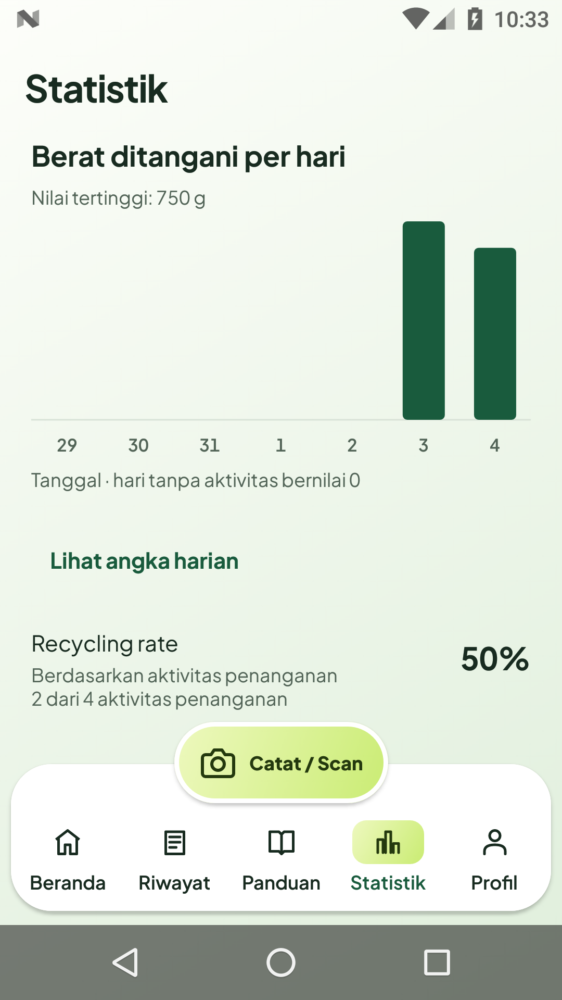
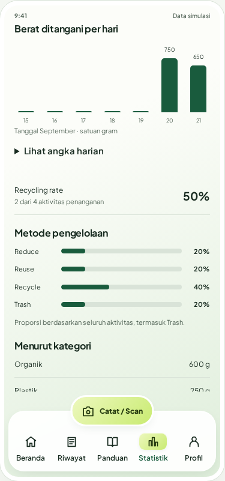
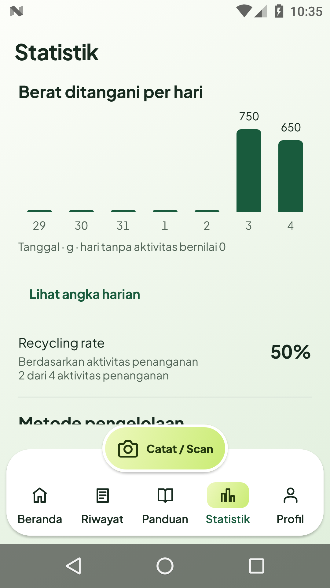
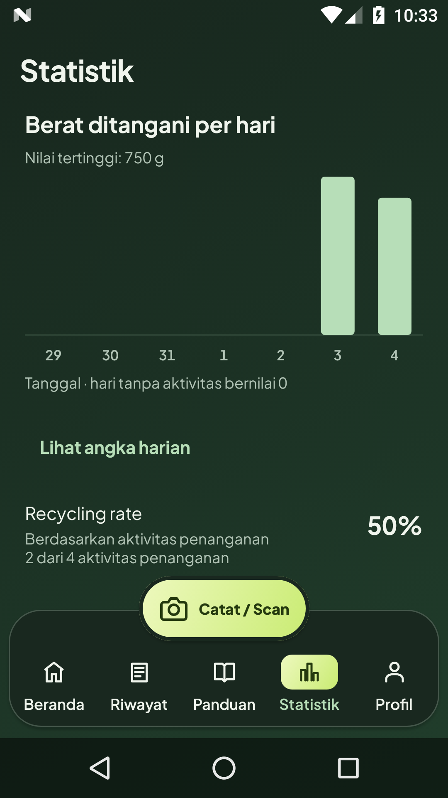
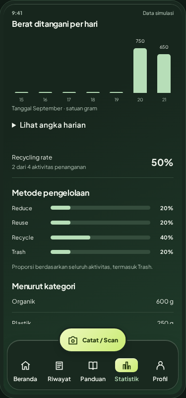
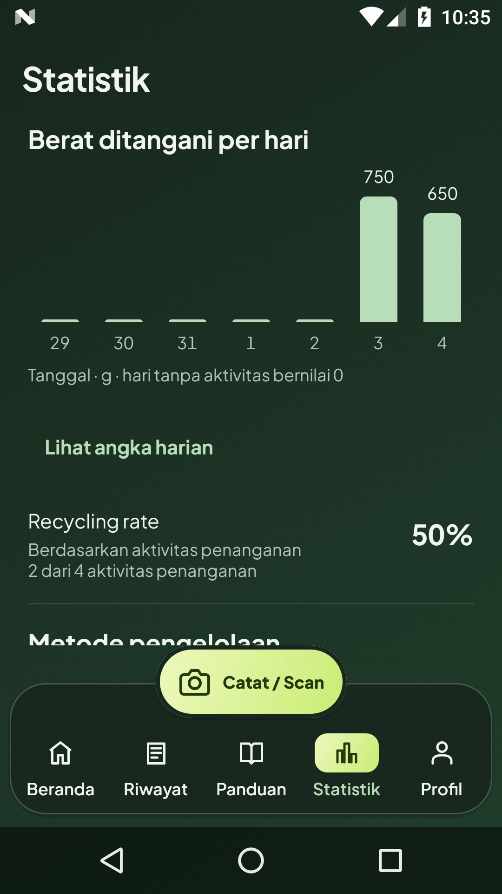

# Statistik dan konten setelah digulir

Checkpoint lanjutan Iteration 2, 4 November 2026. Sumber visual tetap `design-system.html` v1.3 beserta `DESIGN.md` dan `SCREEN_SPEC.md`. Ini pemeriksaan bagian konten tertentu, bukan penerimaan seluruh UI.

## Perubahan

Grafik mingguan menampilkan nilai positif di atas batang, termasuk 750 dan 650 pada fixture kit. Grafik sebelumnya belum menggambar nilai ini. Tinggi maksimum batang mengikuti referensi: 90 dp untuk tujuh hari dan 95 dp untuk 30 hari; sudut atas 5 dp. Penanda dasar minimum 2 dp mengikuti `.chart-bar` pada kit, termasuk hari kosong. Penanda tersebut tidak mengubah jumlah: hari kosong tetap 0 pada data dan rincian teks.

Nilai dan tanggal menggunakan `bodySmall` 12/18 sp sesuai skala Android dalam DESIGN. Ukuran kecil 9 px pada pratinjau HTML tidak disalin menjadi 9 sp; `labelSmall` 11 sp sebelumnya juga tidak lagi dipakai untuk sumbu. Lebar kolom mempertimbangkan hasil pengukuran seluruh label. Bila angka dan ukuran teks membutuhkan ruang lebih besar, hanya bidang grafik yang dapat digeser, disertai petunjuk. Halaman tetap selebar viewport. Satuan g dan benda tetap terpisah dan rincian setiap tanggal tetap dapat dibuka sebagai teks.

Empat resource mode contoh yang tidak lagi memiliki pemakai dihapus. Cabang ringkasan remote yang belum tersedia sekarang mengatakan “Ringkasan belum tersedia.” Adapter dummy tetap default, dengan penyimpanan per akun dan alur simpan yang sudah ada. Penghapusan teks tidak diklaim sebagai integrasi backend.

Rincian metode kini satu baris label–grafik–persentase sesuai mockup. Lebar label dan persentase diukur dengan ukuran teks aktual. Jumlah aktivitas per metode menjadi deskripsi aksesibilitas pada baris, sehingga informasi perhitungan tetap tersedia. Kategori memakai dua kolom nama dan jumlah dengan divider; ikon tambahan dan keterangan 0 benda berulang dihapus. Jumlah benda positif tetap tampil sebagai satuan tersendiri, mengikuti perilaku kit. Keterangan basis kategori tetap tersedia pada heading aksesibilitas dan Reduce tetap ditampilkan terpisah dalam ringkasan.

## Cakupan pemeriksaan

`ScreenKitReviewTest.scrolledSectionsStayReachableAboveTheDock` membuka kedua tema dan memeriksa 13 posisi: aktivitas terbaru Beranda; tindakan Detail; akhir Riwayat; akhir artikel dan daftar Panduan; grafik mingguan, rincian harian, metode, akhir kategori dan grafik bulanan Statistik; akhir Profil; akhir Pengaturan; dan tombol Simpan editor. Perjalanan menggunakan sentuhan melalui Android input dispatch pada tab. Aksi hapus/keluar/simpan hanya diperiksa keterjangkauannya, tidak dijalankan dalam pemeriksaan ini.

`StatisticsDesignTest` mempertahankan pemeriksaan hari nol, perubahan gram/benda/Reduce, periode kosong/30 hari dan kegagalan refresh/retry. Kasus baru memakai tujuh nilai harian 100.000 g, menggeser grafik hingga tanggal terakhir, lalu membuka rincian tepat 100.000 g tanpa mengecilkan teks.

## Hasil terverifikasi

Native build memakai `-Pwastenot.hotReload=false`, JDK 17 dan emulator API 24. Build, lint dan 171 debug unit tests lulus, nol gagal/error/skip. APK aplikasi SHA-256 `82355d4120d8ea1cc2f924b43a73063d38d0ea04fd740a79faf9a5931bf12f3a`; APK penguji `6067ca6487c3350d7677cccf3cf76924c7175af31adac5109b77663c83dc08a6`.

| Konfigurasi | Eksekusi lulus | Gagal / skip | Durasi tes |
|---|---:|---:|---:|
| Ponsel 360 dp, teks 100% | 11 | 0 / 0 | 72,683 dtk |
| Ponsel 360 dp, teks 200% | 11 | 0 / 0 | 74,244 dtk |
| Rail 600 dp, teks 200% | 11 | 0 / 0 | 126,623 dtk |

Total **33 eksekusi dari enam metode tes unik**, mencakup kedua tema. Ada 138 PNG sesudah perubahan, termasuk 78 viewport section dengan metadata caption/navbar tanpa pelanggaran pemeriksaan yang direkam. Bukti juga memuat 40 PNG baseline dan 24 render kit. [Manifest](scrolled-content-checkpoint.json) mengikat source, kedua APK, log dan gambar. Hasil lama pada dokumen checkpoint lain tetap berlaku pada source masing-masing.

Baseline `6c3548c` dijalankan dengan APK penguji yang sama. Perjalanan 13 posisi dalam kedua tema lulus. Dua pemeriksaan baru gagal pada masing-masing tema Statistik: bidang grafik yang dapat digeser belum ada, dan jumlah metode masih berupa caption teks, belum berupa state description pada baris ringkas. Empat kegagalan ini adalah perbedaan kontrak pemeriksaan baru; bukan klaim bahwa baseline kehilangan informasi jumlah metode. Perbedaan tampilan angka batang serta susunan metode/kategori diperiksa langsung pada gambar sebelum/sesudah.

Transfer hasil perjalanan ponsel 200% terputus setelah JUnit sudah melaporkan `OK (1 test)`. APK aplikasi/penguji terpasang diverifikasi ulang, 26 pasang gambar/metadata diambil kembali dari emulator, dan seluruh PNG serta konfigurasi diperiksa. Kasus perangkat tersebut tidak diulang atau dihitung dua kali. Transfer parsial disimpan sebagai diagnostik di artifact root eksternal.

## Perbandingan visual

Frame HTML memiliki kanvas 360 px dalam bingkai 374 px dan tinggi pratinjau 800 px. Ponsel native memiliki layar 360×640 dp termasuk system bars. Tanggal native mengikuti seed lokal saat pengujian; fixture HTML tetap September. Foto berikut adalah posisi setelah digulir, sehingga isi sebelum posisi tersebut memang dapat berada di luar viewport.

| Tema | Baseline Android | Kit | Android sesudah |
|---|---|---|---|
| Terang, grafik mingguan |  |  |  |
| Gelap, grafik mingguan |  |  |  |

Rincian metode: [sebelum](scrolled-content/before-S13-methods-light.png), [kit](scrolled-content/reference-S13-methods-light.png), [sesudah](scrolled-content/normal-S13-methods-light.png), [ponsel 200%](scrolled-content/phone200-S13-methods-light.png), [rail 200% gelap](scrolled-content/wide200-S13-methods-dark.png). Kolom metode memakai minimum 66/35 dp dan gap 12 dp dari CSS kit, lalu bertambah menurut lebar label aktual. Kategori memakai padding vertikal 12 dp dan gap 16 dp; tidak menggandakan jarak section di antara row dan divider.

Bagian akhir yang diperiksa: [Beranda](scrolled-content/normal-S04-recent-light.png), [editor](scrolled-content/normal-S05-editor-end-light.png), [Riwayat](scrolled-content/normal-S07-last-record-light.png), [Detail](scrolled-content/normal-S08-actions-light.png), [daftar Panduan](scrolled-content/normal-S11-last-guide-light.png), [artikel](scrolled-content/normal-S12-article-end-light.png), [rincian harian](scrolled-content/normal-S13-daily-values-light.png), [kategori](scrolled-content/normal-S13-categories-end-dark.png), [Profil](scrolled-content/normal-S14-account-end-light.png), [Pengaturan](scrolled-content/normal-S16-settings-end-light.png). Angka besar: [ponsel 200%](scrolled-content/phone200-large-values-light.png) dan [rail 200%](scrolled-content/wide200-large-values-dark.png). Tepian plot yang berada di luar bidang horizontal memang memerlukan geser; tanggal terakhir dan nilai tepat pada rincian teks diuji.

## Remote dan dummy

Update Android `main` sampai `c125859` sudah masuk melalui merge `98ddeaf` tanpa mengubah WIP di checkout utama. Backend baru tersedia dan readiness HTTPS menjawab 200; metadata tanpa token menjawab 401. Ini belum membuktikan alur akun/write/AI dari perangkat. [Peta integrasi](../../tasks/BACKEND_INTEGRATION.md) mencatat kontrak baru dan adapter yang masih harus disambungkan. Dummy tetap default sampai integrasi lengkap; tidak menjadi fallback sukses ketika HTTP gagal.

## Batas penerimaan

Pemeriksaan ini tidak menyelesaikan audit seluruh state selected/pressed/focus/error, transisi setiap rute, pemulihan proses, cursor Riwayat, integrasi HTTP, DataStore, spoken TalkBack atau perangkat fisik. [Matriks Iteration 2](../../tasks/ITERATION_2_DESIGN.md) tetap menjadi cakupan akhir. PR tetap draft sampai persyaratan keseluruhan dibuktikan.
