# Aksi sekunder C04/C07 yang konsisten

26 Oktober 2026, branch `codex/android-iteration-2-design`, melanjutkan `e1c9b28`. Acuan: DESIGN §4/6/9, SCREEN_SPEC C04/C07, `.btn.secondary` dan `.btn:disabled` pada CSS kit v1.3. Sasaran penuh tetap [dalam pengerjaan](../../tasks/ITERATION_2_DESIGN.md).

## Perubahan dan acuan

Batal pada D01 sebelumnya menolak ketukan saat hapus berlangsung, tetapi labelnya tetap memakai ink aktif `#182B20`. [Reproduksi native](secondary-before-failure.txt) gagal karena kit meminta muted `#526457`. Tombol sekunder lain memiliki variasi container, border, tinggi, atau lebar label sendiri. Pada S08, mockup menempatkan Hapus catatan sebagai aksi secondary; warna destructive baru dipakai pada konfirmasi D01.

`SecondaryActionButton` sekarang menyatukan 16 titik pemakaian dalam 14 file layar/alur: Startup, Beranda, Riwayat/filter, hasil simpan, detail, editor, Profil, pencarian Panduan, pemulihan draf, dialog hapus/keluar/buang/konflik, serta aksi pendukung scan. Surface/ink/outline aktif dan soft/muted/divider nonaktif opak mengikuti token tema. Radius 12 dp, minimum 52 dp, label 14/20 sp weight 700, label panjang membungkus, dan ikon opsional mengikuti warna konten. Lebar tetap ditentukan pemakai.

Callback, syarat enabled, pembatalan baca konflik dan gate saat write berlangsung dipertahankan. Hapus pada S08 kini mengikuti secondary biasa; konfirmasi D01 tetap destructive. DateField, pilihan satuan, pemilih tema dan dropdown scan tetap kontrol field dengan semantiknya masing-masing. Tidak ada perubahan repository, data, dependensi atau integrasi HTTP/AI.

| Perbandingan C07 | Kit v1.3 | Android native terbaru |
|---|---|---|
| Terang |  | 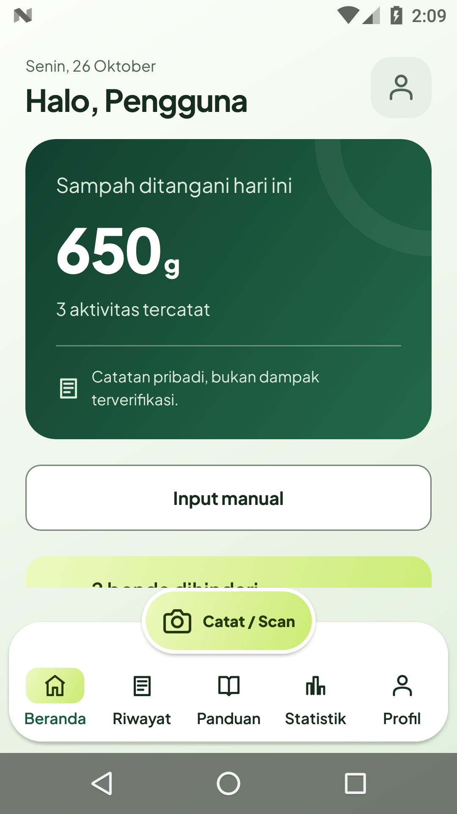 |
| Gelap | 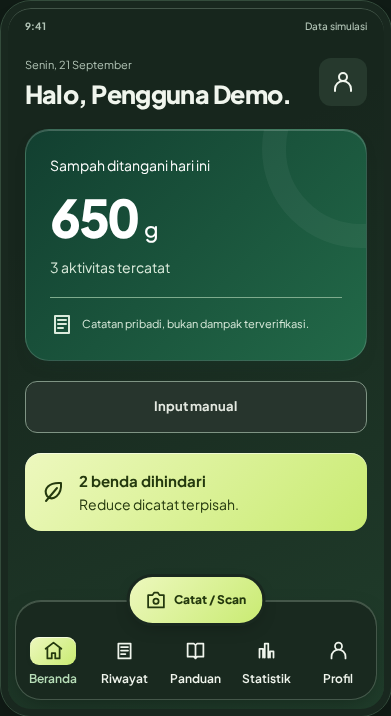 | 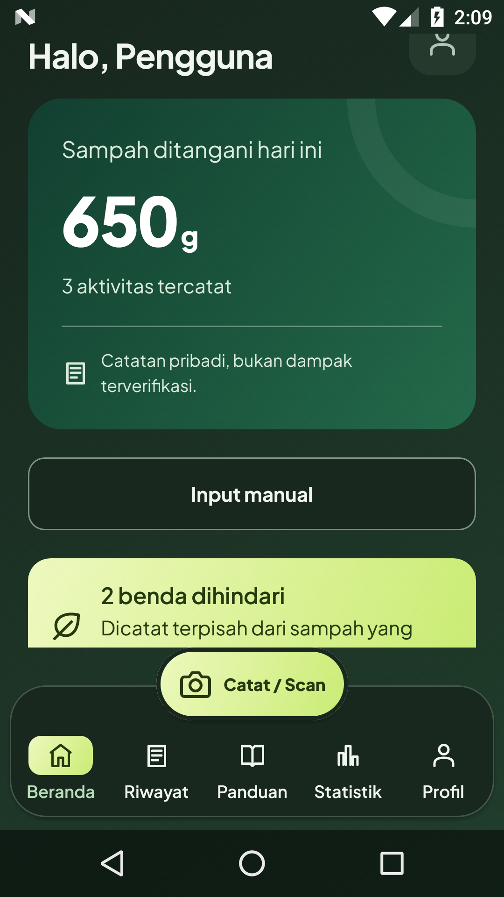 |

Frame kit dan Android memiliki ukuran serta system bar berbeda. Gambar gelap merupakan satu posisi scroll, sehingga tanggal/header paling atas tidak seluruhnya terlihat. Perbandingan ini memeriksa material aksi C07 dan konteks dock; tidak menyatakan seluruh komposisi layar sudah diterima.

## Verifikasi native

| API / lebar / font | Regresi | Pengambilan ulang journey | Durasi regresi |
|---|---:|---:|---:|
| 24 / 360 dp / normal | 46 | 1 | 262,289 detik |
| 24 / 360 dp / 200% | 46 | 1 | 271,076 detik |
| 24 / 600 dp / 200% | 46 | 1 | 458,136 detik |

**141 eksekusi native / 46 metode unik, nol skip.** APK aplikasi identik pada seluruh matriks dan pengambilan ulang: `04a621e41bd9e035f48e0ee5b19464e38462d08bfefe20d49d45722afb2ef5ea`. APK penguji matriks: `57eafbe8bc89072df8d4354292ea7be055587ed931977d5a296fb533eb470b82`; APK penguji pengambilan ulang: `7c1813fa36385e353d40174d69ffb606f3df0c1b1ce5ec9e86cbbef1c387e395`. Perbedaan source hanya helper screenshot pada `Iteration2DesignTest`; hash seluruh source dan gambar dicatat pada [manifest checkpoint](secondary-checkpoint.json).

Empat metode baru mencakup render terang/gelap dengan label panjang, ikon dan disabled; gate sentuhan/Tab/Enter; serta warna Batal pada D01 pending. Warna label dibaca dari hasil layout aktual, bukan hanya token. Tiga titik background per tombol dan border dibaca dari screenshot: **72 pasangan foreground/background**, seluruhnya ≥4,5:1, dan **24 border** sesuai token. Kontras disabled minimal **5,40:1 terang / 6,72:1 gelap**. Label panjang menjadi dua baris pada ponsel 200%, tanpa overflow; kontrol memiliki tinggi minimal 52 dp.

Regresi mencakup hapus/cache read-only/conflict/storage failure, D02/D03 dan keyboard, pemilihan versi konflik, cleanup draf, akun/tema/logout, Panduan/prefill/viewport, filter/riwayat, hasil create/edit, submission/retry, fase scan, Startup, lima stack/dock/manual/rail dan transisi editor. Alur memakai dummy atau state deterministik. Peluncuran Settings setelah permanent denial kamera dan layanan server nyata tidak dibuktikan oleh suite ini.

| Konfigurasi | Terang | Gelap | D01 pending |
|---|---|---|---|
| Normal | 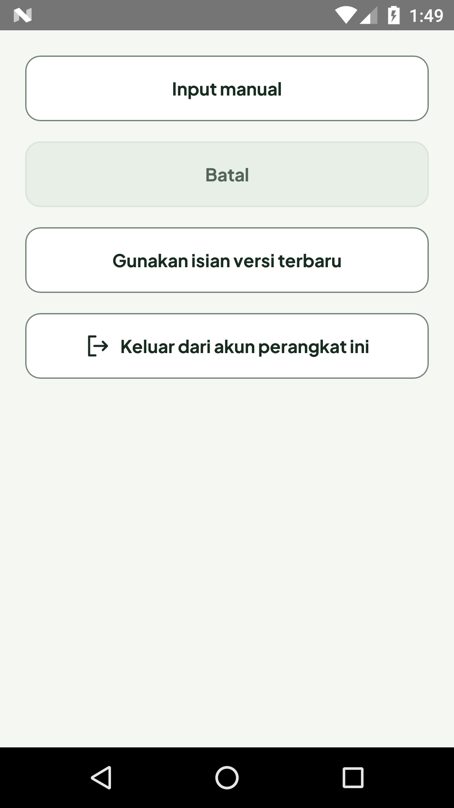 | 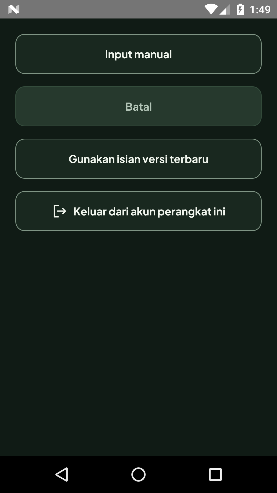 | 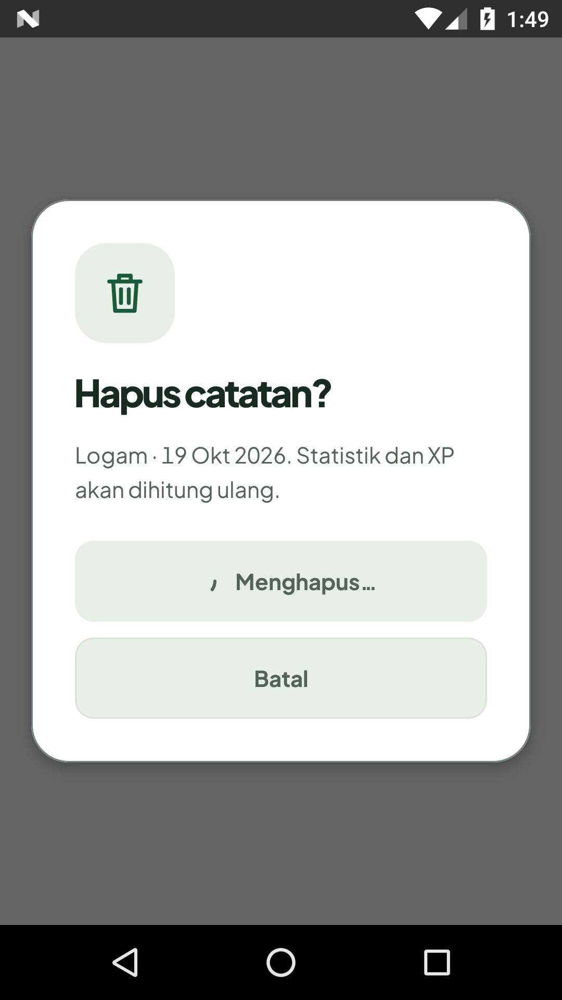 |
| Ponsel 200% | 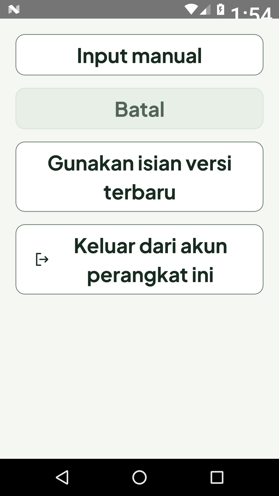 | 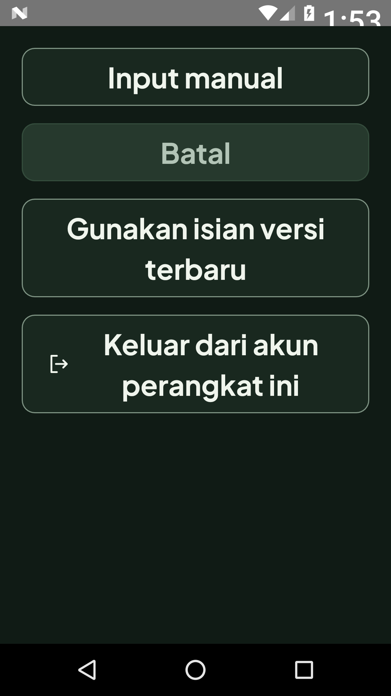 | 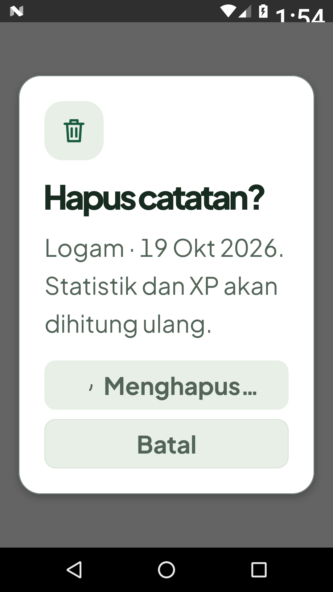 |
| Lebar 200% | 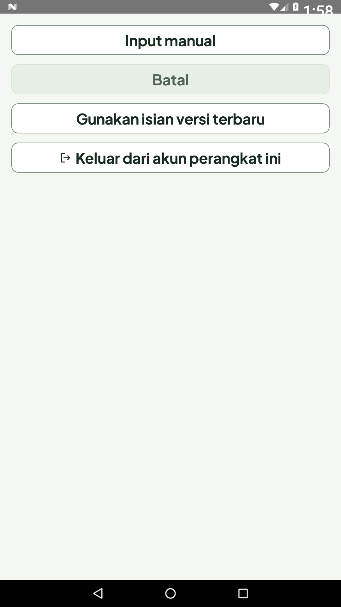 | 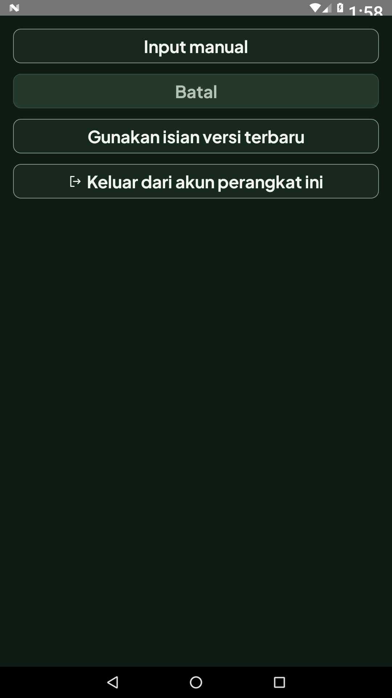 | 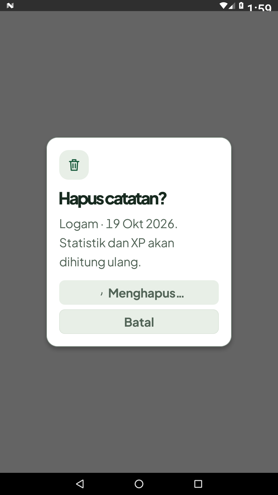 |

D01 pending gelap juga diperiksa: [gambar normal](secondary-delete-dark-normal.png). Screenshot menampilkan satu viewport; dialog/konten panjang dapat digulir.

Satu gambar Beranda terang dari helper lama tercampur frame launcher emulator dan **ditolak sebagai bukti visual**. Hashnya disimpan pada manifest. Helper kini menunggu frame window aplikasi untuk Beranda, mengabaikan screenshot pemanasan, dan memperhitungkan fokus sheet yang berbeda. Satu journey yang sama diulang pada ketiga konfigurasi; semua lulus dengan APK aplikasi identik. Percobaan helper yang gagal tidak dihitung dalam hasil final.

Build native, lint debug, **171 debug unit tests** (nol gagal/error/skip), serta gate API 24/adjustResize/lima font/OFL lulus. Pemeriksaan emulator dilakukan lokal; status Actions mengikuti head PR masing-masing. CI `e1c9b28` sebelumnya gagal pada upload akibat kuota artefak, walaupun build dan verifikasi paket lulus.

## Batas checkpoint

Material default/disabled, label, target sentuh dan perilaku keyboard pada pemakai yang diuji telah diperiksa. ENERGY 2 / RHYTHM 2 / MOTION 1 tetap mengikuti kit; tidak ada dekorasi atau animasi baru. Audit visual pressed/focus seluruh kontrol, C05/C06, field/selector, highlight CTA, seluruh screen/navbar/navigasi, spoken TalkBack dan perangkat lain masih berlanjut. Migrasi DataStore, cursor/pull-to-refresh, capability tambahan, HTTP dan AI mengikuti matriks penuh. PR #96 tetap draft; checkpoint ini bukan penerimaan seluruh UI.
