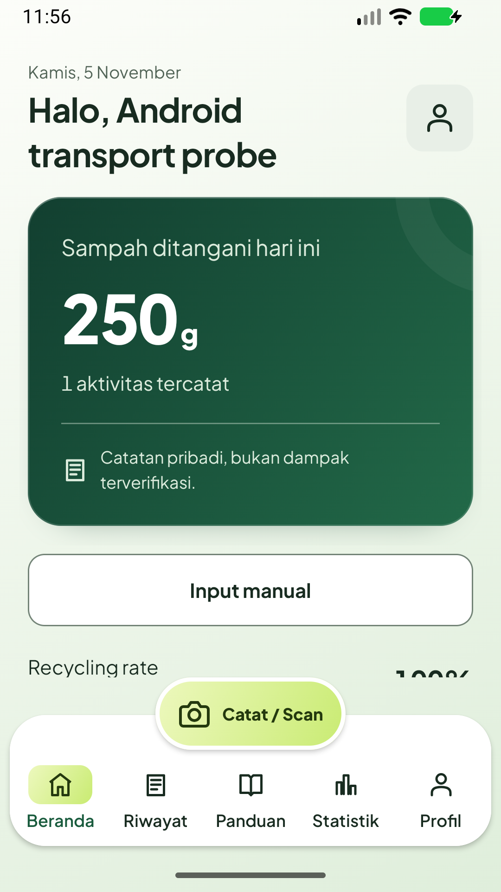
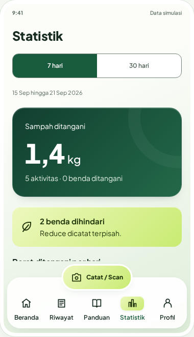
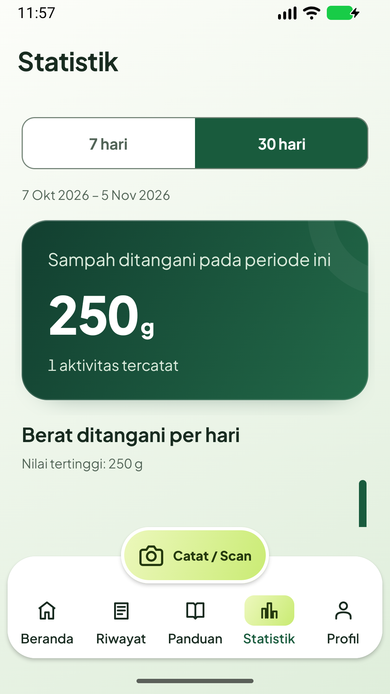
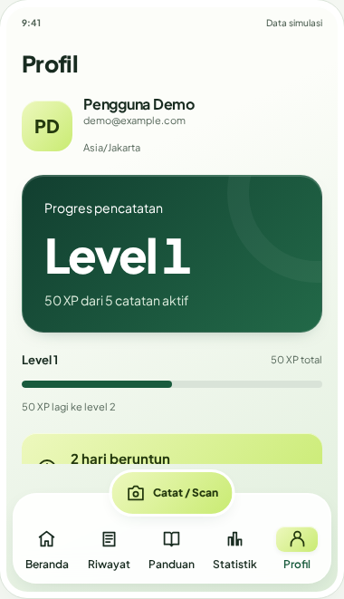
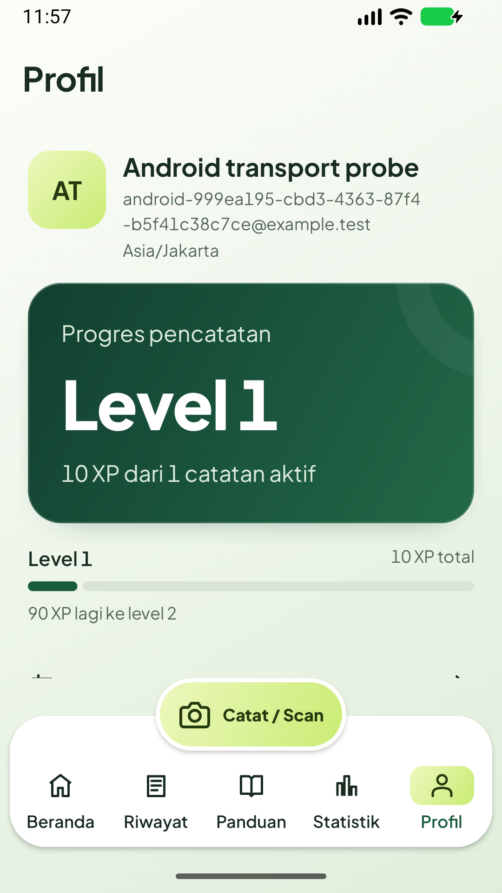

# Layar ringkasan dengan backend nyata

Checkpoint branch `codex/android-summary-screens`, bertumpuk di atas PR #99. Sumber visual adalah DESIGN/SCREEN_SPEC serta mockup HTML v1.3. Cakupannya S04, S13, progres S14 dan pembaruan sesudah pencatatan; penerimaan seluruh aplikasi tetap mengikuti [matriks Iteration 2](../../tasks/ITERATION_2_DESIGN.md).

## Perilaku

Beranda menggunakan tanggal, ringkasan, tiga catatan terbaru dan progres dari `/dashboard`. Statistik menggunakan `/statistics?from=…&to=…`; Profil memakai progres dashboard yang sama. Halaman pertama Riwayat tidak dijadikan sumber agregat. Adapter dummy menyediakan bentuk snapshot yang sama dari seluruh dataset lokalnya; UI tidak lagi memilih kalkulasi dummy saat adapter remote digunakan.

Sesudah receipt tambah/ubah/hapus, revisi workspace memicu pembacaan dashboard dan statistik yang sudah dibuka. Pembacaan ringkasan terpisah dari daftar, dengan loading/error sendiri. Pilihan 7/30 tersimpan di SavedStateHandle. Pergantian periode membatalkan pekerjaan lama dan menolak respons terlambat. Jika periode baru gagal, snapshot sukses sebelumnya dapat tampil dengan label **Data terakhir · jumlah hari · tanggal sebenarnya**. Retry tetap memakai pilihan terbaru. Snapshot dan pekerjaan dibuang ketika root akun dilepas.

DTO menolak statistik yang total metode, hari atau kategori tidak konsisten dengan ringkasannya. Penjumlahan dan persentase tidak meluapkan Long. Reduce dan gram/benda tetap terpisah; rate null tidak diubah menjadi angka. Akun tanpa aktivitas hari ini memperoleh notice C29, dengan progres sepanjang waktu tetap tersedia.

## APK dan alur HTTPS publik

APK checkpoint memakai `USE_DUMMY_DATA=false`, hot reload nonaktif, minSdk 30 (Android 11) dan origin `https://pred-autoscaler.bccdev.id/wastenot/api/v1/`. Hash app **3fe1cb6260c86f3a2d559e71d8fc623525a419cc7922a126e3dcc84ba56baa26**. Berkas untuk pengguna: `WasteNot-core-android11-remote.apk`; URL dan flag adalah konfigurasi build, bukan pilihan tersembunyi pada layar.

Alur native pada **API 30** menggunakan **MainActivity dan AppContainer sebenarnya**, form Daftar, credential Android Keystore dan HTTPS publik. Tidak mengganti account session/repository dengan fake:

1. Buat akun uji unik dari layar Daftar; Beranda kosong dan XP server nol.
2. Simpan Recycle/Plastik 250 g dari form. Beranda/Statistik menampilkan 250 g dan Profil 10 XP dari satu catatan.
3. Pilih 30 hari, pindah tab dan kembali; pilihan tetap 30 hari.
4. Ubah catatan menjadi 3 benda. Ringkasan dan seri benda berubah; XP tetap 10.
5. Hapus lewat dialog. Statistik kosong, progres nol, serta respons dashboard/statistik server mengonfirmasi total nol.
6. Keluar melalui D02 dan kembali ke Masuk.

API 30: **1 tes native lulus**, enam tahap fungsional, delapan PNG baru. APK app `3fe1cb6…` sama dengan percobaan API 36 yang juga lulus; APK penguji akhir `16bfbf7…` menambah reset posisi scroll Beranda sebelum screenshot. **Android 17/API 37 lulus pada run akhir yang bersih**: satu tes, enam tahap, delapan PNG baru; cleanup server nol dan pengaturan perangkat pulih. APK app sama, APK penguji akhir `1ee0777…` menambah pemeriksaan active window untuk menolak capture yang tertutup dialog sistem. [Hasil akhir](server-screens/core-api37-clean-result.json) dan [log](server-screens/core-api37-clean-native.log) dibedakan dari percobaan semantik awal yang screenshot-nya ditolak karena ANR System UI.

Driver host awal gagal memulihkan font_scale karena setting awal belum ada (`null`). Tes aplikasi dan cleanup server sudah lulus. Setting dipulihkan dengan menghapus override, lalu ukuran/density/font dibaca kembali dan sama persis dengan kondisi awal; delapan hash PNG diverifikasi kembali. Hasil awal tetap disimpan, dengan [bukti rekonsiliasi](server-screens/core-api30-reconciled.json). Tidak mengulang tes aplikasi untuk menutupi kegagalan driver.

Identitas fixture diperiksa belum ada sebelum tes. Sesudahnya akun dihapus berdasarkan email/nama persis. Sesi, refresh token berdasarkan session ID, catatan dan operasi AI milik akun tersebut semuanya nol; pengaturan ukuran/density/font dipulihkan. Emulator API 30/37 memakai AVD QA baru; percobaan API 36 sebelumnya memakai datadir baru. Userdata AVD pengguna tetap dipertahankan. Boot pertama API 30 mengalami watchdog restart sebelum APK dipasang; log dipisahkan dari tes aplikasi. Tidak mengubah deployment, gateway, trust TLS atau data pengguna lain.

## Perbandingan viewport

Angka/nama/tanggal berbeda karena APK membaca akun uji server, sedangkan kit memakai lima aktivitas contoh PRD. Perbandingan ini menilai susunan, token, tipografi, material dan dock; bukan persamaan dataset atau seluruh isi scroll.

| Mockup kit | APK dengan backend publik |
|---|---|
|  |  |
|  |  |
|  |  |

Review render akhir API 30 dan API 37: tanggal Beranda kini terlihat utuh setelah reset scroll; ringkasan 250 g dan periode 30 hari berasal dari server; Profil menampilkan 10 XP/1 catatan. Nama/email fixture lebih panjang daripada contoh kit dan membungkus tanpa menimpa avatar. Pine, lime, font dan dock berlabel mengikuti kit. Viewport Android 360 dp dengan status/navigation bar berbeda dari frame kit 390 px, sehingga ini bukan klaim pixel-identical. Warna area navigasi sistem setelah keyboard masih perlu diperiksa dalam audit inset/IME seluruh layar; dock aplikasi tetap berfungsi. Seluruh isi scroll/transisi belum dinyatakan diterima.

## Verifikasi dan batas

Pada API 37, ServerSummaryScreenTest lulus **9 eksekusi / 3 metode unik**: tiga terang, tiga gelap, tiga font 200%, nol gagal/skip; 15 PNG baru. Banner error tidak overflow dan tanggal snapshot lama tetap eksplisit. Ini harness komponen tanpa scaffold/inset navigasi akun, sehingga status/navigation bar pada gambar komponen bukan penerimaan inset aplikasi. Alur MainActivity publik diuji terpisah di atas.

202 debug unit tests dan lint lulus. Enam kasus SummariesViewModel menguji pembacaan independen, race respons, kegagalan periode baru, snapshot lama yang tetap dilabeli, pemulihan pilihan dan clear akun. Kasus DTO juga menolak total tidak konsisten/overflow.

Bukti historis sebelum minimum berubah: matriks komponen API 24 lulus **29 eksekusi dari 12 metode unik**, tanpa gagal/skip pada run final: 12 normal terang, delapan gelap, sembilan font 200%. APK dan sumber v5 dicatat terpisah. Setelah matriks tersebut, perubahan sumber aplikasi hanya notice S04 ketika hari ini kosong; notice itu diperiksa kembali dalam alur publik. Penguji publik kemudian memakai MainActivity dan sinkronisasi frame untuk menangkap layar sesudah transisi. Perubahan penguji tidak mengubah APK app publik.

Percobaan awal yang ditolak tetap direkam: selector tes ambigu pada angka 250 g di ringkasan/kategori; system_server API 24 crash saat screenshot, lalu hanya matriks yang terhenti diulang; asumsi penguji bahwa respons Daftar selalu memuat progres; dan capture yang masih menampilkan layar keluar. Kasus tersebut tidak dicampurkan dengan hasil final. Cleanup percobaan awal diverifikasi kembali. Percobaan API 37 dengan dialog ANR System UI juga ditolak meskipun assertion Compose lulus; memilih Wait pada emulator QA dan menunggu sistem pulih tidak mengubah aplikasi atau menonaktifkan ANR. Pemeriksaan active window kini mencegah capture semacam itu diterima. Log dan hash final ada pada [manifest](server-screens-checkpoint.json).

- **Hard gate, cakupan checkpoint:** **belum selesai secara global**; alur inti API 30 lulus, penerimaan visual seluruh aplikasi masih berjalan.
- **Purpose/direction:** ENERGY 2 / RHYTHM 2 / MOTION 1 dari kit. Pine untuk ringkasan, lime untuk aksi/progres, font Plus Jakarta Sans dan dock berlabel dipertahankan; tidak ada angka lingkungan atau hasil AI rekaan.
- **Craft, cakupan checkpoint:** data nyata, loading/error/retry dan pencegahan race memiliki bukti; font 200%/tema gelap diuji kembali pada API 37, sembilan eksekusi dari tiga metode unik dengan pasangan APK akhir. Spoken TalkBack, perangkat fisik dan variasi inset/IME belum selesai.

Android 7/API 24 tidak lagi menjadi syarat rilis sesuai pilihan pengguna; kegagalan TLS lamanya tetap disimpan sebagai sejarah pada [QA transport](BACKEND_RECORDS.md). Minimum saat ini Android 11/API 30, runtime Android 11/API 30 dan Android 17/API 37 lulus untuk alur core tersebut; compile/target tetap 36. Pergantian hari otomatis, cursor/filter/pull-to-refresh Riwayat, alur dua akun HTTP, retry/timeout write melalui UI, Panduan/AI, spoken TalkBack, perangkat fisik dan penerimaan visual seluruh screen/navbar/navigasi masih terbuka. Default adapter pada source tetap dummy sampai rangkaian integrasi selesai. APK checkpoint remote disediakan terpisah untuk uji core, belum rilis lengkap.
