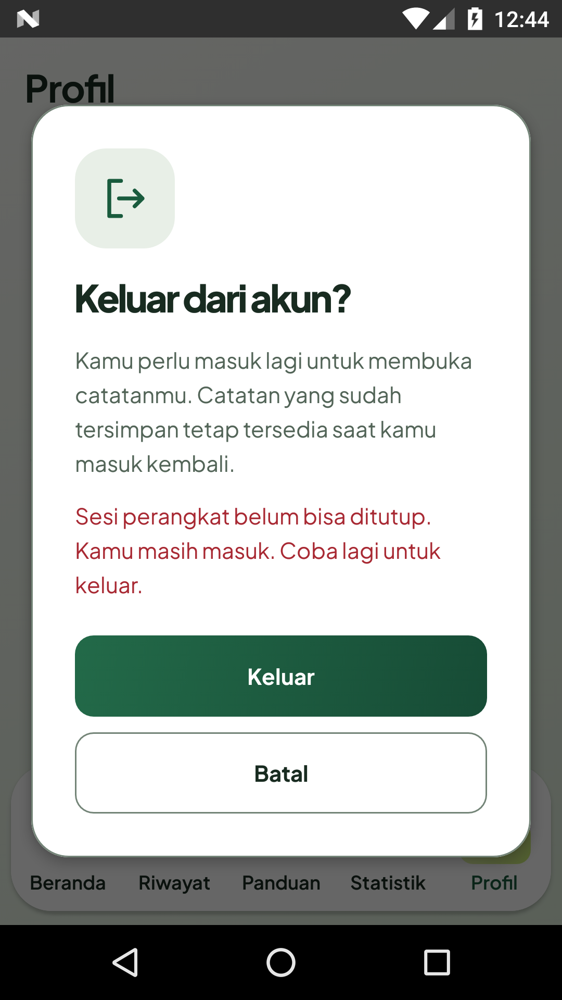
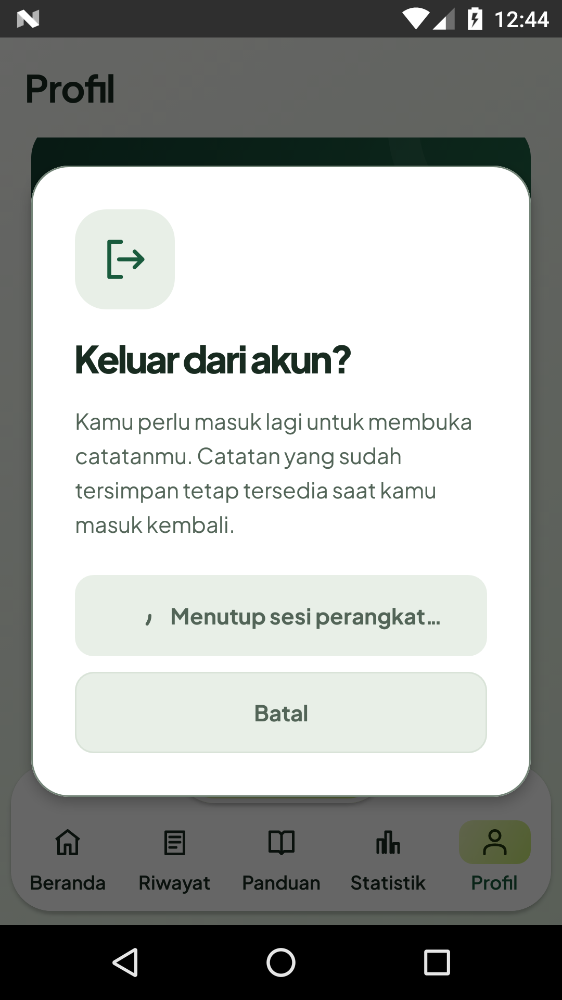
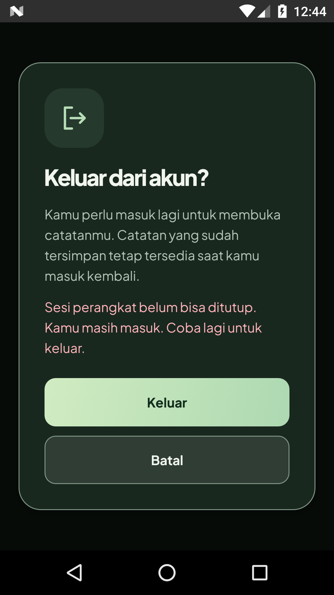
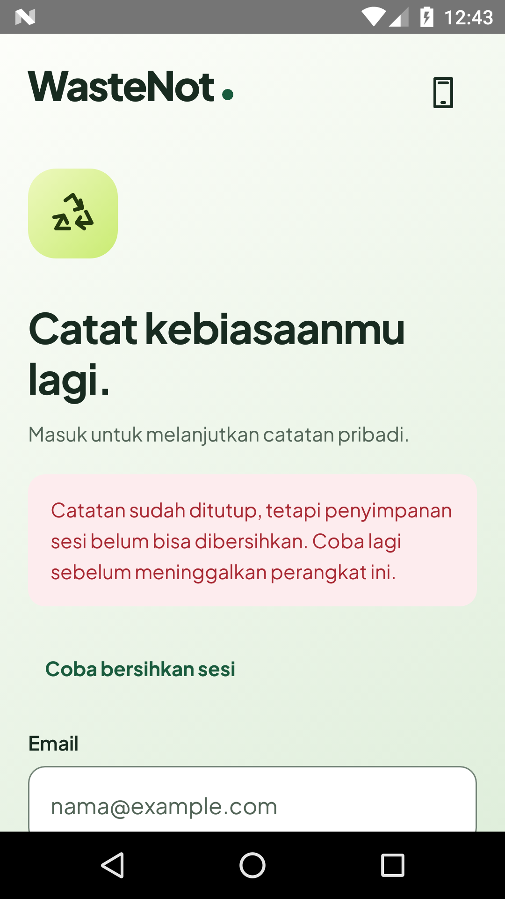

# Keluar: status menunggu dan kegagalan sesi

26 Oktober 2026; pekerjaan dimulai 25 Oktober. Checkpoint D02/C27, root akun/auth, dan label retry. [Manifest](session-exit-checkpoint.json) mengikat source, APK dan kasus. [Matriks Iteration 2](../../tasks/ITERATION_2_DESIGN.md) tetap menjadi cakupan seluruh aplikasi; PR #96 tetap draft.

## Sebelum dan sesudah

[Reproduksi sebelum perbaikan](logout-before-failure.txt) menjalankan MainNavigation → Profil → D02 dengan AccountSession yang mengembalikan gagal membersihkan sesi dan tetap Authenticated. Dialog hilang sebelum hasil operasi ditampilkan. Kasus yang sama gagal dua kali pada APK checkpoint sebelumnya; state holder sudah menyediakan hasil, tetapi root akun belum meneruskannya ke dialog.

Sekarang dialog tetap terbuka sampai fase sesi benar-benar berubah. Saat menunggu, kedua aksi serta Back/Escape dinonaktifkan. Jika akun masih aktif setelah kegagalan, pesan menyatakan pengguna masih masuk; Keluar mengulangi operasi secara eksplisit dan Batal kembali ke Profil. Jika adapter sudah menutup root akun, layar Masuk tetap menyediakan pesan dan retry pembersihan sesi. Jalur ini tidak mengaku mencabut sesi server.

| State | Native |
|---|---|
| Gagal di root akun |  |
| Menunggu hasil sesi |  |
| Tema gelap |  |
| Root akun sudah tertutup |  |

D02 memakai C27 yang sama: surface opak maksimum 400 dp/radius 24, padding 28, ikon kit 64/radius 20 dengan glyph 30, heading Plus Jakarta Sans 24/800, serta dua aksi bertumpuk minimum 52. Gradasi Pinus menandai Keluar. Error memakai token error dan semantics live region Polite. [Kegagalan draf](logout-draft-cleanup-failed.png) mempunyai pesan terpisah dan didahulukan bila pembersihan draf gagal sebelum penutupan sesi dicoba. Deklarasi live region diuji; spoken TalkBack belum dibuktikan.

[Posisi aksi ponsel/teks 200%](logout-failed-actions-phone200.png), [menunggu pada 600 dp/200%](logout-pending-wide200.png), dan [retry Masuk pada teks besar](logout-auth-cleanup-phone200.png). Screenshot yang digulir ke aksi tidak menyatakan heading selalu terlihat bersamaan. [Perbandingan C27 dengan kit](EXIT_DIALOGS.md) tetap berlaku untuk geometri; varian pending/error mengikuti kewajiban state pada SCREEN_SPEC §4.

## Perbaikan label yang ditemukan penguji

Pengujian jalur root yang sudah tertutup menemukan `didOverflowWidth` pada “Coba bersihkan sesi”, bahkan pada konfigurasi normal. Tiga kasus baru lain sudah lulus, tetapi kandidat itu tidak diterima. Label TextButton retry sekarang memakai lebar intrinsik, sama dengan pola label C03. Assertion overflow dipertahankan dan dilengkapi ukuran kotak/paragraf; label serta callback diuji ulang pada tiga konfigurasi. Tidak ada font yang diperkecil agar penguji lulus.

## State tombol nonaktif

Pemeriksaan render kandidat sebelumnya menemukan Batal masih memakai surface/ink normal ketika operasinya pending, walaupun semantics sudah disabled. [Kandidat sebelum koreksi](logout-before-disabled-cancel.png) tidak diterima sebagai hasil final. CSS kit `.btn:disabled` menetapkan soft/muted/divider. Secondary action sekarang memakai container soft, label muted yang tetap terbaca dan border divider pada state tersebut; state aktif tetap surface/ink/outline. Warna label aktual dari TextLayoutResult diperiksa untuk kedua tema, dan render diperiksa kembali. Regresi serta protokol proses diulang pada APK final.

## Verifikasi

Build native/lint dan **171 debug unit tests** lulus, nol gagal/error/skip. Gate APK memeriksa API 24, MainActivity adjustResize, lima font dan OFL. Empat smoke kasus baru lulus sebelum regresi. Angka final berikut memakai APK aplikasi/penguji identik:

| API 24 | Lulus | Skip |
|---|---:|---:|
| 360 dp / teks normal | 27 | 0 |
| 360 dp / teks 200% | 27 | 0 |
| 600 dp / teks 200% | 27 | 0 |
| Prepare/restore proses untuk create dan edit | 4 | 0 |
| Total: 29 metode test unik | 85 | 0 |

Empat kasus baru mencakup gagal → Batal → retry berhasil; status pending yang dipulihkan lewat StateRestorationTester tanpa panggilan ulang; Back/Escape dan konfirmasi berulang saat pending; root auth dengan retry/label terbaca; serta UI kedua tema untuk pending, gagal sesi dan gagal draf. Kasus tema/state berada dalam satu metode UI. Pemulihan SavedState tersebut emulasi Compose, bukan bukti rotasi perangkat fisik.

Satu run terhenti ketika thread `android.display` pada `system_server` mengalami SIGSEGV; proses penguji kemudian menerima DeadSystemException. Log run tersebut disimpan dan tidak dihitung sebagai hasil final. AVD dimulai ulang tanpa wipe data, lalu seluruh matriks/protokol dijalankan pada APK yang sama.

Dua puluh tiga regresi lain mencakup sesi/auth/akun A → B → A, konfirmasi/batal keyboard dan sentuhan pada D02/D03, profil, logout dengan draf tertunda, idempotent replay, transisi editor dan UI pemulihan draf. Penguji host menghentikan proses hidup lalu memeriksa snapshot/request ID create dan edit pada proses baru; draf tetap tidak membuat log otomatis. Installed APK dicocokkan byte-nya sebelum protokol proses.

[28 pasangan token](session-exit-contrast.json) mencakup 26 pasangan terdahulu serta dua pasangan soft/muted untuk label nonaktif. Semua memenuhi ambang masing-masing; hash Color.kt pada checkpoint draf dan checkpoint ini cocok. Rasio tersebut membuktikan pasangan token tercatat, bukan audit pixel seluruh aplikasi. Pengujian native di atas lokal; CI GitHub memeriksa build/lint/unit/gate paket secara terpisah.

## Gate dan batas

Hard PASS pada scope: hasil gagal tetap terlihat, pending tidak bisa dikonfirmasi ulang/ditutup, retry/cancel nyata, tidak kembali ke data privat dari root auth, label bebas overflow, target dan dua tema diperiksa. Purpose PASS: C27 mempertahankan keputusan Keluar dan menunjukkan dua jenis kegagalan secara akurat. Liveliness PASS: ENERGY 2 / RHYTHM 2 / MOTION 1, satu aksi utama, hierarki dan spacing kit, tanpa gerak dekoratif. Craft PASS pada konfigurasi yang tercatat: kasus reproduksi menjadi hijau, render diperiksa terpisah dari semantics, dan regresi root/draf diperiksa.

Kegagalan sesi dipicu melalui AccountSession deterministik, bukan disk-full atau outage server nyata. Jalur Masuk ulang dari Startup saat pembersihan sesi gagal, backend deployed, timeout/revocation HTTP, spoken TalkBack, seluruh pemicu/fokus modal, API 36/perangkat fisik, DataStore, history cursor/refresh, achievement/capability serta penerimaan seluruh screen/navbar/navigasi masih terbuka. Checkpoint ini menggantikan batas “hasil logout gagal di root akun belum ditampilkan” pada QA draf sebelumnya; tidak menutup semua kriteria D02/A04.
