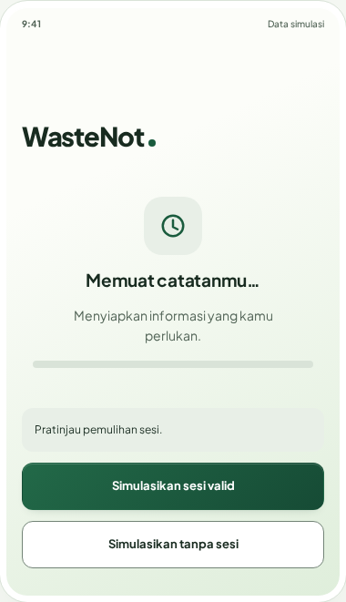
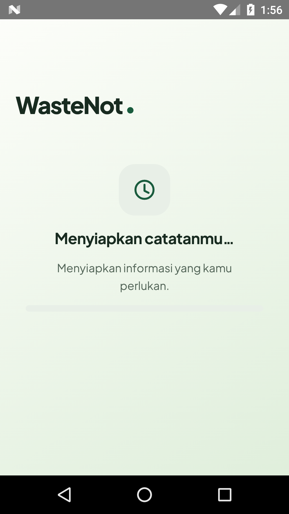
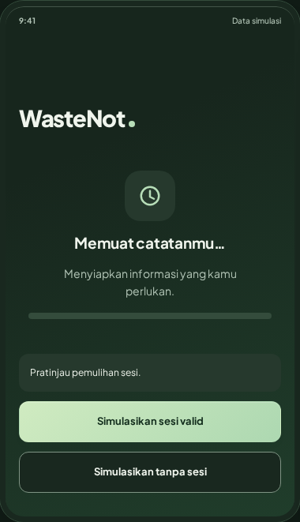
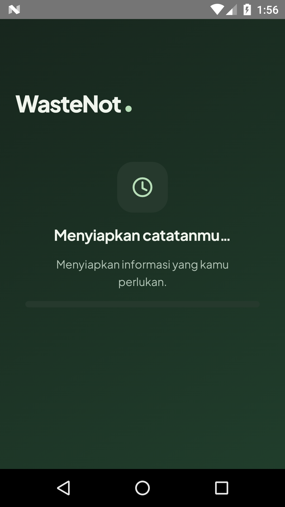

# Pemulihan sesi dan wordmark

24 Oktober 2026. Checkpoint S01/C01/C29 serta transisi root S01 → Masuk. [Manifest](startup-checkpoint.json) mengikat source, APK native/penguji, hasil tiap kasus, PNG dan sumber kit. Ini bagian dari [matriks Iteration 2](../../tasks/ITERATION_2_DESIGN.md), bukan penerimaan seluruh screen/navigasi.

## Perbandingan kit dan Android

| Tema | Kit v1.3, S01 | Android |
|---|---|---|
| Terang |  |  |
| Gelap |  |  |

Kit dirender dari HTML/font lokal yang diminta. Frame dokumentasi memiliki status bar, label Data simulasi, notice dan tombol simulasi. Bagian dokumentasi tersebut tidak menjadi kontrol aplikasi. Android memakai copy “Menyiapkan catatanmu…” dari SCREEN_SPEC S01, sedangkan HTML memakai “Memuat catatanmu…”. Lebar/tinggi sistem dan line height berbeda; tabel membandingkan komposisi, bukan seluruh pixel.

Wordmark Plus Jakarta Sans 29 sp/800, tracking −1,3 sp dan titik Pinus kini dipakai bersama oleh S01 dan form akun. Padding atas 88 dp mengikuti padding konten 18 ditambah offset S01 70 pada mockup; inset sistem ditangani tersendiri. State memakai bidang soft 64 dp/radius 20, ikon clock/alert 30 dari path kit, judul 19 sp/700, body 14 dan progress indeterminate 8 dp. Canvas memakai gradasi tema. Konten maksimum 560 dp; state maksimum 400 dan deskripsi maksimum 270. Form tetap dapat digulir pada jendela pendek/teks besar.

| Kondisi | Bukti Android |
|---|---|
| Gagal memeriksa sesi | [Terang](startup-light-error.png), [gelap](startup-dark-error.png) |
| Fokus dan aktivasi keyboard | [Coba lagi mendapat fokus](startup-keyboard-focus.png) |
| 360 dp, teks 200% | [Loading](startup-light-loading-phone200.png), [aksi setelah scroll](startup-dark-actions-phone200.png) |
| 600 dp, teks 200% | [Loading](startup-light-loading-wide200.png), [aksi](startup-dark-actions-wide200.png) |
| S01 → Masuk | [Awal transisi](startup-transition-first.png), [tujuan](startup-transition-last.png) |

## Perilaku dan regresi

Tidak ada timer splash, onboarding wajib atau tombol data contoh. Bootstrap tetap dimiliki SessionViewModel. UI loading tidak menawarkan aksi yang mengirim permintaan lain. Saat validasi identitas belum dapat dipastikan, tersedia Coba lagi dan Masuk ulang, dengan dua tombol setinggi minimum 52 dp. Identitas lama dan lima tab privat tidak ditampilkan sebelum hasil sesi dipastikan.

Root NavDisplay kini memakai fade masuk 180 ms/keluar 120 ms, sama dengan navigasi form akun. Canvas tetap terisi selama perpindahan; entry guard dan perlindungan pergantian identitas dipertahankan. Trace mengamati S01 → Masuk dengan gate sesi fixture: tujuan muncul setelah hasil sesi dilepas, tanpa langkah pengguna tambahan atau bootstrap kedua. Setiap sampel memeriksa tidak ada tab privat/nama Fixture A. Sampel memakai clock Compose dan PNG window Android; ini bukan pengukuran FPS, predictive seek atau audit semua transisi root.

Diagnostik native awal menemukan wordmark mempunyai kotak 400 px tetapi paragraf 960 px. Lebar intrinsik membatasi keduanya tanpa menggeser titik ke ujung halaman. Pemeriksaan didOverflowWidth/didOverflowHeight tetap digunakan pada wordmark dan heading untuk semua konfigurasi. Keyboard memakai event Android Tab/Enter; penguji tidak meminta fokus langsung pada tombol. Retry dan Masuk ulang masing-masing harus memanggil callback hanya ketika diaktifkan, juga lewat sentuhan.

## Verifikasi

Build native/lint dan **160 debug unit tests** lulus, nol gagal/error/skip. Gate APK API 24, MainActivity adjustResize, lima bobot font dan OFL lulus. **30 eksekusi native / 10 kasus unik**, nol skip, memakai aplikasi dan APK penguji identik:

| API 24 | Runner | Lulus | Dilewati |
|---|---:|---:|---:|
| 360 dp, teks normal | 10 | 10 | 0 |
| 360 dp, teks 200% | 10 | 10 | 0 |
| 600 dp, teks 200% | 10 | 10 | 0 |

Dua kasus StartupDesign memeriksa loading/error kedua tema, keterbacaan, target sentuh, aksi dalam viewport serta keyboard. Satu kasus SessionRoot baru memeriksa checking, pelepasan gate dan sampel transisi. Lima regresi SessionRoot mempertahankan identitas, retry/login ulang, validasi/credential error/IME/autofill, pendaftaran dan pemisahan lifetime panduan. Dua journey MainActivity memeriksa akun baru 0 XP, login ulang akun awal 50 XP, tema/pengaturan, Back dan pembatalan Keluar.

[22 pasangan token warna](startup-contrast.json) memenuhi ambang teks 4,5:1 serta ikon/outline 3:1; teks dasar minimum 5,239:1 pada endpoint canvas yang diperiksa. Ini bukan pengukuran setiap pixel atau seluruh state tombol aplikasi.

Kandidat awal, run gagal dan capture yang masih menampilkan frame sebelumnya tidak dihitung sebagai bukti akhir. Capture final menunggu window penguji memiliki fokus dan menyelesaikan draw; readback awal yang tertinggal tidak dipublikasikan. Gambar native berasal dari ComponentActivity penguji dengan state terkontrol; journey MainActivity adalah regresi terpisah. UI ini tidak ditahan lebih lama di produk untuk memudahkan screenshot.

## Gate dan batas checkpoint

- Hard PASS pada S01: loading dan error mempunyai perilaku, tidak ada kontrol simulasi, data privat tetap ditahan, serta aksi dapat dicapai pada teks 200%.
- Purpose PASS: komposisi, wordmark, ikon, token warna, ukuran state dan hierarki mengikuti kit; linear progress menyatakan loading tanpa mengarang persentase.
- Liveliness PASS pada cakupan ini: ENERGY 2 / RHYTHM 2 / MOTION 1; satu state menjadi fokus dan perpindahan memakai fade pendek.
- Craft PASS pada konfigurasi tercatat: terang/gelap, keterbacaan, keyboard, ponsel/600 dp dan screenshot yang benar diperiksa. API 36/perangkat fisik, spoken TalkBack dan motion semua root/route masih audit berikutnya.

Session/account source dalam pengujian root adalah fixture; aplikasi tetap memakai adapter dummy persisten. Ini tidak membuktikan layanan autentikasi/refresh deployed. Repo organisasi yang dapat diakses saat pemeriksaan masih Android dan landing; integrasi backend dilanjutkan setelah layanan tersedia. Draf disk/per akun/process death, cursor/pull-to-refresh, achievement dan penerimaan visual seluruh layar tetap terbuka. PR #96 tetap draft.
