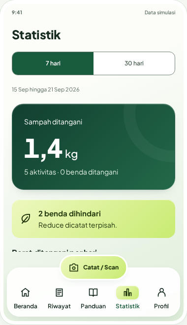
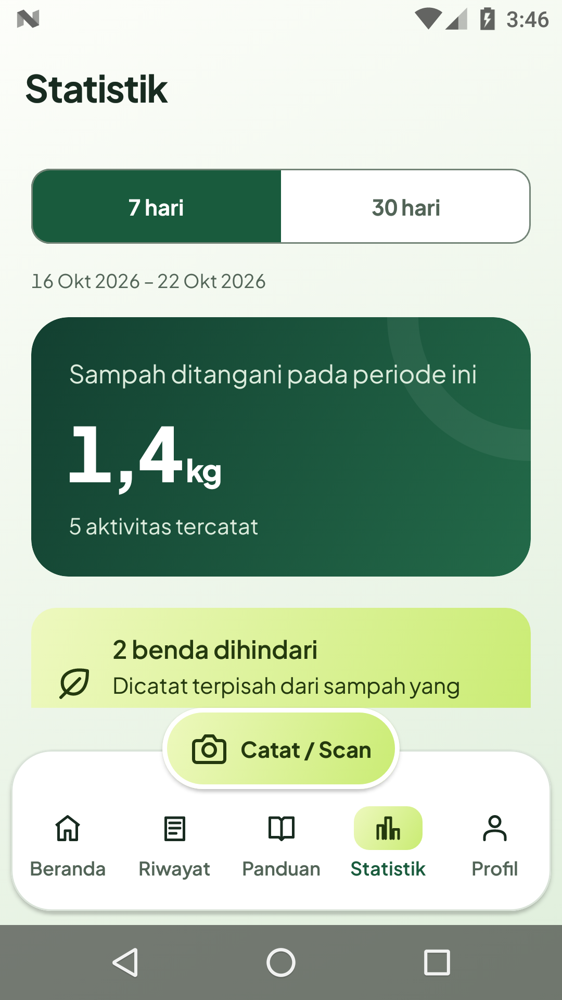
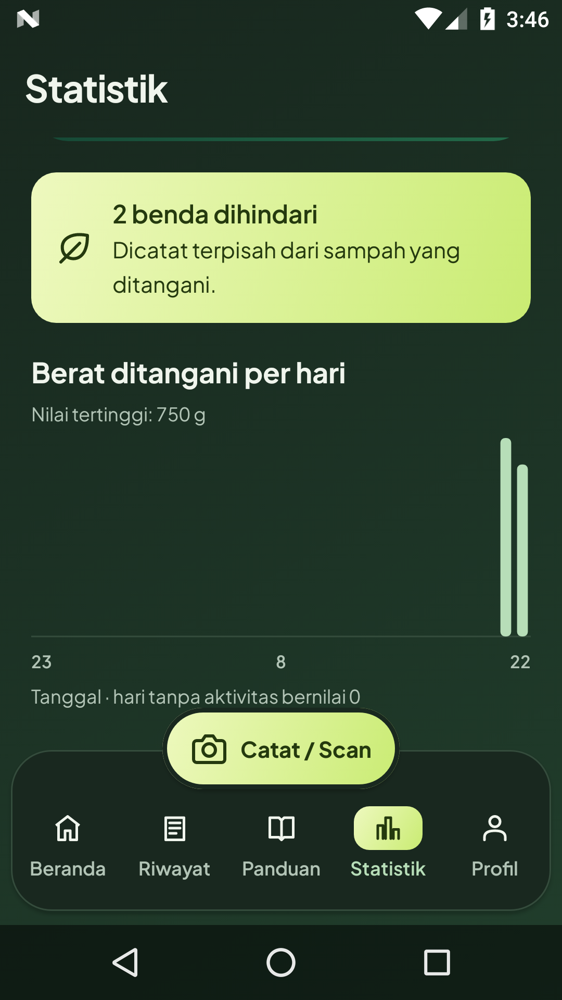

# S13 Statistik — checkpoint 22 Oktober 2026

Acuan: SCREEN_SPEC S13, DESIGN C15/C18/C22/C23 dan PRD §9. Sumber aplikasi adalah dummy persisten per akun sesuai permintaan pengguna. Tidak ada tombol demo atau data demo tambahan pada layar. Agregat di bawah berasal dari himpunan catatan dummy lengkap; adapter HTTP tidak menghitung statistik dari halaman Riwayat parsial.

| Kit 7 hari | Android, ponsel normal | Android gelap, 30 hari |
|---|---|---|
|  |  |  |

Kontrol periode menjadi segmen menyatu, memakai warna peran tema dan target minimal 48 dp. Ringkasan pinus, Reduce lime, font Plus Jakarta Sans, ikon kategori dan baris berdivider mengikuti kit. Grafik berada setelah Reduce dan sebelum recycling rate. Chart g dan benda memakai seri serta label terpisah; hari kosong bernilai 0. Skala maksimum dan tanggal terlihat, tanpa konversi benda ke gram. Angka harian dapat dibuka sebagai teks dengan tanggal penuh, termasuk hari bernilai nol.

Dataset acuan menghasilkan 1.400 g, lima aktivitas, dua benda dihindari, rate 50% (dua dari empat aktivitas penanganan). Empat metode memakai basis lima aktivitas, termasuk Reduce dan Trash: 20/20/40/20%. Ketujuh kategori menampilkan berat dan jumlah penanganan terpisah. Reduce-only memberi rate null dengan penjelasan tidak ada aktivitas penanganan. Periode kosong menawarkan periode lain dan Catat aktivitas, yang benar-benar membuka editor dari tab Statistik.

## Bukti state dan konfigurasi

- [Grafik 7 hari dan nol](statistics-chart-light.png), [angka harian](statistics-daily-light.png), [empat metode](statistics-methods-light.png), [tujuh kategori](statistics-categories-light.png).
- Harness komponen: [seri benda](statistics-count-dark200.png), [Reduce-only](statistics-reduce-dark200.png), [periode kosong](statistics-empty-dark200.png), [refresh gagal dengan data tetap ada](statistics-refresh-dark200.png). Gambar ini bukan respons HTTP nyata.
- Aplikasi lengkap: [ponsel teks 200%](statistics-app-phone200.png), [rail 600 dp/200%](statistics-app-wide200.png). Konten yang lebih tinggi dari viewport tetap dapat digulir; gambar satu viewport bukan isi seluruh layar.

135 debug unit tests, nol gagal/error/skip; build aplikasi dan instrumentasi native serta lint debug lulus. Empat unit test baru memeriksa rentang inklusif 7/30, tanggal masa depan/di luar periode, hari nol, dataset kanonik, satuan campuran, Reduce-only dan kategori/metode.

21 eksekusi native dari tujuh kasus unik lulus, tanpa skip, pada API 24/SwiftShader: 360 dp normal, 360 dp/200% dan 600 dp/200%. Masing-masing menjalankan empat state S13, presisi ringkasan, perjalanan Statistik dan regresi Riwayat/filter/rentang. Perjalanan aplikasi memeriksa perubahan tema, tab, Activity recreate, tabel terbuka, manual entry tanpa write/XP dan pemulihan posisi chart dengan toleransi 1 px. Animasi Compose aktif (1); animasi window/transition platform dimatikan untuk screenshot stabil. Ini bukan bukti predictive Back atau process death tanpa bundle.

Empat capture aplikasi pada setiap konfigurasi juga menguji lebih dari 30 piksel OnAccent di dalam bounds label Catat/Scan. Ini membuktikan kehadiran glyph label pada frame tersebut, bukan seluruh bentuk ikon, clipping atau kesesuaian semua kontrol. Pembesaran PNG dan pemeriksaan piksel membantah dugaan tombol kosong pada preview penuh; tidak ada source rendering yang diubah untuk dugaan itu. [Koreksi QA sebelumnya](VISUAL_RECHECK.md) tetap berlaku.

Percobaan awal penguji gagal karena singkatan bulan Android berbeda dari JVM dan helper mencoba menggulir tab dock tanpa ancestor scroll. Keduanya diperbaiki pada harness; run tersebut tidak dihitung dalam 21 eksekusi final. [JSON checkpoint](statistics-checkpoint.json) mengikat hash APK app/test, source, PNG dan hasil setiap konfigurasi.

## Masih perlu diselesaikan

Integrasi endpoint agregat statistik dan pembatalan/penolakan respons HTTP lama, spoken feedback TalkBack, pengujian perangkat fisik, API 36 pada implementasi ini dan audit visual/motion semua layar. Pilihan periode dummy sinkron selalu memfilter periode yang sama dengan judul; hal itu tidak membuktikan penanganan race respons jaringan. PR tetap draft; matriks Iteration 2 mempertahankan scope layar lain.
