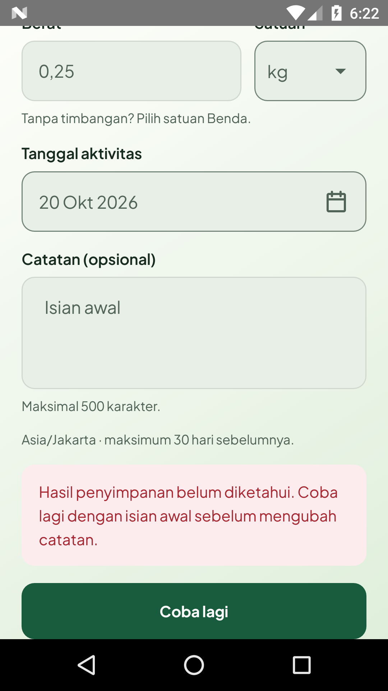
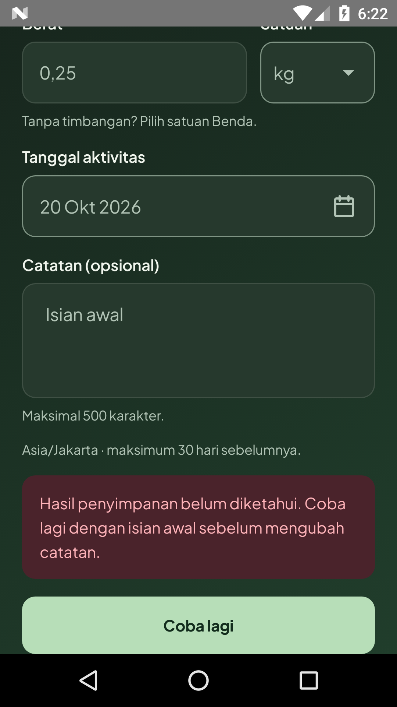

# Editor: hasil simpan belum pasti

20 Oktober 2026, branch `codex/android-iteration-2-design`. Lanjutan [editor S05/S09](EDITOR.md), mengacu SCREEN_SPEC S05 dan API §5. Seluruh aplikasi tetap [dalam pengerjaan](../../tasks/ITERATION_2_DESIGN.md).

## Perubahan yang dibuktikan

Sebelumnya, sesudah server menyimpan tetapi respons hilang, pemanggilan save dengan catatan berbeda masih mencapai store memakai request ID yang sama. Uji regresi menghasilkan `Changed payload must never reach the store expected:<1> but was:<2>`. Error UI juga hanya mengatakan belum tersimpan, meskipun hasil transaksi sebenarnya belum diketahui.

Sekarang submit valid menyimpan snapshot isian awal. Input 0,25 kg tetap terlihat sebagai 0,25 kg, sedangkan retry mengirim 250 gram dan notes yang sudah di-trim. Semua field terkunci selama request aktif atau hasilnya belum pasti. Retry eksplisit memakai snapshot dan UUID awal; jendela tanggal yang bergeser tidak mengubah payload retry. Setelah receipt dikonfirmasi, alur detail/edit yang sama tetap tersedia.

ViewModel menahan payload create yang belum selesai di-resolve dan menolak isian berbeda sebelum memanggil store. Double tap tidak memulai write kedua. Receipt replay tidak memberi XP baru; state sukses tetap menunggu ID hasil penyimpanan dan refresh data turunan.

| Hasil | Form dan pemulihan |
|---|---|
| Timeout, network, server, HTTP tak terklasifikasi, respons malformed | Hasil belum diketahui; nilai awal dipertahankan; Coba lagi, dengan penjelasan bahwa isian awal dipakai |
| Validasi ditolak | Isian tetap tersedia dan bisa dikoreksi |
| Storage lokal gagal | Pesan kegagalan penyimpanan perangkat; bisa dicoba lagi |
| Rate limit | Pesan untuk menunggu sebelum mencoba lagi |
| IDEMPOTENCY_CONFLICT | Pesan permintaan sudah dipakai; Lihat riwayat; tidak membuat ID baru otomatis |
| LOG_DELETED | Menjelaskan catatan sudah dihapus dan tidak dibuat ulang; Lihat riwayat |

Snapshot dan error masuk Saver editor. Restore state layar tidak mengirim request otomatis; snapshot yang tersimpan saat write aktif diperlakukan sebagai hasil belum pasti. Format Saver editor lama tetap dapat dipulihkan. Ini belum penyimpanan draf ke disk yang terisolasi akun.

Menutup form setelah hasil belum pasti tetap memerlukan konfirmasi. Pesan menjelaskan bahwa menutup form tidak membatalkan permintaan yang telah dikirim dan pengguna perlu memeriksa riwayat sebelum mencatat aktivitas sama. Konfirmasi menutup memang membuang draf layar; persistensi draf terpisah masih pekerjaan berikutnya.

## Perbandingan visual

Kit tidak menyediakan frame timeout interaktif tersendiri. [Referensi S05 terang](reference-S05-light.png) dan [gelap](reference-S05-dark.png) tetap acuan form; state error menerapkan bidang opak, role errorContainer/onErrorContainer, radius, jarak, font dan tombol dari DESIGN §2/6/8/9.

| Terang, hasil belum pasti | Gelap, hasil belum pasti |
|---|---|
|  |  |

Gambar state gagal berasal dari harness komponen editor dengan canvas, warna konten dan safeDrawing inset aplikasi, tanpa app bar. Fault hanya ada dalam tes, bukan menu demo produk. Journey navigasi aplikasi diuji terpisah pada APK yang sama. Copy pemulihan diringkas setelah inspeksi teks 200%; CTA memakai Coba lagi dari kit, sedangkan pesan tetap menjelaskan retry dengan isian awal. Screenshot footer setelah scroll bukan klaim seluruh form muat sekaligus. Tanggal 20 Oktober dan notes uji berbeda dari contoh galeri.

| Konfigurasi | Timeout terang | Timeout gelap | Sudah dihapus | Konflik request |
|---|---|---|---|---|
| 360 dp | [Lihat](submission-unknown-light-360.png) | [Lihat](submission-unknown-dark-360.png) | [Lihat](submission-deleted-light-360.png) | [Lihat](submission-conflict-dark-360.png) |
| 360 dp, 200% | [Lihat](submission-unknown-light-360-font200.png) | [Lihat](submission-unknown-dark-360-font200.png) | [Lihat](submission-deleted-light-360-font200.png) | [Lihat](submission-conflict-dark-360-font200.png) |
| 600 dp, 200% | [Lihat](submission-unknown-light-600-font200.png) | [Lihat](submission-unknown-dark-600-font200.png) | [Lihat](submission-deleted-light-600-font200.png) | [Lihat](submission-conflict-dark-600-font200.png) |

Lebar 600 dp diperoleh lewat density 288 pada emulator 1080×1920, bukan tablet fisik. Pada teks 200%, jam status bar API 24 terpotong oleh UI sistem; kontrol aplikasi diperiksa terpisah.

Host tes awal belum meneruskan warna konten/canvas tema dan inset shell. Host diperbaiki sebelum bukti final diambil. Hasil percobaan itu tidak dihitung sebagai penerimaan visual. CTA kini diperiksa minimal 48 dp dan seluruh bounds-nya berada di viewport setelah safeDrawing inset. Teks error terhubung ke live region; kontras dihitung 6,11:1 terang dan 7,97:1 gelap. Pengucapan TalkBack belum diperiksa.

## Pengujian

Native build app/instrumentasi, lint debug dan **120 debug unit tests**, 0 gagal/error/skip, lulus. Enam unit test tambahan mencakup guard payload yang sebelumnya merah, serialisasi write/double tap, koreksi setelah penolakan, raw/canonical snapshot, retry tanggal bergeser, Saver dan restore write terputus. Test mapper HTTP yang sudah ada juga mencakup 409 IDEMPOTENCY_CONFLICT dan 410 LOG_DELETED.

| API 24 | Kasus lulus | Durasi |
|---|---:|---:|
| 360 dp, font normal | 9 | 94,858 detik |
| 360 dp, font 200% | 7 | 72,300 detik |
| 600 dp, font 200% | 6 | 46,886 detik |

Total **22 eksekusi dari 10 kasus unik**, tidak ada kasus yang dilewati.

Hitungan di atas hanya suite final setelah host tema/inset dikoreksi. [Rekap portable](submission-native-results.json) memuat nama setiap kasus. Lima kasus editor memeriksa loading/field disabled, payload retry sama, tidak ada request otomatis saat restore, terminal conflict/deleted tanpa retry, serta koreksi setelah validasi ditolak. Journey aplikasi memeriksa kedua tema editor, simpan/edit/XP, feedback, dock atau rail sesuai konfigurasi.

Gate APK: min SDK 24, MainActivity adjustResize, lima weight font dan OFL. APK yang dipasang dibandingkan byte/hash dengan export yang diuji:

- App: `25e0ef37fbaf53d0f37bc9892b7a2ca5e458c9561d5bd81349b71ddb3e74eb30`
- Instrumentasi: `e8aff935f2cfecd18bd8fdcd0b3d842356eecfbb08e817e3274c2c432d919675`

## Batas checkpoint

Adapter write HTTP masih NOT_CONFIGURED; respons timeout pada perjalanan ViewModel memakai store dummy yang sengaja kehilangan respons sesudah commit. State gagal native memakai harness di atas. Ini bukan bukti transaksi terhadap backend sungguhan.

Persistensi draf ke disk/per akun, process death nyata tanpa bundle, metadata field error server, retryAt rate limit, konflik version D04, pengukuran IME editor, spoken feedback dan audit motion/material bersama belum selesai. Guide/detail, cursor/pull-to-refresh, Statistik, Profil/pengaturan dan kamera/AI tetap bagian sasaran penuh. Issue A16 dan PR tetap terbuka.
