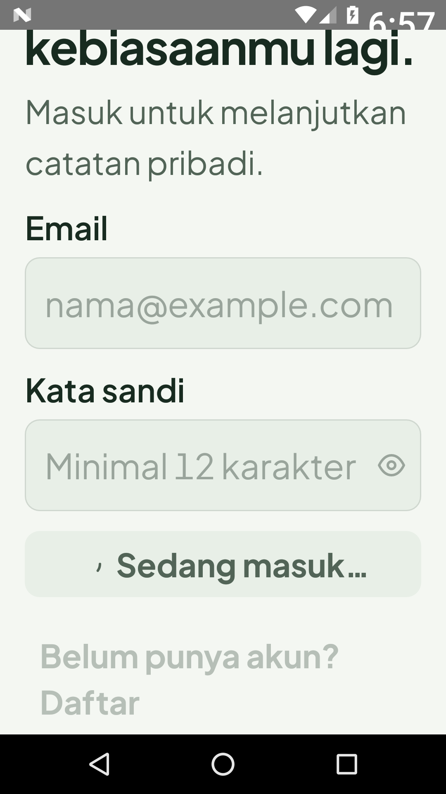
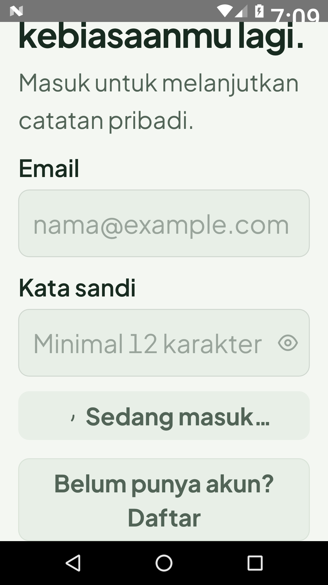
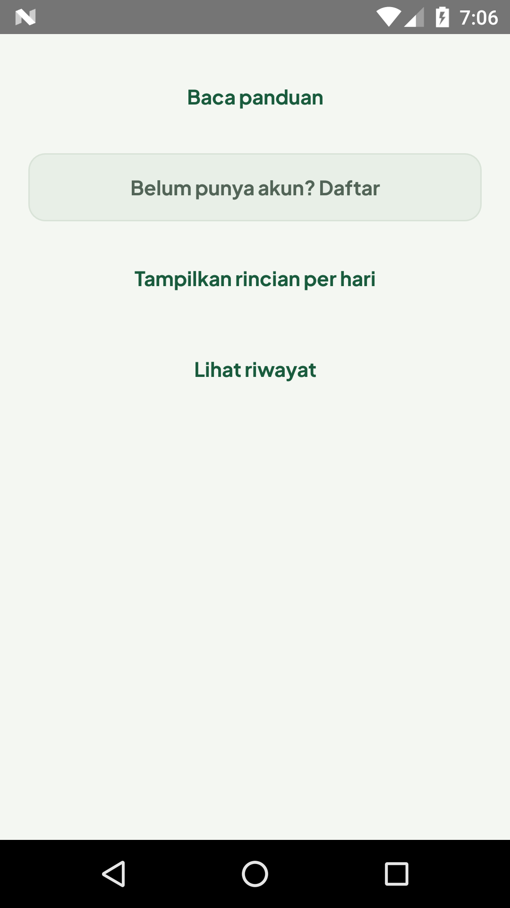
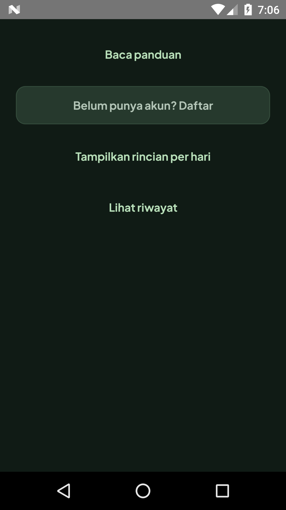
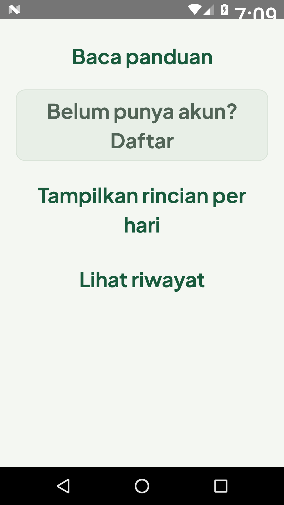
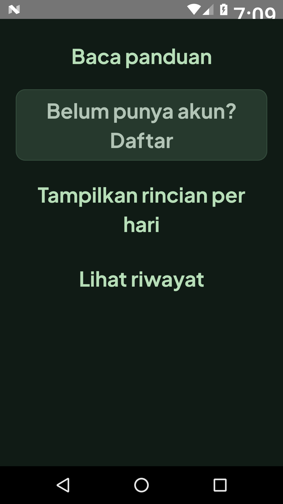
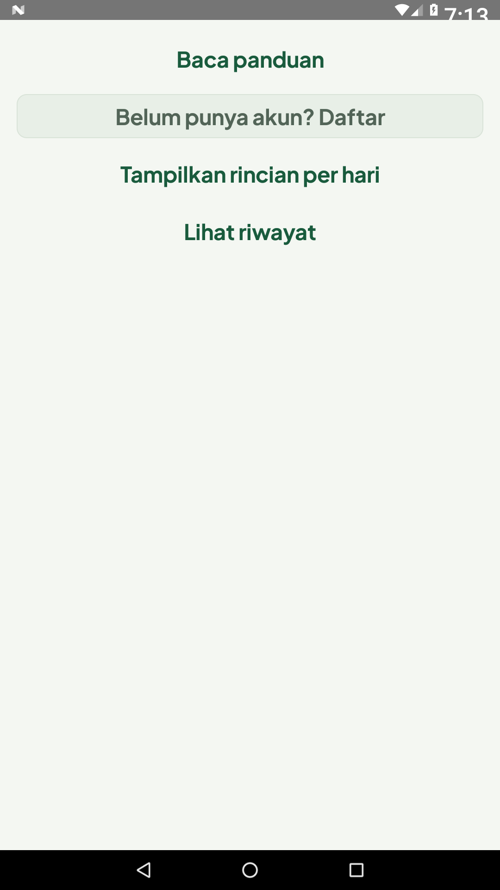
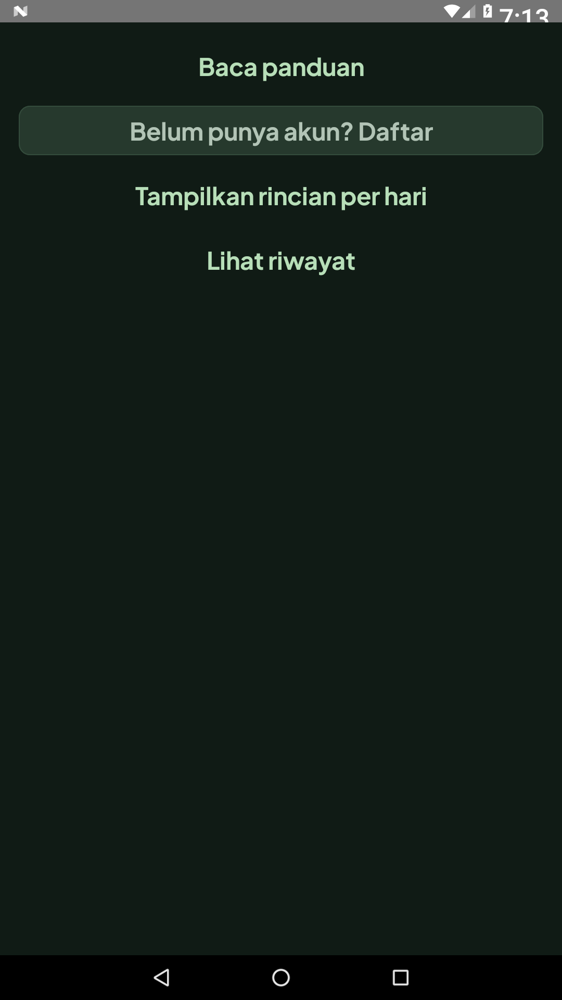

# Aksi teks C05: disabled yang terbaca dan label utuh

26 Oktober 2026, branch `codex/android-iteration-2-design`, melanjutkan `959eadf`. Acuan: SCREEN_SPEC C05, DESIGN §4/6/9, serta `.btn.text-btn`, `.btn:disabled` dan `.text-link` pada CSS kit v1.3. [Sasaran seluruh layar](../../tasks/ITERATION_2_DESIGN.md) tetap dalam pengerjaan.

## Sebelum dan sesudah

Ketika Masuk/Daftar sedang mengirim, aksi perpindahan form sudah dinonaktifkan, tetapi warna label hasil layout memiliki alpha **0,38**. Kit memakai muted opak. [Reproduksi native](text-action-before-failure.txt) pada app `959eadf` gagal pada pemeriksaan warna tersebut. Pemeriksaan baris Aktivitas terbaru/Lihat riwayat lulus pada baseline; struktur barisnya dipertahankan sebagai patokan regresi.

| Form Masuk pending, ponsel 200% | Sebelum | Sesudah |
|---|---|---|
| Warna dan label C05 |  |  |

`TextActionButton` kini dipakai pada **18 titik dalam 9 file**: form akun/cleanup sesi, Beranda, Panduan, Riwayat/filter, detail, Statistik, Profil, aksi kalender dan pemilih tema. Aksi tersedia memakai primary pada background transparan; disabled memakai soft/muted/divider opak. Radius 12 dp, label 14/20 sp weight 700 dan target minimum 48 dp mengikuti peran C05. Label memakai lebar intrinsik dan rata tengah sehingga dapat membungkus tanpa terpotong. Lebar, callback, semantik tambahan serta enabled tetap diteruskan dari pemakai.

Aturan pilihan tanggal, konfirmasi/Batal, tema, clear/filter, sumber artikel, expand/collapse Statistik dan retry tidak diubah. Perubahan tidak menambah dependensi, copy produk, logika akun, HTTP atau AI. Source panduan tetap membuka URI review yang diberikan pemakai.

## Verifikasi

| API / lebar / font | Regresi | Kalender tambahan | Durasi regresi |
|---|---:|---:|---:|
| 24 / 360 dp / normal | 20 | 1 | 188,069 detik |
| 24 / 360 dp / 200% | 20 | 1 | 194,382 detik |
| 24 / 600 dp / 200% | 20 | 1 | 270,754 detik |

**63 eksekusi native / 21 metode unik, nol skip.** APK aplikasi identik pada matriks utama dan pemeriksaan kalender: `64efaa109e90f41267f7ff6b6e2c692b3b2207d8258a8dd49f5bd3e39ed866fb`. APK penguji matriks utama: `09b34bed91cdec820ca3d4a12557800ef24f62dd101dc7b7c5a8a93d859c3ed0`; APK penguji kalender: `8d96e3741d4e34696c71200d3ae18654a78dcb738bca35c5193f158824fd3bba`. Perbedaannya hanya penambahan satu file test kalender; seluruh source matriks utama tetap identik. [Manifest](text-action-checkpoint.json) mengikat source, kasus, konfigurasi, warna dan gambar ke hash masing-masing. Lima pemeriksaan smoke awal tidak ditambahkan ke total final.

Lima metode baru memeriksa render C05 kedua tema, Tab/Enter/sentuhan, form Masuk/Daftar pending dan sesudah idle, serta ruang baca heading/link Beranda. Source dua metode reproduksi tidak berubah dari baseline ke source final; APK penguji baseline berbeda karena suite komponen baru ditambahkan kemudian. Probe baseline berisi satu kegagalan warna dan satu kasus heading yang lulus, bukan dua regresi produk.

Warna foreground dibaca dari layout aktual. **72 sampel foreground/background** memenuhi 4,5:1; disabled minimal **5,40:1 terang / 6,72:1 gelap**. **24 pemeriksaan tepi** mencakup enam border disabled dan 18 tepi transparan. Label panjang menjadi dua baris pada ponsel 200%, tanpa overflow. Kontrol tetap ≥48 dp dan pemakai compact tidak dipaksa memenuhi lebar window. Sentuhan/Enter menolak aksi disabled dan callback bekerja kembali setelah enabled. Baris Aktivitas terbaru tetap maksimal dua baris pada konfigurasi yang diuji; link riwayat bekerja pada kedua tema.

Regresi meliputi Panduan/pencarian/clear/prefill/viewport, filter dan kalender Apply/Batal/rentang tanggal, daftar/notice/load more Riwayat, periode/tabel/scroll Statistik, editor/validasi/recreate/save/storage failure, akun/tema/logout, lima stack/dock/manual/rail, serta retry cleanup pada root Masuk. Ini dummy atau state deterministik, bukan pengujian layanan server.

Pemeriksaan kalender tambahan menjalankan Batal setelah memilih tanggal lain, lalu memastikan tanggal awal dan jumlah callback tetap. Terapkan mengubah tanggal tepat sekali. Tanpa pilihan, Terapkan nonaktif, label muted opak dan ketukan tidak mengubah nilai atau menutup picker. Kedua tema diuji pada setiap konfigurasi; durasi 12,535 / 12,732 / 17,135 detik. Contoh: [kalender terang 200%](text-action-date-light-phone200.png) dan [gelap 200%](text-action-date-dark-phone200.png).

| Konfigurasi | Komponen terang | Komponen gelap | Form pending |
|---|---|---|---|
| Normal |  |  | [Masuk terang](text-action-auth-light-normal.png) / [Daftar gelap](text-action-auth-dark-normal.png) |
| Ponsel 200% |  |  | [Masuk terang](text-action-auth-light-phone200.png) / [Daftar gelap](text-action-auth-dark-phone200.png) |
| Lebar 200% |  |  | [Masuk terang](text-action-auth-light-wide200.png) / [Daftar gelap](text-action-auth-dark-wide200.png) |

Baris Beranda pada ponsel 200%: [gambar](text-action-overview-phone200.png). Form panjang digulir menuju aksi yang diperiksa; gambar adalah satu viewport, bukan seluruh screen. State field lain pada gambar belum menjadi penerimaan C08/C09. Tidak ada klaim semua kontrol auth telah lolos audit kontras.

Build native, lint debug, **171 debug unit tests** (nol gagal/error/skip) dan gate API 24/adjustResize/lima font/OFL lulus. Emulator dijalankan lokal. Pada checkpoint sebelumnya `959eadf`, [CI push](https://github.com/waste-not-app/waste-not-android/actions/runs/40246375822) dan [CI PR](https://github.com/waste-not-app/waste-not-android/actions/runs/40246377643) berhasil pada build/lint/unit/verifikasi paket tetapi gagal upload akibat kuota artefak. Status CI source terbaru tetap mengikuti head PR.

## Batas checkpoint

Material default/disabled, wrapping, target dan keyboard pada cakupan di atas telah diperiksa. ENERGY 2 / RHYTHM 2 / MOTION 1 tetap mengikuti kit; tidak ada aksen atau animasi baru. Visual pressed/focus seluruh pemakai, C06, field/selector, highlight CTA, seluruh screen/navbar/navigasi, spoken TalkBack dan perangkat lain tetap terbuka. DataStore, cursor/pull-to-refresh, capability tambahan serta HTTP/AI mengikuti matriks penuh. PR #96 tetap draft.
