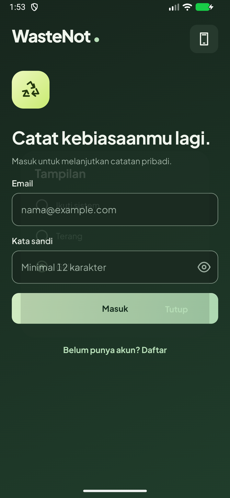
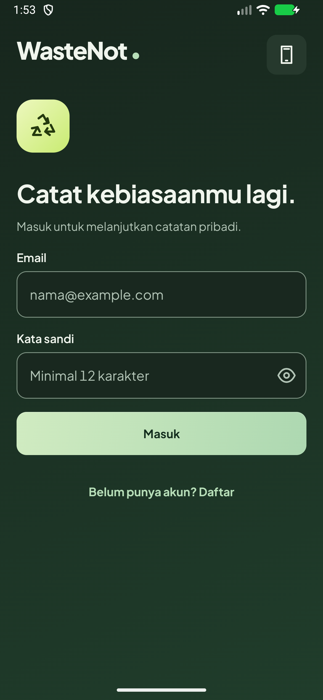
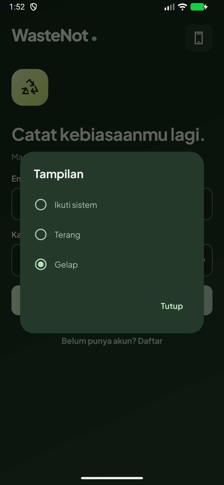
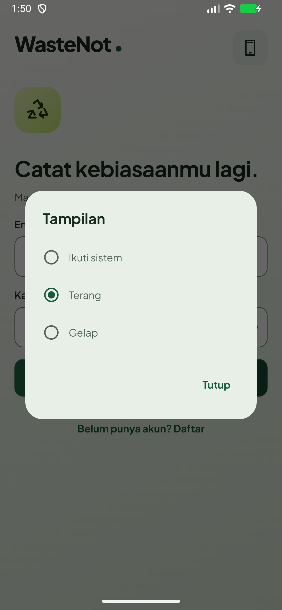

# Preferensi tampilan: migrasi DataStore

9 November 2026, A30/#41. Pilihan Ikuti sistem/Terang/Gelap kini memakai Preferences DataStore 1.3.0. Pilihan lama pada SharedPreferences `appearance` dimigrasikan; hanya key `theme` yang dipindahkan. Akun, token, catatan dan draf memakai penyimpanan masing-masing seperti sebelumnya.

## Perilaku dan implementasi

ThemePreferences menyediakan Flow dan penulisan suspend melalui satu delegate DataStore pada application context. ThemeViewModel menampilkan pilihan baru segera, menserialkan penulisan dan mengabaikan intent antrean yang sudah digantikan. Emisi lama tidak mengganti pilihan yang masih disimpan atau yang gagal disimpan. Setelah penulisan dikonfirmasi, observasi dibuka ulang untuk membaca nilai kanonis.

Nilai awal belum diketahui dimodelkan sebagai `null`, bukan dianggap pilihan tersimpan. MainActivity menahan draw konten sampai mode pertama selesai diproses dalam composition. Pembacaan awal memiliki batas lima detik; kegagalan memberi fallback sistem dengan banner dan retry, sehingga form akun tetap dapat dibuka. Kegagalan tulis mempertahankan preview dan intent pilihan pengguna dengan pesan bahwa penyimpanan belum dapat dipastikan. Retry menyimpan kembali pilihan tersebut.

Nilai enum yang tidak dikenal atau bertipe salah mengikuti sistem. File preferensi tampilan yang korup diganti default; kebijakan ini dibatasi pada file tampilan. Migration membersihkan key legacy setelah hasil tersimpan, mempertahankan key lain dan tidak menimpa pilihan DataStore yang sudah ada. Pemilih tema dan token visual dipertahankan. Library dipilih dari [dokumentasi DataStore](https://developer.android.com/topic/libraries/architecture/datastore) dan [rilis stabil](https://developer.android.com/jetpack/androidx/releases/datastore).

Fixture navigasi/pengujian AI kini menyimpan, mengatur dan memulihkan tema melalui kontrak DataStore, bukan menulis file SharedPreferences lama. Semua fixture tetap berada pada source pengujian; APK aplikasi mempertahankan adapter backend nyata.

## APK

| Paket | SHA-256 |
|---|---|
| Debug native | `6861ba45bb8f9d9b50b25cf4c9e84679130ca75f4dbf30e09a9fa80f704e6dbe` |
| Staging native | `07ba9daeec34f0006e5d7bc4eb641dabda697cf8389d04e9d2383e82b6611199` |
| Penguji native | `f89a1842093f6b68d3ce561da6b3b56bc72ba2de251667d7dcd20953a4d021bb` |

Staging **36.408.131 byte**, `com.example.wastenot.staging`, tidak debuggable, minimum API30/target36, signature v2. SDK, adjustResize, lima bobot Jakarta Sans/OFL serta gate source/DEX/assets tanpa adapter lokal diperiksa. [Manifest build](theme-datastore/build-manifest.json), [salinan APK lokal](theme-datastore/delivery.json). Pointer APK lokal diperbarui setelah penerimaan; versi riwayat `09c5327d` tetap diarsipkan.

## Pengujian

**264 debug unit tests, nol failure/error/skip**, termasuk tujuh metode ThemeViewModel dan empat metode berkas DataStore. Mencakup pilihan sebelum I/O selesai, emisi lama, antrean cepat/intent terakhir, error baca/tulis dan retry, batas startup, pergantian observasi, seluruh mode setelah berkas ditutup/dibuka, enum salah, file korup serta preservasi key lain. [Hasil unit](theme-datastore/unit-test-result.json), [lint/unit/build](theme-datastore/lint-unit-build.log), [build APK native](theme-datastore/native-build.log).

**Enam metode native lulus pada percobaan pertama**, API37, 390dp/font100% kecuali pemilih komponen yang secara lokal memakai font200%:

| Metode/alur | Bukti |
|---|---|
| Migrasi tiga pilihan legacy, mempertahankan key lain dan nilai DataStore yang sudah ada | File/migration Android nyata |
| Nilai legacy salah tipe/tidak dikenal | Fallback sistem dan pilihan berikutnya dapat disimpan |
| Tujuan migrasi gagal ditulis | Nilai legacy tetap tersedia; migrasi ke tujuan sehat lulus |
| Pemilih pada font200% | Tiga pilihan terlihat, langsung terpilih dan tersimpan ke DataStore |
| MainActivity sebenarnya | Tiga pilihan bertahan sesudah recreate; mode Sistem mengikuti perubahan night mode perangkat |
| Kegagalan preferensi startup dan penulisan | Form email tetap dapat dicapai; retry memulihkan baca serta pilihan tulis terakhir |

[Log native](theme-datastore/theme-native.log) dan [hasil/perangkat](theme-datastore/native-result.json). Kegagalan startup/tulis memakai ThemeStore terkontrol hanya pada APK penguji untuk membuktikan wiring UI. Kegagalan tujuan migrasi adalah I/O berkas Android nyata pada path milik tes. Keduanya tidak diklaim sebagai pengisian disk perangkat atau pengujian backend. Tidak ada akun backend, catatan ataupun generasi AI baru dibuat pada batch ini.

## Upgrade aplikasi di luar instrumentation

APK lama `09c5327d` dipasang pada package staging. Melalui UI dipilih Gelap, kemudian proses dihentikan dan dibuka lagi; Gelap masih terpilih. APK DataStore dipasang menggunakan upgrade package biasa, tanpa clear data/uninstall. Pilihan Gelap tetap aktif dan kembali diverifikasi setelah proses versi baru dihentikan/dibuka lagi. Paket debug pengujian tidak berubah.

| Sebelum: APK SharedPreferences | Sesudah: APK DataStore |
|---|---|
|  |  |
|  |  |

[Hasil upgrade](theme-datastore/upgrade-result.json), [pilihan legacy](theme-datastore/legacy-selected.xml), [pilihan sesudah migrasi](theme-datastore/datastore-selected.xml), [startup sesudah restart](theme-datastore/datastore-restarted-startup.log). Screenshot menunjukkan frame pertama yang diamati setelah startup stabil, bukan pengukuran frame-by-frame splash sistem.

## Tampilan dan pemulihan

| Pilihan/keadaan | Terang | Gelap |
|---|---|---|
| Pilihan eksplisit |  |  |
| Mengikuti sistem |  |  |

Pemilih tetap memakai komposisi radio dan token kit yang sudah ada. [Banner baca gagal](theme-datastore/captures/read-failure.png), [baca pulih](theme-datastore/captures/read-recovered-dark.png), [tulis gagal](theme-datastore/captures/write-failure.png), [tulis pulih](theme-datastore/captures/write-recovered-light.png). Empat belas PNG asli diverifikasi terhadap [manifest capture](theme-datastore/capture-manifest.json). Gambar dan metadata tidak diubah untuk menyamarkan state.

Self-review mengikuti code-reviewer: batas file/migrasi, cancellation dan intent tulis, lifecycle/draw, error/retry, sumber APK serta isolasi fixture diperiksa; tidak ditemukan penghalang produk pada scope perubahan. Night mode, ukuran, density dan font perangkat dikembalikan; emulator task dihentikan. Tema staging sengaja tetap Gelap sebagai hasil skenario upgrade.

Ini penerimaan S16/penyimpanan tema. Native akun/data statistik tidak diulang dan tidak diklaim dari pengujian ini. Audit font besar seluruh aplikasi, spoken TalkBack, performa 1.000 log serta regresi core/AI akhir masih memiliki scope terpisah. Hasil CI dicatat setelah selesai; keberadaan APK bukan bukti otomatis seluruh goal selesai.

## Build native sebagai default

Hook awal menjalankan 264 debug tests dengan HotSwan aktif dan menemukan satu kegagalan pada pemulihan baca: reflection interpreter membungkus IOException menjadi UndeclaredThrowableException sebelum catch pemilik state. [Hook gagal](theme-datastore/product-hook-first-failed.log) dan [stack trace](theme-datastore/hotswan-read-failure.xml) dipertahankan. Ini berbeda dari 264 unit tests native dan enam metode Android yang sudah lulus.

Percobaan pengecualian kelas kedua mengikuti [opsi resmi HotSwan](https://hotswan.dev/docs/gradle-configuration#excluding-classes), tetapi kombinasi dua pola menghasilkan `Wrong plugin option format: null` pada konfigurasi 2.0.1/Kotlin 2.3.20; [log kompilasi](theme-datastore/hotswan-theme-fix.log). Perubahan pengecualian tambahan dibatalkan. Tidak ada catch generik atau pengabaian assertion ditambahkan untuk meloloskan interpreter.

Build native kini menjadi default, sehingga perintah build/unit/hook/CI biasa memakai jalur runtime aplikasi. Hot reload tetap pilihan pengembangan eksplisit `-Pwastenot.hotReload=true`; keterbatasan jalur I/O interpreter tersebut masih berlaku pada mode itu. Tidak ada gate/hook yang dilewati. [Delta konfigurasi](theme-datastore/native-default-delta.json) memisahkan fingerprint source APK yang diterima dari perubahan default setelahnya: source aplikasi/dependency sama, hanya default properti dan komentar berubah. APK checkpoint memang dibangun dengan `-Pwastenot.hotReload=false`, sehingga delta ini tidak mengubah runtime APK yang diuji.

Hook produk dengan default native lulus tanpa bypass: lint debug dan task `test`. [Log hook](theme-datastore/product-hook.log), [jumlah hasil per varian](theme-datastore/product-hook-tests.json). Source main sama dengan APK yang diterima; perubahan default build dibatasi pada delta di atas.
