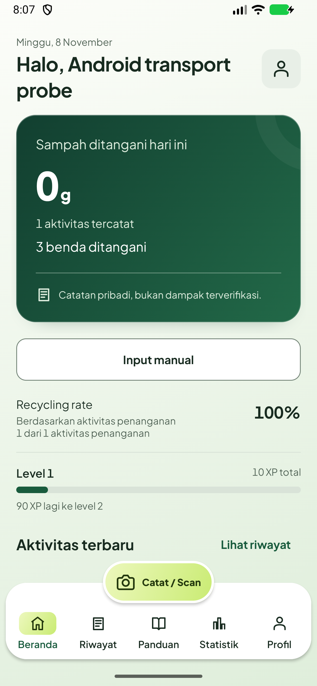
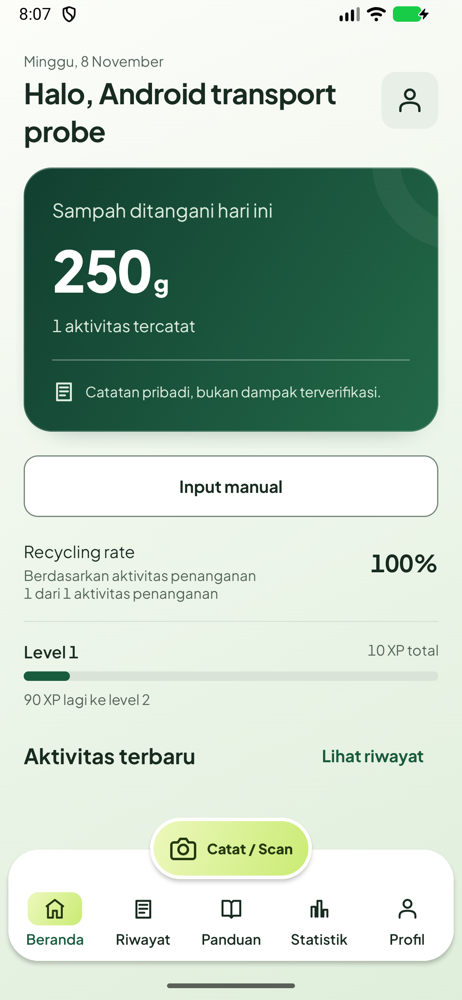
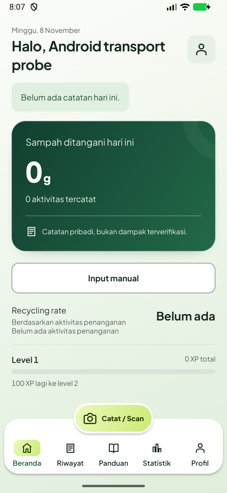
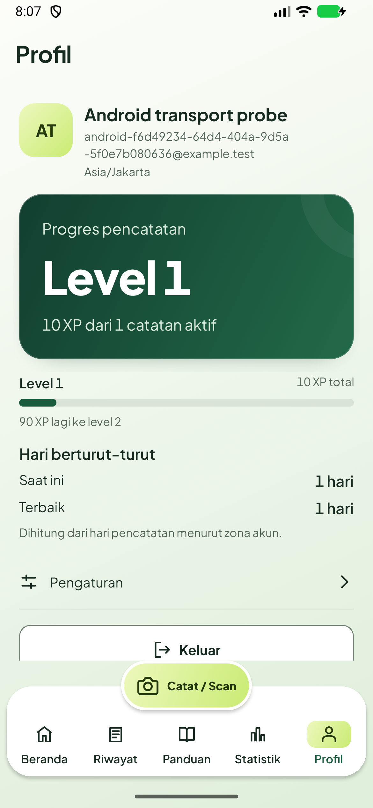
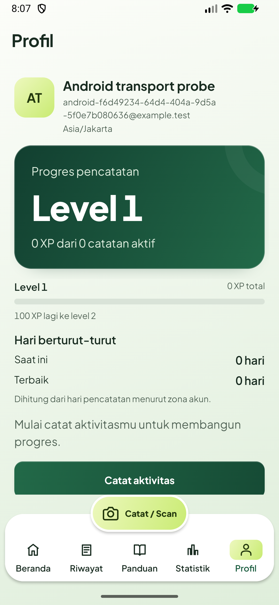
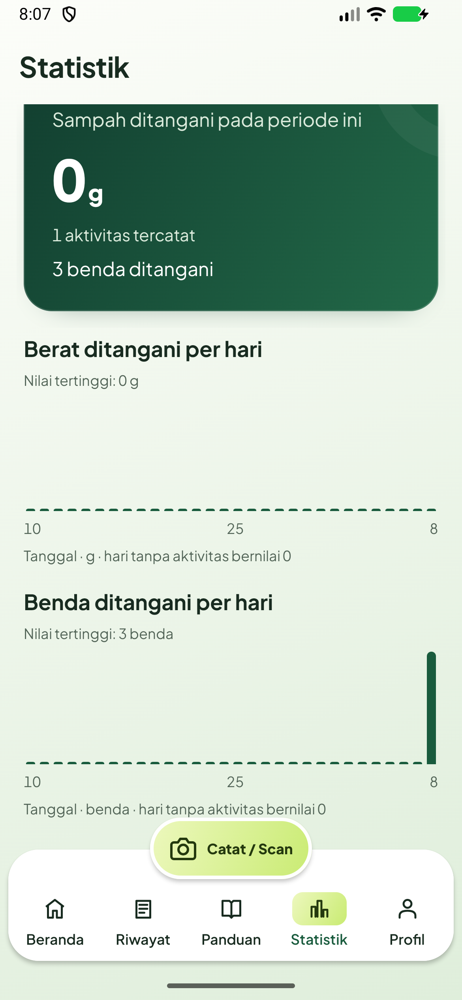
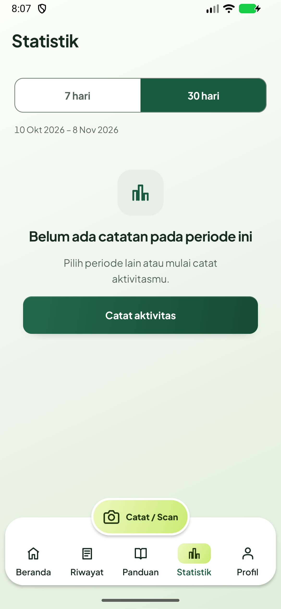
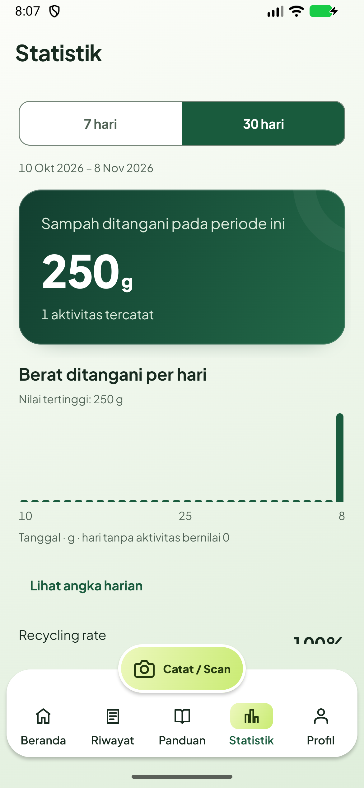

# Akun dan data backend nyata

APK debug native memakai source produk `e499511658ca252ab8698ca237c73b7ca27dd0fe`.

Delapan frame berikut berasal dari satu akun sementara yang benar-benar dibuat melalui backend HTTPS. Catatan 250 g diubah menjadi tiga benda lalu dihapus. Akun uji kemudian dihapus melalui pemeriksaan server yang dibatasi identitasnya.

## home counted

## home created

## home empty

## profile created

## profile deleted

## statistics counted

## statistics deleted

## statistics month

