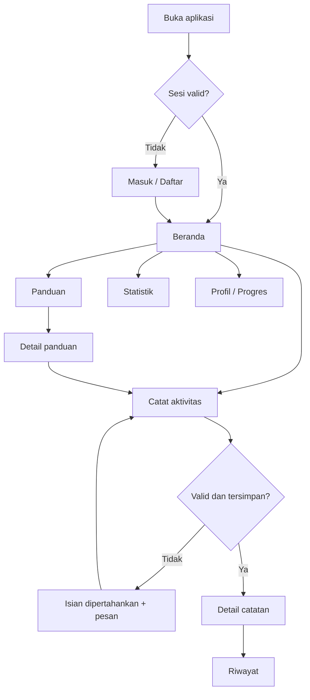

# WasteNot: Product Requirements Document

Versi 1.1 · 21 September 2026 · Android MVP · Target pengerjaan 4 minggu

**Status:** spesifikasi rancangan untuk implementasi, bukan laporan fitur yang sudah tersedia. Dokumen ini memperluas seluruh 20 bagian `WasteNot_PRD.pdf` versi 1.0, 6 halaman. Detail baru diberi label **Keputusan rancangan** atau **Usulan**. Persetujuan produk dan hasil pengujian belum diasumsikan.

Dokumen pendamping: [desain](DESIGN.md), [spesifikasi layar](SCREEN_SPEC.md), [arsitektur](ARCHITECTURE.md), [kontrak API](API.md), [rencana implementasi dan QA](IMPLEMENTATION_PLAN.md), [design system interaktif](design-system.html).

## 1. Ringkasan produk

WasteNot membantu pengguna mencatat aktivitas pengelolaan sampah pribadi, menemukan panduan penanganan, dan melihat kebiasaan Reduce, Reuse, Recycle (3R). Produk dipakai untuk refleksi pribadi; angka yang ditampilkan merupakan catatan pengguna, bukan pengukuran dampak lingkungan yang diverifikasi.

Platform yang ditetapkan pengguna adalah Android dengan Kotlin dan Jetpack Compose. Backend terpisah menyimpan akun, aktivitas, panduan, serta statistik. Jetpack Compose adalah toolkit UI Android, bukan infrastruktur server. Rancangan backend dari PDF adalah Go, PostgreSQL, autentikasi JWT, dan Docker Compose.

MVP harus menyelesaikan alur nyata: membuat akun → masuk → mencatat aktivitas → melihat riwayat → melihat ringkasan dan statistik berubah. UI HTML dalam paket ini adalah referensi visual dan simulasi interaksi; aplikasi Android akhirnya harus menggunakan data backend.

## 2. Masalah dan konteks

Pengguna sering tidak mengetahui berapa banyak sampah yang mereka hasilkan, tidak yakin bagaimana menangani material tertentu, dan sulit menilai konsistensi kebiasaan. Catatan manual tidak menyatukan pencatatan, panduan, dan evaluasi. WasteNot menyediakan tempat yang ringkas untuk ketiganya.

Hipotesis produk: jika pencatatan singkat, panduan mudah dicari, dan perubahan kebiasaan terlihat, pengguna lebih bersedia mencatat secara rutin. Hipotesis ini belum dibuktikan dengan riset pengguna dan tidak dipresentasikan sebagai hasil penelitian.

## 3. Tujuan dan ukuran keberhasilan

| ID | Tujuan | Bukti penerimaan |
|---|---|---|
| G-01 | Pencatatan praktis | Pengguna yang memahami UI dapat menyimpan satu catatan dalam ≤30 detik; ukur saat uji kegunaan |
| G-02 | Riwayat bisa dipercaya | Catatan yang sukses tersimpan muncul kembali setelah aplikasi ditutup dan dibuka |
| G-03 | Evaluasi pribadi yang konsisten | Dashboard dan statistik memakai definisi metrik yang sama dan dapat dihitung ulang dari data |
| G-04 | Panduan mudah ditemukan | Pencarian nama/kata kunci mengantar ke detail penanganan yang relevan |
| G-05 | Dorongan kebiasaan ringan | XP dan level berubah setelah aktivitas valid; streak/achievement mengikuti cakupan iterasi |
| G-06 | Demo end-to-end | Alur utama memakai akun, backend, dan database nyata; stabil pada perangkat demo |

Target ≤30 detik berasal dari PDF. Target respons p95, tingkat retensi, pertumbuhan pengguna, dan pengurangan emisi tidak ditetapkan tanpa baseline. Untuk tugas, laporkan jumlah skenario lulus, waktu pencatatan teramati, perangkat, kondisi jaringan, dan cacat tersisa.

## 4. Pengguna dan kebutuhan

### Pengguna utama

Mahasiswa dan pengguna muda yang ingin memperbaiki kebiasaan sehari-hari. Mereka mungkin memiliki timbangan, tetapi tidak selalu. Karena itu pencatatan mendukung berat **atau** jumlah benda tanpa mengonversi jumlah ke kilogram secara spekulatif.

### Skenario pengguna

| Situasi | Kebutuhan | Hasil yang diharapkan |
|---|---|---|
| Selesai minum dari botol kemasan | Mencatat kategori dan tindakan | Satu aktivitas tercatat tanpa terlalu banyak isian |
| Menggunakan ulang wadah | Membedakan Reuse dari Recycle | Riwayat dan statistik menunjukkan metode yang benar |
| Membawa wadah sendiri | Mencatat benda sekali pakai yang dihindari | Reduce tidak menambah total sampah yang ditangani |
| Tidak yakin menangani barang | Mencari panduan berdasarkan nama | Membaca langkah, batasan, dan sumber yang ditinjau |
| Mengevaluasi satu minggu | Melihat total dan komposisi | Memahami satuan, rentang tanggal, dan basis persentase |
| Jaringan terputus saat menyimpan | Mempertahankan isian | Dapat mencoba kembali tanpa catatan ganda |

Tidak ada persona bernama, wawancara, atau kutipan pengguna yang direkayasa dalam spesifikasi ini.

## 5. Cakupan dan prioritas

| Fitur | Prioritas PDF | Target rancangan ini | Batas |
|---|---|---|---|
| Register, login, logout, sesi | Must | MVP inti | Email/password; tanpa social login |
| Dashboard | Must | MVP inti | Hari ini, recycling rate, aktivitas terbaru, XP/level |
| Tambah catatan | Must | MVP inti | Kategori, berat/jumlah, metode, tanggal, catatan |
| Riwayat, detail, filter | Must | MVP inti | Hanya data pemilik |
| Ubah dan hapus catatan | Tersirat dalam CRUD minggu 2 | Keputusan rancangan: MVP inti | Memperbaiki kesalahan input; bukan kolaborasi |
| Waste Guide | Must | MVP inti | Knowledge base yang dikurasi; tanpa chatbot |
| Statistik | Must | MVP inti | 7/30 hari, kategori, metode; tanpa skor lingkungan |
| XP dan level | Should, tetapi ada dalam acceptance PDF | Baseline demo | 10 XP per catatan aktif; aturan di §10 |
| Streak dan achievement | Should | Iterasi setelah inti | Bisa dipangkas jika alur inti belum stabil |
| Pengingat | Should | Setelah inti | Opt-in, lokal, waktu perkiraan |
| Foto | Opsional/Stretch | Opsi perluasan | Tidak menghalangi penyimpanan catatan tanpa foto |
| Peta titik daur ulang | Could/Stretch | Opsi perluasan | Bergantung sumber lokasi terverifikasi |

**Penyelesaian konflik sumber:** PDF menempatkan gamifikasi sebagai Should tetapi meminta perubahan XP/level/achievement dalam acceptance. Baseline mencakup XP dan level sederhana. Jika seluruh gamifikasi dipangkas, catat penyimpangan acceptance dan konfirmasikan dengan penilai, jangan mengklaim memenuhi seluruh PDF.

### Tidak termasuk MVP

AI image classification, IoT/smart bin, pickup, marketplace, pembayaran, jejaring sosial, leaderboard, QR recycling point, antrean sinkronisasi offline-first, export CSV/PDF, personalisasi reminder, klaim karbon atau sertifikasi lingkungan. Lupa password via email dan penghapusan akun mandiri belum masuk baseline demo; peluncuran publik memerlukan keputusan tambahan di §18.

## 6. Prinsip pengalaman

1. Satu tindakan utama per layar, dengan “Catat aktivitas” mudah ditemukan dari Beranda dan Riwayat.
2. Tampilkan satuan bersama angka dan basis perhitungan bersama persentase.
3. Gunakan bahasa yang membantu, tanpa menyalahkan pengguna yang memilih Trash.
4. Keberhasilan baru ditampilkan setelah server mengonfirmasi transaksi.
5. Isian yang gagal tidak hilang. Pengulangan request tidak membuat catatan ganda.
6. UI selalu menjelaskan keadaan kosong, loading, error, dan data lama yang masih ditampilkan.

## 7. Information architecture dan perjalanan pengguna

Navigasi utama mengikuti PDF: **Beranda · Riwayat · Panduan · Statistik · Profil**. Tambah catatan bukan tab keenam. Layar auth, form, dan detail menggunakan navigasi kembali; bar utama hanya muncul pada lima tujuan utama.



### Alur utama

Login → Beranda → Catat aktivitas → pilih metode dan kategori → isi berat atau jumlah → simpan → server menyimpan → detail catatan dengan feedback → riwayat/ringkasan/progres diperbarui.

### Alur perbaikan

Riwayat → detail milik sendiri → ubah → validasi → simpan dengan version check. Hapus memerlukan dialog yang menyebut catatan dan efek ke statistik/XP. Setelah sukses kembali ke riwayat. Konflik perubahan tidak boleh menimpa versi baru secara diam-diam.

### Alur panduan

Panduan → ketik nama/kata kunci → pilih item → baca langkah dan sumber → “Catat aktivitas ini”. Kategori/metode boleh diisi dari panduan; jumlah, tanggal, dan keputusan pengguna tetap harus dikonfirmasi.

### Alur sesi kedaluwarsa

Request 401 → coba refresh sekali → jika gagal, hapus sesi dan cache pribadi → tampilkan Masuk dengan alasan. Draf nonrahasia boleh disimpan per identitas akun agar dapat ditawarkan kembali setelah login ke akun yang sama, tidak boleh terbuka ke akun lain.

## 8. Functional requirements dan acceptance

ID FR-01 sampai FR-10 mempertahankan penomoran sumber; FR-11 dan seterusnya adalah perincian tambahan.

| ID | Kebutuhan | Acceptance yang dapat diuji | Layar |
|---|---|---|---|
| FR-01 | Register dan login | Email valid + password sesuai aturan menghasilkan sesi; email duplikat/credential salah memberi pesan; password tidak tersimpan di UI state persisten | S01–S03 |
| FR-02 | Tambah waste log | Isian valid menghasilkan tepat satu catatan milik akun aktif; tombol disabled saat request berlangsung | S05 |
| FR-03 | Simpan atribut lengkap | Kategori, quantity_kind, nilai kanonik, metode, tanggal aktivitas, catatan, dan waktu server dapat dibaca ulang | S05, S08 |
| FR-04 | Riwayat dan detail sendiri | Catatan diurutkan tanggal aktivitas menurun dengan urutan ID stabil; objek akun lain mendapat 404 | S07, S08 |
| FR-05 | Filter kategori/metode | Filter dapat digabung dengan AND; reset mengembalikan seluruh data; chip menunjukkan filter aktif | S07, S10 |
| FR-06 | Pencarian panduan | Pencarian nama/kata kunci mengabaikan kapitalisasi; hasil kosong memiliki langkah pemulihan | S11, S12 |
| FR-07 | Total dan recycling rate | Hasil mengikuti §9, termasuk denominator nol, Reduce, dan satuan campuran | S04, S13 |
| FR-08 | XP | Satu catatan aktif menyumbang 10 XP; replay request tidak menambah XP kedua kali | S04, S14 |
| FR-09 | Level/achievement | Level dihitung dari XP; bila achievement diaktifkan, threshold serta koreksi data mengikuti §10 | S14, S15 |
| FR-10 | Statistik rentang waktu | 7/30 hari inklusif hari ini, tanggal lokal akun; hari tanpa aktivitas bernilai nol | S13 |
| FR-11 | Edit | Hanya pemilik dapat mengubah; created_at tetap; updated_at/version berubah; agregat dihitung kembali | S09 |
| FR-12 | Delete | Batal tidak mengubah data; konfirmasi menghapus catatan aktif dan memperbarui agregat | S08, D01 |
| FR-13 | Logout | Sesi server dicabut, state/cache pribadi dibersihkan, Back tidak membuka layar akun sebelumnya | S14, D02 |
| FR-14 | Error/retry | Offline/timeout/5xx mempertahankan isian dan menyediakan retry; timeout create memakai client_request_id yang sama | S05, S20 |
| FR-15 | Reminder opsional | Default mati; permission hanya diminta saat diaktifkan; penolakan tidak menghalangi fitur lain | S17 |
| FR-16 | Foto opsional | Satu gambar tervalidasi per log, akses privat, kegagalan upload dapat dipulihkan | S18 |
| FR-17 | Peta opsional | Tanpa izin lokasi tetap bisa melihat daftar titik; tidak membuat titik fiktif | S19 |
| FR-18 | Pengaturan tampilan | Terang, gelap, atau sistem; pilihan disimpan lokal dan tidak memengaruhi data statistik | S16 |

### Validasi form

| Field | Aturan rancangan | Pesan utama |
|---|---|---|
| Nama akun | Setelah trim, 2–60 karakter | “Isi nama sepanjang 2–60 karakter.” |
| Email | Trim luar, normalisasi untuk uniqueness, maksimal 254; validasi format di client dan server | “Periksa format email.” |
| Password | 12–128 karakter; tidak trim; boleh paste dan password manager | “Gunakan minimal 12 karakter.” |
| Konfirmasi password | Sama dengan password; hanya untuk UI registrasi | “Kata sandi belum sama.” |
| Kategori | Salah satu enum server | “Pilih kategori.” |
| Metode | REDUCE, REUSE, RECYCLE, TRASH | “Pilih cara pengelolaan.” |
| Jenis jumlah | WEIGHT atau COUNT; tidak keduanya | “Pilih berat atau jumlah benda.” |
| Berat | 1–100.000 gram; UI g bulat atau kg maksimal 3 desimal | “Masukkan berat antara 1 g dan 100 kg.” |
| Jumlah | Bilangan bulat 1–10.000 benda | “Masukkan jumlah benda 1–10.000.” |
| Tanggal aktivitas | Hari ini atau 30 hari sebelumnya, menurut zona akun | “Pilih tanggal dalam 30 hari terakhir.” |
| Catatan | Opsional, trim luar, maksimal 500 karakter | “Catatan maksimal 500 karakter.” |
| Foto (opsional) | Satu JPEG/PNG/WebP, ≤5 MiB, server memeriksa isi file | “Pilih gambar maksimal 5 MB.” |

Batas nilai adalah keputusan rancangan untuk input pribadi, bukan fakta dari PDF. Client memakai parser angka yang menerima koma atau titik desimal untuk kg, menolak separator ribuan yang ambigu, NaN, Infinity, nilai negatif, dan precision berlebih. Server menerima integer gram atau count saja. Tidak ada konversi plastik/botol → gram otomatis.

Pada edit, activity_date lama boleh dipertahankan walaupun sudah di luar jendela 30 hari; ini memungkinkan koreksi berat/catatan lama. Jika tanggal diubah, tanggal baru harus mengikuti jendela validasi create. Validation yang bergantung hari memakai tanggal server menurut timezone akun.

## 9. Aturan data dan statistik

### 9.1 Kategori dan metode

Kategori baseline: ORGANIC (Organik), PLASTIC (Plastik), PAPER (Kertas), GLASS (Kaca), METAL (Logam), ELECTRONIC (Elektronik), OTHER (Lainnya). Kategori mendeskripsikan material; metode adalah tindakan. Kategori tidak memaksakan metode, karena penerimaan fasilitas dan kondisi barang berbeda.

| Metode | Arti pada aplikasi | Dihitung sebagai |
|---|---|---|
| Reduce | Benda/berat perkiraan yang dihindari, misalnya tidak mengambil kantong | Aktivitas pencegahan; terpisah dari sampah ditangani |
| Reuse | Menggunakan ulang benda yang sudah dimiliki | Aktivitas penanganan tercatat |
| Recycle | Menyerahkan/mengolah untuk daur ulang menurut catatan pengguna | Aktivitas penanganan tercatat; bukan bukti daur ulang aktual |
| Trash | Membuang ke aliran residu | Aktivitas penanganan tercatat |

**Keputusan rancangan penting:** Reduce bukan sampah yang dihasilkan. Header form berubah menjadi “Jumlah yang dihindari”; UI menunjukkan bantuan agar pengguna tidak mencatat satu tindakan dua kali. Nilai Reduce tidak masuk total berat sampah ditangani. Reuse adalah peristiwa penggunaan ulang, sehingga benda yang dipakai beberapa kali dapat muncul pada tanggal berbeda; total tidak boleh diklaim sebagai massa sampah unik yang dihasilkan.

### 9.2 Rumus kanonik

Ambil himpunan catatan aktif milik pengguna dalam rentang tanggal `L`. Hapus catatan yang sudah dihapus. Definisikan `H` sebagai L dengan metode REUSE/RECYCLE/TRASH, dan `R` sebagai L dengan metode REDUCE.

```text
total_handled_weight_g = sum(weight_g pada H yang quantity_kind = WEIGHT)
total_handled_count    = sum(item_count pada H yang quantity_kind = COUNT)
avoided_weight_g       = sum(weight_g pada R yang quantity_kind = WEIGHT)
avoided_count          = sum(item_count pada R yang quantity_kind = COUNT)
activity_count        = count(L)
handled_activity_count = count(H)
recycled_activity_count = count(H dengan method = RECYCLE)
recycling_rate        = recycled_activity_count / handled_activity_count * 100
method_share[m]       = count(L dengan method m) / count(L) * 100
```

Jika denominator nol, API mengirim `null` untuk persentase, UI menulis “Belum ada aktivitas penanganan”. Total numerik tetap 0. Nilai bukan 0% jika basis data belum ada. Label lengkap: **“Recycling rate · berdasarkan aktivitas penanganan”**. Jumlah benda tidak menjadi denominator recycling rate. Satu catatan 20 benda tetap satu aktivitas, sehingga metrik ini bukan persentase massa atau benda yang didaur ulang.

Pembulatan UI: persentase 1 desimal bila diperlukan; berat g untuk <1.000 g dan kg hingga 3 desimal di detail, ringkasan hingga 2 desimal. Hitung memakai nilai integer sebelum pembulatan. Daftar metode menampilkan keempat metode, termasuk Trash, supaya total dan denominator transparan. “Aktivitas 3R” adalah jumlah REDUCE+REUSE+RECYCLE dan harus dilabeli terpisah jika ditampilkan.

### 9.3 Waktu dan rentang

Simpan `activity_date` sebagai date dan `activity_timezone` sebagai IANA timezone akun. `created_at`/`updated_at` UTC berasal dari server, bukan jam perangkat. Zona awal mengikuti pilihan registrasi dari perangkat, dengan fallback Asia/Jakarta yang terlihat oleh pengguna. Baseline mengunci zona akun setelah registrasi untuk menghindari reinterpretasi data lama; perubahan zona adalah keputusan lanjutan.

“7 hari” berarti tanggal hari ini dan enam hari sebelumnya; “30 hari” berarti hari ini dan 29 hari sebelumnya. Rentang API `from`/`to` inklusif dan maksimum 366 hari. Tidak ada filter tanggal masa depan. Pergantian hari mengubah ringkasan sesuai zona akun, bukan waktu server UTC. Rekap kategori untuk berat dan jumlah benda harus memakai seri/label terpisah.

### 9.4 Contoh data untuk desain dan pengujian

Seluruh angka di mockup menggunakan **data simulasi**, dengan tanggal acuan 21 September 2026 di Asia/Jakarta.

| ID | Tanggal | Kategori | Metode | Nilai |
|---|---|---|---|---|
| DEMO-01 | 21 Sep 2026 | Plastik | Recycle | 250 g |
| DEMO-02 | 21 Sep 2026 | Kaca | Reuse | 400 g |
| DEMO-03 | 21 Sep 2026 | Plastik | Reduce | 2 benda dihindari |
| DEMO-04 | 20 Sep 2026 | Organik | Trash | 600 g |
| DEMO-05 | 20 Sep 2026 | Kertas | Recycle | 150 g |

Hasil hari ini: 650 g ditangani, 0 benda ditangani, 2 benda dihindari, 3 aktivitas, recycling rate 1/2 = 50%. Hasil 7 hari: 1.400 g, 5 aktivitas, 2 benda dihindari, recycling rate 2/4 = 50%. Proporsi aktivitas: Reduce 20%, Reuse 20%, Recycle 40%, Trash 20%. Tidak menjumlahkan 1.400 g dan 2 benda.

## 10. Gamifikasi

Aturan berikut adalah usulan sederhana untuk target satu bulan, bukan angka baku dari sumber.

```text
xp = jumlah catatan aktif sepanjang waktu * 10
level = floor(xp / 100) + 1
xp_into_level = xp mod 100
xp_to_next_level = 100 - xp_into_level
```

XP sama untuk semua metode agar UI tidak mendorong laporan palsu. Edit tidak memberi XP baru. Hapus mengurangi XP dan dapat menurunkan level. Server menghitung dari catatan aktif; client tidak mengirim XP/level. XP adalah progres pencatatan, bukan nilai kebaikan lingkungan. Contoh data §9.4 menghasilkan 50 XP, level 1, 50 XP menuju level 2.

Streak adalah jumlah hari aktivitas beruntun. Jika hari ini belum ada catatan tetapi kemarin ada, streak kemarin tetap tampil dengan teks “Belum mencatat hari ini”. Jika hari ini dan kemarin sama-sama kosong, streak 0. Beberapa catatan sehari tetap satu hari. Backdate dalam jendela input dihitung ulang; tidak ada leaderboard atau hadiah bernilai uang, sehingga tidak diperlukan sistem anti-cheat dalam MVP. Contoh data menghasilkan streak 2 hari.

| Achievement opsional | Syarat | Tampilan terkunci |
|---|---|---|
| Langkah pertama | ≥1 catatan aktif | 0/1 catatan |
| Mulai terbiasa | ≥5 catatan aktif | min(count,5)/5 |
| Pilah untuk daur ulang | ≥3 catatan Recycle aktif | min(count,3)/3 |
| Satu minggu konsisten | Streak terbaik dari catatan aktif ≥7 hari | min(best_streak,7)/7 |

Status achievement dihitung ulang setelah koreksi data. Bila syarat tidak lagi terpenuhi, achievement kembali terkunci; jelaskan pada konfirmasi hapus. `unlocked_at` menyimpan saat status terakhir beralih menjadi terbuka. Satu pasangan user/achievement unik. Tidak ada popup berulang ketika kembali membuka layar.

## 11. Kebutuhan layar dan state

Spesifikasi per field, aksi, dan state berada di [SCREEN_SPEC.md](SCREEN_SPEC.md). Inventaris mencakup 20 layar/panel dan 4 dialog. Layar opsional tetap ditandai sebagai opsi desain.

| Kelompok | Layar |
|---|---|
| Akses | S01 Pemulihan sesi; S02 Masuk; S03 Daftar |
| Tracking | S04 Beranda; S05 Tambah; S06 Berhasil; S07 Riwayat; S08 Detail; S09 Ubah; S10 Filter |
| Belajar/evaluasi | S11 Panduan; S12 Detail panduan; S13 Statistik |
| Akun/kebiasaan | S14 Profil/progres; S15 Achievement; S16 Pengaturan; S17 Pengingat opsional |
| Perluasan | S18 Foto opsional; S19 Titik daur ulang opsional |
| Ketahanan | S20 Galeri state loading, kosong, tidak ditemukan, error, offline, sesi berakhir |
| Dialog | D01 Hapus; D02 Keluar; D03 Buang draf; D04 Konflik perubahan |

Semua layar data memiliki loading, content, empty bila relevan, dan error. Refresh tidak harus mengosongkan data lama; tampilkan indikator data belum diperbarui. Tidak boleh menyajikan catatan milik akun sebelumnya ketika berganti akun.

## 12. Konten Waste Guide

Setiap artikel memiliki nama, kategori, kata kunci, rekomendasi metode, ringkasan, langkah, hal yang perlu dihindari, sumber URL, tanggal review, dan peninjau internal. Target isi awal diusulkan 12–20 item umum agar pencarian berguna; angka ini bukan konten yang sudah tersedia.

Konten di HTML merupakan contoh editorial berlabel draf. Penanggung jawab konten wajib memeriksa sumber dan kesesuaian lokal sebelum seed produksi. Panduan tidak menjamin semua fasilitas menerima material tertentu. Baterai, limbah elektronik, benda tajam, atau limbah berbahaya tidak boleh diberi instruksi pembongkaran/pembakaran/penanganan berisiko. Untuk jenis tersebut arahkan ke petugas/fasilitas resmi dengan sumber yang sudah ditinjau.

Konten draf tidak masuk endpoint publik panduan. Pencarian kosong bukan error dan menyediakan hapus kata kunci. Artikel yang tidak lagi dipublikasikan mengembalikan 404 dengan jalan kembali ke daftar.

## 13. Kebutuhan nonfungsional

| ID | Kebutuhan | Cara verifikasi |
|---|---|---|
| NFR-01 | Usability ≤30 detik setelah mengenal UI | Catat durasi pada 3–5 calon pengguna, sebagai usulan metode; laporkan data, jangan mengklaim sebelum diuji |
| NFR-02 | Responsif pada dataset MVP | Uji daftar 1.000 catatan milik satu akun; pagination 20; catat load time dan jank perangkat demo |
| NFR-03 | Tidak ada kehilangan input yang dapat dicegah | Rotasi, background, timeout, retry; password tidak dipersistenkan |
| NFR-04 | Isolasi antar akun | Dua akun, request detail/update/delete ID silang, statistik silang, URL foto silang |
| NFR-05 | Keamanan sesi | TLS di lingkungan bersama; hash password; token tidak muncul di log/URL; logout mencabut refresh session |
| NFR-06 | Aksesibilitas | Target sentuh ≥48 dp, TalkBack, font scale 200%, kontras AA, status tidak hanya warna |
| NFR-07 | Adaptasi ukuran | 360 dp, landscape, tablet; form tidak tertutup keyboard/system bars |
| NFR-08 | Maintainability | UI, ViewModel/state, repository/network terpisah; token visual terpusat |
| NFR-09 | Observability terbatas | Request ID, status, durasi; tanpa password, bearer token, catatan pribadi, atau gambar |
| NFR-10 | Pemulihan data | Backup database terenkripsi dan satu uji restore sebelum demo final bila menggunakan server bersama |

Dataset 1.000, pagination 20, dan matriks perangkat adalah target rancangan pengujian. Bukan klaim performa yang sudah tercapai.

## 14. Data, privasi, dan izin

Data minimum: nama, email, credential hash di backend, zona waktu, catatan aktivitas, progres turunan. Foto opsional disimpan privat dan hanya dikirim ketika pengguna memilihnya. Lokasi tidak diperlukan untuk fitur inti. Notifikasi tidak aktif secara default.

Tidak ada password plaintext, password hash, refresh token, atau lokasi presisi dalam respons profil. Cache pribadi dihapus saat logout. Draf tidak dibagikan antar akun. Penyimpanan rahasia Android dibahas di ARCHITECTURE, terpisah dari preferences biasa.

Retensi akun, penghapusan akun, persetujuan privasi, kontak pengelola, dan durasi backup harus ditetapkan oleh tim sebelum distribusi publik. Dokumen ini tidak mengklaim kepatuhan regulasi. Demo memakai akun uji dan data yang memang diizinkan pemiliknya.

## 15. Arsitektur dan dependensi produk

Android Kotlin + Jetpack Compose/Material 3 + ViewModel + StateFlow + satu library navigasi + HTTP client. Backend Go modular monolith + PostgreSQL. Docker Compose mengorkestrasi backend/database; object storage hanya ditambahkan jika foto dikerjakan.

Dependensi yang menghalangi core: API auth dan log, schema database, domain/TLS untuk penggunaan di luar lokal, data panduan terkurasi, perangkat demo. Maps SDK, provider geolokasi, camera, dan object storage tidak menjadi prasyarat pencatatan.

API draf pada PDF diperluas dengan logout/refresh, update/delete log, detail panduan, ringkasan dashboard, dan metadata kategori. Semua kontrak di [API.md](API.md) adalah proposal, belum endpoint terpasang.

## 16. Rencana empat minggu

| Minggu | Hasil utama | Gate selesai |
|---|---|---|
| 1 | Repo/aplikasi, theme, navigasi, schema, backend, auth | Akun bisa dibuat, login, logout, sesi pulih; UI ↔ API nyata |
| 2 | Tambah, detail, ubah/hapus, riwayat, beranda | Satu catatan bertahan setelah restart, retry tidak duplikat, filter benar |
| 3 | Panduan, statistik, XP/level; streak/achievement jika cukup | Rumus cocok dengan dataset acuan; pencarian menggunakan data terkurasi |
| 4 | QA, aksesibilitas, polish, dokumentasi, build presentasi | Skenario penerimaan inti lulus, tidak ada bug kritis; opsi tambahan hanya jika aman |

Urutan pemangkasan: Maps → foto → reminder → achievement/streak → gamifikasi di luar baseline. Jangan mengorbankan auth, tracking, riwayat, dashboard, panduan, statistik, isolasi data, dan penanganan kegagalan demi opsi tambahan. Ini mempertahankan Waste Guide sebagai Must, meskipun ringkasan urutan scope PDF tidak menyebutnya.

## 17. Definition of done dan acceptance MVP

- [ ] Register/login/logout dan pemulihan sesi berfungsi pada API nyata.
- [ ] Tambah catatan valid, invalid, gagal jaringan, dan replay request lulus.
- [ ] Riwayat/detail/filter memuat data sendiri, bertahan setelah restart.
- [ ] Ubah/hapus memperbarui dashboard, statistik, dan progres secara konsisten.
- [ ] Berat dan jumlah terpisah; Reduce tidak menambah total ditangani.
- [ ] Kasus tanpa data menampilkan persentase “belum ada”, bukan NaN/Infinity.
- [ ] Panduan dapat dicari, detail tersedia, konten produksi telah direview.
- [ ] XP/level baseline berubah; pengurangan scope gamifikasi dicatat jika dilakukan.
- [ ] Lima layar data utama memiliki loading, empty, content, error yang relevan.
- [ ] Dua akun terbukti terisolasi, termasuk cache lokal dan objek foto jika ada.
- [ ] TalkBack, target 48 dp, font scale, system insets, terang/gelap diperiksa.
- [ ] Build Android dan backend diuji; hasil dan keterbatasan dicatat.

Checklist ini masih target implementasi. Pemeriksaan paket dokumentasi tidak membuktikan acceptance aplikasi Android.

## 18. Risiko dan keputusan yang masih terbuka

| Risiko / keputusan | Default rancangan | Yang harus dilakukan tim |
|---|---|---|
| Makna “total waste” ambigu | Label “Sampah ditangani”; Reduce terpisah | Setujui sebelum schema dan analytics ditulis |
| Berat dan benda tercampur | Dua agregat, tidak ada konversi otomatis | Gunakan kasus uji bersama Android/backend |
| CRUD disebut hanya di roadmap PDF | Ubah/hapus termasuk core untuk koreksi | Pastikan kapasitas minggu 2 |
| Gamifikasi Should vs acceptance | XP/level baseline; lainnya fleksibel | Konfirmasi ekspektasi penilai bila dipangkas |
| Jenis backend belum dipilih | Usulan Go + Gin + PostgreSQL | Pin versi yang kompatibel saat setup; Fiber tetap alternatif sumber |
| Hosting dan anggaran | Docker Compose pada satu host pilihan tim | Tetapkan host, domain, biaya, backup owner; tidak ada klaim biaya gratis |
| Jadwal satu bulan | Vertical slice mingguan | Bagi pemilik Android/backend/konten/QA |
| Data panduan dan lokasi | Editorial review wajib | Sumber dan penanggung jawab belum tersedia |
| Public release | Di luar baseline demo | Tambahkan password reset, kebijakan privasi, deletion/retention, rate-limit review |
| API/library berubah | Pin stable saat kickoff | Catat versi aktual di version catalog dan lockfile |

## 19. Traceability terhadap PDF

| Bagian PDF | Halaman | Bagian dokumen lengkap |
|---|---|---|
| 1 Product Overview | 1 | §1 |
| 2 Problem Statement | 1 | §2 |
| 3 Product Goals | 1 | §3 |
| 4 Non-Goals | 1 | §5 |
| 5 Target Users | 1 | §4 |
| 6 Core User Journey | 2 | §7 |
| 7 MVP Features | 2 | §5 |
| 8 Screen Requirements | 2 | §11 + SCREEN_SPEC |
| 9 Functional Requirements | 2–3 | §8; FR-01–FR-10 dipertahankan |
| 10 Business Rules | 3 | §9–10 |
| 11 Information Architecture | 4 | §7 |
| 12 Data Model | 4 | API §2 |
| 13 Technical Architecture | 4 | §15 + ARCHITECTURE |
| 14 API Endpoint Draft | 4 | API §3–8 |
| 15 Non-Functional Requirements | 5 | §13–14 |
| 16 4-Week Development Plan | 5 | §16 + IMPLEMENTATION_PLAN |
| 17 MVP Acceptance Criteria | 5 | §17 |
| 18 Stretch Goals | 5 | §5 dan SCREEN_SPEC opsi |
| 19 Success Metrics | 5–6 | §3 dan §17 |
| 20 Reference & Attribution | 6 | §20 |

## 20. Sumber dan atribusi

Sumber kebutuhan: `docs/WasteNot_PRD.pdf`, versi 1.0, 6 halaman, dibaca pada 21 September 2026. Lokasi sumber yang diberikan: `/home/oktaavsm/Code/github.com/wastenot-android/docs/WasteNot_PRD.pdf`.

PDF mengatribusikan inspirasi produk kepada WasteNot oleh tim Supernova, BINUS, pada PROXO National IT Competition 2024. Atribusi ini diteruskan sebagai pernyataan dokumen sumber; tautan akademik final dan rincian prestasi masih perlu diverifikasi sebelum dimasukkan ke laporan resmi. Paket ini merupakan adaptasi baru untuk tugas Android, bukan spesifikasi asli produk kompetisi.

Referensi visual: `docs/example-project-overview/design-system-v2.html` adalah design system **Titip.in**. Hanya arah warna hangat, pasangan font, dan format dokumentasi layar yang digunakan; fitur jastip/preloved/WhatsApp/transaksi tidak diwariskan ke WasteNot. Teks instruksi dalam dokumen sumber diperlakukan sebagai isi referensi, bukan instruksi untuk menjalankan tindakan pada lingkungan pengguna.
