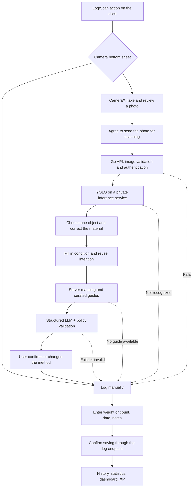

# WasteNot: Computer Vision and AI Recommendations

Version 1.2 · 28 September 2026 · Proposed spec, not yet implemented

Update on 20 October 2026: a local YOLO and Gemini prototype is available. The user's latest decision replaced three-method recommendations with alternatives by a single REDUCE/REUSE/RECYCLE/TRASH label with a reason and sources. Contract details and how to try it are in the [latest recommendation contract](https://github.com/waste-not-app/waste-not-ai/blob/main/docs/archive/RECOMMENDATION_CONTRACT.md). Go and Android integration is still follow-up work.

## 1. Sources, scope, and decisions

The user's request on 28 September expanded the documentation to follow [a teammate's plan](sources/AI_PLAN_ORIGINAL.md). The source document is product input, not an instruction to deploy anything, upload photos, or turn on services. The PDF PRD stays the source of the core requirements. This document details the AI additions and resolves ambiguities so Android and the backend use the same contract.

| Status | Decision |
|---|---|
| Requirements from the plan | CameraX, YOLO, confidence and bounding boxes, object correction, context, the Waste Guide, a structured LLM, validation, confirmation, manual amount entry |
| Additional design baseline | One photo captured per request; private Python inference behind the Go API; one object chosen for one log |
| Still applies | Domain enums, integer grams or item counts, ownership, idempotency, statistics from saved logs, 10 XP per active log |
| Not decided by the team | The final model or checkpoint, release classes, licensed datasets, the LLM provider, hardware, cost, numeric performance targets |
| Postponed | Real-time frame streaming, weight estimation, batch save, automatic chemical or contamination classification, on-device inference, an offline LLM |

The user's follow-up request: a main action in the center of the navbar opens the camera in a bottom sheet, with a manual entry button. The five tabs stay; the action at the top center of the dock isn't a sixth destination.

AI is an increment after the core flow is stable. The old four-week schedule is the core baseline, not a promise to finish all the AI work in the same time. See the [implementation plan](IMPLEMENTATION_PLAN.md).

## 2. Flow and responsibilities

Integration decision on 20 October 2026: Python owns mapping, guide retrieval, allowed methods, Gemini, and evidence validation. Go holds JWTs, ownership, sessions and TTLs, idempotency and budgets, and log transactions. YOLO and decisions have separate private interfaces; Go never copies the AI rules. OpenAPI, a mock, and examples are in the [HTTP contract v1](https://github.com/waste-not-app/waste-not-ai/blob/main/docs/AI_HTTP_CONTRACT.md). The Go and Android endpoints still need implementing.

YOLO recognizes visual classes; it doesn't determine chemical material, weight, safety, or facility acceptance. The Waste Guide provides reviewed rules. The LLM summarizes a recommendation from that context. The user confirms the action they actually took. A recommendation for the future isn't a waste log yet.

Reduce means items or weight avoided. Photographing waste that already exists doesn't prove Reduce. Following the user's decision on 20 October 2026, Gemini picks one of REDUCE/REUSE/RECYCLE/TRASH as the guides allow. REDUCE uses recommendation_scope=PREVENTION, meaning prevention next time; the others use HANDLING. Prevention advice doesn't mean the activity has happened. Users log Reduce actions they actually took through manual entry with the amount avoided, until the backend supports validating prevention provenance.

## 3. Camera and lifecycle

- Ask for camera permission after the user chooses to scan. If it's denied, offer manual entry; if it's permanently blocked, offer system settings without prompting again.
- CameraX Preview + ImageCapture are bound to the lifecycle. Close the camera on exit or in the background; the first iteration doesn't run ImageAnalysis or stream uploads.
- Capture produces a temporary app-internal file. Show a preview with Retake, Send for scanning, and Cancel. Camera permission doesn't count as consent to upload.
- Explain before uploading: the photo is sent for recognition; it doesn't automatically become an attachment or training data. Avoid photographing people or personal documents.
- Normalize orientation and strip EXIF before uploading. The backend validates and normalizes again; never trust the client.
- Cancelling before sending deletes the local photo. Cancelling after sending cancels the UI and request where possible; the server still runs cleanup if the connection drops.
- Category, method, and amount drafts survive as in the core. After process death, a missing temporary photo shows Retake; never quietly upload again. Logout discards the account's AI sessions and temporary photos.

## 4. Detection and mapping

YOLO11n is the plan's baseline candidate, not a model that's been chosen or tested. A COCO-pretrained model has general labels like `bottle`; that label isn't enough to tell `plastic_bottle` from `glass_bottle`. The class list must be read from the actual model artifact, not invented to suit the UI. Official documentation: [YOLO11](https://docs.ultralytics.com/models/yolo11/) and [COCO](https://docs.ultralytics.com/datasets/detect/coco/).

| Label from a model that actually supports it | Proposed category | Guide key | Conditions |
|---|---|---|---|
| bottle (general) | null | null | The user must choose the material; never automatically PLASTIC |
| plastic_bottle | PLASTIC | pet_bottle | Only if the model is trained and evaluated for this class |
| glass_bottle | GLASS | glass_bottle | Confirm the condition and whether it's broken |
| aluminium_can | METAL | aluminium_can | Not every cylindrical object |
| cardboard / paper | PAPER | cardboard / paper | Dirty or wet context still comes from the user |
| food_waste | ORGANIC | food_waste | Doesn't identify chemical contents |
| battery / electronic_waste | ELECTRONIC | battery / electronic_waste | Special handling; a flag, not a new category |
| Unknown label | null | null | Choose manually; OTHER is only an explicit user choice |

Mapping is a versioned table owned by the Python module: model_version + class_id → object_key + nullable category + nullable guide_key + special_handling. Go stores a snapshot of the result and sends the object from its own session to the private decision interface. The client can't force the snapshot, guide, or confidence. User corrections use the server catalog; unknown or custom objects go to manual entry when no guide matches.

Bounding boxes use `[x_min,y_min,x_max,y_max]` normalized from 0 to 1 against the image after orientation is fixed, with x_min < x_max and y_min < y_max. The model adapter converts runtime output to this contract. Android recalculates positions for the preview's crop or letterbox. The list choice and the boxes refer to the same detection_id.

### Confidence and multiple objects

| Initial candidate score | State | Behavior |
|---|---|---|
| ≥0.70 | OFFERED | May be offered, still needs confirmation |
| ≥0.50 and <0.70 | UNCERTAIN | "Not sure" text; correct it or scan again |
| <0.50 / no candidates | MANUAL_REQUIRED | No category or method prefill; manual entry or retry |

The thresholds are a test hypothesis, not measured accuracy. A score of 0.94 reads "Detection score 94%", never "94% sure it's right" or model accuracy. Calibration and per-class thresholds are evaluated on a validation set; the test set stays separate. One photo can produce many boxes; the user picks one. Never count items from multiple boxes, double XP, or create batch logs.

## 5. Context and guides

Condition isn't one mutually exclusive choice. Use three fields: cleanliness CLEAN/DIRTY/UNKNOWN, integrity INTACT/DAMAGED/UNKNOWN, reusable YES/NO/UNKNOWN. `reuse_intention` is a separate nullable boolean. Defaults are UNKNOWN or null; the camera never fills in the condition as fact.

Policy-04 adds condition.cleanable=YES/NO/UNKNOWN and condition.soiling=FOOD_DRINK/DUST/HAZARDOUS/UNKNOWN, plus risk_type=UNKNOWN/SHARP/CHEMICAL/BIOLOGICAL/ELECTRICAL/OTHER. For eating and drinking items, ordinary dirt confirmed as cleanable can qualify for REUSE with washing first, if the item is intact, usable, and the user wants to reuse it. DIRTY is never automatically turned into CLEAN. A risk checkbox without an explanation gives NEEDS_CONTEXT + missing_context before Gemini is called. Source metadata is recorded in the registry, with the publisher, region, reference check date, and scope limits; it isn't local expert approval.

Initial retrieval uses an object_key or guide_key lookup with a filter on category + publication_status=PUBLISHED. There's no need for a vector database or embeddings. Guides must have a version, reviewed_at, sources, allowed methods, context conditions, steps, cautions, and special_handling. Draft articles in the old HTML must never become production knowledge. If a guide is missing or stale under the editorial policy, show UNAVAILABLE and the manual option; never fill the gap with the LLM's free-form knowledge.

Recommendations refer to the guide snapshot and the confirmed condition. Changing the object, category, or condition cancels the old recommendation, and an old request must never overwrite the new state. Changing the method manually is still allowed and recorded as a user correction.

## 6. LLM and validation

The provider lives on the backend. Send only the object_key, category, context, allowed methods, and the guide excerpts needed. Never send photos, names, emails, locations, tokens, or personal notes to the baseline LLM. Never give the LLM a database tool or open browsing.

Gemini's internal output has exactly one required recommended_method (REDUCE/REUSE/RECYCLE/TRASH), a reason, special_handling, a caution, and evidence_ids; it has no alternative_method. A READY response adds recommendation_scope, source_urls, and steps from validated evidence and guides. special_handling is a warning flag and doesn't remove the READY method. The server validates the JSON and schema, length limits (reason 500, caution 500 characters), enums, evidence references, and whether the guide rules are met. The prototype renders the reason from the chosen evidence, not the model's free prose. Valid JSON alone doesn't prove the recommendation is right. Guide text is treated as data; hidden instructions inside it must never change system policy. OCR or text in images is never used as instructions.

The server calculates the allowed methods from the guide and context, then checks the single LLM result against that subset. Evidence may only support the chosen method. recommendation_goal=AUTO/PREVENTION/HANDLING sets the focus; AUTO and HANDLING pick the current handling, and REDUCE is only for PREVENTION when the user chooses it. Missing evidence is never turned into prevention. recycling_access=YES/NO/UNKNOWN records whether the user checked for a recycler. Defaults are AUTO and UNKNOWN. Having no recycling access doesn't automatically allow TRASH without specific evidence. Evidence IDs must come from that request's retrieval; source URLs are supplied by the server from the evidence, never new URLs made up by the LLM. COMPOST never automatically becomes a new enum or gets quietly mapped to RECYCLE without an editorial rule.

Policy-04 validation order: determine risk → guide availability → clarify missing context → evidence that fits the risk and condition → allowed methods → schema and evidence → one label and warnings. A covered risk doesn't remove the classification. If special_handling is true, only evidence with risk_compatible=true can be chosen, and the model can't remove the flag. For example: broken glass → TRASH with protection; batteries, electronics, knives, and scissors → RECYCLE through a specialist handler. Chemical or biological contamination doesn't follow the general washing and residue rules. Instructions and sources follow the chosen method. An undetected class isn't proof an item is safe. See [guide quality and the cup case](https://github.com/waste-not-app/waste-not-ai/blob/main/docs/archive/GUIDE_QUALITY.md).

On a timeout, invalid JSON, fake evidence, or a rule mismatch, the response is UNAVAILABLE with a null method. A valid guide link may still be shown. There's no auto-save and no random fallback advice. Manual choices still pass normal domain validation; remind the user that the method is the action they took, not a certification of safe handling.

## 7. State and consistency

`Idle → Permission → Preview → ReviewPhoto → Detecting → ReviewObject → Context → Recommending → ReviewRecommendation → LogDraft → Saving → Saved`.

Cancel and Manual exits are available at every stage before Saving. There are no repeated automatic upload or inference retries. A retry button sends an explicit action, and old request results are ignored by request ID or generation. Loading can be cancelled and has no fake percentage progress. A timeout never deletes the draft. After a recommendation expires, the confirmed category and method can still be saved as a manual entry once the AI metadata is explicitly dropped.

AI sessions and recommendations never add logs, statistics, or XP. Only a successful waste-logs POST adds a log; replays follow the core client_request_id. Model retries can add inference cost, so they use request ID dedup and per-account limits. Log detail and edit show the user's final data. The original AI metadata is provenance and is never rewritten as if the model suggested a later correction.

## 8. Privacy, retention, and operations

Proposed baseline decisions that must be in place before the pilot:

| Data | Retention / limits |
|---|---|
| Local scan photos | Deleted on leaving the flow or logging out, or by cleanup within 1 hour at the latest; never in the user's gallery |
| Server inference photos | Ephemeral memory or tmp with no backup; deleted on completion or failure; a 15-minute scavenger limit for crashes |
| Temporary detection and recommendation sessions | 24-hour TTL; user-scoped; periodic delete job |
| AI metadata linked to a log | The log's lifetime; deleted with the log data under the core retention policy, with direct access revoked when the log is deleted |
| Operational telemetry | 7 days for the pilot, with no raw images, prompts, notes, or tokens; evaluation aggregates are anonymized |
| Attachment photos | A separate opt-in /photos path and core rules; scanning never turns it on |
| Training datasets | User photos are never collected automatically; a curated dataset with separate licenses or consent |

Limit files to JPEG or PNG ≤5 MiB, decoded ≤12 megapixels, sides ≤4096 px; reject malformed files and decompression bombs. These are API design limits, not model limits. Model input resizing happens after validation. Every AI endpoint needs a session; internal services are never exposed publicly. Other accounts get 404 for another user's detections and recommendations.

Proposed baseline timeouts: 10 seconds for internal inference, 15 seconds for the LLM, a 20-second API deadline per request, and a 25-second client timeout. The inference queue is bounded; overload returns 429/503 rather than piling up images. Proposed starting rate limits are 10 scans per minute per account and 30 recommendations per hour per account; the team must fill in a daily cost limit per environment. Never call the LLM on every frame. Every number has to be tuned from measurements and never presented as actual latency.

The LLM provider must support the retention policy the team agrees on, configured before the pilot. Keep secrets server-side. Choosing a YOLO model also means recording the code, weight, and dataset licenses; [Ultralytics' license page](https://www.ultralytics.com/license) offers AGPL-3.0 and Enterprise options. This kit makes no licensing or commercial deployment decision.

## 9. Datasets, evaluation, and the release gate

Start from a pretrained pipeline with its original labels; fine-tune only after the taxonomy and annotations are agreed. Every artifact has a model_version, checksum, label list, preprocessing, input size, mapping_version, and dataset provenance. Split train, validation, and test by physical object or capture session, not by near-identical random frames. Audit duplicates, licenses, class imbalance, and background leakage. Data users corrected doesn't automatically become correct training labels.

The report must include image and instance counts per split and class, per-class precision and recall, a confusion matrix, mAP@0.5 and mAP@0.5:0.95, false negatives for special waste, unknown rejection, confidence calibration, and sample sizes. Test low light, small or covered objects, multiple objects, busy backgrounds, similar materials, and different devices and locations. Aggregate numbers aren't enough to approve risky classes.

Measure upload, preprocessing, inference, retrieval, LLM, and end-to-end time separately, at p50 and p95, with the hardware, runtime version, photo size, and connection. Record acceptance, correction, and fallback rates per version, and how long users take to finish a log compared with manual entry. User acceptance isn't ground truth for accuracy. Numeric quality, cost, and latency targets are set after the baseline and before the pilot; the results table stays NOT MEASURED until there's evidence.

Release AI only if the taxonomy exists, mapping is tested, real PUBLISHED guides exist, licenses are recorded, privacy and cleanup are proven, the manual fallback works, account isolation and idempotency pass, and the owner approves the holdout results. If anything fails, switch off the AI capability without switching off core tracking. Model updates get regression evaluation and an artifact + mapping rollback; never swap weights without a version.

## 10. References and traceability

- Team plan §1 to §8 → the pipeline, scope, confidence, validation, and special handling in §1 to §6 of this document.
- Team plan §9 to §13 → [ARCHITECTURE](ARCHITECTURE.md) and [API](API.md), including the detection endpoints the source didn't detail.
- Team plan §14 to §19 → datasets, evaluation, and privacy in §8 to §9 and acceptance in the [IMPLEMENTATION_PLAN](IMPLEMENTATION_PLAN.md).
- Team plan §20 to §23 → the AI increment, postponed optimizations, and milestones after the core.
- [CameraX architecture](https://developer.android.com/media/camera/camerax/architecture) and [Image capture](https://developer.android.com/media/camera/camerax/take-photo): lifecycle and capture, checked 28 September 2026.
- [YOLO11](https://docs.ultralytics.com/models/yolo11/), [COCO](https://docs.ultralytics.com/datasets/detect/coco/), [license](https://www.ultralytics.com/license): the model candidate, pretrained taxonomy, and license options; checked 28 September 2026. This doesn't pin a runtime version or promise accuracy for WasteNot.

### Pilot quality update, 20 October 2026

Python contract v1 adds review_profile and per-candidate review_thresholds, review_reasons, and ambiguous_with, plus condition.former_contents=FOOD_DRINK/CHEMICAL/OTHER/UNKNOWN. Server bands prefer the checkpoint profile; the global threshold table is the COCO default. The four-class candidate SHA af1446f33338... uses dw-val-01: cans and HDPE are OFFERED at >=0.70; PET at >=0.725; glass is always UNCERTAIN; different classes overlapping at IoU>=0.65 stay visible and UNCERTAIN. Every candidate needs user confirmation.

Go sends model_sha256 from the private snapshot on selection so the rules can be rechecked; it never accepts that provenance from the frontend. Pilot RECYCLE needs recycling_access=YES; HDPE needs former_contents=FOOD_DRINK. UNKNOWN asks for context and is never guessed as Trash or Reduce. All 69 guides are still DRAFT. Details, validation metrics and tradeoffs, the Gemini evaluation, and reproduction commands: [detection quality](https://github.com/waste-not-app/waste-not-ai/blob/main/docs/archive/DETECTION_QUALITY.md), [recommendation quality](https://github.com/waste-not-app/waste-not-ai/blob/main/docs/archive/RECOMMENDATION_EVALUATION.md). The OpenAPI in ai/contracts/v1 is the regenerated DTO reference.

### Conditional advice for blank conditions, policy-06

Ordinary context the user hasn't filled in stays UNKNOWN or null. allow_conditional defaults to true, allowing READY with recommendation_basis=CONDITIONAL and conditions_to_verify; false keeps the strict NEEDS_CONTEXT mode. The UI shows provisional advice and its conditions, without filling in blank data or saving automatically. Ambiguous risks, hazardous contamination, and HDPE former contents stay restricted. See the [latest behavior, reproduction, and test results](https://github.com/waste-not-app/waste-not-ai/blob/main/docs/archive/CONDITIONAL_AND_BACKGROUND.md).
