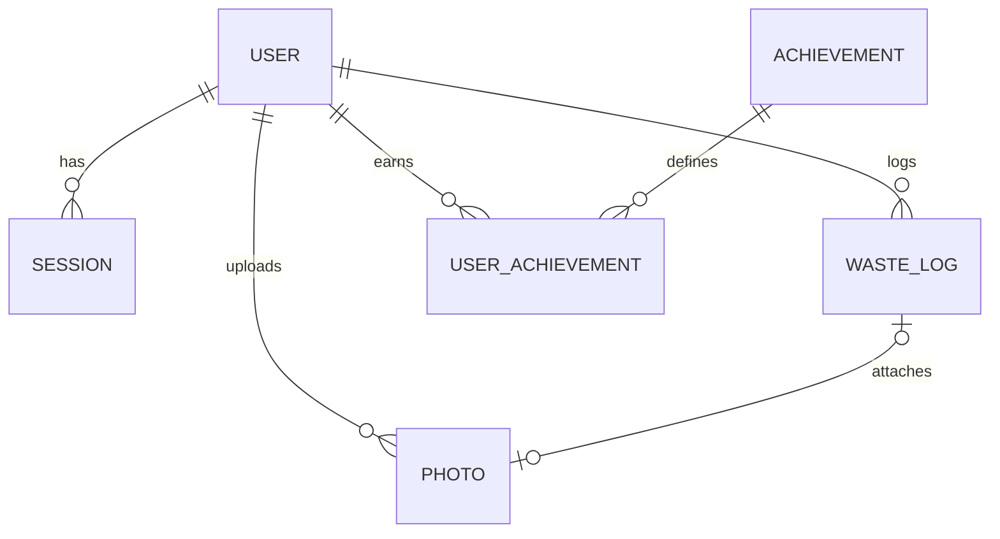

# WasteNot: Data Model and API Contract

Version 1.2 · 28 September 2026 · Core plus AI extension · Implementation design

AI update on 20 October 2026: a single REDUCE/REUSE/RECYCLE/TRASH label with a reason and sources replaces recommendations with alternatives. See the [four-method contract](https://github.com/waste-not-app/waste-not-ai/blob/main/docs/archive/RECOMMENDATION_CONTRACT.md) for the prototype's behavior and the integration changes not yet implemented in Go or Android.

This document defines the proposed contract between Android and the backend, filling out the endpoint draft on page 4 of the PDF. Domain rules are in [PRD.md](PRD.md). The `/v1` prefix is a design decision. Examples use simulated data, not real accounts or endpoints.

## 1. Conventions

- HTTPS for shared environments. The base URL comes from build configuration; never hardcode the production address in composables.
- UTF-8 JSON, `snake_case`, UUIDs as strings, RFC 3339 UTC timestamps, and `YYYY-MM-DD` activity dates.
- Authentication uses `Authorization: Bearer <access_token>`. The server takes the user from the token, never from the body or query.
- In this baseline, every endpoint except register, login, refresh, and health requires authentication.
- Success responses use `data`; lists add `page`; errors use `error` and `request_id`.
- Weights are stored as integer grams and item counts as integers. The server calculates percentages at full precision, and the client displays them as the PRD describes.
- `created_at` and `updated_at` belong to the server. `activity_date` belongs to the user, within the allowed limits.
- API enum values are uppercase English, while UI labels are localized. Enums never use display names as database keys.
- `Cache-Control: no-store` for auth and private responses at HTTP intermediaries. Any deliberate app cache must be isolated per user.

## 2. Data model

### 2.1 Entities

| Entity | Fields and constraints |
|---|---|
| users | id UUID PK; name varchar(60); normalized_email varchar(254) UNIQUE; password_hash; timezone IANA; created_at, updated_at |
| sessions | id UUID PK; user_id FK; refresh_token_hash UNIQUE; expires_at; revoked_at nullable; created_at |
| waste_logs | id UUID PK; user_id FK; category enum; method enum; quantity_kind enum; weight_g nullable; item_count nullable; activity_date date; activity_timezone; notes varchar(500); photo_id nullable; client_request_id UUID; request_hash; version int; created_at, updated_at; deleted_at nullable |
| waste_guides | id UUID PK; slug UNIQUE; name; category; keywords; recommended_method; summary; steps JSON; cautions JSON; source_url; reviewed_at; publication_status |
| achievements | id UUID PK; code UNIQUE; name; description; requirement_type; requirement_value integer |
| user_achievements | user_id FK + achievement_id FK composite PK; unlocked_at; derived from active logs |
| photos (optional) | id UUID PK; user_id FK; object_key UNIQUE; mime_type; size_bytes; status; created_at |

The PDF's `xp`, `level`, and `streak` fields on User become derived response fields in this design. For the MVP dataset, calculate them from active logs so edits and deletes never leave a wrong progress cache. Don't store a second copy without an invalidation strategy. `user_achievements` only needs storing if achievements are turned on and unlock timestamps are needed.

### 2.2 Enums

```text
category: ORGANIC | PLASTIC | PAPER | GLASS | METAL | ELECTRONIC | OTHER
method: REDUCE | REUSE | RECYCLE | TRASH
quantity_kind: WEIGHT | COUNT
publication_status: DRAFT | PUBLISHED | ARCHIVED
requirement_type: ACTIVE_LOG_COUNT | RECYCLE_LOG_COUNT | BEST_STREAK
```

### 2.3 Database constraints

The SQL below shows the constraints that must exist; it isn't a complete production migration.

```sql
CHECK (
  (quantity_kind = 'WEIGHT'
    AND weight_g IS NOT NULL AND weight_g BETWEEN 1 AND 100000
    AND item_count IS NULL)
  OR
  (quantity_kind = 'COUNT'
    AND item_count IS NOT NULL AND item_count BETWEEN 1 AND 10000
    AND weight_g IS NULL)
);
UNIQUE (user_id, client_request_id);
CHECK (version >= 1);
```

Use NOT NULL for user_id, category, method, quantity_kind, activity_date, activity_timezone, client_request_id, request_hash, version, created_at, and updated_at. Validate enums in the database. Add an active index on `(user_id, activity_date DESC, id DESC) WHERE deleted_at IS NULL`, and category or method filter indexes when the query plan shows a need. Soft delete keeps the request identity so a create replayed after a delete doesn't create a new activity; hard delete and retention are decided separately.

Every query for private objects includes `user_id = authenticated_user`. Hard-to-guess UUIDs are not access control. Object storage must never use a public bucket.

### 2.4 Relationships



A photo_id links to at most one active log and must belong to the same user. WasteGuide has no personal ownership; users can only read PUBLISHED records.

## 3. Endpoint list

| Method | Endpoint | Purpose | Status |
|---|---|---|---|
| POST | /v1/auth/register | Create an account + session | From the PDF, expanded |
| POST | /v1/auth/login | Create a session | From the PDF |
| POST | /v1/auth/refresh | Rotate the refresh token | Added in this design |
| POST | /v1/auth/logout | Revoke the current session | Added in this design |
| GET | /v1/me | Profile and progress | From the PDF |
| GET | /v1/dashboard | Today's summary and the 3 latest activities | Added in this design |
| GET | /v1/metadata | Categories, methods, validation limits, capabilities | Added in this design |
| GET | /v1/waste-logs | History, filters, pagination | From the PDF |
| POST | /v1/waste-logs | Add a log | From the PDF |
| GET | /v1/waste-logs/{id} | Your own detail | From the PDF |
| PATCH | /v1/waste-logs/{id} | Correct a log | Clarifies the PDF's CRUD |
| DELETE | /v1/waste-logs/{id} | Delete a log | Clarifies the PDF's CRUD |
| GET | /v1/waste-guide | List and search | From the PDF |
| GET | /v1/waste-guide/{id} | Article detail | Added in this design |
| GET | /v1/statistics | Summary, daily series, categories, methods | From the PDF |
| GET | /v1/achievements | Achievements and progress | From the PDF, optional feature |
| POST | /v1/photos | Multipart upload of a private image | Optional |
| DELETE | /v1/photos/{id} | Delete an unused attachment | Optional |
| POST | /v1/ai/detections | Scan a temporary photo | AI extension §10 |
| GET | /v1/ai/objects | Object correction catalog | AI extension §10 |
| POST | /v1/ai/recommendations | Validated recommendation | AI extension §10 |
| DELETE | /v1/ai/detections/{id} | Discard a scan session | AI extension §10 |
| GET | /health/live | Process is alive | Operations |
| GET | /health/ready | App and DB are ready | Operations; never leak details |

The baseline has no Maps endpoint. If the map option is chosen, decide the provider or verified location list and its contract separately. No dummy addresses are ever served as real facility data.

## 4. Authentication and profile

### Register

```http
POST /v1/auth/register
Content-Type: application/json
```

```json
{
  "name": "Demo User",
  "email": "demo@example.com",
  "password": "a-long-sample-password",
  "timezone": "Asia/Jakarta"
}
```

A 201 returns `user`, `access_token`, `access_expires_at`, `refresh_token`, `refresh_expires_at`, and `session_id` inside `data`. Login takes an email and password and returns the same session payload with a 200. These credentials only illustrate the format; never create a seed account with that password.

Proposed defaults: a 15-minute access token and a 7-day refresh session. The values are pinned in backend configuration and aren't facts from the PDF. The JWT holds `sub`, `sid`, `iat`, `exp`, issuer, and audience. Verify the allowed algorithm, signature, issuer and audience, expiry, and that the session isn't revoked. The refresh token is a cryptographically random opaque value; the server only stores its hash.

Refresh takes a refresh_token, revokes the old token, and issues a new pair atomically. The app serializes refreshes so several 401s never trigger concurrent rotations. If a rotation's outcome is unknown, ask the user to sign in again; never retry the refresh without limit. An authenticated logout revokes the session_id in the JWT, returns 204, and is idempotent. If logout fails on the network, the client still deletes its local secrets and says the session was removed from the device; it can't claim the server session was revoked. The expiry limit still applies.

### Google sign-in

`POST /v1/auth/google/challenge` takes no body and returns `data.nonce`. Pass it to Android Credential Manager as the Google sign-in nonce. Use it once within five minutes. Send the resulting Google ID token to `POST /v1/auth/google` as `id_token`, with the device IANA `timezone`. The server verifies Google's signature, issuer, audience, expiry, verified email, and the one-time nonce. The response is the same 200 session payload as password sign-in.

The server identifies returning users by Google's stable subject, not their email. New Google accounts are passwordless. If the email matches an unlinked password account, `409 GOOGLE_LINK_REQUIRED` asks for the current WasteNot password. Start a new challenge and send it as `current_password` with a fresh ID token; a successful link retains the same account, logs and XP. A different linked Google identity is never replaced (`409 GOOGLE_IDENTITY_CONFLICT`). Google sign-in requires the provider to be configured (`503 GOOGLE_AUTH_UNAVAILABLE` otherwise).

The session user and `/me` include `has_password`. Email password reset does not add a password to a Google-only account. To delete an account, `DELETE /v1/me` accepts one proof: `password`, or `google_id_token` from a fresh challenge and the same linked Google account. The Google ID token is never saved on the device.

### GET /me

```json
{
  "data": {
    "id": "00000000-0000-4000-8000-000000000001",
    "name": "Demo User",
    "email": "demo@example.com",
    "timezone": "Asia/Jakarta",
    "progress": {
      "active_log_count": 5,
      "xp": 50,
      "level": 1,
      "xp_into_level": 50,
      "xp_to_next_level": 50,
      "current_streak": 2,
      "best_streak": 2,
      "has_logged_today": true
    }
  }
}
```

The password hash is never sent. If streaks aren't turned on, the streak fields may be null and the UI hides that section rather than showing zero as if it had been calculated. Metadata sends boolean capabilities such as `achievements`, `reminders`, `photos`, and `recycling_points` to match the options actually built; never use a flag in place of authorization.

## 5. Activity logs

### Create

```json
{
  "client_request_id": "00000000-0000-4000-8000-000000000011",
  "category": "PLASTIC",
  "method": "RECYCLE",
  "quantity_kind": "WEIGHT",
  "weight_g": 250,
  "item_count": null,
  "activity_date": "2026-09-21",
  "notes": "Sample simulated data.",
  "photo_id": null
}
```

The server sets the time zone from the account. A 201 returns the whole WasteLog, including id, activity_timezone, version=1, server timestamps, and the latest `progress`. For COUNT, send weight_g=null and an integer item_count. Extra fields such as user_id, xp, or created_at are rejected, not used.

### Idempotency and timeouts

Android creates the `client_request_id` once when a new draft is prepared and stores it with the non-secret draft. The save button is disabled while a request is active. The server does the insert and uniqueness check in one transaction.

| Situation | Result |
|---|---|
| This user has never sent the ID | Save one log, 201 |
| Same ID + same canonical payload | Return the same log, 200; no extra XP |
| Same ID + different payload | 409 IDEMPOTENCY_CONFLICT; never overwrite |
| Same ID but the log was deleted | 410 LOG_DELETED; never bring it back |
| The server committed but the response was lost | Retry the same payload with the same ID |

The client must never edit and then send a new payload with a request ID whose outcome is unknown. Resolve it first by retrying the original payload; once the object is found, open the editor. If the user wants a different activity, start a new draft with a new ID. Uniqueness on `(user_id, client_request_id)` holds even for parallel requests.

### List and filters

```http
GET /v1/waste-logs?category=PLASTIC&method=RECYCLE&from=2026-09-15&to=2026-09-21&limit=20
```

Category and method each take one value or are left out. Filters combine with AND, and dates are inclusive. `limit` defaults to 20, with a maximum of 100. The opaque cursor holds the `(activity_date,id)` position and is bound to the filter and the user; it isn't an offset. Order is `activity_date DESC, id DESC`. When filters change, reset the cursor and the list. Pull-to-refresh starts from the first page; the client dedupes by id while paginating because data can change.

```json
{
  "data": [],
  "page": {"next_cursor": null, "has_more": false}
}
```

An empty list is a 200. If a later page fails, earlier pages stay, with a retry at the bottom.

### Read, update, delete

GET by id returns 200; missing, deleted, or another account's objects all return 404. PATCH takes mutable fields plus the `version` that was read. Fields left out don't change; `notes: null` means empty; immutable fields are rejected. After merging, run the same weight/count XOR validation as create.

An unchanged old activity_date may stay outside the create window. A new date in a PATCH must fall between today and 30 days ago in the account's time zone. A null notes value is normalized to an empty string before saving.

```json
{"version": 1, "weight_g": 300, "notes": "Corrected the weight."}
```

Updates use the conditional query `WHERE id=? AND user_id=? AND version=? AND deleted_at IS NULL` and bump the version. A 409 VERSION_CONFLICT requires the UI to load the latest version before reapplying the change, with the user's draft kept. Never auto-merge weight or method.

DELETE uses the header `If-Match: "<version>"`; a missing header → 428 PRECONDITION_REQUIRED. A mismatch → 409 VERSION_CONFLICT. A successful delete → 204, with `deleted_at` set and the version bumped. Replaying a delete on your own deleted object → 204; another account's object → 404. Every aggregate excludes deleted_at.

## 6. Dashboard and statistics

GET dashboard takes today's date from the account's time zone, not a client parameter. The response has `date`, `timezone`, `summary`, up to 3 `recent_logs`, and all-time `progress`. The summary uses the same aggregate contract as statistics.

```http
GET /v1/statistics?from=2026-09-15&to=2026-09-21
```

```json
{
  "data": {
    "from": "2026-09-15",
    "to": "2026-09-21",
    "timezone": "Asia/Jakarta",
    "summary": {
      "total_handled_weight_g": 1400,
      "total_handled_count": 0,
      "avoided_weight_g": 0,
      "avoided_count": 2,
      "activity_count": 5,
      "handled_activity_count": 4,
      "recycled_activity_count": 2,
      "recycling_rate_percent": 50.0,
      "recycling_rate_basis": "HANDLED_ACTIVITY_COUNT"
    },
    "method_counts": {"REDUCE": 1, "REUSE": 1, "RECYCLE": 2, "TRASH": 1},
    "daily": [
      {"date": "2026-09-15", "handled_weight_g": 0, "handled_count": 0, "activity_count": 0},
      {"date": "2026-09-16", "handled_weight_g": 0, "handled_count": 0, "activity_count": 0},
      {"date": "2026-09-17", "handled_weight_g": 0, "handled_count": 0, "activity_count": 0},
      {"date": "2026-09-18", "handled_weight_g": 0, "handled_count": 0, "activity_count": 0},
      {"date": "2026-09-19", "handled_weight_g": 0, "handled_count": 0, "activity_count": 0},
      {"date": "2026-09-20", "handled_weight_g": 750, "handled_count": 0, "activity_count": 2},
      {"date": "2026-09-21", "handled_weight_g": 650, "handled_count": 0, "activity_count": 3}
    ],
    "categories": [
      {"category": "ORGANIC", "handled_weight_g": 600, "handled_count": 0},
      {"category": "PLASTIC", "handled_weight_g": 250, "handled_count": 0},
      {"category": "PAPER", "handled_weight_g": 150, "handled_count": 0},
      {"category": "GLASS", "handled_weight_g": 400, "handled_count": 0},
      {"category": "METAL", "handled_weight_g": 0, "handled_count": 0},
      {"category": "ELECTRONIC", "handled_weight_g": 0, "handled_count": 0},
      {"category": "OTHER", "handled_weight_g": 0, "handled_count": 0}
    ]
  }
}
```

Days with no activity are still sent as zero. Empty data sends category and day arrays full of zeros, with recycling_rate_percent=null. Invalid date filters or ranges over 366 days → 422. The API never sends CO2 saved, money values, or weights estimated from items. The UI names the metric and its basis, and every chart has a text summary or table.

## 7. Guides, achievements, and photos

GET waste-guide takes a `q` of up to 100 characters, an optional category, and limit and cursor. The query is trimmed; an empty string means the full list. Search names and keywords case-insensitively. The backend uses parameterized queries and never builds SQL from q.

Guide details send id, name, category, recommended_method, summary, steps[], cautions[], source_url, and reviewed_at. `reviewed_at` must never be fabricated. PUBLISHED data has to pass editorial review; sample drafts in the HTML never automatically become seeds.

GET achievements sends id, title, description, current_value, target_value, is_unlocked, and unlocked_at. Progress values are capped for display, but the raw counts aren't thrown away. Threshold and correction semantics follow PRD §10.

For the MVP, optional photos are uploaded as multipart straight to the backend rather than through a complex upload protocol. The backend checks the byte signature, MIME type, size ≤5 MiB, dimension and decompression limits, and ownership, strips sensitive EXIF metadata, then stores the file in a private bucket. It responds with a photo_id and a short-lived preview URL. Logs only accept a photo_id, never an arbitrary URL. Signed URLs are only issued after authorization, and logs never record full URLs.

Uploads not linked to a log are cleaned up after 24 hours (a proposed temporary retention). If saving the log fails, the user can retry with the same photo_id while it's still valid. Photos linked to a log are deleted under the log retention policy, and user access is refused as soon as the log is deleted. Never say a file is permanently deleted if it still exists in a backup.

## 8. Error contract

```json
{
  "error": {
    "code": "VALIDATION_ERROR",
    "message": "Check the highlighted fields.",
    "fields": {"weight_g": "Weight must be at least 1 gram."}
  },
  "request_id": "example-request-id"
}
```

| HTTP | Code | Android behavior |
|---|---|---|
| 400 | INVALID_REQUEST | A specific message; no automatic retry |
| 401 | UNAUTHENTICATED / SESSION_EXPIRED | Refresh once; sign in if that fails |
| 404 | NOT_FOUND | Back to the list; never reveal another owner |
| 409 | EMAIL_EXISTS | Highlight the registration email |
| 409 | VERSION_CONFLICT | D04, keep the draft, offer to load the new version |
| 409 | IDEMPOTENCY_CONFLICT | Resolve the original log before starting a new draft |
| 410 | LOG_DELETED | Explain that the replayed log was deleted |
| 413 | FILE_TOO_LARGE | Pick another photo or continue without one |
| 415 | UNSUPPORTED_MEDIA_TYPE | Pick an allowed format |
| 422 | VALIDATION_ERROR | Inline errors per field, focus the first error |
| 428 | PRECONDITION_REQUIRED | Fetch the object's version before deleting |
| 429 | RATE_LIMITED | Respect Retry-After; no retry loops |
| 500/503 | INTERNAL_ERROR / UNAVAILABLE | A generic message + retry; request_id for diagnosis |

Error responses never include stack traces, SQL, tokens, other owners' emails, or internal paths. A network timeout isn't proof a transaction failed; create must use the idempotency mechanism.

## 9. Transactions, security, and contract tests

Create, request uniqueness, and derived achievement changes happen in one transaction that keeps a single domain outcome. For the MVP, XP and statistics are calculated directly from active logs. Summary endpoints use a consistent transaction snapshot when they combine several queries. Server validation is always required, even when the client has already validated.

Passwords are stored with Argon2id through a maintained library; store the parameters and salt with the hash, and never write a homemade hash function. This follows the [OWASP Password Storage Cheat Sheet](https://cheatsheetseries.owasp.org/cheatsheets/Password_Storage_Cheat_Sheet.html). Rate limit auth per IP and normalized identity without letting someone else's attack lock a user out permanently; agree on the limit values after testing.

Required cases: user A can't read, change, or delete user B's logs; integer lower and upper bounds; the unit XOR; every invalid enum; Reduce only; no logs; mixed units; parallel creates with the same ID; version conflicts; replay after delete; expired and revoked tokens; dates around the day rollover. Shared Android and backend acceptance tests use the PRD §9.4 dataset.

## 10. AI extension v1.2

Integration update on 20 October 2026: the [HTTP contract v1](https://github.com/waste-not-app/waste-not-ai/blob/main/docs/AI_HTTP_CONTRACT.md) and the [public OpenAPI](https://github.com/waste-not-app/waste-not-ai/blob/main/contracts/v1/public.openapi.json) are the machine-readable reference and are more complete than the short examples below. The envelope adds api_version=1.0.0; the recommendation request adds confirmed_object=true, input_source, and context_revision. Python is the single owner of mapping, policy, and Gemini; Go wraps the results with sessions, ownership, TTLs, dedup, and storage. A public mock is available; the production Go backend is still follow-up work.

This contract extends the core with the same `/v1` prefix (the plan's `/api/v1` example is normalized). Every payload below is a design example. [AI_SPEC](AI_SPEC.md) defines the mapping, the recommendation policy, media limits, TTLs, and retention. No AI endpoint creates logs or XP.

| Method | Endpoint | Function |
|---|---|---|
| GET | /v1/ai/objects | Catalog of supported object_key/category values and the mapping version |
| POST | /v1/ai/detections | Upload an ephemeral photo, run YOLO, store a user-scoped result session |
| POST | /v1/ai/recommendations | Confirm or correct the object, retrieve guides, return validated advice |
| DELETE | /v1/ai/detections/{id} | Discard your own session and temporary recommendations; idempotent 204 |

GET /v1/ai/objects returns data.items with object_key, label, category, special_handling, and catalog_version; it never includes an arbitrary prompt. The OTHER category can be chosen manually without forcing a fake object_key.

GET /v1/metadata adds the booleans `capabilities.ai_scan` and `capabilities.ai_recommendation` and a nullable `ai_object_catalog_version`. When a capability is false, the Log button stays with manual input; logging as a whole is never hidden. Raw model configuration and secrets never go into public metadata.

### 10.1 Detection

Multipart fields: `image` as JPEG or PNG and `client_request_id` as a UUID. External image URLs and base64 JSON aren't accepted. Files are ≤5 MiB, decoded ≤12 MP with sides ≤4096, and orientation and EXIF are normalized server-side. Authentication and account limits are checked before inference. The first response is 201 and an identical replay within the TTL is 200; the same ID with a different image digest → 409 IDEMPOTENCY_CONFLICT. Dedup is scoped to the user, and the digest never becomes training data.

```json
{
  "data": {
    "detection_id": "7d58dd23-03c8-4f68-8caa-cefb0a720100",
    "status": "REVIEW_REQUIRED",
    "model_version": "candidate-unvalidated-01",
    "mapping_version": "mapping-01",
    "expires_at": "2026-09-29T03:00:00Z",
    "image": {"width": 960, "height": 1280},
    "objects": [{
      "object_id": "object-1",
      "raw_class": "bottle",
      "confidence": 0.94,
      "bbox": [0.12, 0.08, 0.62, 0.88],
      "confidence_band": "OFFERED",
      "object_key": null,
      "category": null,
      "requires_material_confirmation": true
    }]
  },
  "request_id": "request-example-1"
}
```

Responses never contain a photo or permanent URL. `status` is REVIEW_REQUIRED when there's a candidate at or above the lower threshold, and MANUAL_REQUIRED when the result is empty, unknown, or all low. `objects` can be empty. Every score is a finite value from 0 to 1, and bounding boxes are validated as AI_SPEC describes. `object_id` is only unique within the detection session. The raw class and the category are different things. Low scores use UNCERTAIN, and results below 0.50 never become a prefill. Thresholds are versioned configuration, not a magic constant in the UI.

### 10.2 Recommendations

```json
{
  "client_request_id": "5131c085-e592-4fe8-bd69-cf6b56d33be6",
  "detection_id": "7d58dd23-03c8-4f68-8caa-cefb0a720100",
  "object_id": "object-1",
  "confirmed_object_key": "pet_bottle",
  "confirmed_category": "PLASTIC",
  "condition": {"cleanliness": "CLEAN", "integrity": "INTACT", "reusable": "UNKNOWN", "cleanable": "UNKNOWN", "soiling": "UNKNOWN"},
  "reuse_intention": false,
  "risk_flag": false,
  "risk_type": "UNKNOWN",
  "recommendation_goal": "AUTO",
  "recycling_access": "UNKNOWN"
}
```

The server takes the confidence, model, and mapping from its own session rather than trusting values the client sends. `confirmed_object_key` comes from the server catalog; the category must match or the server returns 422. For unknown classes with no guide, fall back to manual entry and never make up a recommendation. The server doesn't accept user_id, an arbitrary guide_key, free-form URLs or prompts, or allowed_methods from the client. Ownership is checked before any model or LLM lookup.

```json
{
  "data": {
    "recommendation_id": "10f6a0b0-533d-4fd4-85a7-ecf38e42b101",
    "status": "READY",
    "category": "PLASTIC",
    "recommended_method": "RECYCLE",
    "recommendation_scope": "HANDLING",
    "reason": "Sample response: check the acceptance rules in the facility guide.",
    "special_handling": false,
    "caution": "This is a contract example, not verified advice.",
    "guide_refs": [{"guide_id": "9fbd97ab-9450-4b6e-a43e-e0bda8a61011", "version": 1}],
    "source_urls": ["https://www.epa.gov/recycle/how-do-i-recycle-common-recyclables"],
    "steps": ["Check the receiving facility's rules."],
    "recommendation_version": "pilot-policy-05",
    "expires_at": "2026-09-29T03:00:00Z"
  },
  "request_id": "request-example-2"
}
```

`status` is READY, NEEDS_CONTEXT, or UNAVAILABLE. READY has exactly one recommended_method from REDUCE/REUSE/RECYCLE/TRASH, a reason, source_urls, and recommendation_scope=PREVENTION for REDUCE or HANDLING for the others. source_details adds the title, publisher, region, checked_at, and scope_note from the registry. There's no alternative_method and no SPECIAL_HANDLING status. special_handling=true is an extra warning that can come with READY. For example, broken glass is READY/TRASH/true, and batteries are READY/RECYCLE/true through a specialist handler. recommendation_goal=AUTO/PREVENTION/HANDLING and recycling_access=YES/NO/UNKNOWN default to AUTO and UNKNOWN; REDUCE is only offered when the user chooses PREVENTION.

Policy-04 additions: condition.cleanable=YES/NO/UNKNOWN, condition.soiling=FOOD_DRINK/DUST/HAZARDOUS/UNKNOWN, and risk_type=UNKNOWN/SHARP/CHEMICAL/BIOLOGICAL/ELECTRICAL/OTHER, all defaulting to UNKNOWN. Ordinarily dirty items confirmed as cleanable can get REUSE after washing. NEEDS_CONTEXT uses a null method and scope plus missing_context (for example ["risk_type"] or ["condition.cleanable"]) without calling Gemini. UNAVAILABLE uses a null method and scope when the guide, service, or output isn't ready or the risk isn't covered; risk cautions are kept. Raw exceptions or provider text are never returned. A recommendation's expiry never outlasts the detection session. User confirmation is never inferred from the generate button.

Store identical recommendations and replays for one client_request_id without calling the provider again within the TTL. A different payload with the same ID → 409. Changed context uses a new request ID, and Android discards the old response. Infrastructure timeouts use 504 AI_TIMEOUT; an unavailable provider uses 503 AI_UNAVAILABLE; semantically invalid output may come back as a 200 with status UNAVAILABLE as a controlled fallback.

### 10.3 Saving logs and metadata

POST /v1/waste-logs stays the only create path. An optional addition to the existing body:

```json
{
  "ai_provenance": {
    "recommendation_id": "10f6a0b0-533d-4fd4-85a7-ecf38e42b101",
    "user_confirmed_object": true,
    "user_confirmed_method": true
  }
}
```

This is an extra fragment, not a full create request; category, method, quantity, date, and client_request_id are still required as in §5. Manual entries leave ai_provenance out. The server validates ownership, TTL, a category matching the confirmation, and that both confirmations are true. The final method may differ from the advice; store final_category and final_method from the waste log and an accepted flag based on the server's comparison, never a client boolean as a measure of accuracy. REDUCE only comes through manual entry, without disposal recommendation provenance.

One recommendation_id can be linked to one waste_log_id; a user-scoped unique constraint prevents a double save with a new request ID. Replaying an identical core create ID returns the same record. Reusing a recommendation for a different log →409 AI_ALREADY_LINKED. Invalid or expired provenance →422 AI_REFERENCE_INVALID / 410 AI_SESSION_EXPIRED; keep the draft and offer a manual save once the user drops the provenance. Never quietly change the result of an idempotent request.

Extra entities:

| Entity | Minimum fields |
|---|---|
| ai_detection_sessions | id, user_id, client_request_id, image_digest, model_version, mapping_version, validated detections JSON, created_at, expires_at; UNIQUE(user_id,client_request_id) |
| ai_recommendations | id, detection_id, user_id, client_request_id, request_hash, confirmed_object_key/category, condition JSON, reuse_intention, status, nullable methods, guide_snapshot_refs, policy/provider/model version, created_at, expires_at |
| ai_log_metadata | waste_log_id UNIQUE FK, recommendation_id UNIQUE, user_id, model/mapping/policy/guide versions, raw_class/confidence, confirmed object/category, original suggestion, final category/method at creation, confirmation flags; never stores photos or raw prompts |

On create, the metadata snapshot and the waste log are written in the same transaction. The snapshot is enough for auditing after the ephemeral session is deleted (the reference ID in the metadata isn't an FK that forces the session to stay alive). Editing a log never reruns the model or changes the original snapshot. Delete follows core retention and removes the metadata on purge; statistics never read the AI tables. Extra migrations are nullable or separate so existing manual logs stay valid.

### 10.4 Errors and contract tests

413/415/422 for size, type, and decoder problems; 401 for sessions; 404 for another person's session; 410 AI_SESSION_EXPIRED; 429 RATE_LIMITED + Retry-After; 503 AI_UNAVAILABLE/AI_DISABLED; 504 AI_TIMEOUT. The error envelope stays as in §8. Upload and inference retries must be explicit and limited; core save retries keep the same ID.

Test malformed boxes and NaN, spoofed category, guide, or confidence, cross-account AI, identical and different replays, expiry, special handling overrides, invalid LLM schema or evidence, unknown classes, no guide, timeouts, cancellation, log transaction rollback, concurrent saves, and manual logs without metadata. Never record image bodies, prompts, or Authorization in the access log.

### Pilot quality update, 20 October 2026

Python contract v1 adds review_profile and per-candidate review_thresholds, review_reasons, and ambiguous_with, plus condition.former_contents=FOOD_DRINK/CHEMICAL/OTHER/UNKNOWN. Server bands prefer the checkpoint profile; the global threshold table is the COCO default. The four-class candidate SHA af1446f33338... uses dw-val-01: cans and HDPE are OFFERED at >=0.70; PET at >=0.725; glass is always UNCERTAIN; different classes overlapping at IoU>=0.65 stay visible and UNCERTAIN. Every candidate needs user confirmation.

Go sends model_sha256 from the private snapshot on selection so the rules can be rechecked; it never accepts that provenance from the frontend. Pilot RECYCLE needs recycling_access=YES; HDPE needs former_contents=FOOD_DRINK. UNKNOWN asks for context and is never guessed as Trash or Reduce. All 69 guides are still DRAFT. Details, validation metrics and tradeoffs, the Gemini evaluation, and reproduction commands: [detection quality](https://github.com/waste-not-app/waste-not-ai/blob/main/docs/archive/DETECTION_QUALITY.md), [recommendation quality](https://github.com/waste-not-app/waste-not-ai/blob/main/docs/archive/RECOMMENDATION_EVALUATION.md). The OpenAPI in ai/contracts/v1 is the regenerated DTO reference.

### Conditional advice for blank conditions, policy-06

Ordinary context the user hasn't filled in stays UNKNOWN or null. allow_conditional defaults to true, allowing READY with recommendation_basis=CONDITIONAL and conditions_to_verify; false keeps the strict NEEDS_CONTEXT mode. The UI shows provisional advice and its conditions, without filling in blank data or saving automatically. Ambiguous risks, hazardous contamination, and HDPE former contents stay restricted. See the [latest behavior, reproduction, and test results](https://github.com/waste-not-app/waste-not-ai/blob/main/docs/archive/CONDITIONAL_AND_BACKGROUND.md).
