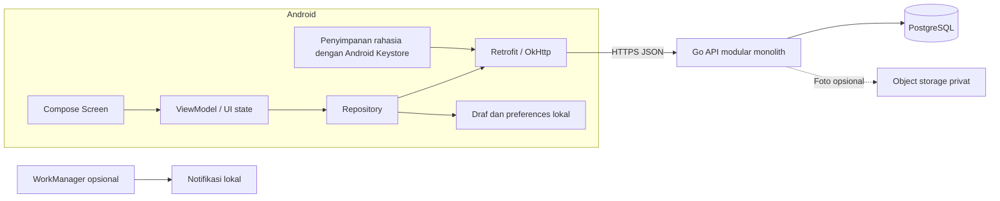
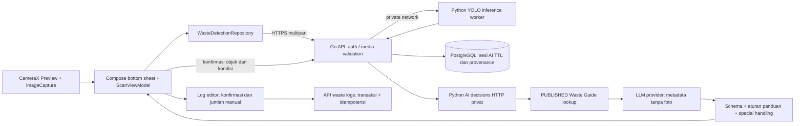

# WasteNot: Arsitektur Android dan Infrastruktur

Versi 1.2 · 28 September 2026 · Core + AI extension · Rancangan implementasi

Dokumen ini merupakan rancangan implementasi. Folder sumber yang diperiksa berisi PDF dan contoh proyek Titip.in; belum ditemukan project Android WasteNot yang dapat di-build. Nama package, versi dependency, hosting, dan pembagian tim belum dipin.

## 1. Keputusan dasar

| Area | Pilihan | Alasan dan batas |
|---|---|---|
| Android | Kotlin, satu Activity, Jetpack Compose, Material 3 | Sesuai pilihan pengguna dan kebutuhan UI native |
| State | ViewModel per layar/alur + StateFlow + UDF | Loading/error/data/draf memiliki pemilik yang jelas |
| Navigasi | Usulan Navigation 3 untuk proyek baru | Rekomendasi Android saat sumber diperiksa; pilih satu stack navigasi |
| Network | Retrofit + OkHttp; satu converter JSON | Selaras draft HTTP client PDF dan pemisahan DTO |
| Preferences | DataStore untuk theme dan reminder | Bukan tempat menyimpan password/refresh token plaintext |
| Dependency injection | Constructor injection + AppContainer sederhana | Cukup untuk satu module; Hilt hanya jika tim memang membutuhkan |
| Local data | Draf kecil per akun + cache memory; persistent read cache opsional | Online-first; antrean write offline tidak termasuk MVP |
| Backend | Usulan Go + Gin + PostgreSQL | Satu modular monolith, satu sumber data utama |
| Deployment | Docker Compose pada satu host | Cukup untuk tugas; bukan klaim high availability |
| Foto | Object storage privat, hanya saat fitur dipilih | Tidak menjadi prasyarat core |
| Chart | Compose Canvas + ringkasan/list teks | Grafik sederhana tidak memerlukan library chart baru |

Navigation 3 adalah pilihan rancangan berdasarkan [dokumentasi resminya](https://developer.android.com/guide/navigation/navigation-3). Jika tim telah memiliki starter Navigation Compose yang stabil, boleh mempertahankannya. Jangan memasang keduanya atau melakukan migrasi hanya demi mengikuti dokumen ini. Kontrak route dan perilaku Back tetap sama.

## 2. Gambaran sistem



Server adalah sumber kebenaran catatan, ownership, waktu server, XP, achievement, serta statistik. Android hanya memformat nilai dan menampilkan state. HTML design system menggunakan simulasi lokal yang tidak menjadi sumber data aplikasi.

## 3. Struktur Android yang cukup untuk MVP

Mulai dengan satu Gradle module `:app`, pemisahan package berdasarkan fitur, dan komponen theme bersama. Package `com.example.wastenot` berikut hanya contoh dan harus diganti dengan applicationId tim sebelum distribusi.

```text
app/src/main/
  java/com/example/wastenot/
    MainActivity.kt
    WasteNotApp.kt
    AppContainer.kt
    navigation/        Route.kt, AppNavigation.kt
    ui/theme/          Color.kt, Type.kt, Shape.kt, Dimens.kt, Theme.kt
    ui/components/     WasteLogRow.kt, MethodChip.kt, QuantityField.kt,
                       AsyncContent.kt, ProgressSummary.kt
    feature/auth/      LoginRoute.kt, LoginScreen.kt, AuthViewModel.kt
    feature/home/      HomeRoute.kt, HomeScreen.kt, HomeViewModel.kt
    feature/log/       History*, LogDetail*, LogEditor*, FilterState.kt
    feature/guide/     GuideList*, GuideDetail*
    feature/statistics/Statistics*
    feature/profile/  Profile*, Achievement*, Settings*
    data/network/     WasteNotApi.kt, dto/, AuthInterceptor.kt
    data/repository/  AuthRepository.kt, LogRepository.kt, GuideRepository.kt,
                      StatisticsRepository.kt
    data/local/       PreferencesStore.kt, DraftStore.kt, TokenStore.kt
    model/            WasteLog.kt, WasteCategory.kt, DisposalMethod.kt
  res/font/           Font statis yang didokumentasikan di DESIGN.md
  res/values/         strings.xml
```

Tanda `*` adalah kelompok file terkait, bukan instruksi membuat file kosong. Jangan membuat module per fitur, BaseViewModel generik, repository factory, atau satu use case untuk setiap endpoint. Ekstrak fungsi domain bersama ketika aturan betul-betul dipakai di beberapa tempat. DTO backend terpisah dari model UI agar perubahan format API tidak bocor ke composable.

## 4. Alur state dan event

UI menampilkan `uiState` dan memanggil fungsi tindakan milik ViewModel. Repository melakukan request, mapping, serta invalidasi. ViewModel mengubah state menjadi hasil yang terlihat. Screen murni menerima state dan callback; Route menghubungkan ViewModel, lifecycle, dan navigasi. Pola UDF dan pengumpulan state yang mengikuti lifecycle merujuk pada [rekomendasi arsitektur Android](https://developer.android.com/topic/architecture/recommendations).

```text
ketuk Simpan
  → ViewModel validasi draf
  → state.isSaving = true
  → Repository.create(draf, clientRequestId)
  → server commit dan memberi id/version
  → state.savedLogId = id; isSaving = false
  → UI menavigasi ke detail, mengonsumsi hasil sekali
  → repository invalidasi Home, History, Statistics, Profile
```

State layar daftar: `items`, `isInitialLoading`, `isRefreshing`, `nextCursor`, `isLoadingMore`, `error`, `filter`, `lastUpdatedAt`. Error refresh dapat hadir bersama data; jangan memaksakan seluruh layar ke Error dan membuang items. State editor: draf, fieldErrors, isSaving, submissionError, savedLogId, requestStatus. State success harus diakui setelah navigasi agar rotasi tidak mendorong detail berulang kali.

ViewModel menjalankan kerja suspend dalam `viewModelScope`, tanpa memblokir main thread dan tanpa menyimpan Activity/NavController. Route mengumpulkan `StateFlow` menggunakan `collectAsStateWithLifecycle()`. Effect hanya untuk sinkronisasi dengan framework atau aksi UI yang berasal dari state; jangan memulai request di body composable pada setiap recomposition.

## 5. Pemulihan state dan koneksi

| Keadaan | Aturan |
|---|---|
| Rotasi/resizing | ViewModel mempertahankan state; scroll position memakai state yang dapat disimpan |
| Process death pada editor | Persist draf nonrahasia per user dan client_request_id di storage internal; restore setelah identitas cocok |
| Background lalu kembali | Periksa relevansi cache/tanggal; refresh bila perlu tanpa menghapus konten |
| Login gagal | Password tetap hanya in-memory selama layar aktif; jangan masuk SavedStateHandle/DataStore |
| Offline sebelum request | Jelaskan belum terkirim; draf tetap tersedia |
| Timeout setelah POST | Status hasil belum diketahui; retry payload dan ID request yang sama |
| Perubahan filter cepat | Batalkan request lama atau abaikan respons dengan filter/version lama |
| Logout/ganti akun | Batalkan scope pekerjaan akun, hapus cache/draf sesuai pilihan aman, hapus token dan stack |
| Refresh gagal | Login ulang; jangan loop retry dan jangan menyebut data sudah tersimpan tanpa konfirmasi |

Baseline tidak mengantre write diam-diam ketika offline. Tombol retry eksplisit. Jika offline-first ditambahkan kelak, dibutuhkan outbox persisten, status sinkronisasi, penyelesaian konflik, dan idempotensi tetap; tidak cukup hanya menambahkan WorkManager.

## 6. Navigasi

Tujuan utama: Home, History, Guide, Statistics, Profile. Detail diberi ID primitive/serializable saja, bukan seluruh objek, password, atau token. Editor menerima optional logId atau guideId; data aktual diambil oleh ViewModel.

| Route | Argumen | Back/result |
|---|---|---|
| Session | Tidak ada | Ganti root menjadi Auth atau Home |
| Login / Register | Tidak ada | Sukses menghapus stack auth |
| Home | Tidak ada | Root utama |
| History | Filter lokal yang tersimpan | Tab reselect tidak membuat duplikasi |
| LogCreate | guideId opsional | Jika dirty, D03; sukses replace editor dengan detail |
| LogDetail | logId | Kembali ke sumber daftar |
| LogEdit | logId | Sukses kembali ke detail, refresh data |
| Guide / GuideDetail | guideId untuk detail | Kembali mempertahankan pencarian |
| Statistics | range lokal | Range tidak reset saat pindah tab |
| Profile / Achievements | Tidak ada | Kembali ke Profil |
| Settings / Reminder | Tidak ada | Kembali ke Profil/Pengaturan |

Bottom navigation mempertahankan stack/scroll setiap tab. Back dari detail kembali ke daftar yang sama. Back dari tab selain Home kembali ke Home; Back dari Home mengikuti perilaku exit Android. System Back/predictive Back dan tombol app bar menggunakan kebijakan dirty-form yang sama. Jangan menampilkan bottom nav di layar login dan editor yang membutuhkan fokus.

## 7. Theme, layout, dan aksesibilitas Compose

Implementasikan token dari [DESIGN.md](DESIGN.md) pada `MaterialTheme.colorScheme`, typography, shapes, dan spacing. Satu wrapper button hanya diperlukan untuk variasi WasteNot yang berulang; komponen Material 3 tetap dipakai langsung jika sudah memenuhi kebutuhan.

Konten dapat menggambar di belakang system bars tetapi input/CTA harus memakai inset yang benar. `Scaffold` inner padding, safe drawing, dan IME inset tidak boleh dijumlah dua kali. Form scrollable dengan CTA yang tetap dapat dicapai saat keyboard tampil. Perilaku system bars dan keyboard harus diuji sesuai [dokumentasi window insets Compose](https://developer.android.com/develop/ui/compose/system/insets).

Target sentuh minimum 48 dp, label teks pada navigasi, contentDescription pada ikon aksi, dan deskripsi chart yang tidak bergantung warna. Gunakan komponen semantics bawaan, heading untuk judul, state description untuk selected/disabled/progress, dan pengumuman error yang relevan. Rujukan: [accessibility defaults Compose](https://developer.android.com/develop/ui/compose/accessibility/api-defaults).

Lebar <600 dp: satu kolom dan NavigationBar. Mulai 600 dp: NavigationRail jika lima tujuan tetap terbaca; konten form dibatasi 560 dp. Mulai 840 dp: list-detail untuk Riwayat/Panduan jika kapasitas memungkinkan; fallback satu kolom terpusat tetap berfungsi. Ambang ini adalah pilihan rancangan WasteNot, bukan klaim ukuran semua perangkat. Font scale 200% boleh menambah tinggi komponen; jangan mengunci tinggi teks.

## 8. Penyimpanan credential dan jaringan

- Access token disimpan di memori; refresh token disimpan melalui penyimpanan rahasia berbasis kunci Android Keystore. Ciphertext berada di app-internal storage dan dikecualikan dari backup. Implementasi memakai primitive/library yang direview, bukan enkripsi buatan sendiri.
- DataStore menyimpan theme/reminder dan draf nonrahasia terisolasi akun, bukan password atau refresh token plaintext.
- Request menempelkan bearer token hanya ke base URL API yang diizinkan, bukan ke source_url panduan atau host gambar eksternal.
- Refresh diserialisasi; retry request satu kali setelah sukses. Jangan me-retry otomatis POST dengan payload/ID baru.
- TLS digunakan pada staging/demo bersama. Cleartext localhost emulator hanya di konfigurasi debug yang terbatas, bukan manifest release.
- Logging interceptor debug meredaksi Authorization, Cookie, password, token, dan payload pribadi; sebaiknya log status/durasi/request ID saja.
- Session server memeriksa sid yang belum revoked agar logout membatalkan akses; JWT expiry saja tidak memberi pencabutan langsung.

Pilihan library secure storage harus direview saat setup karena status API/dependency dapat berubah. Tidak ada dependency secret-store yang ditambahkan oleh paket dokumentasi ini.

## 9. Backend modular monolith

Satu proses API, satu database, feature package `auth`, `logs`, `guides`, `statistics`, dan `progress`. Handler membaca request dan menjalankan validasi transport. Service menyatukan aturan domain dan transaksi. Query/repository menerapkan ownership dan database access. Pembagian boleh berupa package tanpa framework arsitektur tambahan.

XP/progres dihitung dari catatan aktif. Tidak perlu message broker, Redis, event sourcing, service mesh, Kubernetes, atau microservice. Query agregasi langsung cukup sampai pengukuran menunjukkan keterbatasan. Jika summary lambat pada data nyata, periksa index/query plan dahulu sebelum cache materialized.

DB migration eksplisit dan versioned. Seed hanya kategori, metode, achievement definition, dan panduan PUBLISHED yang sudah ditinjau. Seed akun demo/catatan simulasi hanya di lingkungan development khusus, tidak saat production startup.

## 10. Lingkungan dan deployment

| Lingkungan | Komponen | Data / akses |
|---|---|---|
| Laptop developer | Android Studio/emulator, backend lokal, Postgres container | Data uji, debug config |
| Staging/demo | APK demo, domain HTTPS, API+DB pada host tim | Akun uji, akses terbatas |
| Publik (lanjutan) | Build release, operasi dan kebijakan lengkap | Memerlukan keputusan privasi, retensi, distribusi |

Topologi Docker Compose usulan: reverse proxy HTTPS → backend → PostgreSQL pada private network. Object storage privat ditambahkan bila foto aktif. Port database tidak dibuka ke internet. Named volume untuk DB, healthcheck, restart policy, serta backup yang diuji. Reverse proxy dapat ditangani platform hosting jika sudah tersedia; jangan menggandakan proxy tanpa alasan.

Variabel konfigurasi yang perlu ditetapkan:

```text
APP_ENV
HTTP_PORT
DATABASE_URL
JWT_ISSUER
JWT_AUDIENCE
JWT_SIGNING_KEY / key file
ACCESS_TOKEN_TTL
REFRESH_TOKEN_TTL
ALLOWED_ORIGINS (hanya bila ada client web yang sah)
PHOTO_STORAGE_* (opsional)
LOG_LEVEL
```

Secret tidak dimasukkan ke Git, APK, screenshot, atau Markdown. Backend menolak startup jika konfigurasi penting hilang. Android hanya membutuhkan public base URL dan konfigurasi nonrahasia; JWT signing key dan credential storage hanya di server.

Pipeline minimal: checkout → lint/check format → unit/domain test → migration test pada DB sementara → build API dan APK debug/demo → simpan artifact → smoke test lingkungan tujuan. Deployment manual terkontrol cukup untuk tugas. Terdapat rollback image sebelumnya dan langkah pemulihan database; migration destruktif perlu strategi tersendiri.

Tidak ada server, domain, atau layanan berbayar yang dibuat oleh dokumen ini. Host, resource limit, dan biaya harus dipilih berdasarkan kapasitas/anggaran tim.

## 11. Fitur opsional Android

### Pengingat

Pengguna memilih opt-in dan waktu perkiraan. Pada Android 13+ izin notifikasi diminta setelah pengguna mengaktifkan fitur, bukan saat first launch. Penolakan tidak menghalangi tracking. Ikuti [notification permission](https://developer.android.com/develop/ui/compose/notifications/notification-permission).

WorkManager digunakan untuk reminder fleksibel, bukan janji tepat pukul tertentu. UI menulis “Sekitar 20.00” dan menyatakan dapat terlambat. Jadwal unique per akun, dibatalkan saat logout/dimatikan. Periksa apakah pengguna sudah mencatat pada hari lokal itu sebelum memunculkan notifikasi. Batas waktu dan kondisi penjadwalan merujuk [work requests](https://developer.android.com/develop/background-work/background-tasks/persistent/getting-started/define-work). Tidak ada exact alarm permission untuk reminder ringan ini.

### Foto

Gunakan Android Photo Picker untuk memilih gambar dengan akses terbatas sesuai [panduan Photo Picker](https://developer.android.com/training/data-storage/shared/photo-picker). Camera capture bukan prasyarat core manual, tetapi diperlukan oleh increment scan AI (§13). Preview lokal dapat dibatalkan, upload menampilkan status, log tetap bisa disimpan tanpa foto. Backend melakukan validasi file dan menghapus EXIF seperti kontrak API.

### Recycling point

Tampilkan daftar dan detail fasilitas yang memiliki sumber/tanggal verifikasi. Permission lokasi hanya ketika pengguna memilih “Gunakan lokasiku”. Manual area/list tetap tersedia jika ditolak. Maps API key dibatasi applicationId/signing certificate sesuai provider. Tidak mengirim lokasi presisi ke analytics dan tidak membuat akun menunggu permission untuk mencatat sampah.

## 12. Versi dan readiness

Pin versi stabil Kotlin, AGP, JDK, Compose BOM, Material 3, Navigation, Lifecycle, Retrofit/OkHttp, dan converter dalam version catalog saat kickoff. Min SDK usulan 26 untuk menyederhanakan perangkat demo dan API tanggal, bukan kewajiban produk yang sudah disetujui. Compile/target SDK dipilih menurut toolchain dan kanal distribusi yang benar-benar digunakan; jangan menyalin versi dari contoh Titip.in tanpa memeriksa kompatibilitas.

Referensi resmi di dokumen ini diperiksa 21 September 2026. Detail versi dan persyaratan distribusi dapat berubah. Catat hasil Gradle sync/build pertama, perangkat/API emulator, dan versi backend/database aktual di README implementasi. Paket ini belum menjalankan build Android karena tidak membuat project aplikasi.

## 13. AI extension: capture, inference, dan rekomendasi

Revisi 28 September: [AI_SPEC](AI_SPEC.md) menetapkan pipeline dan [API §10](API.md) kontraknya. Baseline server inference dipilih sebagai rancangan prototype; on-device adalah optimasi berikutnya setelah pengukuran. CameraX diperlukan untuk scan, terpisah dari Photo Picker lampiran opsional. Tidak ada project Android/model/server yang dibangun oleh revisi dokumentasi ini.



Tambahkan package `feature/scan`, `data/ai`, `core/camera` di module Android yang sama; tidak perlu memecah Gradle module hanya karena contoh tree sumber. ScanViewModel menyimpan immutable state, objek dipilih, konteks, IDs dan fase request. Lifecycle kamera dan surface preview berada di UI adapter; ViewModel tidak menyimpan Activity/VideoView/bitmap besar. Foto di file internal sementara dengan reference, bukan SavedStateHandle berisi bytes. Repository menangani HTTP dan DTO; aturan safety/mapping authoritative di backend.

Tombol Catat/Scan adalah action pada tengah atas dock lima tab, membuka satu ModalBottomSheet multi-step S21–S25. Sheet punya scroll, close/Back, manual fallback, camera preview, capture, hasil, kondisi, dan konfirmasi. Sheet ditutup saat masuk editor S05; bukan tab keenam. Untuk tablet action berada dekat NavigationRail dan sheet dibatasi lebar. Kembali/close menghentikan kamera; hasil request terlambat diabaikan. Setelah process death pulihkan draf nonfoto yang aman, minta capture lagi bila file tidak ada. Jangan menimpa log draft dirty dengan hasil scan baru tanpa dialog konfirmasi.

Keputusan 20 Oktober 2026: Go memiliki autentikasi, sesi/ownership, dedup/in-flight, budget dan penyimpanan domain. Python memiliki mapping, knowledge lookup, allowed methods dan validasi Gemini sebagai satu implementasi. Worker YOLO dan modul keputusan memakai proses/token terpisah; hanya modul keputusan memegang key Gemini. Go memanggil HTTP privat dan memvalidasi bentuk respons, tanpa mengimplementasikan ulang policy. [Kontrak HTTP v1](https://github.com/waste-not-app/waste-not-ai/blob/main/docs/AI_HTTP_CONTRACT.md) menyediakan OpenAPI, contoh dan mock; backend Go/Android belum diimplementasikan oleh adapter ini. Tidak menambahkan broker/vector DB/Kubernetes.

Model artifact dan mapping dipin dengan checksum/version; preprocessing/postprocessing teruji bbox terhadap orientasi gambar. Go menolak respons worker yang malformed. Worker readiness mengecek model termuat; kegagalan AI tidak membuat health core atau login/logs gagal. Circuit breaker sederhana/batas concurrency dan feature capability dapat mematikan AI sambil mempertahankan manual.

Konfigurasi Go: feature flags, `AI_INFERENCE_URL`/`AI_SERVICE_TOKEN`, `AI_RECOMMENDATION_URL`/`AI_RECOMMENDATION_TOKEN`, deadline, TTL dan budget akun. Worker YOLO memakai `AI_MODEL_PATH`/`AI_DEVICE`; versi model/mapping dibaca dari hasil aktual. Modul keputusan memakai `GEMINI_MODEL`, `GEMINI_API_KEY[_1.._5]`, `GEMINI_TIMEOUT_SECONDS` dan bundle panduan yang ditinjau. Key tidak masuk Go/APK. Batas waktu/retensi mengikuti AI_SPEC §8 dan kontrak HTTP v1.

CI tambahan: schema/model adapter fixture, mapping test, rekomendasi dengan fake provider, authorization/TTL/idempotensi, cleanup gambar, state machine/camera lifecycle dan E2E scanner. Pengujian model berkas asli terpisah dari unit test dan mengeluarkan evaluation report. Staging memakai dataset yang boleh digunakan, bukan foto pribadi otomatis. Rollback versi worker+mapping+policy dilakukan bersama; core schema tetap kompatibel log manual.
