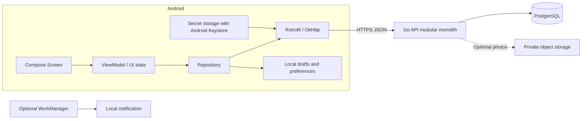
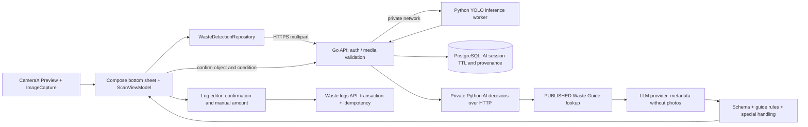

# WasteNot: Android Architecture and Infrastructure

Version 1.2 · 28 September 2026 · Core plus AI extension · Implementation design

This is an implementation design. The source folder that was reviewed held the PDF and the Titip.in sample project; there was no buildable WasteNot Android project yet. Package names, dependency versions, hosting, and team roles aren't pinned.

## 1. Core decisions

| Area | Choice | Reasoning and limits |
|---|---|---|
| Android | Kotlin, one Activity, Jetpack Compose, Material 3 | The user's choice, and it fits a native UI |
| State | A ViewModel per screen or flow + StateFlow + UDF | Loading, errors, data, and drafts each have a clear owner |
| Navigation | Navigation 3 proposed for a new project | Android's recommendation when the sources were reviewed; pick one navigation stack |
| Network | Retrofit + OkHttp; one JSON converter | Matches the PDF's HTTP client draft and keeps DTOs separate |
| Preferences | DataStore for theme and reminders | Not a place for passwords or plaintext refresh tokens |
| Dependency injection | Constructor injection + a simple AppContainer | Enough for one module; Hilt only if the team really needs it |
| Local data | Small per-account drafts + an in-memory cache; a persistent read cache is optional | Online first; an offline write queue isn't in the MVP |
| Backend | Go + Gin + PostgreSQL proposed | One modular monolith with one primary data source |
| Deployment | Docker Compose on one host | Enough for the assignment; not a high availability claim |
| Photos | Private object storage, only if the feature is chosen | Not a core prerequisite |
| Charts | Compose Canvas + a text summary or list | Simple charts don't need a new chart library |

Navigation 3 is a design choice based on its [official documentation](https://developer.android.com/guide/navigation/navigation-3). If the team already has a stable Navigation Compose starter, it can keep it. Don't install both or migrate just to follow this document. The route contract and Back behavior stay the same.

## 2. System overview



The server is the source of truth for logs, ownership, server time, XP, achievements, and statistics. Android only formats values and shows state. The HTML design system uses a local simulation that is never a data source for the app.

## 3. An Android structure that's enough for the MVP

Start with one Gradle module, `:app`, packages split by feature, and shared theme components. The `com.example.wastenot` package below is only an example and should be replaced with the team's applicationId before distribution.

```text
app/src/main/
  java/com/example/wastenot/
    MainActivity.kt
    WasteNotApp.kt
    AppContainer.kt
    navigation/        Route.kt, AppNavigation.kt
    ui/theme/          Color.kt, Type.kt, Shape.kt, Dimens.kt, Theme.kt
    ui/components/     WasteLogRow.kt, MethodChip.kt, QuantityField.kt,
                       AsyncContent.kt, ProgressSummary.kt
    feature/auth/      LoginRoute.kt, LoginScreen.kt, AuthViewModel.kt
    feature/home/      HomeRoute.kt, HomeScreen.kt, HomeViewModel.kt
    feature/log/       History*, LogDetail*, LogEditor*, FilterState.kt
    feature/guide/     GuideList*, GuideDetail*
    feature/statistics/Statistics*
    feature/profile/  Profile*, Achievement*, Settings*
    data/network/     WasteNotApi.kt, dto/, AuthInterceptor.kt
    data/repository/  AuthRepository.kt, LogRepository.kt, GuideRepository.kt,
                      StatisticsRepository.kt
    data/local/       PreferencesStore.kt, DraftStore.kt, TokenStore.kt
    model/            WasteLog.kt, WasteCategory.kt, DisposalMethod.kt
  res/font/           Static fonts documented in DESIGN.md
  res/values/         strings.xml
```

A `*` marks a group of related files, not an instruction to create empty files. Don't create a module per feature, a generic BaseViewModel, a repository factory, or one use case per endpoint. Extract shared domain functions once a rule is genuinely used in several places. Backend DTOs stay separate from UI models so API format changes don't leak into composables.

## 4. State and event flow

The UI shows `uiState` and calls the ViewModel's action functions. The repository makes requests, maps results, and invalidates data. The ViewModel turns state into visible results. Screens only take state and callbacks; Routes connect the ViewModel, lifecycle, and navigation. The UDF pattern and lifecycle-aware state collection follow [Android's architecture recommendations](https://developer.android.com/topic/architecture/recommendations).

```text
tap Save
  → ViewModel validates the draft
  → state.isSaving = true
  → Repository.create(draft, clientRequestId)
  → the server commits and returns id/version
  → state.savedLogId = id; isSaving = false
  → the UI navigates to the detail and consumes the result once
  → the repository invalidates Home, History, Statistics, Profile
```

List screen state: `items`, `isInitialLoading`, `isRefreshing`, `nextCursor`, `isLoadingMore`, `error`, `filter`, `lastUpdatedAt`. A refresh error can coexist with data; never force the whole screen into Error and throw away the items. Editor state: draft, fieldErrors, isSaving, submissionError, savedLogId, requestStatus. A success state must be acknowledged after navigation so rotation doesn't push the detail again and again.

ViewModels run suspend work in `viewModelScope`, never block the main thread, and never hold an Activity or NavController. Routes collect `StateFlow` with `collectAsStateWithLifecycle()`. Effects are only for syncing with the framework or for UI actions that come from state; never start a request in a composable body on every recomposition.

## 5. State and connection recovery

| Situation | Rule |
|---|---|
| Rotation or resizing | The ViewModel keeps state; scroll position uses saveable state |
| Process death in the editor | Persist non-secret drafts per user with the client_request_id in internal storage; restore once the identity matches |
| Backgrounded, then back | Check whether the cache and date are still relevant; refresh if needed without clearing content |
| Sign-in fails | The password stays in memory only while the screen is active; never in SavedStateHandle or DataStore |
| Offline before the request | Explain it wasn't sent; the draft stays |
| Timeout after a POST | The outcome is unknown; retry with the same payload and request ID |
| Fast filter changes | Cancel old requests or ignore responses for an old filter or version |
| Sign-out or account switch | Cancel the account's work scope, clear caches and drafts as safety requires, and clear tokens and the back stack |
| Refresh fails | Sign in again; don't loop retries and never say data is saved without confirmation |

The baseline never quietly queues writes while offline. Retry is explicit. If offline-first is added later, it needs a persistent outbox, sync status, conflict resolution, and idempotency; adding WorkManager alone isn't enough.

## 6. Navigation

Main destinations: Home, History, Guide, Statistics, Profile. Details get only primitive or serializable IDs, never whole objects, passwords, or tokens. The editor takes an optional logId or guideId; the ViewModel fetches the actual data.

| Route | Arguments | Back / result |
|---|---|---|
| Session | None | Replaces the root with Auth or Home |
| Login / Register | None | Success clears the auth stack |
| Home | None | Main root |
| History | Saved local filters | Reselecting the tab doesn't duplicate it |
| LogCreate | Optional guideId | If dirty, D03; success replaces the editor with the detail |
| LogDetail | logId | Back to the list it came from |
| LogEdit | logId | Success returns to the detail and refreshes data |
| Guide / GuideDetail | guideId for the detail | Back keeps the search |
| Statistics | Local range | The range doesn't reset when switching tabs |
| Profile / Achievements | None | Back to Profile |
| Settings / Reminder | None | Back to Profile or Settings |

Bottom navigation keeps each tab's stack and scroll. Back from a detail returns to the same list. Back from any tab other than Home goes to Home; Back from Home follows Android's exit behavior. System Back, predictive Back, and the app bar button share the same dirty-form policy. Don't show the bottom nav on sign-in or on editors that need focus.

## 7. Theme, layout, and accessibility in Compose

Implement the tokens from [DESIGN.md](DESIGN.md) in `MaterialTheme.colorScheme`, typography, shapes, and spacing. A button wrapper is only needed for WasteNot variants that repeat; use Material 3 components directly when they already do the job.

Content can draw behind the system bars, but inputs and CTAs must use the right insets. Never add up `Scaffold` inner padding, safe drawing, and IME insets twice. Forms scroll, and the CTA stays reachable when the keyboard is open. Test system bar and keyboard behavior against the [Compose window insets documentation](https://developer.android.com/develop/ui/compose/system/insets).

Touch targets of at least 48 dp, text labels on navigation, contentDescription on action icons, and chart descriptions that don't rely on color. Use the built-in semantics components, headings for titles, state descriptions for selected, disabled, and progress, and announcements for relevant errors. Reference: [Compose accessibility defaults](https://developer.android.com/develop/ui/compose/accessibility/api-defaults).

Under 600 dp: one column and a NavigationBar. From 600 dp: a NavigationRail if the five destinations stay readable, with form content capped at 560 dp. From 840 dp: list-detail for History and Guide if there's capacity; a centered single-column fallback still works. These thresholds are WasteNot design choices, not a claim about every device size. At 200% font scale components may grow taller; never lock text height.

## 8. Credential storage and networking

- The access token stays in memory; the refresh token is stored through secret storage backed by an Android Keystore key. The ciphertext lives in app-internal storage and is excluded from backups. Use reviewed primitives or libraries, never homemade encryption.
- DataStore holds the theme, reminders, and account-isolated non-secret drafts, never passwords or plaintext refresh tokens.
- Requests attach the bearer token only to the allowed API base URL, never to a guide's source_url or an external image host.
- Refreshes are serialized; retry the request once after a successful refresh. Never automatically retry a POST with a new payload or ID.
- Shared staging and demo environments use TLS. Cleartext to the emulator's localhost is only allowed in a limited debug configuration, never in the release manifest.
- The debug logging interceptor redacts Authorization, Cookie, passwords, tokens, and personal payloads; ideally it logs only status, duration, and request ID.
- Server sessions check that the sid isn't revoked so signing out cuts off access; JWT expiry alone doesn't give immediate revocation.

Review the secure storage library choice at setup, since API and dependency status can change. This documentation package adds no secret-store dependency.

## 9. Backend modular monolith

One API process, one database, and feature packages `auth`, `logs`, `guides`, `statistics`, and `progress`. Handlers read requests and run transport validation. Services bring together domain rules and transactions. Queries and repositories enforce ownership and database access. Plain packages are fine, without an extra architecture framework.

XP and progress are calculated from active logs. There's no need for a message broker, Redis, event sourcing, a service mesh, Kubernetes, or microservices. Direct aggregate queries are enough until measurements show a limit. If summaries get slow on real data, check indexes and query plans before adding a materialized cache.

Database migrations are explicit and versioned. Seeds only cover categories, methods, achievement definitions, and reviewed PUBLISHED guides. Demo accounts and simulated logs are seeded only in a dedicated development environment, never at production startup.

## 10. Environments and deployment

| Environment | Components | Data and access |
|---|---|---|
| Developer laptop | Android Studio or emulator, local backend, Postgres container | Test data, debug config |
| Staging or demo | Demo APK, HTTPS domain, API and DB on the team's host | Test accounts, limited access |
| Public (later) | Release build, full operations and policies | Needs privacy, retention, and distribution decisions |

Proposed Docker Compose topology: HTTPS reverse proxy → backend → PostgreSQL on a private network. Add private object storage if photos are turned on. The database port is never exposed to the internet. Use a named volume for the DB, a healthcheck, a restart policy, and tested backups. The hosting platform can handle the reverse proxy if it already provides one; don't double up proxies without a reason.

Configuration variables to set:

```text
APP_ENV
HTTP_PORT
DATABASE_URL
JWT_ISSUER
JWT_AUDIENCE
JWT_SIGNING_KEY / key file
ACCESS_TOKEN_TTL
REFRESH_TOKEN_TTL
ALLOWED_ORIGINS (only when there's a legitimate web client)
PHOTO_STORAGE_* (optional)
LOG_LEVEL
```

Secrets never go into Git, the APK, screenshots, or Markdown. The backend refuses to start if important configuration is missing. Android only needs the public base URL and non-secret configuration; the JWT signing key and storage credentials live only on the server.

Minimum pipeline: checkout → lint and format check → unit and domain tests → migration tests on a temporary DB → build the API and a debug or demo APK → store artifacts → smoke test the target environment. A controlled manual deployment is enough for the assignment. Keep a rollback to the previous image and database recovery steps; destructive migrations need their own strategy.

This document creates no servers, domains, or paid services. Choose the host, resource limits, and costs based on the team's capacity and budget.

## 11. Optional Android features

### Reminders

The user opts in and picks an approximate time. On Android 13 and later, notification permission is requested after the user turns the feature on, not at first launch. Denying it never blocks tracking. Follow [notification permission](https://developer.android.com/develop/ui/compose/notifications/notification-permission).

WorkManager handles flexible reminders, not a promise of an exact time. The UI says "Around 8:00 PM" and that the reminder may arrive late. Schedules are unique per account and cancelled on sign-out or when turned off. Check whether the user has already logged that local day before showing the notification. Time limits and scheduling conditions follow [work requests](https://developer.android.com/develop/background-work/background-tasks/persistent/getting-started/define-work). This light reminder doesn't need the exact alarm permission.

### Photos

Use the Android Photo Picker to choose images with limited access, following the [Photo Picker guide](https://developer.android.com/training/data-storage/shared/photo-picker). Camera capture isn't a prerequisite for manual core logging, but the AI scan increment needs it (§13). The local preview can be cancelled, uploads show status, and the log can still be saved without a photo. The backend validates the file and strips EXIF as the API contract says.

### Recycling points

Show the list and details of facilities that have a source and verification date. Location permission is only requested when the user picks "Use my location". A manual area or list stays available if it's denied. Restrict the Maps API key to the applicationId and signing certificate as the provider allows. Never send precise location to analytics, and never make an account wait for a permission before logging waste.

## 12. Versions and readiness

Pin stable versions of Kotlin, AGP, the JDK, the Compose BOM, Material 3, Navigation, Lifecycle, Retrofit and OkHttp, and the converter in the version catalog at kickoff. Min SDK 26 is proposed to simplify demo devices and date APIs; it isn't an approved product requirement. Choose the compile and target SDK based on the toolchain and distribution channel actually used; don't copy versions from the Titip.in example without checking compatibility.

The official references in this document were checked on 21 September 2026. Versions and distribution requirements can change. Record the first Gradle sync and build results, the device or emulator API, and the actual backend and database versions in the implementation README. This package hasn't run an Android build because it doesn't create an app project.

## 13. AI extension: capture, inference, and recommendations

The 28 September revision: [AI_SPEC](AI_SPEC.md) defines the pipeline and [API §10](API.md) its contract. Server inference is the baseline for the prototype design; on-device is a later optimization after measurement. CameraX is needed for scanning, separate from the optional Photo Picker attachment. This documentation revision builds no Android project, model, or server.



Add the `feature/scan`, `data/ai`, and `core/camera` packages in the same Android module; there's no need to split Gradle modules just because of the sample tree. ScanViewModel holds immutable state, the selected object, context, IDs, and the request phase. The camera lifecycle and preview surface live in a UI adapter; the ViewModel never holds an Activity, VideoView, or large bitmap. Photos sit in temporary internal files referenced by path, never as bytes in SavedStateHandle. The repository handles HTTP and DTOs; the authoritative safety and mapping rules live on the backend.

The Log/Scan button is an action at the top center of the five-tab dock that opens one multi-step ModalBottomSheet, S21 to S25. The sheet has scrolling, close and Back, the manual fallback, the camera preview, capture, results, condition, and confirmation. It closes when the S05 editor opens; it's not a sixth tab. On tablets the action sits near the NavigationRail and the sheet width is capped. Back or close stops the camera, and late request results are ignored. After process death, restore safe non-photo drafts and ask for a new capture if the file is gone. Never overwrite a dirty log draft with a new scan result without a confirmation dialog.

Decision on 20 October 2026: Go owns authentication, sessions and ownership, dedup and in-flight tracking, budgets, and domain storage. Python owns mapping, knowledge lookup, allowed methods, and Gemini validation as one implementation. The YOLO worker and the decision module use separate processes and tokens; only the decision module holds the Gemini key. Go calls them over private HTTP and validates the response shape without reimplementing the policy. The [HTTP contract v1](https://github.com/waste-not-app/waste-not-ai/blob/main/docs/AI_HTTP_CONTRACT.md) provides OpenAPI, examples, and a mock; this adapter doesn't implement the Go backend or Android. No broker, vector DB, or Kubernetes is added.

Model artifacts and mappings are pinned by checksum and version; preprocessing and postprocessing test bounding boxes against image orientation. Go rejects malformed worker responses. Worker readiness checks that the model is loaded; an AI failure never fails core health, sign-in, or logs. A simple circuit breaker or concurrency limit plus a feature capability can switch AI off while keeping manual entry.

Go configuration: feature flags, `AI_INFERENCE_URL`/`AI_SERVICE_TOKEN`, `AI_RECOMMENDATION_URL`/`AI_RECOMMENDATION_TOKEN`, deadlines, TTLs, and per-account budgets. The YOLO worker uses `AI_MODEL_PATH`/`AI_DEVICE`; model and mapping versions come from the actual results. The decision module uses `GEMINI_MODEL`, `GEMINI_API_KEY[_1.._5]`, `GEMINI_TIMEOUT_SECONDS`, and the reviewed guide bundle. Keys never go into Go or the APK. Time limits and retention follow AI_SPEC §8 and HTTP contract v1.

Extra CI: schema and model adapter fixtures, mapping tests, recommendations with a fake provider, authorization, TTL and idempotency, image cleanup, the state machine and camera lifecycle, and scanner E2E. Real model file tests run separately from unit tests and produce an evaluation report. Staging uses datasets the team is allowed to use, never personal photos collected automatically. The worker, mapping, and policy versions roll back together; the core schema stays compatible with manual logs.
