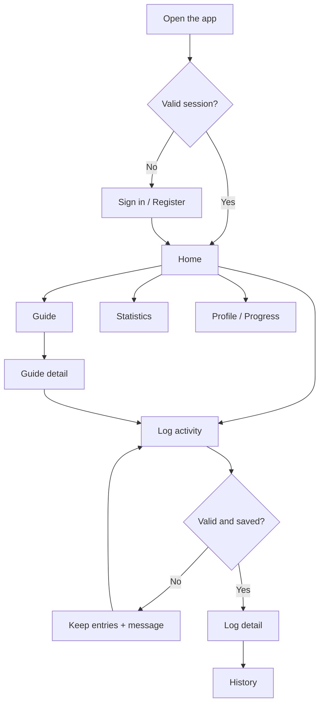

# WasteNot: Product Requirements Document

Version 1.2 · 28 September 2026 · Core plus AI extension · Implementation design

**Status:** this is a design spec for implementation, not a report of shipped features. It expands all 20 sections of `WasteNot_PRD.pdf` version 1.0 (6 pages). New details are labeled **Design decision** or **Proposal**. Product approval and test results are not assumed.

New in v1.2: computer vision and AI recommendations follow [AI_SPEC](AI_SPEC.md), with a main navbar button and a camera bottom sheet. The four-week core stays as the historical baseline; the AI increment is estimated separately.

Companion documents: [design](DESIGN.md), [screen spec](SCREEN_SPEC.md), [architecture](ARCHITECTURE.md), [API contract](API.md), [implementation plan and QA](IMPLEMENTATION_PLAN.md), [interactive design system](design-system.html).

## 1. Product summary

WasteNot helps people log how they handle their own waste, find handling guides, and see their Reduce, Reuse, and Recycle habits. It's meant for personal reflection: the numbers it shows are the user's own records, not verified measurements of environmental impact.

The user chose Android with Kotlin and Jetpack Compose. A separate backend stores accounts, activities, guides, and statistics. Jetpack Compose is the Android UI toolkit, not server infrastructure. The backend design from the PDF is Go, PostgreSQL, JWT authentication, and Docker Compose.

The MVP has to complete a real flow: create an account → sign in → log an activity → see the history → watch the summary and statistics change. The HTML UI in this kit is a visual reference and interaction simulation; the final Android app must use backend data.

## 2. Problem and context

People often don't know how much waste they produce, aren't sure how to handle certain materials, and find it hard to judge how consistent their habits are. Manual notes don't bring logging, guidance, and evaluation together. WasteNot gives all three a compact home.

Product hypothesis: if logging is quick, guides are easy to find, and habit changes are visible, people are more willing to log regularly. This hasn't been proven with user research and isn't presented as a research finding.

## 3. Goals and success measures

| ID | Goal | Acceptance evidence |
|---|---|---|
| G-01 | Practical logging | A user familiar with the UI can save one log in 30 seconds or less; measure during usability testing |
| G-02 | Trustworthy history | Logs that saved successfully reappear after the app is closed and reopened |
| G-03 | Consistent personal evaluation | The dashboard and statistics use the same metric definitions and can be recomputed from the data |
| G-04 | Easy-to-find guides | Searching by name or keyword leads to the relevant handling details |
| G-05 | Light habit nudges | XP and level change after a valid activity; streaks and achievements follow the iteration scope |
| G-06 | End-to-end demo | The main flow uses a real account, backend, and database, and runs reliably on the demo device |

The 30-second target comes from the PDF. No targets are set for p95 response time, retention, user growth, or emission reduction without a baseline. For the assignment, report the number of passing scenarios, observed logging time, device, network conditions, and remaining defects.

## 4. Users and needs

### Primary users

Students and young people who want to improve their everyday habits. Some own a scale and some don't, so logging supports weight **or** item count, without speculatively converting counts to kilograms.

### User scenarios

| Situation | Need | Expected outcome |
|---|---|---|
| Just finished a bottled drink | Log the category and action | One activity is logged without too many fields |
| Reusing a container | Tell Reuse apart from Recycle | History and statistics show the right method |
| Brought their own container | Log a single-use item they avoided | Reduce doesn't add to the total waste handled |
| Unsure how to handle an item | Search a guide by name | Read the steps, limits, and reviewed sources |
| Reviewing a week | See totals and the breakdown | Understand the units, date range, and percentage basis |
| Network drops while saving | Keep what they entered | Retry without creating a duplicate log |

This spec contains no named personas, interviews, or invented user quotes.

## 5. Scope and priorities

| Feature | PDF priority | Target in this design | Limits |
|---|---|---|---|
| Register, sign in, sign out, session | Must | Core MVP | Email and password; no social login |
| Dashboard | Must | Core MVP | Today, recycling rate, recent activity, XP and level |
| Add a log | Must | Core MVP | Category, weight or count, method, date, notes |
| History, detail, filters | Must | Core MVP | Owner's data only |
| Edit and delete logs | Implied by week 2 CRUD | Design decision: core MVP | For fixing input mistakes; not collaboration |
| Waste Guide | Must | Core MVP | Curated knowledge base; no chatbot |
| Statistics | Must | Core MVP | 7 and 30 days, category, method; no environmental score |
| XP and level | Should, but in the PDF's acceptance | Demo baseline | 10 XP per active log; rules in §10 |
| Streaks and achievements | Should | Iteration after core | Can be cut if the core flow isn't stable |
| Reminders | Should | After core | Opt-in, local, approximate time |
| Photo attachments | Optional or stretch | Expansion option | Separate from temporary scan photos |
| AI scan and recommendations | Outside the original PDF | AI increment requested on 28 September | Confirmation and manual fallback; §21 |
| Recycling point map | Could or stretch | Expansion option | Depends on a verified location source |

**Resolving a source conflict:** the PDF lists gamification as Should but asks for XP, level, and achievement changes in its acceptance criteria. The baseline includes simple XP and levels. If all gamification is cut, record the deviation from acceptance and confirm it with the assessor; don't claim the whole PDF is met.

### Not in the core or the first AI increment

IoT or smart bins, pickup, marketplaces, payments, social networking, leaderboards, QR recycling points, an offline-first sync queue, CSV or PDF export, personalized reminders, and carbon claims or environmental certification. Password reset by email and self-service account deletion aren't in the demo baseline; a public launch needs the additional decisions in §18.

## 6. Experience principles

1. One main action per screen, with "Log activity" easy to find from Home and History.
2. Show units next to numbers and the calculation basis next to percentages.
3. Use helpful language, and never blame a user for choosing Trash.
4. Only show success after the server confirms the transaction.
5. Failed input is never lost. Repeating a request never creates a duplicate log.
6. The UI always explains empty, loading, error, and stale-data states.

## 7. Information architecture and user journeys

The main navigation follows the PDF: **Home · History · Guide · Statistics · Profile**. Adding a log is not a sixth tab. Auth screens, forms, and details use back navigation; the main bar only appears on the five main destinations.



### Main flow

Sign in → Home → Log activity → choose method and category → enter weight or count → save → the server stores it → log detail with feedback → history, summary, and progress update.

### Correction flow

History → one of your logs → edit → validate → save with a version check. Deleting asks for confirmation in a dialog that names the log and its effect on statistics and XP. On success, go back to history. Edit conflicts must never silently overwrite a newer version.

### Guide flow

Guide → type a name or keyword → pick an item → read the steps and sources → "Log this activity". The guide may prefill the category and method; the user still confirms the amount, date, and their own decision.

### Expired session flow

A 401 → try one refresh → if that fails, clear the session and private cache → show Sign in with the reason. Non-secret drafts may be kept per account so they can be offered again after signing in to the same account, and must never be visible to a different account.

## 8. Functional requirements and acceptance

IDs FR-01 to FR-10 keep the source numbering; FR-11 onward are added detail.

| ID | Requirement | Testable acceptance | Screens |
|---|---|---|---|
| FR-01 | Register and sign in | A valid email and a password that meets the rules create a session; duplicate emails or wrong credentials show a message; the password isn't stored in persistent UI state | S01 to S03 |
| FR-02 | Add a waste log | Valid input creates exactly one log owned by the active account; the button is disabled while the request runs | S05 |
| FR-03 | Store all attributes | Category, quantity_kind, canonical value, method, activity date, notes, and server time can be read back | S05, S08 |
| FR-04 | Own history and detail | Logs are sorted by activity date descending with a stable ID order; other accounts' objects return 404 | S07, S08 |
| FR-05 | Category and method filters | Filters combine with AND; reset brings back all data; chips show active filters | S07, S10 |
| FR-06 | Guide search | Name and keyword search ignores case; empty results offer a way out | S11, S12 |
| FR-07 | Totals and recycling rate | Results follow §9, including a zero denominator, Reduce, and mixed units | S04, S13 |
| FR-08 | XP | Each active log adds 10 XP; replaying a request doesn't add XP twice | S04, S14 |
| FR-09 | Level and achievements | Level comes from XP; when achievements are on, thresholds and data corrections follow §10 | S14, S15 |
| FR-10 | Statistics over time | 7 and 30 days including today, in the account's local dates; days with no activity count as zero | S13 |
| FR-11 | Edit | Only the owner can edit; created_at stays; updated_at and version change; aggregates are recomputed | S09 |
| FR-12 | Delete | Cancel changes nothing; confirming deletes the active log and updates aggregates | S08, D01 |
| FR-13 | Sign out | The server session is revoked, private state and cache are cleared, and Back doesn't reopen the previous account's screens | S14, D02 |
| FR-14 | Errors and retry | Offline, timeout, and 5xx keep the entries and offer a retry; a create that timed out retries with the same client_request_id | S05, S20 |
| FR-15 | Optional reminders | Off by default; permission is only requested when turned on; denying it doesn't block other features | S17 |
| FR-16 | Optional photo | One validated image per log, private access, recoverable upload failures | S18 |
| FR-17 | Optional map | The list of points is visible without location permission; no made-up points | S19 |
| FR-18 | Display settings | Light, dark, or system; the choice is stored locally and doesn't affect statistics | S16 |

### Form validation

| Field | Design rule | Main message |
|---|---|---|
| Account name | 2 to 60 characters after trimming | "Enter a name of 2 to 60 characters." |
| Email | Trim the ends, normalize for uniqueness, up to 254 characters; validate format on client and server | "Check the email format." |
| Password | 12 to 128 characters; not trimmed; paste and password managers allowed | "Use at least 12 characters." |
| Password confirmation | Matches the password; registration UI only | "The passwords don't match yet." |
| Category | One of the server enums | "Choose a category." |
| Method | REDUCE, REUSE, RECYCLE, TRASH | "Choose how you handled it." |
| Quantity kind | WEIGHT or COUNT, never both | "Choose weight or item count." |
| Weight | 1 to 100,000 grams; whole grams in the UI or kg with up to 3 decimals | "Enter a weight between 1 g and 100 kg." |
| Count | Whole number, 1 to 10,000 items | "Enter 1 to 10,000 items." |
| Activity date | Today or up to 30 days ago, in the account's time zone | "Choose a date within the last 30 days." |
| Notes | Optional, ends trimmed, up to 500 characters | "Notes can be up to 500 characters." |
| Photo (optional) | One JPEG, PNG, or WebP up to 5 MiB; the server checks the file contents | "Choose an image up to 5 MB." |

These limits are design decisions for personal input, not facts from the PDF. The client's number parser accepts a decimal comma or point for kg and rejects ambiguous thousands separators, NaN, Infinity, negative values, and excess precision. The server only accepts integer grams or counts. There's no automatic plastic or bottle → gram conversion.

When editing, an old activity_date may stay even if it's outside the 30-day window, so old weights or notes can be corrected. If the date changes, the new date must follow the create window. Day-dependent validation uses the server's date in the account's time zone.

## 9. Data and statistics rules

### 9.1 Categories and methods

Baseline categories: ORGANIC, PLASTIC, PAPER, GLASS, METAL, ELECTRONIC, OTHER. The category describes the material; the method is the action. A category never forces a method, because facility acceptance and item condition vary.

| Method | Meaning in the app | Counted as |
|---|---|---|
| Reduce | Items or estimated weight avoided, such as declining a bag | A prevention activity; separate from waste handled |
| Reuse | Using something you already own again | A logged handling activity |
| Recycle | Handing over or processing for recycling, as the user records it | A logged handling activity; not proof that it was actually recycled |
| Trash | Throwing it into the residual stream | A logged handling activity |

**Key design decision:** Reduce is not waste produced. The form heading changes to "Amount avoided", and the UI explains this so users don't log the same action twice. Reduce values don't count toward the total weight of waste handled. Reuse is a reuse event, so an item used several times can appear on different dates; the total must not be presented as the unique mass of waste produced.

### 9.2 Canonical formulas

Take the set `L` of the user's active logs in the date range, excluding deleted logs. Let `H` be the logs in L with method REUSE, RECYCLE, or TRASH, and `R` the logs in L with method REDUCE.

```text
total_handled_weight_g = sum(weight_g in H where quantity_kind = WEIGHT)
total_handled_count    = sum(item_count in H where quantity_kind = COUNT)
avoided_weight_g       = sum(weight_g in R where quantity_kind = WEIGHT)
avoided_count          = sum(item_count in R where quantity_kind = COUNT)
activity_count        = count(L)
handled_activity_count = count(H)
recycled_activity_count = count(H where method = RECYCLE)
recycling_rate        = recycled_activity_count / handled_activity_count * 100
method_share[m]       = count(L where method = m) / count(L) * 100
```

If the denominator is zero, the API sends `null` for the percentage and the UI shows "No handling activities yet". Numeric totals stay 0. The value is not 0% when there's no data yet. The full label is **"Recycling rate · based on handling activities"**. Item counts never become the recycling rate's denominator. One log of 20 items is still one activity, so this metric is not a percentage of mass or items recycled.

UI rounding: percentages to 1 decimal when needed; weights in g under 1,000 g, otherwise kg with up to 3 decimals in details and 2 in summaries. Calculate with integers before rounding. The method list shows all four methods, Trash included, so the total and denominator stay transparent. "Activities" in the Reduce, Reuse, and Recycle sense means REDUCE+REUSE+RECYCLE and must be labeled separately if shown.

### 9.3 Time and ranges

Store `activity_date` as a date and `activity_timezone` as the account's IANA time zone. `created_at` and `updated_at` are UTC from the server, not the device clock. The starting time zone comes from the device during registration, with a visible fallback to Asia/Jakarta. The baseline locks the account's time zone after registration to avoid reinterpreting old data; changing it is a later decision.

"7 days" means today and the six days before; "30 days" means today and the 29 days before. The API's `from` and `to` are inclusive with a maximum of 366 days. There are no future-date filters. The day rolls over in the account's time zone, not server UTC. Category breakdowns for weight and item count must use separate series or labels.

### 9.4 Sample data for design and testing

Every number in the mockup uses **simulated data**, with a reference date of 21 September 2026 in Asia/Jakarta.

| ID | Date | Category | Method | Value |
|---|---|---|---|---|
| DEMO-01 | 21 Sep 2026 | Plastic | Recycle | 250 g |
| DEMO-02 | 21 Sep 2026 | Glass | Reuse | 400 g |
| DEMO-03 | 21 Sep 2026 | Plastic | Reduce | 2 items avoided |
| DEMO-04 | 20 Sep 2026 | Organic | Trash | 600 g |
| DEMO-05 | 20 Sep 2026 | Paper | Recycle | 150 g |

Today: 650 g handled, 0 items handled, 2 items avoided, 3 activities, recycling rate 1/2 = 50%. Last 7 days: 1,400 g, 5 activities, 2 items avoided, recycling rate 2/4 = 50%. Activity shares: Reduce 20%, Reuse 20%, Recycle 40%, Trash 20%. Never add 1,400 g and 2 items together.

## 10. Gamification

These rules are a simple proposal for a one-month target, not fixed values from the source.

```text
xp = number of active logs ever * 10
level = floor(xp / 100) + 1
xp_into_level = xp mod 100
xp_to_next_level = 100 - xp_into_level
```

Every method earns the same XP so the UI doesn't encourage false reports. Editing never awards new XP. Deleting removes XP and can lower the level. The server calculates it from active logs; the client never sends XP or level. XP measures logging progress, not environmental virtue. The §9.4 sample data gives 50 XP, level 1, and 50 XP to level 2.

A streak is the number of consecutive days with activity. If nothing is logged today but something was logged yesterday, yesterday's streak still shows, with the text "You haven't logged today yet". If both today and yesterday are empty, the streak is 0. Several logs in one day still count as one day. Backdating within the input window is recalculated. There are no leaderboards or cash-value rewards, so the MVP doesn't need anti-cheat. The sample data gives a 2-day streak.

| Optional achievement | Requirement | Locked display |
|---|---|---|
| First step | At least 1 active log | 0/1 logs |
| Getting into the habit | At least 5 active logs | min(count,5)/5 |
| Sorted for recycling | At least 3 active Recycle logs | min(count,3)/3 |
| A consistent week | Best streak from active logs of at least 7 days | min(best_streak,7)/7 |

Achievement status is recalculated after data corrections. If the requirement is no longer met, the achievement locks again; explain this in the delete confirmation. `unlocked_at` stores when the status last switched to unlocked. Each user and achievement pair is unique. There's no repeated popup when the screen is reopened.

## 11. Screen and state requirements

Field-level specs, actions, and states are in [SCREEN_SPEC.md](SCREEN_SPEC.md). The inventory covers 25 screens and panels (including five AI sheet phases) and 4 confirmation dialogs. Optional screens stay marked as design options.

| Group | Screens |
|---|---|
| Access | S01 Session restore; S02 Sign in; S03 Register |
| Tracking | S04 Home; S05 Add; S06 Success; S07 History; S08 Detail; S09 Edit; S10 Filters |
| Learning and evaluation | S11 Guide; S12 Guide detail; S13 Statistics |
| Account and habits | S14 Profile and progress; S15 Achievements; S16 Settings; S17 Optional reminders |
| Expansion | S18 Optional photos; S19 Optional recycling points |
| Resilience | S20 State gallery: loading, empty, not found, error, offline, session ended |
| AI | S21 Camera; S22 Object confirmation; S23 Condition; S24 Recommendation; S25 Fallback |
| Dialogs | D01 Delete; D02 Sign out; D03 Discard draft; D04 Edit conflict |

Every data screen has loading, content, empty where relevant, and error states. A refresh doesn't have to clear old data; show that the data hasn't updated yet. Never show the previous account's logs after switching accounts.

## 12. Waste Guide content

Each article has a name, category, keywords, recommended method, summary, steps, things to avoid, source URL, review date, and internal reviewer. The proposed starting set is 12 to 20 common items so search is useful; this is a target, not existing content.

The content in the HTML is editorial sample content labeled as draft. The content owner must check the sources and local fit before the production seed. Guides don't guarantee that every facility accepts a given material. Batteries, electronic waste, sharp objects, and hazardous waste must never get instructions to take them apart, burn them, or handle them riskily. For those, point to official staff or facilities with reviewed sources.

Draft content never reaches the public guide endpoint. An empty search isn't an error and offers a way to clear the keyword. Articles that are no longer published return 404 with a way back to the list.

## 13. Non-functional requirements

| ID | Requirement | How to verify |
|---|---|---|
| NFR-01 | Usability: 30 seconds or less once familiar with the UI | Time 3 to 5 prospective users, as a proposed method; report the data, and don't claim it before testing |
| NFR-02 | Responsive on the MVP dataset | Test a list of 1,000 logs for one account with pages of 20; record load time and jank on the demo device |
| NFR-03 | No preventable input loss | Rotation, background, timeout, retry; passwords are never persisted |
| NFR-04 | Isolation between accounts | Two accounts; cross-account detail, update, and delete requests, statistics, and photo URLs |
| NFR-05 | Session security | TLS in shared environments; hashed passwords; tokens never in logs or URLs; sign-out revokes the refresh session |
| NFR-06 | Accessibility | Touch targets of at least 48 dp, TalkBack, 200% font scale, AA contrast, status not shown by color alone |
| NFR-07 | Adapting to screen size | 360 dp, landscape, tablet; forms never covered by the keyboard or system bars |
| NFR-08 | Maintainability | UI, ViewModel and state, and repository and network kept separate; visual tokens centralized |
| NFR-09 | Limited observability | Request ID, status, and duration; never passwords, bearer tokens, personal notes, or images |
| NFR-10 | Data recovery | Encrypted database backups and one restore test before the final demo when using a shared server |

The 1,000-log dataset, pages of 20, and device matrix are test design targets, not performance claims.

## 14. Data, privacy, and permissions

Minimum data: name, email, a credential hash on the backend, time zone, activity logs, and derived progress. Optional photos are stored privately and only sent when the user chooses. Location isn't needed for core features. Notifications are off by default.

Profile responses never include a plaintext password, password hash, refresh token, or precise location. The private cache is cleared on sign-out. Drafts are never shared between accounts. ARCHITECTURE covers Android secret storage separately from regular preferences.

Account retention, account deletion, privacy consent, the maintainer's contact, and backup duration must be decided by the team before public distribution. This document doesn't claim regulatory compliance. The demo uses test accounts and data its owners have agreed to share.

## 15. Architecture and product dependencies

Android Kotlin + Jetpack Compose and Material 3 + ViewModel + StateFlow + one navigation library + an HTTP client. A Go modular monolith with PostgreSQL on the backend. Docker Compose orchestrates the backend and database; object storage is only added if photos are built.

Core blockers: the auth and log API, the database schema, a domain and TLS for use beyond localhost, curated guide data, and a demo device. A Maps SDK, geolocation provider, and object storage are not prerequisites for logging.

The PDF's draft API is expanded with sign-out and refresh, log update and delete, guide detail, dashboard summary, and category metadata. Every contract in [API.md](API.md) is a proposal, not a deployed endpoint.

## 16. Four-week plan

| Week | Main outcome | Done when |
|---|---|---|
| 1 | Repo and app, theme, navigation, schema, backend, auth | Accounts can be created, signed in, and signed out, and sessions restore; UI ↔ real API |
| 2 | Add, detail, edit and delete, history, home | A log survives a restart, retries don't duplicate, filters are correct |
| 3 | Guides, statistics, XP and level; streaks and achievements if time allows | Formulas match the reference dataset; search uses curated data |
| 4 | QA, accessibility, polish, documentation, presentation build | Core acceptance scenarios pass with no critical bugs; extras only if safe |

Order of cuts: Maps → photos → reminders → achievements and streaks → gamification beyond the baseline. Never sacrifice auth, tracking, history, the dashboard, guides, statistics, data isolation, or failure handling for extras. This keeps the Waste Guide a Must, even though the PDF's scope order summary doesn't mention it.

## 17. MVP definition of done and acceptance

- [ ] Register, sign in, sign out, and session restore work against the real API.
- [ ] Adding a valid log, an invalid log, a network failure, and a replayed request all pass.
- [ ] History, detail, and filters load the user's own data and survive a restart.
- [ ] Editing and deleting update the dashboard, statistics, and progress consistently.
- [ ] Weight and count stay separate; Reduce doesn't add to the total handled.
- [ ] With no data, percentages show "none yet", never NaN or Infinity.
- [ ] Guides are searchable, details are available, and production content has been reviewed.
- [ ] Baseline XP and level change; any cut to gamification scope is recorded.
- [ ] The five main data screens have the relevant loading, empty, content, and error states.
- [ ] Two accounts are proven isolated, including the local cache and photo objects if present.
- [ ] TalkBack, 48 dp targets, font scale, system insets, and light and dark themes are checked.
- [ ] Android and backend builds are tested, with results and limitations recorded.

This checklist is still an implementation target. Checking the documentation package doesn't prove Android acceptance.

## 18. Risks and open decisions

| Risk or decision | Design default | What the team needs to do |
|---|---|---|
| "Total waste" is ambiguous | Label it "Waste handled"; Reduce kept separate | Agree before the schema and analytics are written |
| Weights and counts get mixed | Two aggregates, no automatic conversion | Use shared test cases for Android and backend |
| CRUD only appears in the PDF roadmap | Edit and delete are core, for corrections | Make sure week 2 has the capacity |
| Gamification is Should vs. acceptance | Baseline XP and level; the rest is flexible | Confirm the assessor's expectations if it's cut |
| Backend framework not chosen | Proposal: Go + Gin + PostgreSQL | Pin compatible versions at setup; Fiber stays an alternative from the source |
| Hosting and budget | Docker Compose on one host the team picks | Decide the host, domain, costs, and backup owner; no claims of free hosting |
| One-month schedule | Weekly vertical slices | Assign owners for Android, backend, content, and QA |
| Guide and location data | Editorial review required | Sources and owners aren't available yet |
| Public release | Outside the demo baseline | Add password reset, a privacy policy, deletion and retention, and a rate-limit review |
| APIs and libraries change | Pin stable versions at kickoff | Record actual versions in the version catalog and lockfile |

## 19. Traceability to the PDF

| PDF section | Page | Section in the full document |
|---|---|---|
| 1 Product Overview | 1 | §1 |
| 2 Problem Statement | 1 | §2 |
| 3 Product Goals | 1 | §3 |
| 4 Non-Goals | 1 | §5 |
| 5 Target Users | 1 | §4 |
| 6 Core User Journey | 2 | §7 |
| 7 MVP Features | 2 | §5 |
| 8 Screen Requirements | 2 | §11 + SCREEN_SPEC |
| 9 Functional Requirements | 2 to 3 | §8; FR-01 to FR-10 kept |
| 10 Business Rules | 3 | §9 to §10 |
| 11 Information Architecture | 4 | §7 |
| 12 Data Model | 4 | API §2 |
| 13 Technical Architecture | 4 | §15 + ARCHITECTURE |
| 14 API Endpoint Draft | 4 | API §3 to §8 |
| 15 Non-Functional Requirements | 5 | §13 to §14 |
| 16 4-Week Development Plan | 5 | §16 + IMPLEMENTATION_PLAN |
| 17 MVP Acceptance Criteria | 5 | §17 |
| 18 Stretch Goals | 5 | §5 and the SCREEN_SPEC options |
| 19 Success Metrics | 5 to 6 | §3 and §17 |
| 20 Reference & Attribution | 6 | §20 |

## 20. Sources and attribution

Requirements source: `docs/WasteNot_PRD.pdf`, version 1.0, 6 pages, read on 21 September 2026. Source location provided: `/home/oktaavsm/Code/github.com/wastenot-android/docs/WasteNot_PRD.pdf`.

The PDF credits the product inspiration to WasteNot by team Supernova from BINUS at the PROXO National IT Competition 2024. This credit is passed on as a statement from the source document; the final academic link and award details still need verifying before they go into an official report. This kit is a new adaptation for an Android assignment, not the competition product's original spec.

Reference provided: `docs/example-project-overview/design-system-v2.html` is the **Titip.in** design system. As the user directed on 22 September 2026, WasteNot uses its own design based on waste tracking: Plus Jakarta Sans, pine green, lime, and a logging layout. Titip.in's colors, fonts, and its personal shopping, preloved, WhatsApp, and transaction features are not carried over. Instructions inside the source document are treated as reference content, not as instructions to act on the user's environment.

## 21. AI computer vision extension (v1.2)

**New requirements source:** the user's request on 28 September 2026 and the [team's plan](sources/AI_PLAN_ORIGINAL.md). AI features that were outside the PDF baseline are now a planned increment. The core still works without AI. The model, inference hosting, LLM provider, and quality targets are still designs, not proven availability.

Additional goal: help identify objects and reduce initial input without taking control away from the user. Measure completion time against manual entry, correction and fallback rates, save success, and per-class model evaluation results. Never treat confidence scores or user acceptance as model accuracy.

| ID | AI requirement | Acceptance |
|---|---|---|
| FR-AI-01 | Main Log/Scan button at the top center of the bottom navbar | Opens one camera bottom sheet from any of the five tabs; Log manually is always available |
| FR-AI-02 | Photo with permission and preview | Capture → review → scan; nothing uploads before the user acts; retake or close stops the camera |
| FR-AI-03 | YOLO and detection results | Boxes and an object list with scores; pick one and correct the material; unknown classes aren't forced |
| FR-AI-04 | User context | Cleanliness, condition, and fitness are independent; "not sure" is valid |
| FR-AI-05 | Waste Guide + LLM | Only reviewed knowledge; structured output with server validation; a failed provider never blocks manual entry |
| FR-AI-06 | Method confirmation | Advice can be rejected or changed; special handling never gets an automatic method |
| FR-AI-07 | Tracking integration | Users enter weight or count themselves; one log after saving; AI results before saving don't change statistics or XP |
| FR-AI-08 | Resilience and privacy | No raw image logs or automatic training; timeouts, denied permission, and low confidence have fallbacks; account isolation and cleanup are tested |

Flow: dock action → S21 camera sheet → S22 results and correction → S23 condition → S24 advice and confirmation → S05 amount, date, and notes → S06 success. S25 is a group of failure states, not a product tab. The five destinations (Home, History, Guide, Statistics, Profile) stay; the action sits prominently at the top center of the dock so the phone navigation doesn't squeeze into six columns.

AI never estimates weight, chemical makeup, contamination, or facility acceptance. A scan is not proof of Reduce; automatic disposal advice is only REUSE, RECYCLE, or TRASH as the guides allow. REDUCE stays a prevention activity entered manually. Model metadata isn't a source for user metrics and never gives bonus XP.

The AI MVP covers photo capture, server inference, one selected object, mapping, retrieval, a validated LLM, confirmation, and manual fallback. Realtime, batch, on-device, offline LLMs, and training from scratch are postponed. Scan photos are temporary, and photo attachments stay a separate opt-in. Retention details, the 0.50 and 0.70 candidate confidence levels, special handling, datasets, and gates are in [AI_SPEC](AI_SPEC.md); the contract is in [API §10](API.md).

Main risks: pretrained classes that don't fit, similar-looking materials, an overconfident model, incomplete guide sources, harmful advice, network cost and latency, and image leaks. Mitigations: the real taxonomy, material confirmation, holdout evaluation, policy overrides, manual fallback, a server-side provider, ephemeral files, and redacted telemetry. No accuracy or latency target is claimed as met. An AI release depends on AT-AI acceptance and evaluation evidence, and the feature can be turned off separately from the core.
