# Tombol utama: gradasi kit dan label yang terbaca

Checkpoint branch `codex/android-iteration-2-design`, melanjutkan `15ef839`. Mengikuti DESIGN §2/4/6/8/9 dan SCREEN_SPEC C03. Sasaran seluruh layar tetap [dalam pengerjaan](../../tasks/ITERATION_2_DESIGN.md).

## Sebelum dan sesudah

ActionButton sebelumnya memakai warna solid default Material; token gradasi aksi sudah tersedia tetapi belum dipakai. Label disabled/loading memakai alpha 0,38. Pada bidang yang benar-benar dirender, kontras label tersebut sekitar 1,67:1 pada tema terang dan 2,30:1 pada tema gelap. Kit meminta soft/muted dengan label tetap terbaca dan target 4,5:1.

| Tema | Sebelum | Sesudah |
|---|---|---|
| Terang | 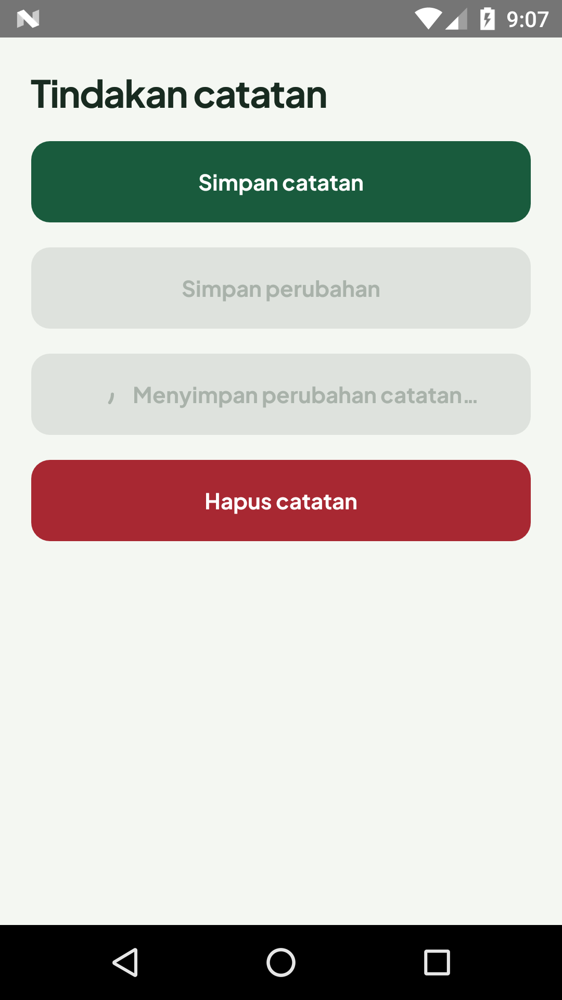 | 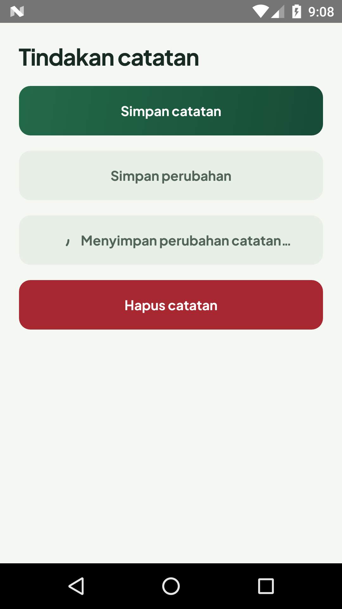 |
| Gelap | 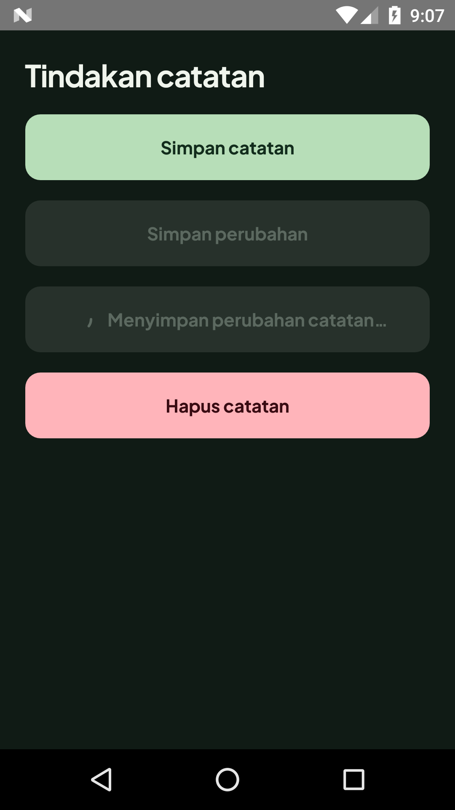 | 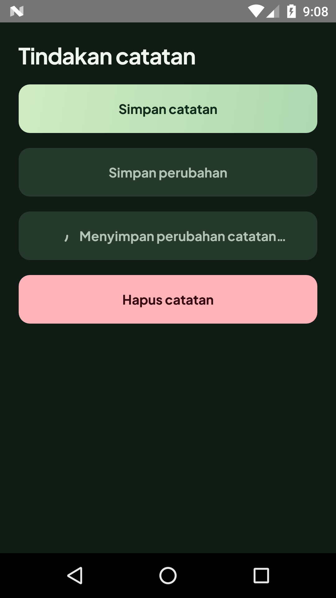 |

Tombol aktif sekarang memakai brush action terpusat: pinus pada tema terang, hijau terang pada tema gelap, dengan onPrimary tema masing-masing. Loading/disabled memakai surfaceContainer dan onSurfaceVariant opak; destructive tetap error/onError. Bentuk 12 dp, minimum 52 dp, weight 700 dan perilaku Button Material dipertahankan. Tidak ada dependency baru. Indikator loading mengikuti warna label, berada di tengah vertikal, dan teks dapat membungkus tanpa tinggi tetap.

APK tes yang identik (`aec3516e803ad16898615fe7609dcf18d71bf7db2f7cc523150ca9ffa0adffdc`) dijalankan pada app sebelum/sesudah. Dua kasus tema gagal pada app sebelumnya karena gradasi/foreground/kontras, lalu lulus pada app baru. Percobaan awal helper yang menangkap window masuk dan memakai lebar paragraph sebagai lebar glyph tidak dimasukkan sebagai bukti regresi produk. Helper final menunggu surface tema tampil dan window idle; pengukuran clipping memeriksa lebar glyph baris serta tinggi teks dengan toleransi pembulatan 1 px.

## Perbandingan dengan kit dan penggunaan aplikasi

Acuan gradasi/action terdapat pada [render kit terang](reference-save-light.png) dan [gelap](reference-save-dark.png), bukan pada Material default. Hasil aplikasi baru di bawah memakai ukuran teks normal; konten berasal dari catatan dummy yang benar-benar disimpan. Tema gelap menunjukkan receipt edit tanpa XP tambahan.

| Tema | Kit v1.3 | Android native |
|---|---|---|
| Terang | 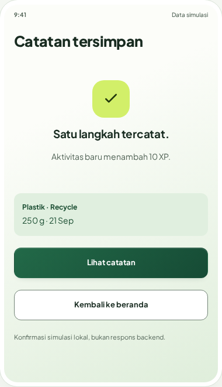 | 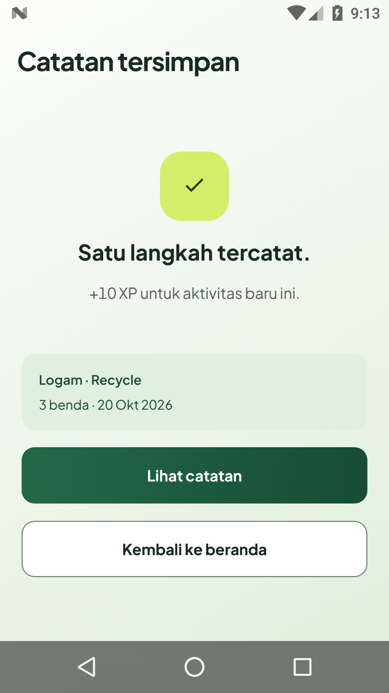 |
| Gelap | 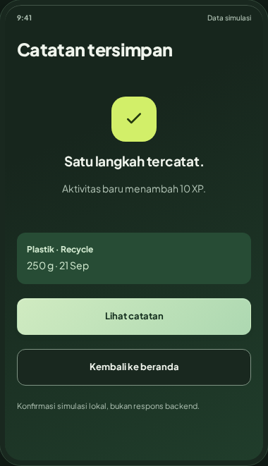 | 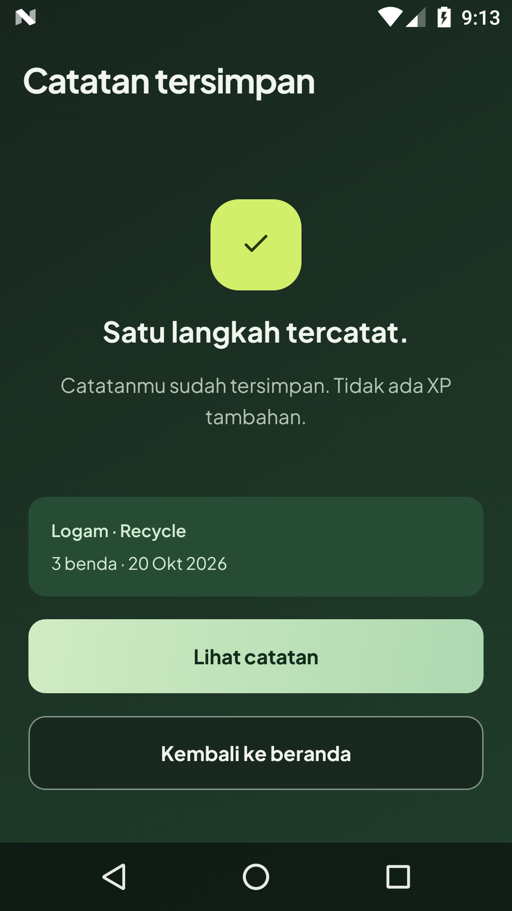 |

[Koreksi pembacaan screenshot 22 Oktober](VISUAL_RECHECK.md): ikon/teks Catat/Scan dan centang S06 terlihat pada PNG asli. Klaim glyph hilang sebelumnya dicabut; tidak ada perbaikan source rendering yang dibutuhkan berdasarkan bukti tersebut.

Frame kit memiliki lebar dan system bar dokumentasi; native memakai system bar API 24 dan konten fixture berbeda. Perbandingan ini memeriksa material tombol yang diubah. Highlight inset/bayangan kecil pada CTA kit, seluruh secondary/text/icon controls, dan kesesuaian semua layar tetap bagian audit material berikutnya.

## Verifikasi

| API / lebar / font | Eksekusi lulus | Durasi |
|---|---:|---:|
| 24 / 360 dp / normal | 11 | 95,123 detik |
| 24 / 360 dp / 200% | 8 | 73,117 detik |
| 24 / 600 dp / 200% | 8 | 110,799 detik |

Ada **27 eksekusi native dari 11 kasus unik**, tanpa skip, pada APK app yang sama (`e8ba05a76d8e095b2c40960447452fffe205551846e46bef018ba17d04e6231c`). APK tes juga identik pada semua suite. Kasus baru memeriksa warna foreground hasil layout dan tiga sampel background native per tombol, tinggi minimum 52 dp, lebar baris/tinggi teks, serta sentuhan dan Enter. Saat loading, sentuhan/Enter tidak memanggil callback lagi; setelah tersedia kembali, sentuhan bekerja. Disabled destructive juga tidak menerima sentuhan.

Sampel mencakup empat state pada dua tema dan tiga konfigurasi, total 72 pasangan foreground/background. Kontras label disabled/loading sesudah perubahan minimal **5,40:1 terang** dan **6,72:1 gelap** pada konfigurasi yang diuji. Semua pasangan sampel minimal 4,5:1. Tes tema yang sudah ada juga memeriksa 101 posisi pada masing-masing gradasi opak dan role warna terkait. [Rekap native](actions-native-results.json) mencatat hasil, konfigurasi, hash APK terpasang dan pengukuran setiap tombol.

Regresi aplikasi meliputi form Catat/Ubah kedua tema, validasi blur/fokus, rotasi, failure STORAGE/recreate/koreksi, create/edit/XP, receipt dan Back, pemilih tema, dock lima tab/manual dan rail lebar. Semua alur memakai dummy persisten melalui jalur aplikasi. Lint debug, build native app/instrumentasi dan 120 debug unit tests lulus, 0 gagal/error/skip. Gate APK minimum 24/adjustResize/lima font/OFL lulus. Runtime perangkat dilakukan lokal; hasil GitHub Actions dicatat pada PR sesuai commit.

| Font 200% | Terang | Gelap |
|---|---|---|
| Ponsel 360 dp | 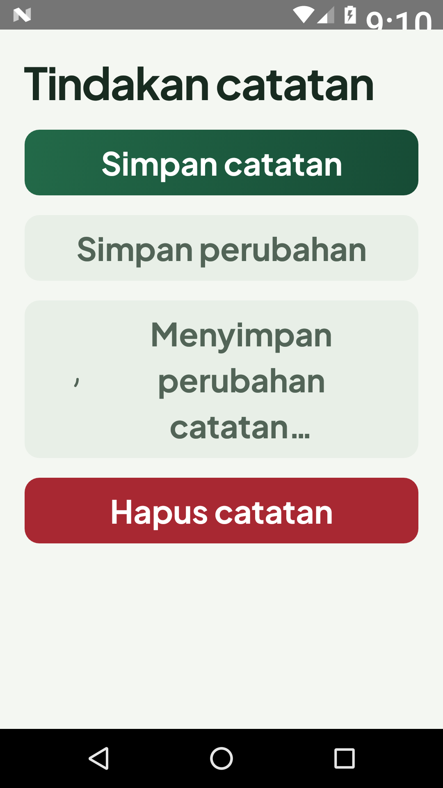 | 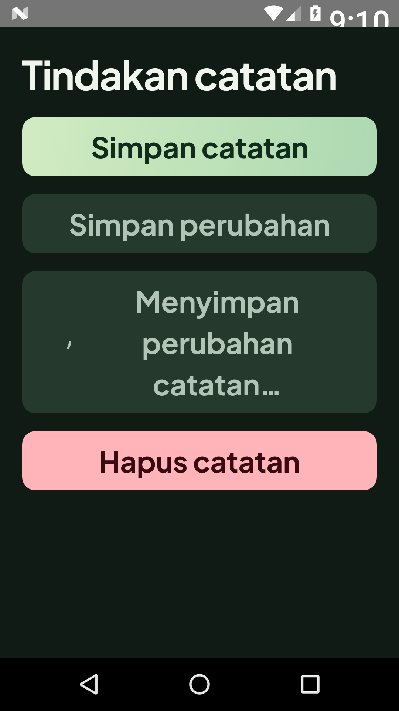 |
| Lebar 600 dp | 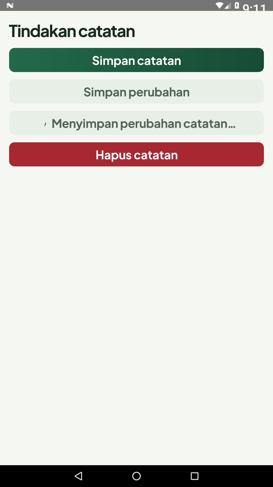 | 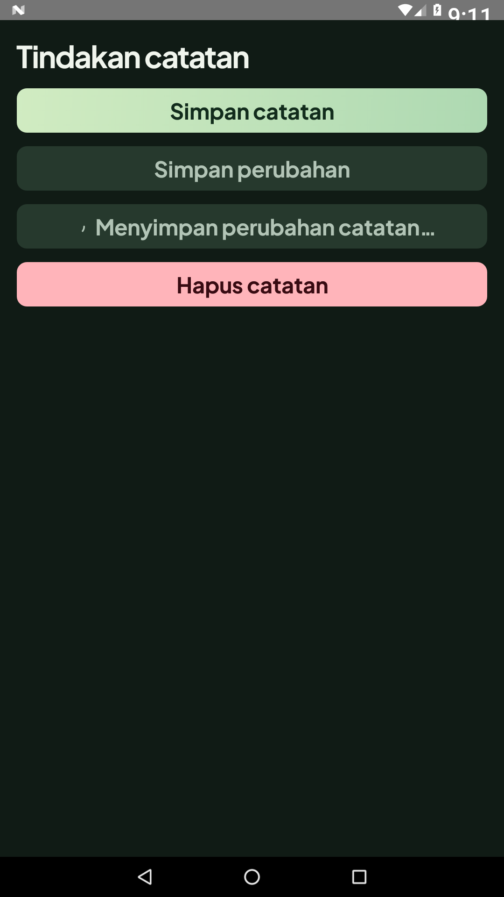 |

Contoh dalam form: [Catat terang 200%](actions-editor-phone200.png), [Catat gelap 200%](actions-editor-dark-phone200.png). Kolom dapat digulir; screenshot sebuah posisi scroll tidak membuktikan seluruh konten terlihat bersamaan. Label panjang loading memakai beberapa baris pada ponsel 200%, tanpa memotong teks atau indikator. UI sistem API 24 pada font besar bukan komponen WasteNot.

## Gate checkpoint

- **Hard PASS untuk C03 yang diubah:** disabled/loading tetap terbaca (72 pasangan sampel, seluruhnya ≥4,5:1), callback touch/Enter bekerja hanya saat enabled, tinggi minimum 52 dp dan teks tidak terpotong pada konfigurasi uji. Tidak ada perubahan salinan atau kontrol produk baru.
- **Purpose PASS:** gradasi mengikuti token aksi DESIGN §2; disabled memakai soft/muted DESIGN §6, destructive mempertahankan peran error. Glass tetap terbatas navigasi.
- **Liveliness PASS untuk perubahan:** ENERGY 2 / RHYTHM 2 / MOTION 1 mengikuti kit; gradasi menandai aksi utama, tidak menambah animasi atau aksen dekoratif baru.
- **Craft PASS untuk cakupan uji:** kedua tema, font normal/200%, ponsel/lebar, keyboard dan journey aplikasi diperiksa. Gate ini tidak menutup audit pembaca layar, semua kontrol lain, seluruh motion, atau semua screen.

Pekerjaan penuh masih mencakup konflik D04, draf tahan process death/per akun, pagination/pull-to-refresh, Panduan/detail, Statistik/grafik, Profil/achievement/pengaturan, auth, kamera/AI dan audit material global. PR #96 tetap draft; checkpoint ini tidak membuktikan integrasi backend HTTP atau menyatakan semua UI sesuai mockup.
