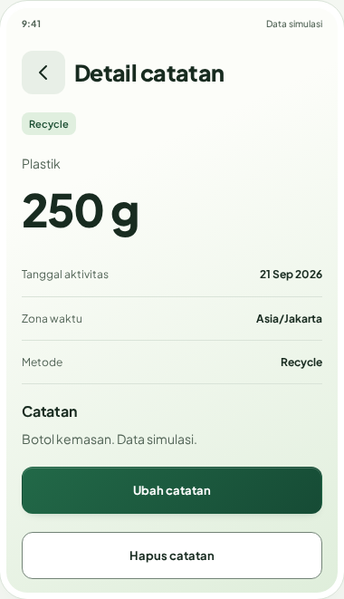
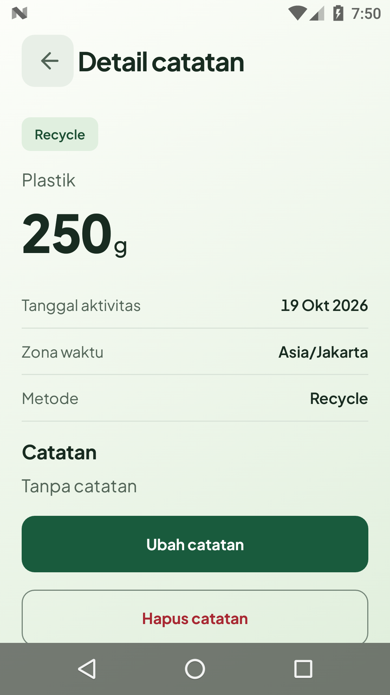
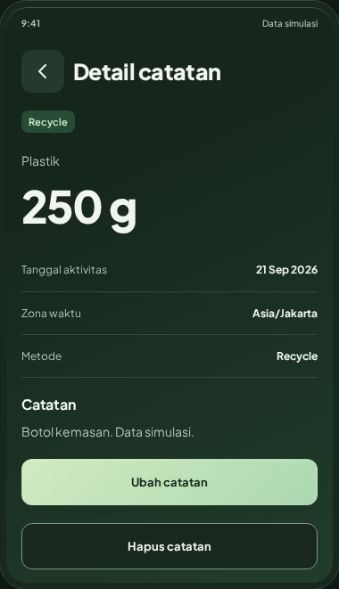
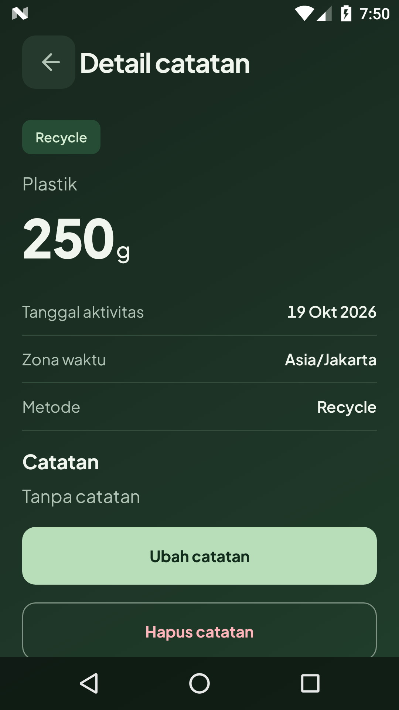
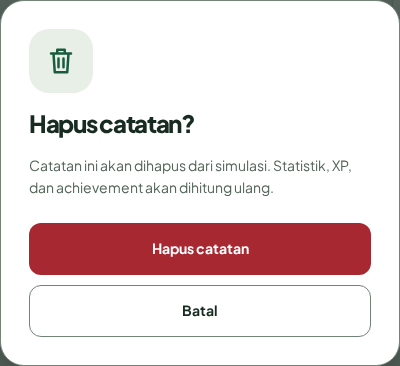
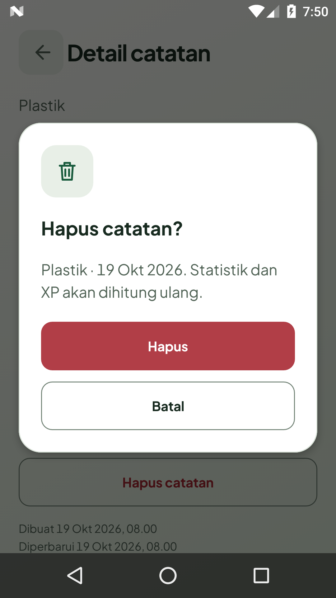
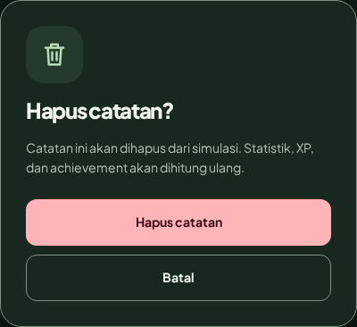
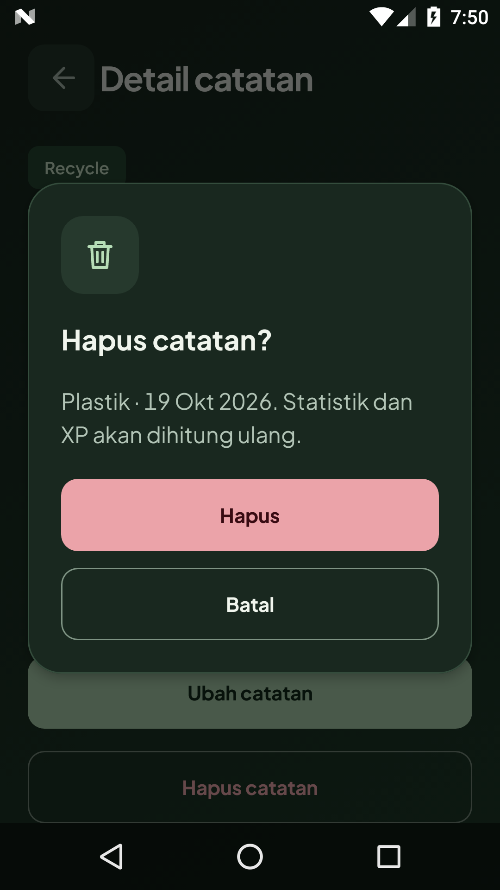

# Detail dan hapus catatan: S08/D01

19 Oktober 2026 · branch `codex/android-iteration-2-design`. Kelanjutan [Beranda/dock](README.md) dan [Riwayat/filter](HISTORY.md). Ini bukti checkpoint detail/hapus lokal; [matriks Iteration 2](../../tasks/ITERATION_2_DESIGN.md) tetap mencakup seluruh layar yang belum selesai.

## Perbandingan visual

Referensi dirender langsung dari kit v1.3 dengan font lokal. Android menggunakan APK native API 24, resolusi fisik 1080×1920, density 480 (360 dp), font normal. Frame/status bar HTML berbeda dari system bars Android; gambar tidak diolah. Tanggal/nama berasal dari dummy persisten, bukan label simulasi pada produk.

| Layar | Referensi kit | Android 360 dp |
|---|---|---|
| Detail terang |  |  |
| Detail gelap |  |  |
| Hapus terang |  |  |
| Hapus gelap |  |  |

Detail memakai tombol Back soft square, badge metode radius 8, kategori, angka dominan dengan satuan, metadata/divider, catatan, Ubah dan Hapus. Timestamp dibuat/diperbarui berada setelah aksi sebagai informasi sekunder sesuai SCREEN_SPEC S08. Ponsel menyembunyikan dock pada detail agar halaman fokus seperti mockup; rail tetap tersedia pada layar lebar. Unit dibuat lebih kecil dari angka untuk membedakan nilai dan satuan; ini perbedaan tipografi dari render HTML, bukan klaim pixel-identical.

Dialog mengikuti panel opak radius 24, ikon tong sampah dari path kit, judul, isi serta dua tombol lebar bertumpuk. Isi menyebut kategori/tanggal dan dampak statistik/XP sesuai D01. Tombol Hapus memakai error/onError; Batal memakai outline dan menerima fokus keyboard awal. Tidak menyalin keterangan simulasi HTML ke UI aplikasi. Isi dapat digulir pada teks besar; sistem Back/dismiss hanya membatalkan saat tidak ada request aktif.

| Konfigurasi | Detail terang | Detail gelap | Hapus terang | Hapus gelap |
|---|---|---|---|---|
| 360 dp, 200% | [Detail](detail-light-360-font200.png) | [Detail](detail-dark-360-font200.png) | [Dialog](delete-light-360-font200.png) | [Dialog](delete-dark-360-font200.png) |
| 600 dp, 200% | [Detail + rail](detail-light-600-font200.png) | [Detail + rail](detail-dark-600-font200.png) | [Dialog](delete-light-600-font200.png) | [Dialog](delete-dark-600-font200.png) |

Pada teks 200% metadata disusun vertikal. Layar/form dapat digulir; screenshot awal bukan bukti seluruh konten muat sekaligus. Tes menggulir ke timestamp dan aksi serta memeriksa digit kuantitas maksimum tetap satu baris. Screenshot font besar memuat clipping jam pada SystemUI API 24; itu bukan judul aplikasi. Screenshot setelah delete: [360 dp](history-after-delete-360.png), [360 dp/200%](history-after-delete-360-font200.png), [600 dp/200%](history-after-delete-600-font200.png).

## Kontrak data dan interaksi

- Detail dibaca melalui `ActivityStore.get(id)`, termasuk ID yang tidak ada pada snapshot daftar. Cache hanya dapat dibaca saat loading/error; Ubah/Hapus memerlukan read terbaru dengan version positif. NOT_FOUND/DELETED menyembunyikan cache dan menampilkan Catatan tidak tersedia. Identitas namespace akun berbeda menghasilkan NOT_FOUND yang sama.
- Write diserialisasi oleh ViewModel. Catatan baru dihapus dari UI setelah adapter dummy mengonfirmasi penyimpanan; agregat Home/History/Statistics/Profile dimuat ulang. Hasil load lama dibatalkan agar tidak menghidupkan kembali catatan. Bila refresh gagal, perubahan yang sudah dikonfirmasi dipertahankan dan error terlihat.
- Konflik version dan precondition tidak mengulang delete otomatis. Pengguna memuat versi terbaru, meninjau lagi, lalu mengonfirmasi ulang. Kegagalan storage/network mempertahankan catatan dan menyediakan retry. Tombol konfirmasi/batal dinonaktifkan selama write; callback hasil dikorelasikan dengan ID.
- Dummy menyimpan records, request hashes dan tombstone dalam satu Editor commit. Replay create setelah delete tidak membuat ulang record; replay delete atas tombstone milik akun sendiri sukses. Seed ID baru berupa UUID per akun; identitas seed yang sudah tersimpan tidak dimigrasi.
- `SharedPreferences.commit()` dapat memperbarui cache sebelum melaporkan gagal. Adapter memulihkan snapshot terakhir ketika commit gagal, termasuk seed gagal, sehingga read/retry tidak melaporkan perubahan yang belum dikonfirmasi. Test mencakup kegagalan sebelum dan setelah cache berubah. Ini bukan jaminan transaksi database atau sinkronisasi cloud.

## Bukti pengujian

- Build native debug/aplikasi instrumentasi dan lint debug lulus setelah penyelarasan dialog; **112 debug unit tests, 0 gagal/error/skip**. APK native lolos gate API 24, MainActivity adjustResize, lima font dan lisensi OFL. Hook commit tetap wajib dijalankan.
- **API 24, 360 dp, font normal:** 19 kasus runner, **18 dijalankan lulus**, satu gestur khusus API 36 dilewati; 172,851 detik. Mencakup detail plain UI, dialog bertumpuk dan disabled saat busy, cancel/delete/rotasi/agregat, navigasi, Riwayat, journey dock/manual serta presisi ringkasan.
- **API 24, 360 dp, font 200%:** **12 kasus lulus**, 115,768 detik. Digit kuantitas maksimum tetap satu baris; metadata/timestamp/aksi dicapai lewat scroll; kedua tombol dialog lebar sama, bertumpuk dan ≥48 dp. Cancel mempertahankan record dan confirm memperbarui XP/statistik. Filter dan posisi scroll tetap diuji.
- **API 24, 600 dp, font 200%:** **12 kasus lulus**, 116,089 detik. Selain kontrak yang sama, pengujian memastikan record yang sama dapat berada di stack Beranda dan Riwayat tanpa tabrakan entry; rail, judul dan aksi tetap dapat digunakan.
- Perubahan terakhir hanya membuat editor memprioritaskan hasil baca detail terbaru sebagai data awal, termasuk bila catatan tidak ada pada snapshot daftar. Layout/dialog tetap sama. Build/lint dan 112 unit tests lulus lagi; APK akhir menjalankan **empat regresi create/edit/detail/delete/stack/rotasi**, semuanya lulus (47,630 detik). Screenshot normal di atas diambil ulang dari APK akhir; screenshot teks besar berasal dari build layout yang sama sebelum perubahan lookup ini.
- Driver window terpisah pada APK akhir memverifikasi **Back sistem KEYCODE_BACK** menutup D01 dan kembali ke detail tanpa write. Dialog dibuka ulang, Batal juga menutupnya; hash preferences catatan sebelum/sesudah identik. Driver membaca hierarchy baru setiap langkah dan berjalan setelah instrumentasi selesai, sehingga tidak mengambil alih koneksi UiAutomation suite.

Delapan tes adapter native pada `detail-device-360.log` lulus pada source data-layer yang sama: tombstone/replay/version, isolasi ID akun, 16 adapter konkuren, rollback kegagalan commit/cache, seed gagal/metadata parsial, tanggal rusak, identitas/password dan persistensi. Suite awal berisi 26 kasus runner, 25 dijalankan lulus dan satu gestur khusus API 36 dilewati (86,520 detik). Ini bukti data-layer, bukan screenshot dialog terbaru.

Percobaan awal `detail-layout-device-360-font200.log` terputus setelah koneksi UiAutomation hilang; tidak dihitung lulus. Logcat mencatat kegagalan screenshot dan crash instrumentasi setelahnya. Penyebab putusnya koneksi tidak terbukti sebagai bug produk. Setelah memastikan instrumentasi sebelumnya telah berhenti, run ulang pada APK yang sama lulus 11 kasus (57,623 detik), dan 600 dp/200% lulus 11 kasus (100,360 detik). Angka tersebut mendahului penyelarasan susunan dialog terakhir; bukti terbaru dicatat terpisah.

## Batas penerimaan

Adapter HTTP get/delete belum diimplementasikan; tidak ada klaim header If-Match atau respons 204 nyata diuji. Dummy mengikuti kontrak version/delete secara lokal. Lampiran/foto private dan kemampuan backend belum tersedia. Activity recreate dan rekonstruksi adapter telah diuji; pemulihan route detail setelah process death, TalkBack menyeluruh dan kualitas transisi per frame belum dibuktikan pada checkpoint ini.

S06 feedback simpan, S09 editor/D04 untuk edit, cursor repository/pull-to-refresh, Panduan, grafik Statistik, Profil/achievement/pengaturan dan alur foto/AI masih pekerjaan aktif. Issue #38/#51 tetap terbuka karena kriteria integrasi/penerimaan penuh belum terpenuhi. Tidak ada klaim semua layar sudah sama dengan mockup.

## Gate visual untuk perubahan checkpoint

- **Hard PASS pada kontrol yang diubah:** tidak ada jalur masuk demo; data berasal dari dummy yang tersimpan. Detail missing/error/retry, cancel, confirm, busy serta konflik/precondition mempunyai perilaku teruji. Kedua tombol dialog bertumpuk dan ≥48 dp pada tiga konfigurasi. Ini tidak menutup gate fitur kamera/Panduan yang belum selesai.
- **Purpose PASS:** panel dialog opak memisahkan konfirmasi dari latar, ikon tong sampah mengidentifikasi tindakan, warna error hanya untuk Hapus dan outline membedakan Batal. Radius 24/12 dan font Plus Jakarta Sans berasal dari kit; tidak ada efek glass pada dialog.
- **Liveliness PASS untuk S08/D01:** ENERGY 2 / RHYTHM 2 / MOTION 1; angka menjadi fokus detail, metadata sekunder dan lime tetap di navigasi. Screenshot terang/gelap dibandingkan dengan render kit. Perbedaan tipografi unit disebutkan di atas untuk audit lanjutan.
- **Craft PASS pada konfigurasi teruji:** screenshot ponsel/rail dan teks 200% diperiksa, aksi bisa dicapai lewat scroll, busy menolak aksi, serta draf/filter/Back tab tetap lulus. Kontras dialog berdasarkan token aktual: teks utama ≥13,91:1, sekunder ≥6,33:1, label Hapus ≥6,97:1, ikon ≥6,88:1 dan outline tombol ≥3,97:1 pada kedua tema. TalkBack, process death dan semua state visual layar lain tetap audit terpisah.
