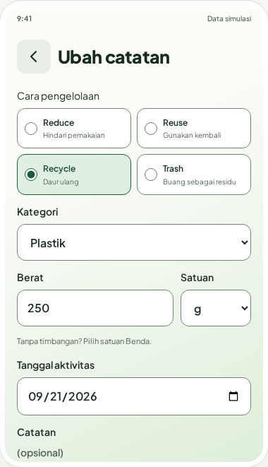
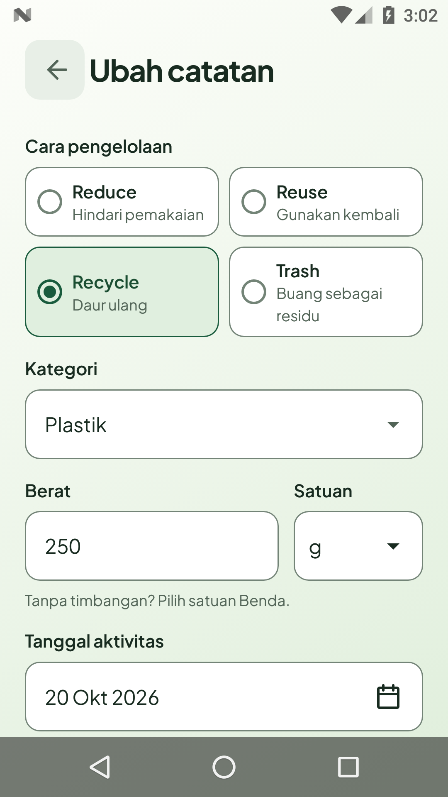
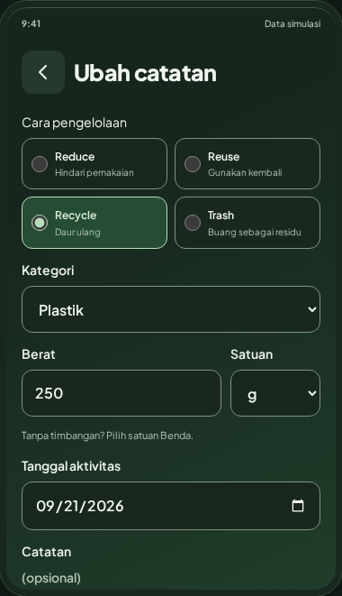
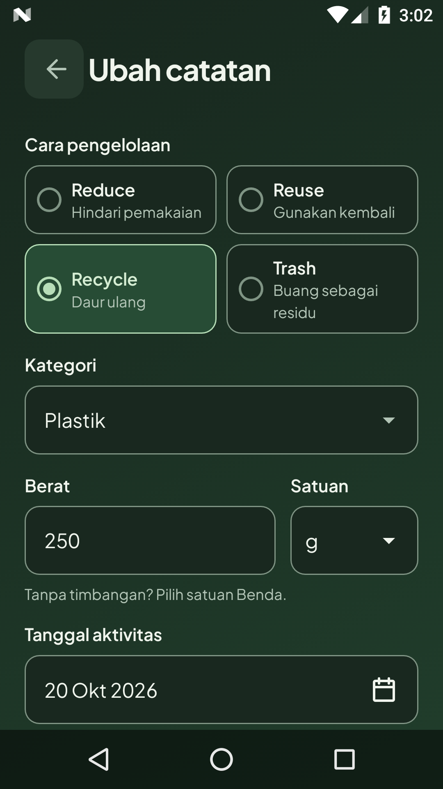

# Editor Catat/Ubah: S05 dan S09

20 Oktober 2026, branch `codex/android-iteration-2-design`. Checkpoint editor bersama, mengikuti SCREEN_SPEC S05/S09 dan DESIGN v1.3. Cakupan seluruh aplikasi tetap [dalam pengerjaan](../../tasks/ITERATION_2_DESIGN.md).

## Perbandingan langsung

[Sebelum perubahan](editor-before-360.png): banner edit besar, metode berupa chip, kategori berlabel mengambang, dan tiga chip satuan di atas field jumlah.

| Tema | Render kit S09 | Android 360 dp |
|---|---|---|
| Terang |  |  |
| Gelap |  |  |

Referensi dirender dari galeri HTML dengan font lokal. Native memakai Plastik/Recycle/250 g yang benar-benar disimpan oleh adapter dummy. Tanggal mengikuti akun pada 20 Oktober, sedangkan kit memakai 21 September. Frame/status bar dokumentasi dan system bars Android berbeda; keterangan simulasi HTML tidak disalin ke produk.

Galeri S05 berisi contoh terisi. Form create Android sengaja dimulai tanpa kategori/metode terpilih sesuai SCREEN_SPEC. [Kit S05](reference-S05-light.png) dan [form kosong Android](editor-create-light-360.png) memperlihatkan perbedaan state tersebut.

## Susunan dan perilaku

- Metode memakai empat pilihan radio beserta arti singkat, grid 2×2 pada teks normal dan daftar pada teks besar/ruang sempit. Tinggi dua pilihan dalam satu baris mengikuti isi terpanjang. Pilihan awal tidak dibuat otomatis.
- Label berada di atas bidang opak, dengan radius 12 dan outline theme. Jumlah dan satuan berdampingan pada ponsel normal, lalu tersusun vertikal ketika perlu. g/kg tetap dikonversi tepat; beralih ke Benda mengosongkan berat dari payload.
- Pemilih satuan menggunakan tombol/menu Material yang ringkas. Label Benda diuji satu baris tanpa overflow. Contoh nilai mengikuti satuan, termasuk 0,25 untuk kg; label/helper Reduce tetap terpisah dari metrik penanganan.
- Catatan memakai label opsional dan placeholder kit. Helper create menampilkan zona akun sebenarnya; informasi edit tanpa XP tambahan berada dekat CTA. Tombol create bertuliskan Simpan catatan.
- Validasi blur hanya menerbitkan error field yang sudah ditinggalkan, tanpa error awal. Submit invalid menggulir dan memfokuskan kontrol pertama yang salah. Fokus radio diizinkan dalam mode sentuh tanpa memilih metode; Tab ke pilihan berikutnya juga diuji.
- Kalender mempertahankan tanggal asli catatan lama di luar jendela create, tanpa membuka seluruh rentang lama. Tanggal draf create yang sudah terlalu lama tetap dapat ditinjau, tetapi Terapkan nonaktif. Batal tidak mengubah nilainya.
- Draf pulih setelah Activity recreate. Edit tidak mengirim write ketika belum berubah; create/edit yang berhasil membuka detail dari receipt tersimpan, dan edit tidak memberi XP kedua. Ini tetap mekanisme dummy, bukan bukti endpoint HTTP.

Ukuran Android mengikuti dp/sp dan role DESIGN, termasuk deskripsi 12 sp. Beberapa deskripsi dapat membungkus pada 360 dp; tidak dikecilkan ke ukuran teks galeri. Form maksimal 560 dp, dapat digulir, dan memakai inset/IME. Pola field auth default tetap memakai input sebagai root agar metadata autofill tidak berpindah ke label container.

## Bukti pengujian

Build native app/instrumentasi, lint debug, serta **114 debug unit tests, 0 gagal/error/skip**, lulus. Gate APK memeriksa API minimum 24, MainActivity adjustResize, lima font dan OFL. Hash APK yang dipasang dibandingkan dengan export yang diuji; [rekap perangkat](editor-native-results.json).

| API 24 | Kasus dijalankan/lulus | Durasi |
|---|---:|---:|
| 360 dp, font normal | 12 | 395,131 detik |
| 360 dp, font 200% | 12 | 71,427 detik |
| 600 dp, font 200% | 11 | 104,184 detik |

Jumlah di atas adalah **35 eksekusi dari 14 kasus unik**, termasuk konfigurasi berbeda; tidak ada kasus yang dilewati pada tiga suite ini. Suite mencakup kedua tema editor, touch/keyboard, blur dan fokus error, kategori/unit/kalender, draf/rotasi, create/edit/XP, dock/rail dan feedback simpan. Regresi keyboard auth diperiksa pada ponsel normal; filter/rotasi pada ponsel 200%. Tes rail memakai startup dummy dan alur Catat/Scan baru.

| Konfigurasi | Awal create | Footer create | Edit | Footer edit |
|---|---|---|---|---|
| 360 dp | [Terang](editor-create-light-360.png) | [Terang](editor-create-end-light-360.png) | [Gelap](editor-edit-dark-360.png) | [Gelap](editor-edit-end-dark-360.png) |
| 360 dp, 200% | [Terang](editor-create-light-360-font200.png) | [Terang](editor-create-end-light-360-font200.png) | [Gelap](editor-edit-dark-360-font200.png) | [Gelap](editor-edit-end-dark-360-font200.png) |
| 600 dp, 200% | [Terang](editor-create-light-600-font200.png) | [Terang](editor-create-end-light-600-font200.png) | [Gelap](editor-edit-dark-600-font200.png) | [Gelap](editor-edit-end-dark-600-font200.png) |

Screenshot footer diambil setelah menggulir ke CTA, bukan klaim seluruh form muat sekaligus. Pada teks 200%, clipping jam status bar API 24 berasal dari UI sistem. Judul/kontrol aplikasi diperiksa terpisah. Lebar 600 dp diperoleh dengan density 288 pada layar fisik 1080×1920, bukan bukti perangkat tablet/foldable fisik.

## Gate checkpoint

- **Hard PASS untuk kontrol yang diubah:** build dan perjalanan native di atas, kontrol berfungsi, target sentuh diperiksa, validasi tidak membuang isian, dan tidak ada jalur demo pada editor.
- **Purpose PASS:** bidang opak menjaga keterbacaan isian; radio dan deskripsi menjelaskan metode; warna pinus/primary-soft menandai pilihan; label/helper/CTA memakai urutan kit. Tidak ada glass pada form.
- **Liveliness PASS untuk editor:** ENERGY 2 / RHYTHM 2 / MOTION 1, satu fokus form, variasi grid/list mengikuti ruang, tanpa gerak dekoratif.
- **Craft PASS pada konfigurasi tercatat:** tema terang/gelap, teks normal/200%, form/rail dan keyboard diperiksa. Kontras token aktual: teks minimal 5,24:1, label selected minimal 7,78:1, helper selected 5,28:1, error pada canvas minimal 5,77:1 dan outline input minimal 3,97:1. Ini belum audit spoken feedback atau seluruh state aplikasi.

## Batas yang masih terbuka

S05 memerlukan snapshot payload/ID serta pemulihan hasil POST yang belum pasti sebelum koreksi; S09 memerlukan konflik D04 dan reload yang menjaga draf. Persistensi draf lintas process death dan akun perlu dibuktikan tersendiri. Pengukuran CTA editor terhadap jendela IME nyata, integrasi write HTTP, spoken feedback TalkBack, audit fokus/motion per frame dan material CTA bersama tetap pekerjaan berikutnya. Tidak ada klaim seluruh layar sudah sesuai atau backend nyata sudah terintegrasi.

Panduan/detail, pagination cursor/pull-to-refresh, grafik Statistik, Profil/achievement/pengaturan dan foto/AI tetap bagian sasaran penuh Iteration 2. Issue Android terkait tetap terbuka dengan checklist parsial berdasarkan bukti.
