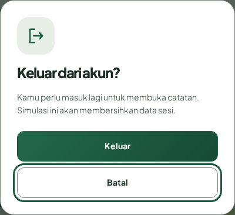
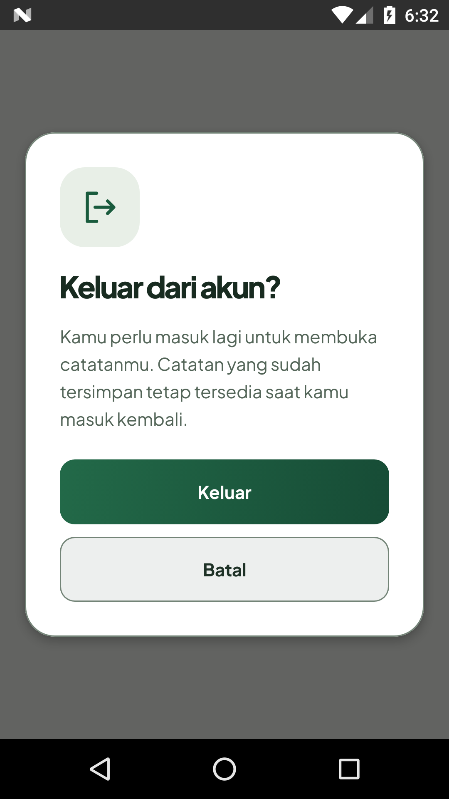
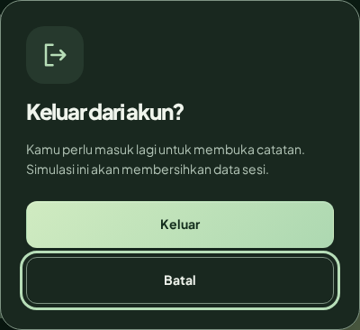
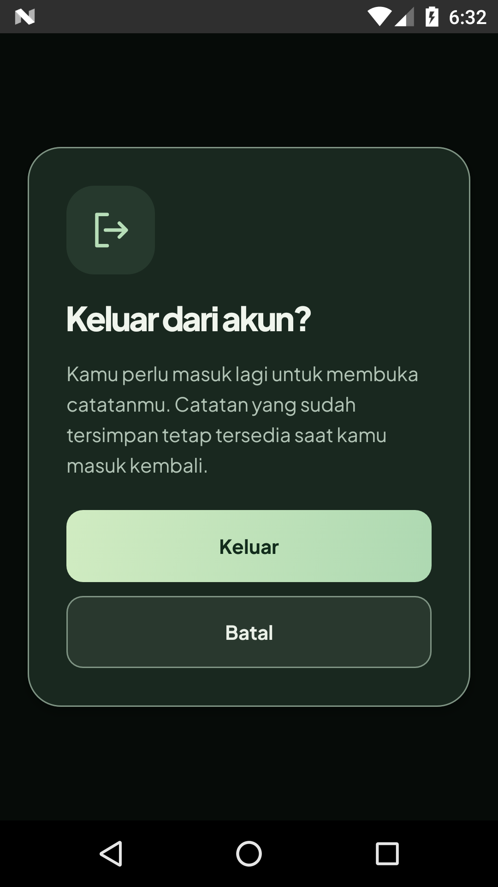
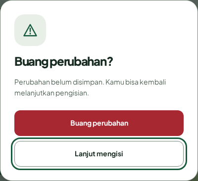
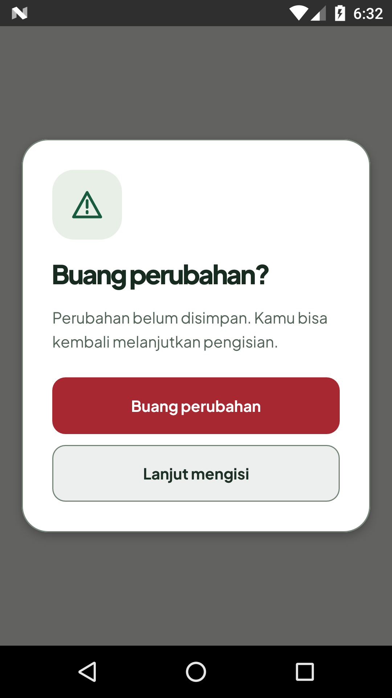
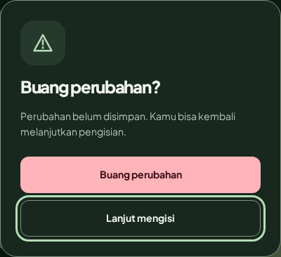
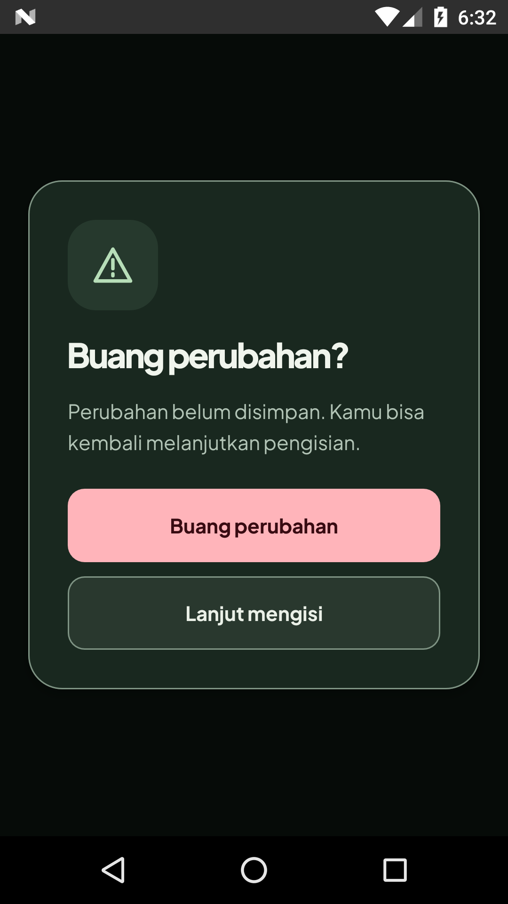

# Keluar dan buang perubahan

24 Oktober 2026. Checkpoint D02/D03/C27 serta lebar label C03. Penerimaan seluruh screen/navbar tetap mengikuti [matriks Iteration 2](../../tasks/ITERATION_2_DESIGN.md). [Manifest](exit-checkpoint.json) mengikat source, APK aplikasi/penguji, konfigurasi, kasus native dan gambar.

## Kit dan implementasi

| Kondisi | Kit v1.3 | Android |
|---|---|---|
| Keluar terang |  |  |
| Keluar gelap |  |  |
| Buang perubahan terang |  |  |
| Buang perubahan gelap |  |  |

[Sebelumnya](exit-before-logout.png), pada APK checkpoint `2969158`, D02 masih berupa AlertDialog Material dengan dua tombol teks mendatar. Referensi dirender dari HTML/font lokal kit yang diminta. Ukuran window Android, inset sistem dan line height berbeda; perbandingan menyatakan komposisi, bukan semua pixel identik. Screenshot dialog final memakai state terkontrol; regresi MainActivity menguji wiring produk secara terpisah.

Panel kini mengikuti C27 yang sudah dipakai D01/D04: surface opak maksimum 400 dp, radius 24, outline dan elevasi 6; padding 28 dan jarak 16; simbol 64/radius 20 dengan ikon 30 dari kit. Judul memakai Plus Jakarta Sans 24 sp/800; body 14. Dua aksi ditumpuk dengan jarak 10 dan tinggi minimum 52, radius 12. Gradasi Pinus menandai Keluar, sedangkan error menandai Buang perubahan. Panel opak menjaga isi keputusan terbaca di atas layar yang diredupkan; bayangan memisahkan modal dari pemicunya.

## Perilaku yang diperiksa

| Aksi | Hasil |
|---|---|
| D02 Batal, Back, Escape atau Enter pada Batal | Modal tertutup; callback Keluar tidak dipanggil |
| D02 Keluar lewat keyboard/sentuhan | Callback tepat satu kali; journey akun kembali ke Masuk dan catatan akun lama tetap tersedia setelah login ulang |
| D03 Lanjut mengisi atau Back | Editor dan isian draf tetap tersedia |
| D03 Buang perubahan | Kembali ke tujuan sebelumnya; editor berikutnya kosong, tidak menyimpan catatan |
| Hasil simpan belum pasti | Memakai Tutup formulir, penjelasan bahwa permintaan yang sudah dikirim tidak dibatalkan, serta Lanjut mengisi; tidak menyebut hasil pasti gagal atau menawarkan Buang perubahan |
| Keyboard | Saat mode keyboard aktif dan window dialog siap, fokus awal berada pada Batal/Lanjut mengisi; Tab mencapai konfirmasi, Enter menjalankan aksi terpilih. Mode sentuh tidak dipaksa menjadi keyboard |

[Fokus Lanjut mengisi](exit-cancel-focus.png) dan [konfirmasi eksplisit](exit-confirm-focus.png). Enter pada fokus awal tidak boleh membuang isian. Fokus input keyboard dibedakan dari fokus spoken TalkBack yang belum diaudit pada checkpoint ini.

Pesan simulasi penghapusan catatan saat Keluar dihapus. Adapter dummy persisten tidak menghapus catatan per akun saat menutup sesi. Copy katalog yang menyebut simulasi tidak disalin ke produk. Ini belum membuktikan pencabutan sesi server deployed.

Lebar intrinsik label C03 kini membatasi paragraf ke kotak teks yang diukur. Pemeriksaan awal menangkap `didOverflowWidth` pada label Keluar. Penguji tetap memeriksa overflow, dan regresi tombol bersama diperketat agar normal/loading/disabled/destructive juga harus bebas overflow. Kandidat/run gagal tidak dihitung sebagai hasil final.

Run berikutnya membuktikan fokus dan label sudah benar, tetapi Escape belum menutup dialog pada API 24. Penanganan key di panel kini mengonsumsi Escape dan menjalankan batal pada KeyUp; tombol Back serta traversal/aktivasi tombol tetap berjalan melalui perilaku normalnya. Tes yang menemukan masalah tetap dijalankan pada hasil final.

## Verifikasi

Build native, lint dan **160 debug unit tests** lulus tanpa gagal/error/skip. Gate API 24, MainActivity adjustResize, lima font dan OFL lulus. **42 eksekusi native / 14 kasus unik**, nol skip, memakai APK aplikasi/penguji identik:

| API 24 | Lulus | Dilewati |
|---|---:|---:|
| 360 dp, teks normal | 14 | 0 |
| 360 dp, teks 200% | 14 | 0 |
| 600 dp, teks 200% | 14 | 0 |

Tiga kasus dialog memeriksa tiga state, dua tema, heading/body/label tanpa overflow, target sentuh dan aksi dalam viewport, callback, fokus serta Back/Escape/Tab/Enter Android. Dua journey akun memeriksa akun baru/akun awal, tema, Back dan pembatalan Keluar. Enam regresi editor memeriksa create/edit, draf dirty/clean, konfirmasi/cancel dan sampel transisi. Tiga regresi C03 memeriksa warna aktual, teks dan state loading/disabled/destructive serta aktivasi. Pengujian native dijalankan lokal, terpisah dari CI GitHub.

Pada teks 200%, dialog dapat digulir tanpa mengecilkan font: [aksi Buang perubahan di ponsel](exit-light-1-actions-phone200.png), [peringatan hasil belum pasti](exit-light-2-heading-phone200.png), dan [aksi pada 600 dp](exit-dark-2-actions-wide200.png). Target sentuh tetap minimal 48 dp dalam penguji.

[14 pasangan token](exit-contrast.json) memenuhi ambang teks 4,5:1 dan ikon/batas kontrol 3:1, minimum teks 6,327:1. Enam JSON `exit-actions-{normal,phone200,wide200}-{light,dark}.json` merekam ukuran label dan sampel pixel C03 untuk tiap konfigurasi; semua daftar pelanggaran kosong. Sampel pixel C03 tidak menggantikan audit kontras seluruh aplikasi.

## Gate dan batas checkpoint

- Hard PASS pada kontrol yang diubah: ketiga state, dua tema, teks besar, callback nyata dan keyboard diperiksa; tidak ada aksi otomatis menyimpan/menghapus ketika modal dibuka atau dibatalkan.
- Purpose PASS: ikon Keluar/peringatan, panel opak, tombol gradasi/destructive, tipografi dan geometri mengikuti kit serta tujuan keputusan masing-masing.
- Liveliness PASS pada cakupan ini: ENERGY 2 / RHYTHM 2 / MOTION 1; satu keputusan utama, hierarki judul/body dan satu aksi utama, tanpa gerak dekoratif.
- Craft PASS pada konfigurasi tercatat: render native diperiksa bersama kit; alur akun/editor dan C03 diuji. Semua layar/navbar, spoken TalkBack, fokus pemicu lintas modal, API lebih baru/perangkat fisik dan process death tetap perlu audit tersendiri.

Draf disk/per akun, backend/auth HTTP, cursor/pull-to-refresh, achievement/streak serta penerimaan visual dan navigasi global belum selesai. Hasil checkpoint ini tidak menutup seluruh kriteria issue D02/D03 ataupun membuat PR #96 siap merge.
