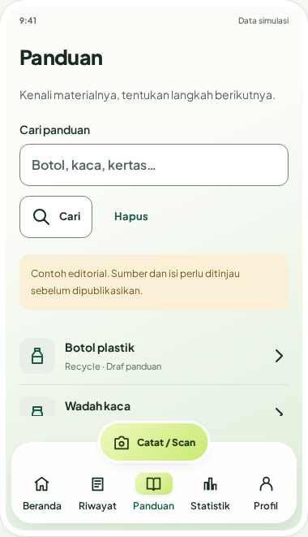
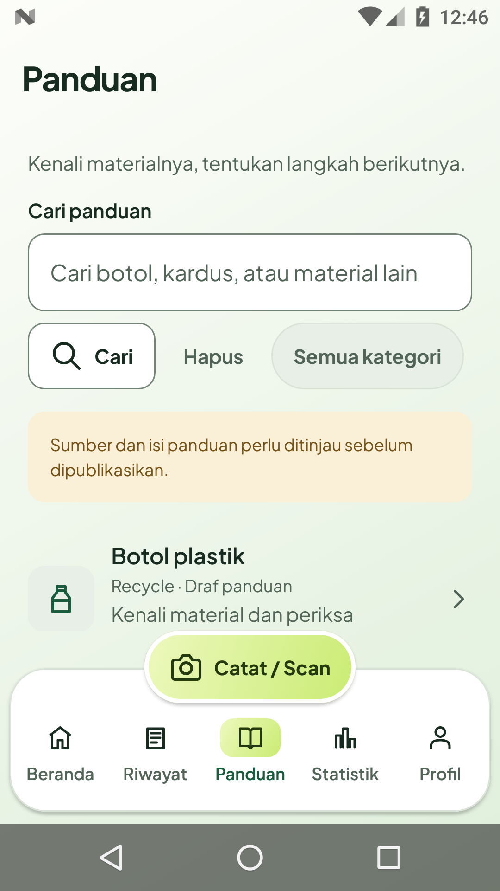
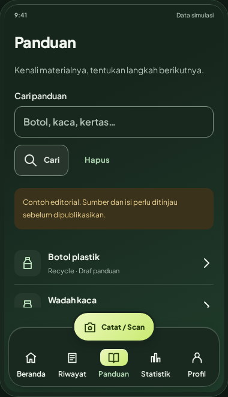
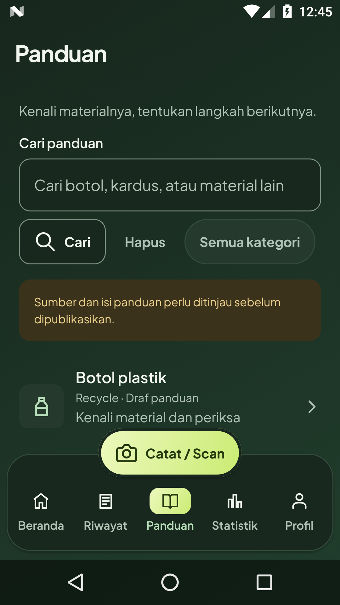
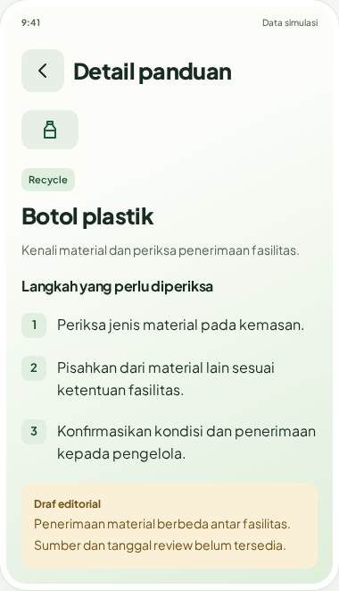
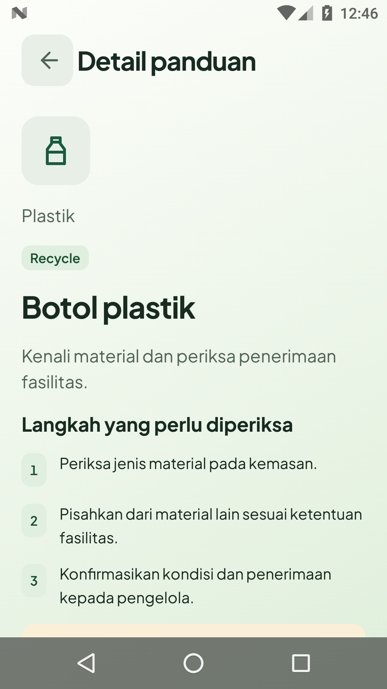
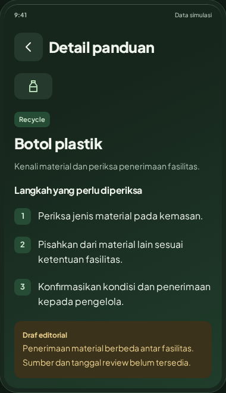
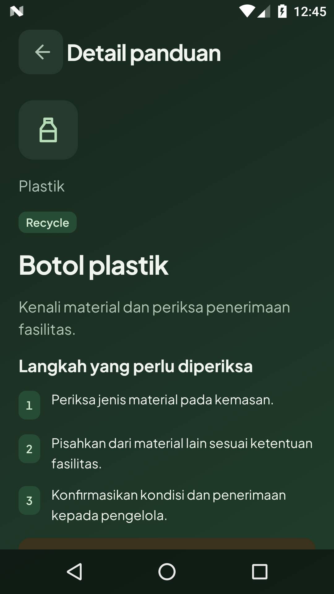
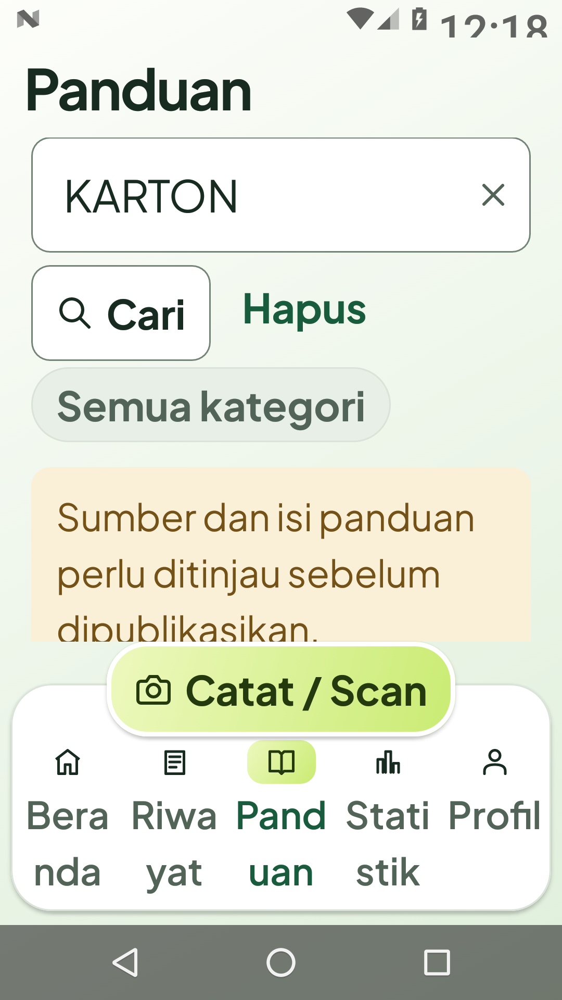
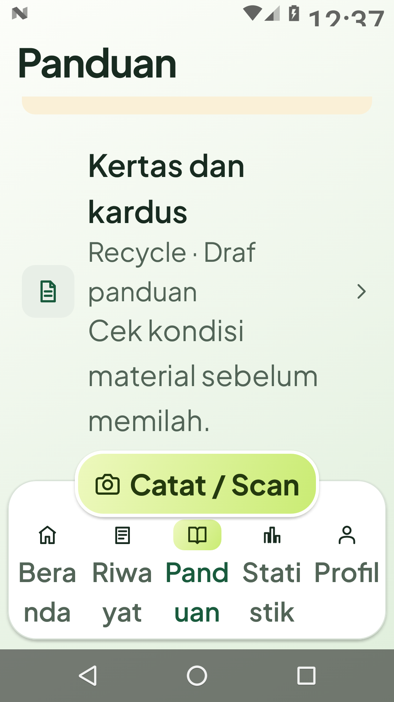

# Panduan dan detail panduan

21–22 Oktober 2026 · `codex/android-iteration-2-design`. S11/S12 menggantikan placeholder dengan daftar, pencarian dan detail yang mengikuti kit v1.3. Fungsi checkpoint dan pemulihan konteks telah diuji pada tiga konfigurasi. Penerimaan visual keseluruhan tetap terbuka, termasuk temuan Catat/Scan pada rail di bawah.

## Perbandingan dengan kit

Referensi berasal dari galeri `design-system.html` v1.3. Gambar Android adalah screenshot native tanpa retouch; system bars dan tinggi viewport mengikuti perangkat, bukan frame dokumentasi HTML.

| Layar/tema | Kit | Android, 360 dp |
|---|---|---|
| S11 terang |  |  |
| S11 gelap |  |  |
| S12 terang |  |  |
| S12 gelap |  |  |

Cari menjadi fokus S11; kategori opsional mengikuti kontrak layar. Baris memakai ikon material kit, metode dan ringkasan pendek dengan divider. S12 memprioritaskan langkah bernomor dan CTA, memakai font Plus Jakarta Sans, canvas pinus–lime serta token surface/soft yang sama dengan layar lain. Notice editorial mempertahankan provenance tiga artikel kit. Dials mengikuti Iteration 2: ENERGY 2 / RHYTHM 2 / MOTION 1.

[Bagian akhir detail/CTA](guide-detail-end-light.png), [prefill awal dengan jumlah kosong](guide-prefill-initial-light.png), [hasil kosong](guide-empty-dark.png), [refresh gagal dengan data lama](guide-refresh-error.png), [artikel hilang](guide-removed.png), dan [metadata sumber fixture penguji](guide-source-error.png) tersedia sebagai bukti terpisah. Tiga gambar state terakhir adalah harness komponen, bukan klaim respons HTTP nyata.

## Data dan interaksi

`GuideStore` memisahkan adapter dummy dari integrasi HTTP berikutnya. Dummy berisi tiga artikel editorial dari kit: Botol plastik, Wadah kaca, serta Kertas dan kardus. Sumber dan tanggal review tetap kosong karena belum tersedia. UI menjelaskan status editorial tersebut; data ini tidak dianggap artikel produksi yang sudah ditinjau.

Pencarian membatasi input 100 karakter, melakukan trim saat meminta data, mencocokkan nama/keyword tanpa membedakan kapital, dan menggabungkan kategori opsional. Perubahan query memakai debounce 300 ms dan membatalkan request sebelumnya. Respons yang mengabaikan pembatalan tetap tidak boleh mengganti hasil terbaru. Refresh gagal mempertahankan artikel untuk pencarian yang sama dan menyediakan retry eksplisit; query/kategori baru membuang hasil lama. Cursor memuat paling banyak 20 artikel per halaman; kegagalan halaman lanjut mempertahankan artikel dan cursor sebelumnya.

Detail menerima ID saja, memuat kategori/metode, ringkasan, langkah bernomor, serta caution dan metadata review apabila memang diberikan. Artikel yang tidak tersedia menawarkan kembali ke daftar. Sumber HTTPS dibuka melalui handler URI Android; client HTTP dan credential aplikasi tidak diteruskan ke tautan luar. Uji metadata memakai `example.org` sebagai fixture penguji, bukan sumber artikel sebenarnya.

Catat aktivitas ini membuka editor dengan kategori/metode awal yang dapat diubah. Jumlah dan catatan tetap kosong. Membaca artikel atau membuka editor tidak membuat log maupun memberi XP. Draf yang sudah diinisialisasi tidak ditimpa ketika data artikel dimuat lagi.

## Regresi scroll selama transisi

Uji pada API 24, lebar 360 dp, menemukan daftar bergeser setelah membuka detail dan kembali. Keyboard sudah tidak terlihat sebelum navigasi. Sebelumnya, Scaffold mengikuti route aktif global: dock segera hilang, sementara daftar lama masih digambar selama fade. Viewport daftar membesar dan LazyColumn membatasi scroll menjadi nol.

| Sampel | Sebelum perbaikan | Dengan frame per entry |
|---|---:|---:|
| Batas bawah viewport sebelum navigasi | 1359 px | 1359 px |
| Batas bawah viewport saat daftar keluar | 1776 px | 1359 px |
| Scroll sebelum navigasi | 92 px | 92 px |
| Scroll setelah Back | 0 px | 92 px |
| Posisi judul setelah Back | 1130 px | 1038 px |

APK instrumentasi identik, SHA-256 `396483bc2bbced8c30203092623db44880508a72aad6deb7904e51de67e8303a`, menghasilkan pergeseran pada app sebelumnya dan posisi yang tetap pada app perbaikan. Perjalanan pertama sesudah perbaikan melewati assertion scroll lalu berhenti pada lookup penguji terhadap item LazyColumn yang belum dikomposisi; perjalanan tersebut belum dihitung lulus penuh.

Header, rail/dock dan inset sekarang dimiliki entry layar masing-masing. Entry yang sedang keluar mempertahankan viewport-nya sampai fade selesai, tanpa membekukan lebar/tinggi perangkat atau menghapus animasi. Stack dan saveable state tiap tab tetap memakai Navigation 3.

Pemindahan header juga memerlukan callback yang membaca keadaan terbaru. Regresi awal menemukan Back app bar melewati konfirmasi draf dan filter Riwayat tidak terbuka. Guard sekarang membaca stack aktif ketika ditekan. Handler Back memakai lambda yang diperbarui; referensi fungsi lokal sebelumnya dianggap sama oleh kebijakan equality state walaupun membawa snapshot `editor`/`draft` yang berbeda. Uji langsung aksi semantics dan uji sentuhan menangkap kegagalan sebelum perbaikan.

Pada teks 200%, probe lanjutan menunjukkan viewport tetap 264–1232 px, tetapi IME kembali aktif ketika daftar keluar. Scroll bergeser dari 1414 menjadi 683 dan judul Kertas dan kardus tidak lagi berada di viewport setelah Back. Screenshot memperlihatkan kolom KARTON dan pesan editorial menggantikan posisi artikel. Kasus yang sama juga gagal dengan animasi berjalan normal, sehingga bukan hanya akibat jam animasi penguji.

Percobaan `clearFocus`, termasuk versi forced, belum membuat kolom melepas fokus. Uji komponen terpisah memastikan callback Cari dipanggil tepat sekali tetapi kolom masih focused. Fokus sekarang dipindahkan secara eksplisit ke tombol Cari saat submit, lalu ke baris artikel ketika dipilih. Target tersebut adalah kontrol yang memang sudah interaktif; tidak ada target fokus pasif atau state query yang dibuang. Probe natural dan empat sampel transisi sesudah perbaikan mempertahankan scroll 1414 dan posisi judul 361 px; IME tidak terlihat sebelum, selama keluar, maupun setelah Back. APK tes `0d1464cc8c8d788fa80604cf82f55dd5c0501fede8639c46ff276a2bc1084d74` dipakai tanpa perubahan untuk kasus komponen sebelum dan sesudah perbaikan; suite final memakai APK tes yang dicatat di bawah.

| Back pada teks 200% sebelum perbaikan | Sesudah perbaikan |
|---|---|
|  |  |

Data pengukuran: [viewport sebelum](guide-scroll-before.json), [viewport sesudah](guide-scroll-after.json), [fokus/scroll teks besar sebelum](guide-return-font200-before.json), dan [empat sampel teks besar sesudah](guide-return-font200-final-trace.json).

## Pemeriksaan perangkat

APK final `00eaf114b69bc79de90350037ca311c8f5831628d04718c92efb6c5870e757f9` dan APK penguji `028c7b43571d46938edcb7722f28b665e5d8e84cbbd3a76f814b0342f04b98e1` dipakai identik pada tiga konfigurasi berikut. **45 eksekusi lulus dari 23 kasus unik, satu skip** khusus gestur API lebih baru. [Ringkasan, hash dan bukti gambar](guide-checkpoint.json) membedakan eksekusi dari kasus unik.

| API 24 | Lulus | Skip | Durasi | Cakupan |
|---|---:|---:|---:|---|
| 360 dp, normal | 8 | 0 | 90,220 s | Tiga perjalanan Panduan dan lima state/fokus |
| 360 dp, teks 200% | 14 | 0 | 92,351 s | Panduan/state dan enam transisi editor/Back |
| 600 dp, teks 200% | 23 | 1 | 267,917 s | Cakupan di atas ditambah tab/filter/rentang/detail/hapus/stack/rotasi |

Build aplikasi dan instrumentasi native, lint debug, **131 debug unit tests (0 gagal/error/skip)**, serta gate minimum SDK 24, adjustResize, lima font dan OFL lulus. Pengujian perangkat ini dilakukan lokal; status GitHub Actions harus dibaca pada SHA PR yang bersangkutan.

Lima kasus state komponen diulang untuk gambar stabil dengan animasi jendela/transition platform dimatikan dan animator Compose tetap aktif. Sampel refresh sebelumnya tercampur transisi launcher dan dikeluarkan. Kelima kasus ulang lulus, 35,748 detik; angka ini dicatat terpisah dan tidak ditambahkan ke 45 eksekusi regresi.

Sebelum perbaikan fokus terakhir, checkpoint frame juga menjalankan 30 kasus runner: 28 lulus dan dua skip, 207,350 detik, pada APK `9945c9fb9b1e00fde763cd95c12b950fcd9788de8baf733f965ef139fc997202`. Cakupan tambahannya sesi/epoch, editor STORAGE/recreate serta receipt. Angka ini tidak dihitung lagi sebagai eksekusi APK final. APK penguji `73d08ad307787fab2503e2a60d2fce71482c7abafc61d81c7a2dc9f4ada75d46` juga mengunci kasus semantics Back sebelum/sesudah perbaikan callback.

Perjalanan Panduan memastikan jumlah log tetap lima ketika membaca/prefill, kategori Kaca dan metode Reuse terpilih dengan jumlah kosong, pemulihan Activity, validasi jumlah wajib, koreksi metode/satuan, lalu hanya simpan eksplisit menghasilkan log keenam dan +10 XP. Ini konfirmasi adapter dummy, bukan bukti server.

Run awal gagal saat mencoba mencari Botol plastik sebelum item LazyColumn dikomposisi. Helper kemudian menggulir daftar berdasarkan isi. Setelah assertion scroll pulih, satu run berhenti pada lookup Wadah kaca setelah penguji sendiri kembali ke awal daftar; helper menggulir kembali ke item itu. Run tersebut dan tiga kegagalan callback awal tidak dihitung lulus.

Pada teks besar, perbaikan lookup Botol plastik memungkinkan perjalanan mencapai regresi fokus yang sebenarnya. Dua perjalanan gagal karena scroll kembali ke kolom pencarian; kasus natural tanpa pengaturan jam animasi juga gagal. Percobaan tersebut dipisahkan dari 45 eksekusi final yang lulus.

## Teks besar dan temuan visual

[Prefill ponsel 200%](guide-prefill-phone200.png), [daftar dengan rail 600 dp/200%](guide-list-wide200.png), dan [prefill lebar](guide-prefill-wide200.png) memperlihatkan wrapping dan form yang dapat digulir. Label dock ponsel membungkus pada teks besar; seluruh isi tidak dipaksa muat pada satu screenshot. Perhitungan [18 pasangan token tema](guide-token-contrast.json), termasuk 256 posisi pada setiap canvas gradient, memberi minimum teks **5,24:1**. Ini perhitungan token, bukan pengukuran pixel semua kontrol.

**Temuan A10 masih terbuka:** [screenshot detail gelap dengan rail](guide-detail-wide200.png) memperlihatkan bidang lime Catat/Scan tanpa ikon dan teks, sedangkan screenshot daftar terang menampilkannya. Semantics/tap yang lulus tidak membuktikan glyph dirender. Bukti asli dipertahankan; penyebab, reproduksi sentuhan nyata untuk temuan rail ini, dan cakupan pada perangkat fisik belum diverifikasi. Temuan S06 sebelumnya pada [QA C03](ACTIONS.md) juga tetap terbuka. Tidak ada klaim kedua temuan mempunyai penyebab yang sama.

## Batas penerimaan

Perjalanan dan screenshot konfigurasi di atas merupakan checkpoint, bukan penerimaan seluruh UI. Temuan rail, integrasi HTTP/PUBLISHED, sumber dan tanggal review nyata, kurasi tambahan, process death tanpa saved bundle, audit keyboard/TalkBack menyeluruh, dan pengujian ulang gesture API 36 pada frame terbaru belum selesai. Kriteria tersebut tetap terbuka dan tidak digantikan oleh keberhasilan dummy atau kompilasi. Statistik, Profil/pengaturan, konflik/draf persisten, cursor Riwayat serta kamera/AI tetap berada pada matriks Iteration 2.
