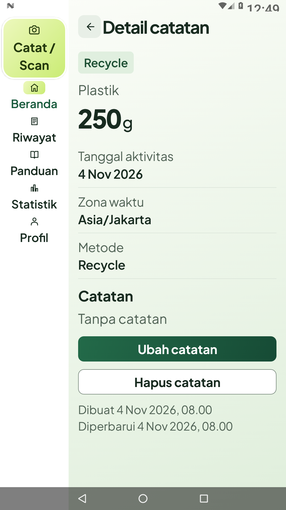

# S04–S16: review viewport dan navigasi

Checkpoint 4 November 2026. **Penerimaan visual seluruh aplikasi masih terbuka.** Review ini memperluas bukti dari komponen menjadi sembilan viewport awal dalam tema terang/gelap, disertai regresi navigasi.

## Perbaikan yang terbukti

Pada rail 600 dp, Catat/Scan terlihat aktif di detail catatan, detail panduan dan Pengaturan. Callback sebelumnya membandingkan rute aktif dengan root tab, sehingga tombol pada halaman anak tidak merespons. Pemeriksaan kini memakai key entry yang sedang tampil. Perlindungan terhadap callback dari entry transisi yang sudah ditinggalkan tetap berlaku.

APK sebelum koreksi gagal di S08; APK sesudahnya membuka/menutup sheet dari S08/S12/S16 dan mempertahankan halaman serta tab asal. APK penguji identik sebelum/sesudah. [Log baseline](screen-navigation-baseline.log) dan [manifest](screen-navigation-checkpoint.json).

## Hasil runtime

| API 24 | Kasus lulus | Durasi |
|---|---:|---:|
| normal | 2 / 2, nol skip | 64.884 s |
| phone200 | 2 / 2, nol skip | 70.459 s |
| wide200 | 2 / 2, nol skip | 66.83 s |

Enam eksekusi dari dua metode unik; 171 debug unit tests, lint dan build native lulus. Kedua metode mencakup perjalanan layar/chrome serta regresi lima tab, manual, sheet, Back, tema dan recreate. Angka checkpoint komponen sebelumnya tetap berlaku pada source masing-masing, tidak dijumlahkan sebagai coverage head ini.

Tes baru mengambil 54 PNG (9 screen × 2 tema × 3 konfigurasi), memeriksa judul melalui batas baris teks dan bounds yang terlihat, target tab ≥48 dp, serta piksel glyph tab/kamera dan label Catat/Scan pada window aplikasi yang baru digambar. Dock hadir pada lima root dan tersembunyi pada anak/editor di ponsel sesuai mockup. Rail tetap hadir pada anak, kecuali editor.

Dua koreksi driver tidak merupakan perbaikan produk: artikel pertama LazyColumn perlu dicari dengan scroll pada teks 200%; menunggu node di luar viewport akan timeout. Pada judul Beranda, paragraph width mencakup ruang yang dialokasikan meski lebar line nyata lebih pendek: flag overflow mentah disimpan, sementara pemeriksaan clipping memakai batas line/ellipsis dan visible height. Screenshot asli mengonfirmasi teks utuh.

## Kit dibanding Android

Sumber: DESIGN.md, SCREEN_SPEC.md dan render design-system.html v1.3. Referensi dirender tanpa mengubah file kit; lebar frame preview diatur 374 px agar kanvas dalamnya 360 px (border 7 px per sisi). Frame tetap setinggi 800 px; AVD memiliki layar 360 × 640 dp termasuk UI sistem. Karena itu jumlah konten yang tampak berbeda. DESIGN memetakan px web ke dp/sp Android, menetapkan target sentuh dan membolehkan konten scroll; perbandingan ini tidak mengklaim pixel-identical. Label simulasi dalam referensi asli tidak ditambahkan ke aplikasi dummy.

| Screen | Android terang / gelap | Kit terang / gelap |
|---|---|---|
| S04 Beranda | [Terang](screen-review/normal-S04-light.png) · [Gelap](screen-review/normal-S04-dark.png) | [Terang](screen-review/kit-S04-light.png) · [Gelap](screen-review/kit-S04-dark.png) |
| S07 Riwayat | [Terang](screen-review/normal-S07-light.png) · [Gelap](screen-review/normal-S07-dark.png) | [Terang](screen-review/kit-S07-light.png) · [Gelap](screen-review/kit-S07-dark.png) |
| S11 Panduan | [Terang](screen-review/normal-S11-light.png) · [Gelap](screen-review/normal-S11-dark.png) | [Terang](screen-review/kit-S11-light.png) · [Gelap](screen-review/kit-S11-dark.png) |
| S13 Statistik | [Terang](screen-review/normal-S13-light.png) · [Gelap](screen-review/normal-S13-dark.png) | [Terang](screen-review/kit-S13-light.png) · [Gelap](screen-review/kit-S13-dark.png) |
| S14 Profil | [Terang](screen-review/normal-S14-light.png) · [Gelap](screen-review/normal-S14-dark.png) | [Terang](screen-review/kit-S14-light.png) · [Gelap](screen-review/kit-S14-dark.png) |
| S05 Catat aktivitas | [Terang](screen-review/normal-S05-light.png) · [Gelap](screen-review/normal-S05-dark.png) | [Terang](screen-review/kit-S05-light.png) · [Gelap](screen-review/kit-S05-dark.png) |
| S08 Detail catatan | [Terang](screen-review/normal-S08-light.png) · [Gelap](screen-review/normal-S08-dark.png) | [Terang](screen-review/kit-S08-light.png) · [Gelap](screen-review/kit-S08-dark.png) |
| S12 Detail panduan | [Terang](screen-review/normal-S12-light.png) · [Gelap](screen-review/normal-S12-dark.png) | [Terang](screen-review/kit-S12-light.png) · [Gelap](screen-review/kit-S12-dark.png) |
| S16 Pengaturan | [Terang](screen-review/normal-S16-light.png) · [Gelap](screen-review/normal-S16-dark.png) | [Terang](screen-review/kit-S16-light.png) · [Gelap](screen-review/kit-S16-dark.png) |

## Temuan visual dan pekerjaan berikutnya

- Susunan lima tab, kamera di tengah atas dock, lime aktif, warna tema dan struktur screen tersedia untuk ditinjau dari pasangan gambar. Ini tidak menutup penerimaan setiap state dan setiap bagian scroll.
- Ikon pembuka S12 masih memakai bidang 64 dp/glyph 32 dp; DESIGN menetapkan glyph 24 dalam bidang 44–48 dp. Ukuran ini perlu diselaraskan. Kategori/metode tetap harus terbaca sesuai SCREEN_SPEC.
- Summary S04/S13/S14 belum memuat border/highlight tipis dan bayangan yang tampak pada render kit. Primary CTA juga masih memerlukan audit highlight/bayangan bersama.
- S11 memuat kategori opsional dan ringkasan baris sesuai SCREEN_SPEC, sehingga tinggi daftar berbeda dari mockup ringkas. Artikel dummy tetap memiliki status editorial yang jujur; tidak ada sumber/tanggal review rekaan.
- Tautan achievement/pengingat tidak ditampilkan saat capability mati, sebagaimana SCREEN_SPEC. Itu tidak membuktikan fitur opsional sudah selesai.
- Bagian bawah seluruh screen, state kosong/error/loading, selected/pressed/focus, pemulihan fokus pemicu modal, motion/predictive Back per frame, resize/rotasi dinamis serta API baru/perangkat fisik/TalkBack lisan tetap membutuhkan penerimaan.

Log run yang gagal karena driver disimpan di folder artefak lokal, dikeluarkan dari total lulus. Hash APK/source dan semua 54 capture tersimpan pada manifest. APK native memakai hotReload=false dan tetap API 24. CI diverifikasi terpisah untuk SHA yang dipublikasikan; hijau tidak berarti seluruh desain selesai.
